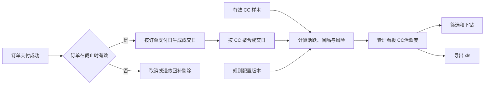

# CC活跃度看板

> 在 CRM 管理看板中增加“CC活跃度”页签，让销售管理者按业务线、团队和个人识别 CC 出单节奏变化，并在风险扩大前安排检查或辅导。
> 需求编号：REQ-DASH-008｜状态：待评审｜更新时间：2026-11-23
> 需求类型：看板与指标｜补充类型：规则状态与数据、权限与审计

## 交互原型

[打开完整交互原型](https://h3-ai-lab.github.io/hhhprd/projects/cc-activity-dashboard/prototype/)

## 目标与范围

**目标**

将现有 Sales Consistency & Early Warning System 的管理方法沉淀为 CRM 能力，让销售管理者不再依赖手工周报，能够按统一口径查看 CC 的最近成交、连续未成交天数、平均出单间隔、每日成交趋势和风险状态。

**做**

- 在现有管理看板增加“CC活跃度”页签。
- 展示近期销售活跃率、销售一致性合格率和高风险 CC 占比。
- 展示 High、Good、Needs Improvement、Low 四档销售一致性分布。
- 展示每位有效 CC 的最近有效成交日期、连续未成交天数、平均出单间隔、风险状态和统计周期内每日成交单数。
- 支持按业务线、销售团队、CC 和统计周期筛选。
- 支持阈值、观察窗口、天数口径和风险建议文案的配置版本。
- 支持从汇总下钻到 CC 个人详情和成交日期明细。
- 支持按当前筛选、数据权限、指标口径导出 `.xls`。

**不做**

- 不建设 Need break、请假、培训和临时停单的申请审批；这类 CC 本期不进入有效样本。
- 不自动创建主管辅导任务、恢复计划或升级任务。
- 不按成交金额评价销售表现；本看板衡量销售活动连续性，不替代收入看板。
- 不分析 AI-CC 对话、知识库、学习进度和续费健康度。

## 核心定义

| 对象 / 字段 | 定义 |
|---|---|
| 有效订单 | 支付成功、未被取消或全额退款，且在统计截止时仍为有效状态的订单；以订单 ID 去重 |
| 有效成交 | 有效订单首次支付成功形成的一次成交事件；退款或取消后从对应成交日回补剔除 |
| 成交日 | 某 CC 在业务线时区的某个自然日至少存在一笔有效成交；同日多笔订单只计一个成交日 |
| 有效 CC 样本 | 统计周期内至少有一个有效销售工作日、归属 CC 岗位、非测试账号且未处于本期排除状态的 CC；每位 CC 只计一次 |
| 平均出单间隔 | 统计周期有效日数（自然日或配置的工作日） ÷ 该 CC 在统计周期内的成交日数 |
| 连续未成交天数 | 从最近有效成交日的次日起，到统计截止日为止的未成交天数；统计周期内无成交时，从有效 CC 首次进入样本之日起算 |
| 统计截止日 | 用户所选结束日期；所有指标的完整日截止为该业务线时区次日 00:00 前 |

默认一致性分层：

| 分层 | 平均出单间隔 |
|---|---:|
| High | ≤ 1.75 天 |
| Good | > 1.75 天且 ≤ 2.33 天 |
| Needs Improvement | > 2.33 天且 ≤ 3.50 天 |
| Low | > 3.50 天或无有效成交 |

默认风险状态：

| 状态 | 连续未成交天数 | 默认建议动作 |
|---|---:|---|
| Healthy | 0 天 | 保持销售节奏 |
| Early Warning | 1 天 | 检查重点客户和近期预约 |
| At Risk | 2–3 天 | 商机盘点并进行一对一辅导 |
| Critical | ≥ 4 天 | 立即干预并制定恢复计划 |

风险状态下方的建议动作是看板提示，不自动生成任务。

## 业务流程

数据异常：

- 成交数据同步延迟时保留最近成功快照，并显示数据更新时间；不把未同步误判为零成交。
- 同一订单重复支付回调按订单 ID 去重，以首次有效支付成功时间形成成交日。
- 订单退款或取消后从对应成交日剔除；删除成交日后重新计算受影响周期的活跃率、一致性、连续未成交天数和风险状态。
- 统计周期开始日或结束日无数据时，页面显示数据未同步，不展示正常状态。
- 规则配置保存失败时保持原版本生效，不产生半完成配置。
- 员工离职、账号停用或调岗时保留历史成交事实；历史周期使用当时 CC 归属和组织快照，不用新负责人覆盖。

## 页面与筛选

入口：`管理看板 → CC活跃度`。

页签顺序沿用现有管理看板：

`转化总览 → 销售跟进 → 支付结果 → CC活跃度`

筛选区沿用管理看板同一筛选区域：

`业务线 → 销售团队 → CC → 统计周期`

- 业务线单选，默认当前管理员最近访问的业务线。
- 销售团队单选；候选人受业务线和数据权限限制。
- CC 单选；候选人受业务线、销售团队和数据权限限制。
- 统计周期默认最近 7 个完整自然日；起止日期均包含，结束日的数据截止到业务线时区次日 00:00。
- “统计周期”和“最近活跃观察窗口”分别控制成交日统计范围与近期活跃判断。
- 页面表格当前不提供排序入口，本期所有表格字段不支持排序。

筛选、汇总、一致性分层、每日成交明细、个人详情和导出使用同一业务线、团队、CC、周期和数据权限范围。

## 看板页面

### 汇总指标

页面顶部展示三个指标卡：

| 指标 | 页面表达 |
|---|---|
| 近期销售活跃率 | 最近观察窗口内有成交日的 CC 数 ÷ 有效 CC 样本数 |
| 销售一致性合格率 | 平均出单间隔达到 Good 及以上门槛的 CC 数 ÷ 有效 CC 样本数 |
| 高风险 CC 占比 | 风险状态为 Critical 的 CC 数 ÷ 有效 CC 样本数 |

每个比率同时展示分子、分母和百分比；分母为 0 时显示“—”。每个指标卡右上角提供“口径”角标。

### 一致性分布

按 High、Good、Needs Improvement、Low 四档展示：

- CC 人数。
- 占有效 CC 样本比例。
- 该档 CC 的平均出单间隔：该档所有有效个人平均出单间隔之和 ÷ 具有有效平均出单间隔的 CC 数；无有效值时为“—”。

分组人数之和必须等于有效 CC 样本数；无成交 CC 进入 Low。

### CC 明细表

默认列顺序：

`CC ID → CC姓名 → 销售团队 → 最近有效成交日期 → 连续未成交天数 → 平均出单间隔 → 一致性分层 → 风险状态 → 统计周期内每日成交单数`

每日成交单数列按日期升序排列；单元格展示当日有效订单笔数，0 显示 0，未来日期不展示。

表格行为：

- 当前没有排序入口，所有字段不支持排序。
- 点击 CC 行打开个人详情抽屉。
- 抽屉展示该 CC 的统计周期、成交日、每日成交单数、最近成交、平均出单间隔、一致性分层和风险状态。
- 无成交时显示“统计周期内无有效成交”，不展示虚假平均间隔。
- 离职或停用 CC 保留历史行，姓名旁显示“离职”或“停用”，不接收当前风险任务。

## 指标具体口径

### 公共口径

- **统计范围**：当前筛选的业务线、销售团队、CC、统计周期和数据权限。
- **业务时间**：以业务线时区确定自然日；开始日 00:00 包含，结束日次日 00:00 不包含。
- **数据截止**：用户所选结束日对应业务线时区的完整日结束。
- **成交去重**：订单按 `order_id` 去重；成交日按 `cc_id + business_date` 去重。
- **CC 去重**：所有人数指标按 `cc_id` 去重，每人只进入一次分母。
- **零值规则**：分母为 0 时比率显示“—”；无成交记录的数量显示 0，平均间隔显示“—”。
- **百分比精度**：保留一位小数。

### 指标定义

| 指标 | 分子 | 分母 | 单位 | 统计时间 | 去重键 | 零分母 |
|---|---|---|---|---|---|---|
| 近期销售活跃率 | 观察窗口内至少有一个成交日的有效 CC 数 | 有效 CC 样本数 | % | 截止日前 N 个完整自然日，N 默认 2 | `cc_id` | 显示“—” |
| 销售一致性合格率 | 平均出单间隔不高于 Good 门槛的有效 CC 数 | 有效 CC 样本数 | % | 所选完整统计周期 | `cc_id` | 显示“—” |
| 高风险 CC 占比 | 风险状态为 Critical 的有效 CC 数 | 有效 CC 样本数 | % | 所选完整统计周期及截止日 | `cc_id` | 显示“—” |
| 平均出单间隔 | 统计周期有效日数（自然日或工作日） | 该 CC 成交日数 | 天 | 所选完整统计周期 | `cc_id` | 无成交显示“—” |
| 连续未成交天数 | 最近成交日次日至截止日的日期数 | — | 天 | 所选统计周期至截止日 | `cc_id` | 无历史起点显示“—” |
| 每日成交单数 | 当日有效订单数 | — | 单 | 每个业务自然日 | `order_id` | 显示 0 |

一致性分层和风险状态只使用当前生效的规则版本；历史周期使用该周期绑定版本的快照，不因后来修改阈值而重算。

## 规则配置

配置入口：管理看板右上角“口径设置”；仅具有规则管理权限的角色可进入。

可配置：

- 最近活跃观察窗口，默认 2 个完整自然日。
- 一致性 High、Good、Needs Improvement 的分层上限。
- 风险 Early Warning、At Risk、Critical 的起始天数。
- 自然日或工作日口径；工作日使用业务线工作日历。
- 生效日期和适用业务线、团队。

受控不可配置：

- 三项汇总指标的分子、分母和去重键。
- 有效订单状态集合中的支付成功事实。
- 订单 ID、CC ID、业务线时区和历史组织快照。

保存时展示受影响范围和新旧规则差异。保存成功后生成新版本，从生效日期起使用；历史周期继续展示其绑定版本。

## 下载

点击“导出”生成当前筛选结果的 `.xls` 文件。

字段顺序：

`business_line、sales_team、cc_id、cc_name、cc_status、latest_valid_sale_date、days_without_sale、sale_day_count、avg_days_to_sale、consistency_level、risk_level、period_start、period_end、rule_version`

日期列按升序追加：

`YYYY-MM-DD_daily_valid_order_count`

- 导出范围不受当前分页影响。
- 汇总、表格、详情和导出使用相同筛选、去重、成交状态和规则版本。
- 无数据时导出仍包含表头。
- 导出失败时不生成空文件或部分文件。

## RBAC 权限数据

### 功能权限

| 页面 / 资源 | 操作 | 业务含义 | 默认角色 | 数据范围 | 审计 |
|---|---|---|---|---|---|
| 管理看板 / CC活跃度 | 查看 | 查看汇总、明细和个人详情 | 超级管理员、业务负责人、销售主管、CC | 业务负责人为授权业务线；主管为团队；CC 为本人 | 否 |
| 口径设置 | 查看 | 查看当前规则版本和生效范围 | 超级管理员、业务负责人 | 授权业务线 | 否 |
| 口径设置 | 新增、编辑、启用 | 创建或调整规则版本 | 超级管理员、被授权业务负责人 | 授权业务线、指定团队 | 是 |
| CC活跃度明细 | 下钻 | 查看 CC 和每日成交明细 | 超级管理员、业务负责人、销售主管、CC | 与列表数据范围一致 | 是 |
| CC活跃度 | 导出 | 下载当前筛选范围 `.xls` | 超级管理员、业务负责人、销售主管 | 与查看、字段和筛选权限一致 | 是 |

### 字段与数据权限

| 字段组 / 列表 | 可见角色 | 编辑角色 | 脱敏 / 隐藏 | 可导出 | 候选范围限制 |
|---|---|---|---|---|---|
| CC姓名、CC ID、团队 | 有页面查看权限的角色 | 不通过看板编辑 | 无 | 仅导出角色 | 仅授权业务线和组织范围 |
| 成交日期、成交单数 | 有页面查看权限的角色 | 不通过看板编辑 | 无客户信息 | 仅导出角色 | 与页面筛选一致 |
| 一致性分层、风险状态 | 有页面查看权限的角色 | 规则版本生效后只读 | 无 | 仅导出角色 | 与页面筛选一致 |
| 规则配置与版本 | 超级管理员、授权业务负责人 | 规则管理角色 | 不向 CC 展示其他团队配置 | 仅导出角色 | 仅授权适用范围 |

### 权限数据变更

| 变更类型 | 权限层级 | 权限项 | 业务说明 | 默认角色 / 数据范围 | 是否新增审计 |
|---|---|---|---|---|---|
| 新增 | 页面 | `crm.dashboard.cc_activity.view` | 查看 CC活跃度页签和汇总 | 超级管理员、业务负责人、销售主管、CC；按授权范围 | 否 |
| 新增 | 动作 | `crm.dashboard.cc_activity.detail` | 下钻 CC 和每日成交明细 | 与页面一致 | 是 |
| 新增 | 页面 | `crm.dashboard.cc_activity.rule.view` | 查看规则配置与版本 | 超级管理员、业务负责人；授权业务线 | 否 |
| 新增 | 动作 | `crm.dashboard.cc_activity.rule.manage` | 新增、编辑、启用规则版本 | 超级管理员、授权业务负责人 | 是 |
| 新增 | 导出 | `crm.dashboard.cc_activity.export` | 导出当前筛选明细 | 超级管理员、业务负责人、销售主管 | 是 |
| 复用 | 数据 | 现有管理看板业务线、团队和 CC 范围 | 页面、下钻和导出使用同一数据权限 | 现有组织权限 | 否 |

审计至少记录操作人、时间、业务线、团队、规则版本、变更前后值、生效日期和结果。成功、失败和未授权尝试均记录。

## 数据依赖与异常

| 数据 | 来源 | 使用方式 | 失败处理 |
|---|---|---|---|
| CC 账号与组织 | 组织架构 | 识别有效 CC、团队与组织快照 | 同步失败时保留最近成功组织快照并提示 |
| 订单、支付、退款 | 订单与支付服务 | 生成有效成交和成交日 | 延迟时保留历史快照，不将未同步显示为零 |
| 工作日历 | 业务线配置 | 工作日口径与完整周期计算 | 缺失时停止工作日模式计算并提示 |
| 指标规则版本 | 管理看板配置 | 计算一致性和风险状态 | 保存失败时继续使用原生效版本 |

离职、停用和调岗：

- 离职或停用账号立即失去页面、下钻、配置和导出权限。
- 历史成交、团队和负责人快照继续保留，并展示离职/停用状态。
- 新负责人不自动继承原 CC 的历史成交；团队或组织调整不改写历史周期归属。
- 历史周期按发生时的 CC 归属和组织快照统计，避免转派后重复计入。
