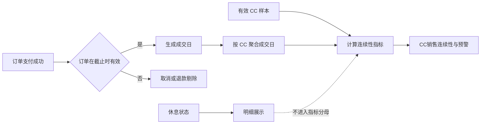

# CC活跃度看板

> 在 CRM 管理看板增加“CC销售连续性与预警”视图，帮助销售管理者识别近期没有成交、销售节奏变慢和连续未成交的 CC。
> 需求编号：REQ-DASH-008｜状态：待评审｜更新时间：2026-11-23
> 需求类型：看板与指标｜补充类型：规则状态与数据、权限与审计

## 交互原型

[打开完整交互原型](https://h3-ai-lab.github.io/hhhprd/projects/cc-activity-dashboard/prototype/)

## 目标与范围

**目标**

将业务方当前通过 Sales Tracking 表维护的 CC 销售连续性管理方式转为 CRM 看板。页面结构与数据展示以业务方提供的截图为唯一设计依据。

页面首屏默认展示业务方截图对应的 2026-11-09 至 2026-11-15 数据，并复现以下结果：

- 近期销售活跃率：16 / 18，88.9%。
- 销售一致性：9 / 18，50.0%。
- 高风险 CC 占比：2 / 18，11.1%。
- 有效 CC：18 位；休息 CC：3 位，只在明细表中展示，不进入指标分母。

**做**

- 展示三项汇总指标。
- 展示销售一致性四档分布。
- 展示每位 CC 的最近成交日期、连续未成交天数、平均出单间隔和每日成交情况。
- 展示风险状态及对应建议动作。
- 支持业务线、销售团队和统计周期筛选。
- 支持通过“口径设置”配置观察窗口、天数口径、一致性阈值和风险阈值。
- 支持按当前筛选与数据权限导出 `.xls`。

**不做**

- 不在页面内新增、审批或修改休息状态。
- 不提供个人详情页或管理干预任务。
- 不分析成交金额、AI-CC 对话、学习进度、续费或退费。

## 核心定义

| 定义 | 口径 |
|---|---|
| 有效订单 | 支付成功、未被取消或全额退款，且在统计截止时仍有效的订单；按订单 ID 去重 |
| 有效成交 | 有效订单首次支付成功形成的一次成交事件 |
| 成交日 | 同一 CC 在同一业务自然日内至少有一笔有效成交；同日多笔只计一个成交日 |
| 有效 CC 样本 | 在所选业务线、销售团队内，岗位为 CC、状态为在岗、非测试账号的 CC；每位 CC 只计一次 |
| 休息 CC | 业务侧当前状态为休息的 CC；在明细表中展示，但不进入任何指标分母 |
| 平均出单间隔 | 统计周期有效天数 ÷ 该 CC 在统计周期内的成交日数；有效天数按当前自然日或工作日配置 |
| 连续未成交天数 | 从最近有效成交日次日起至统计截止日的有效天数；周期内没有成交时，从统计周期开始日计算 |

销售一致性分层默认采用业务方当前口径，可通过口径设置生成新版本：

| 分层 | 平均出单间隔 |
|---|---:|
| 高一致性 | ≤ 1.75 天 |
| 良好 | > 1.75 天且 ≤ 2.33 天 |
| 待改善 | > 2.33 天且 ≤ 3.50 天 |
| 低一致性 | > 3.50 天或无有效成交 |

风险状态与建议动作默认采用业务方当前口径，可通过口径设置生成新版本：

| 状态 | 连续未成交天数 | 建议动作 |
|---|---:|---|
| 健康 | 0 天 | 保持销售节奏 |
| 早期预警 | 1 天 | 检查重点客户和近期预约 |
| 有风险 | 2–3 天 | 进行商机盘点并安排一对一辅导 |
| 高危 | ≥ 4 天 | 立即干预并制定恢复计划 |

建议动作只作为看板提示，不自动创建任务。

## 业务流程

## 页面与筛选

入口：`管理看板 → CC销售连续性与预警`。

筛选顺序：

`业务线 → 销售团队 → 统计周期`

- 业务线默认越南，可按管理员权限切换。
- 销售团队默认全部团队，候选范围受业务线和数据权限限制。
- 统计周期默认 2026-11-09 至 2026-11-15。
- 开始日期和结束日期均包含；结束日期按业务线时区的完整日截止。
- 当前页面不提供排序入口，表格所有字段不支持排序。

筛选变化后，三项指标、一致性分布、CC 明细和风险说明使用同一业务线、团队、日期与数据权限范围。

## 页面结构

页面顶部依次展示：

`近期销售活跃率 → 销售一致性 → 高风险 CC 占比`

每张指标卡包含：

- 中文指标名称。
- 百分比。
- 分子和分母。
- “口径”角标；点击后展示分子、分母、单位、统计范围、时间字段、去重键和零值规则。

中部左侧展示“销售一致性分布”，依次为：

`高一致性 → 良好 → 待改善 → 低一致性`

每档展示 CC 人数、占有效 CC 样本比例和组内平均出单间隔。

中部右侧展示 CC 明细表，默认列顺序：

`CC编号 → CC姓名 → 所属团队 → 连续未成交天数 → 最近有效成交日期 → 平均出单间隔 → 一致性分层 → 统计周期内每日成交标记`

- 每日列按日期升序排列。
- 有有效成交显示 1，无成交显示“-”。
- 活跃 CC 在指标计算后按连续未成交天数从高到低排列；休息 CC 固定展示在表格末尾。
- 休息 CC 的连续未成交天数、最近成交日期和平均出单间隔显示“—”，一致性分层显示“休息”。
- 无数据时展示空态，不将无数据显示为真实零。

页面底部展示“风险状态与建议动作”表，固定列出健康、早期预警、有风险、高危四档及其天数范围和建议动作。

## 指标具体口径

### 公共口径

- **统计范围**：当前筛选的业务线、销售团队、统计周期和数据权限。
- **业务时间**：以业务线时区确定自然日；开始日 00:00 包含，结束日次日 00:00 不包含。
- **订单去重**：按 `order_id` 去重。
- **成交日去重**：按 `cc_id + 业务日期` 去重。
- **有效 CC 去重**：按 `cc_id` 去重；休息 CC 不进入分母。
- **零分母**：显示“—”和“0 / 0”，不显示 0%。
- **精度**：百分比和平均出单间隔保留一位小数时，按业务展示统一格式；计算使用未截断值。

### 指标定义

| 指标 | 分子 | 分母 | 单位 | 统计时间 | 去重键 | 零分母 |
|---|---|---|---|---|---|---|
| 近期销售活跃率 | 当前观察窗口内至少有一个成交日的有效 CC 数；默认窗口 2 个完整日 | 有效 CC 样本数 | % | 截止日前 N 个完整日，N 默认 2 | `cc_id` | 显示“—” |
| 销售一致性 | 平均出单间隔不高于当前“良好”上限的有效 CC 数；默认上限 2.33 天 | 有效 CC 样本数 | % | 所选完整统计周期 | `cc_id` | 显示“—” |
| 高风险 CC 占比 | 连续未成交天数达到当前“高危”起点的有效 CC 数；默认 ≥ 4 天 | 有效 CC 样本数 | % | 所选完整统计周期至截止日 | `cc_id` | 显示“—” |
| 平均出单间隔 | 统计周期有效天数（自然日或工作日） | 该 CC 成交日数 | 天 | 所选完整统计周期 | `cc_id` | 无成交显示“—” |
| 连续未成交天数 | 最近成交日次日至截止日的日期数 | — | 天 | 所选统计周期至截止日 | `cc_id` | 无最近成交时从周期开始日计算 |

### 一致性分布

四档人数之和必须等于有效 CC 样本数。每位有效 CC 只能进入一个分层。

组内平均出单间隔：

- 分子：组内所有有效个人平均出单间隔之和。
- 分母：组内具有有效平均出单间隔的 CC 数。
- 无有效值显示“—”。

## 口径设置

入口：页面右上角“口径设置”。

可配置：

- 近期活跃观察窗口，默认 2 天。
- 天数口径：自然日或工作日，默认自然日。
- 高一致性、良好、待改善的平均出单间隔上限。
- 早期预警、有风险、高危的起始天数。
- 生效日期。

受控不可配置：

- 三项指标的分子、分母、单位和 CC 去重键。
- 有效订单、有效成交和成交日的基础定义。
- 休息 CC 不进入指标分母的规则。

保存前校验阈值必须依次递增且为正数。保存成功后生成新规则版本并立即刷新当前视图；历史周期使用当时生效版本。

## 下载

点击“导出”按当前业务线、销售团队、统计周期、数据权限和规则版本生成 `.xls`。

字段顺序：

`业务线 → 销售团队 → CC编号 → CC姓名 → CC状态 → 最近有效成交日期 → 连续未成交天数 → 成交日数 → 平均出单间隔 → 一致性分层 → 规则版本 → 每日成交标记`

- 导出不绕过分页或数据权限。
- 休息 CC 按当前列表范围导出，“CC状态”为“休息”。
- 无数据时不生成导出文件。

## RBAC 权限数据

### 功能权限

| 页面 / 资源 | 操作 | 业务含义 | 默认角色 | 数据范围 | 审计 |
|---|---|---|---|---|---|
| 管理看板 / CC销售连续性与预警 | 查看 | 查看汇总、分布、CC 明细和风险动作 | 超级管理员、业务负责人、销售主管、CC | 业务负责人为授权业务线；主管为团队；CC 为本人 | 否 |
| 指标口径 | 查看 | 查看指标公式、时间与去重规则 | 有页面查看权限的角色 | 与页面一致 | 否 |
| 口径设置 | 新增、编辑、启用 | 配置阈值、观察窗口、天数口径和生效日期 | 超级管理员、被授权业务负责人 | 授权业务线和团队 | 是 |
| CC销售连续性与预警 | 导出 | 下载当前筛选范围 `.xls` | 超级管理员、业务负责人、销售主管 | 与查看、字段和筛选权限一致 | 是 |

### 字段与数据权限

| 字段组 / 列表 | 可见角色 | 编辑角色 | 脱敏 / 隐藏 | 可导出 | 候选范围限制 |
|---|---|---|---|---|---|
| CC编号、CC姓名、所属团队 | 有页面查看权限的角色 | 不通过看板编辑 | 不展示联系方式 | 仅导出角色 | 仅授权业务线和组织范围 |
| 成交日期、成交标记 | 有页面查看权限的角色 | 不通过看板编辑 | 不展示客户与订单信息 | 仅导出角色 | 与页面筛选一致 |
| 一致性分层、风险状态 | 有页面查看权限的角色 | 不通过看板编辑 | 无 | 仅导出角色 | 与页面筛选一致 |
| 口径配置 | 超级管理员、授权业务负责人 | 规则管理角色 | 不向 CC 展示其他团队配置 | 本需求不提供 | 仅授权适用范围 |

### 权限数据变更

| 变更类型 | 权限层级 | 权限项 | 业务说明 | 默认角色 / 数据范围 | 是否新增审计 |
|---|---|---|---|---|---|
| 新增 | 页面 | `crm.dashboard.cc_activity.view` | 查看 CC销售连续性与预警 | 超级管理员、业务负责人、销售主管、CC；按授权范围 | 否 |
| 新增 | 动作 | `crm.dashboard.cc_activity.rule.manage` | 新增、编辑和启用规则版本 | 超级管理员、授权业务负责人 | 是 |
| 新增 | 导出 | `crm.dashboard.cc_activity.export` | 导出当前筛选明细 | 超级管理员、业务负责人、销售主管 | 是 |
| 复用 | 数据 | 现有管理看板业务线与团队数据权限 | 汇总、明细和候选团队使用同一范围 | 现有组织权限 | 否 |

## 数据依赖与异常

| 数据 | 来源 | 使用方式 | 失败处理 |
|---|---|---|---|
| CC账号与团队 | 组织架构 | 识别有效 CC、休息状态和组织归属 | 同步失败时保留最近成功快照并提示 |
| 订单、支付、退款 | 订单与支付服务 | 生成有效成交和成交日 | 延迟时保留最近成功快照，不将未同步误判为零成交 |

- 同一订单重复支付回调按订单 ID 去重。
- 退款或取消后从对应成交日剔除，并重新计算指标。
- 员工离职或停用后，历史成交和团队快照保留，不从历史周期删除。
- 历史周期使用事件发生时的 CC 归属和组织快照，后续调岗不回写历史业绩。
