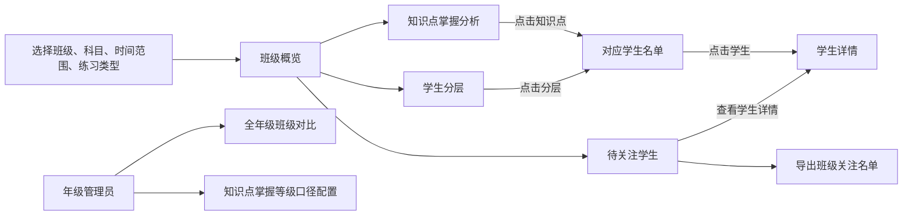

# 班级学习画像看板

> 在现有教师后台新增轻量学习画像模块，让班主任在一个入口判断班级整体学习状态、知识点薄弱项、学生分层和待关注学生，并支持学生详情、CSV 导出和操作留痕。
> 需求编号：REQ-CLP-001｜状态：待评审｜更新时间：2026-11-18
> 需求类型：看板与指标｜补充类型：表单、字段与列表、权限与审计
> 当前版本：v0.1（首次创建）
> 说明：未确认的阈值和底层数据口径在本稿中给出“建议默认值”，并在“待确认问题”中集中列出；这些值经确认后才能冻结。

> 📌
> - **核心页面**：班级学习画像看板、学生详情页、知识点口径配置。
> - **核心能力**：四项班级指标、知识点掌握分析、学生分层、待关注学生、CSV 导出。
> - **不做**：不自动改变教学任务，不对学生做人工标签覆盖，不提供管理员完整隐私联系方式。

## 原型方案

[查看原型方案](https://h3-ai-lab.github.io/hhhprd/projects/class-learning-profile/prototype/)

## 需求背景

当前班主任只能查看学生个人成绩，无法快速了解班级整体学习情况，也难以在同一入口识别需要重点关注的学生。平台需要新增轻量模块，在不改变现有教学业务流程的前提下，将分散的练习、作业、成绩和知识点标签汇总为可解释的班级学习画像。

## 目标用户

| 角色 | 使用目标 | 数据范围 |
|---|---|---|
| 班主任 | 查看所带班级学习状态，识别薄弱知识点和待关注学生，进入学生详情并导出班级关注名单 | 仅本人当前所带班级 |
| 教研 / 年级管理员 | 查看全年级班级画像，对比班级表现，配置知识点掌握等级口径 | 所属年级范围内全部班级 |
| 系统 | 按统一口径自动统计学习数据、生成分层和关注原因 | 不提供人工页面，不修改教学任务或学生标签 |

## 业务目标

- 班主任在一个入口回答班级整体状态、薄弱知识点、学生分层和待关注学生四个问题。
- 将看板结论下钻到可核对的班级、知识点和学生明细。
- 统一班主任与年级管理员使用的指标、筛选、数据时间和导出口径。
- 减少跨页面查成绩、人工拼接名单和重复整理待关注学生的工作。

## 页面结构说明

模块挂载在现有教师后台：

```text
班级运营
└── 班级学习画像
    ├── 班级概览
    ├── 知识点掌握
    ├── 学生分层
    ├── 待关注学生
    └── 学生详情（从看板下钻）

系统配置（教研 / 年级管理员）
└── 知识点掌握等级口径
```

页面关系：



## 目标与范围

**做**

- 班级概览：四个核心指标、统一筛选、统计时间和指标口径说明。
- 知识点掌握分析：知识点名称、掌握率、班级平均得分、掌握等级，支持按掌握率排序和下钻学生名单。
- 学生分层：优秀、稳定、波动、待关注四类，展示人数与占比，可进入学生列表。
- 待关注学生：展示系统识别原因，支持查看详情、标记已关注和导出班级关注名单。
- 学生详情：基本信息、成绩趋势、完成情况、薄弱知识点和历史学习记录。
- 年级管理员：查看所属年级全部班级，并通过班级对比表比较班级表现。
- 知识点掌握等级口径配置：配置已掌握、待巩固、未掌握的阈值。
- 操作审计、关键行为埋点、脱敏 CSV 导出和完整页面状态。

**不做**

- 不自动创建或派发教学任务。
- 不允许班主任修改系统分层、待关注结果或关注原因。
- 不展示手机号、邮箱、监护人联系方式、地址等完整隐私联系方式。
- 不做学生端或家长端。
- 不在本模块编辑原始成绩、练习完成状态或知识点题库映射。
- 不提供公开分享链接。

## 公共统计口径

以下口径用于所有指标、排序、下钻和导出：

- **统计对象**：学生在有效班级关系存续期间产生的学习记录；学生转班后，历史学习记录仍归发生时的班级，不追溯改入新班级。
- **有效练习**：已发布、未取消、未删除，且练习类型属于当前筛选范围的作业、测验或课堂练习；平台定义的测试数据不纳入。
- **完成记录**：学生在有效练习中存在已提交记录。多次提交只保留最新一次有效提交，不按提交次数重复计入。
- **有效得分**：教师已确认或系统已定稿的最新提交成绩，按 `学生得分 ÷ 练习满分 × 100` 归一化为 0–100 分；未批阅或成绩无效的记录不计入得分类指标，但仍可计入完成率。
- **时间范围**：按练习的 `assigned_at`（布置时间）落入筛选起止日期，起止日期均包含；最新得分取该范围内练习的最新有效提交。
- **班级关系**：按练习发生时学生的班级归属统计；当前页面班级范围取当前账号有权查看的班级。
- **学生去重**：人数类指标按 `student_id` 去重；学生-练习完成关系按 `student_id + practice_id` 去重。
- **知识点口径**：以题目当时绑定的知识点快照统计；题目后续改标签不回写历史掌握率。
- **数据范围**：看板汇总、知识点与分层下钻、学生详情和导出使用同一班级、科目、日期和练习类型筛选范围。
- **展示精度**：得分和百分比统一显示一位小数；掌握等级判断使用未四舍五入的原始值。
- **零分母**：分母为 0 时显示“—”，不得显示 0%。
- **统计时间**：页面顶部展示统一的 `stats_as_of`，所有卡片和明细共享同一统计批次。

## 指标定义

### 班级概览指标

| 指标 | 业务用途 | 分子 | 分母 | 单位与范围 | 时间 / 去重 | 零值与异常 |
|---|---|---|---|---|---|---|
| 班级平均得分 | 判断班级整体成绩水平 | 每名有有效得分的学生先计算个人平均分，再求和 | 有至少一条有效得分记录的去重学生数 | 分，0–100 | 练习布置时间；按 `student_id` 去重学生，个人平均分按最新有效提交计算 | 无有效学生得分时显示“—”；单学生多次练习不在班级层重复加权 |
| 作业完成率 | 判断当前练习类型的整体完成情况；名称沿用需求，统计范围随练习类型变化 | 存在有效提交的去重学生-练习对数 | 已发布且未取消的去重应完成学生-练习对数 | % | 练习布置时间；按 `student_id + practice_id` 去重 | 无应完成记录显示“—”；完成记录不得因多次提交重复计数 |
| 知识点掌握率 | 判断班级对当前知识点的整体掌握水平 | 所有有有效数据知识点的掌握率之和 | 有有效题目数据的知识点数 | % | 练习布置时间；知识点按班级聚合 | 无有效知识点显示“—”；百分比不得超过 100%，出现异常时展示错误状态 |
| 待关注学生数 | 提示需要班主任优先查看的学生规模 | 命中任一有效自动关注规则的去重学生数 | — | 人 | 当前筛选范围；按 `student_id` 去重 | 无学生学习数据时显示“—”，并展示无数据提示；不是 0 人 |
| 数据不完整人数 | 识别当前画像缺少必要数据的学生规模 | 在完成、得分或知识点数据中任一必要数据缺失的去重学生数 | — | 人 | 当前筛选范围；按 `student_id` 去重 | 无班级学生时显示 0；无学习数据的学生也计为数据不完整 |

**作业完成率名称说明**：当练习类型为“测验”或“课堂练习”时，指标卡仍显示该副标题说明“当前选择：测验/课堂练习”。是否统一改名为“练习完成率”列入待确认问题。

### 知识点指标

| 指标 | 分子 | 分母 | 说明 |
|---|---|---|---|
| 单知识点掌握率 | 与该知识点关联的所有有效已作答题目所获分数之和 | 与该知识点关联的所有有效题目满分之和 | 题目按知识点快照统计；未提交练习不计入掌握率分母，单独通过完成率反映 |
| 知识点班级平均得分 | 学生对包含该知识点的有效练习的最新归一化得分之和 | 有有效得分的去重学生数 | 同一练习包含多个知识点时，可复用于多个知识点行；按学生等权 |
| 已掌握知识点占比 | 掌握等级为“已掌握”的知识点数 | 有有效题目数据的知识点数 | 用于年级管理员对比班级时参考 |

掌握等级默认规则：

| 等级 | 默认条件 | 页面含义 |
|---|---|---|
| 已掌握 | 掌握率 ≥ 80% | 可进入综合练习或拓展内容 |
| 待巩固 | 60% ≤ 掌握率 < 80% | 需要复习、短练或课堂再讲解 |
| 未掌握 | 掌握率 < 60% | 需要优先干预 |

### 学生个人指标

| 指标 | 口径 |
|---|---|
| 学生平均得分 | 学生在筛选范围内每个有效练习最新有效提交的归一化得分平均值 |
| 学生完成率 | 学生存在有效提交的学生-练习对数 ÷ 应完成的学生-练习对数 |
| 最近作业得分 | 筛选范围内 `assigned_at` 最晚且已产生有效得分的作业提交；没有时显示“—” |
| 连续未完成次数 | 从筛选范围内最晚一次有效练习开始向前，按当前所选练习类型连续统计未提交次数；遇到一次已提交即停止 |
| 个人知识点掌握率 | 学生在某知识点关联题目上的得分之和 ÷ 满分之和 |
| 得分稳定性 | 学生所有有效归一化得分的总体标准差；只有一个有效得分时记为 0 |
| 薄弱知识点 | 个人掌握率低于“未掌握”阈值的知识点，按掌握率升序最多展示 3 个；没有时显示“—” |

### 学生分层口径

分层按以下优先级判断，同一学生只进入一层：

| 优先级 | 分层 | 默认规则 |
|---|---|---|
| 1 | 待关注 | 无任何有效学习数据，或完成率 < 60%，或平均得分 < 60 分，或连续未完成次数 ≥ 2 |
| 2 | 优秀 | 平均得分 ≥ 85 分且完成率 ≥ 90% |
| 3 | 波动 | 完成率 ≥ 70% 且得分稳定性 ≥ 10 分 |
| 4 | 稳定 | 其余有有效学习数据的学生 |

- 分层人数按去重学生统计。
- 分层占比 = 该层人数 ÷ 当前班级学生总人数。
- 无有效得分和完成数据的学生默认进入“待关注”，关注原因为“数据不完整”；页面同时单独展示“数据不完整 N 人”，避免被误认为已确认学习表现偏低。
- 分层标题和表格必须提供口径角标，展示当前阈值。

### 待关注识别口径

默认自动关注规则：

| 关注原因 | 默认触发条件 |
|---|---|
| 完成率偏低 | 学生完成率 < 60% |
| 得分偏低 | 学生平均得分 < 60 分 |
| 连续未完成 | 连续未完成次数 ≥ 2 |
| 知识点薄弱 | 至少 1 个个人知识点掌握率达到“未掌握”阈值 |
| 数据不完整 | 筛选范围内没有任何完成或得分数据，无法形成完整画像 |

- 命中任一规则即进入待关注集合；同一学生只计一次。
- 关注原因按“完成率偏低 → 得分偏低 → 连续未完成 → 知识点薄弱 → 数据不完整”的顺序合并展示。
- 班主任标记“已关注”只增加关注状态、操作人和时间，不删除系统识别结果，不改变待关注学生数。
- 自动规则阈值需要支持后台配置时，本期先固定为上述默认值；是否开放页面配置列入待确认问题。

## 筛选与字段

### 全局筛选

| 筛选 | 选项 / 规则 | 默认值 | 排序 |
|---|---|---|---|
| 班级 | 当前账号权限内的班级；班主任可选自己带的班级，年级管理员可选所属年级班级 | 第一个有权限的班级 | 不支持排序 |
| 科目 | 当前班级存在练习数据的科目；建议默认全科后选择单科 | 全部科目 | 不支持排序 |
| 时间范围 | 开始日期、结束日期，按练习布置时间包含首尾；开始日期不得晚于结束日期 | 建议最近 30 个自然日 | 不支持排序 |
| 练习类型 | 全部、作业、测验、课堂练习 | 全部 | 不支持排序 |

筛选规则：

- 修改筛选后，概览、知识点、分层、待关注和学生详情均使用同一筛选范围。
- 无权限班级不出现在筛选项、搜索建议或空态提示中。
- 筛选无数据与班级从未有学习数据使用不同空态。
- 年级管理员选择“全年级对比”时不进入单班级明细，班级对比表按班级汇总。
- 当前模块为新建页面，不继承其他页面排序配置。

### 班级概览字段

| 字段 | 含义 | 展示规则 | 排序 |
|---|---|---|---|
| 班级名称 | 当前统计班级 | 显示班级名称和年级 | 不支持 |
| 统计时间 | 最近一次成功完成统计的时间 | 精确到分钟并显示时区 | 不支持 |
| 班级平均得分 | 见指标定义 | 分数，一位小数 | 不支持 |
| 作业完成率 | 当前练习类型的完成率 | 百分比，同时展示分子 / 分母 | 不支持 |
| 知识点掌握率 | 有数据知识点的平均掌握率 | 百分比，同时展示有数据知识点数 | 不支持 |
| 待关注学生数 | 自动关注集合人数 | 人数，并展示班级已分层学生总数 | 不支持 |

### 知识点掌握表字段

| 字段 | 含义 | 展示与空值 | 排序 |
|---|---|---|---|
| 知识点名称 | 课程下当前科目的知识点 | 无数据时保留知识点并显示“暂无数据” | 不支持 |
| 掌握率 | 单知识点掌握率 | 百分比；同时展示得分 / 满分 | 支持升序、降序；默认降序；空值固定末位 |
| 班级平均得分 | 知识点关联练习的班级平均得分 | 一位小数；无有效得分显示“—” | 不支持 |
| 掌握等级 | 已掌握、待巩固、未掌握 | 按配置阈值计算；无数据不展示等级 | 不支持 |
| 操作 | 下钻学生名单 | 点击知识点名称或“查看学生”进入同筛选范围名单 | 不支持 |

### 学生列表字段

知识点下钻、分层下钻和待关注列表共用以下基础字段：

| 字段 | 含义 | 展示规则 | 排序 |
|---|---|---|---|
| 学生姓名 | 学生展示名称 | 教师后台内显示；无权限时隐藏 | 不支持 |
| 学生标识 | 稳定识别学生的内部 ID | 用于核对和导出，不展示联系方式 | 不支持 |
| 所属班级 | 当前统计班级 | 显示当前班级名称 | 不支持 |
| 分层结果 | 优秀、稳定、波动、待关注 | 只读 | 不支持 |
| 平均得分 | 学生平均得分 | 一位小数 | 不支持 |
| 完成率 | 学生完成率 | 百分比，同时展示完成数 / 应完成数 | 不支持 |
| 最近作业得分 | 最近一次有成绩作业的得分 | 一位小数；无成绩显示“—” | 不支持 |
| 连续未完成次数 | 最近连续未提交的作业数 | 整数；无记录为 0 | 不支持 |
| 薄弱知识点 | 个人未掌握知识点摘要 | 最多 3 个，剩余显示“等 N 个” | 不支持 |
| 关注原因 | 系统识别原因 | 仅待关注列表展示 | 不支持 |
| 数据状态 | 完整、部分缺失、暂无数据 | 部分缺失时必须显示 | 不支持 |
| 操作 | 查看详情；待关注列表增加标记已关注 | 按权限展示 | 不支持 |

知识点、分层和待关注列表不新增其它排序能力；只有知识点掌握率按需求提供排序。

## 功能需求

### 1. 班级概览

- 进入模块后默认展示第一个有权限班级的概览。
- 顶部展示班级平均得分、作业完成率、知识点掌握率、待关注学生数。
- 班级平均得分、完成率和知识点掌握率同时展示分子、分母，或能直接组成比率的两个计数。
- 每张指标卡右上角提供“口径”角标，展示指标名称、分子、分母、单位、统计范围、时间字段、去重键和零值规则。
- 展示统一统计时间；不同模块的数据时间必须一致。
- 支持筛选班级、科目、时间范围和练习类型。
- 年级管理员可选择“全年级对比”，展示班级名称、班级平均得分、作业完成率、知识点掌握率、待关注学生数和数据不完整人数。
- 全年级对比不展示学生名单，不展示隐私联系方式。

### 2. 知识点掌握分析

- 按知识点展示掌握率、班级平均得分和掌握等级。
- 无题目数据的知识点保留名称并显示“暂无数据”，不伪造为 0%。
- 默认按掌握率降序，可切换升序；未掌握知识点可通过升序优先查看。
- 点击知识点名称或“查看学生”进入该知识点对应的学生名单。
- 学生名单只能展示当前班级、科目、时间范围和练习类型下有该知识点有效数据的学生。
- 掌握等级受当前年级、科目的配置阈值影响；修改阈值只影响之后生成的统计批次，并展示新的统计时间。

### 3. 学生分层

- 展示优秀、稳定、波动、待关注四层的人数、占比和分层口径。
- 占比分母为四类有效分层学生总人数；数据不完整学生单独显示数量。
- 点击任一分层进入该层学生列表。
- 分层结果由系统生成，班主任不可编辑。
- 分层列表支持查看学生详情，不新增批量改标签能力。

### 4. 待关注学生

- 默认展示当前筛选范围命中的全部待关注学生。
- 列表字段包含学生姓名、最近作业得分、作业完成率、连续未完成次数、薄弱知识点、关注原因。
- 支持查看学生详情和导出班级关注名单。
- 支持标记“已关注”；标记后展示关注状态、操作人和时间。
- “已关注”不删除记录、不修改自动关注原因、不减少待关注学生数；如需隐藏已关注学生，列入待确认问题。
- 系统识别结果不允许班主任删除或强制移出。

### 5. 学生详情

学生详情由知识点、分层或待关注列表进入，返回后保留原筛选、页签和列表状态。

页面展示：

- 学生姓名、学生标识、所属班级、年级、当前科目。
- 最近学习成绩趋势：按练习时间展示有效归一化得分；至少覆盖当前筛选范围。
- 完成情况：应完成数、已完成数、完成率和连续未完成次数。
- 薄弱知识点：个人掌握率低于“未掌握”阈值的知识点及掌握率。
- 历史学习记录：练习名称、练习类型、布置时间、提交时间、得分、完成状态、关联知识点。
- 数据完整性提示：部分区间缺失时展示“数据不完整”，不将缺失值填为 0。

不展示手机号、邮箱、监护人信息、住址或其它完整隐私联系方式。

### 6. 全年级班级对比

- 仅教研 / 年级管理员展示。
- 对比范围限定为当前账号所属年级。
- 每行一个班级，使用与单班级概览相同的指标口径和统计时间。
- 点击班级进入该班级的单班级画像。
- 对比表不增加学生明细、隐私联系方式或跨年级查询。

### 7. 知识点掌握等级口径配置

- 入口：系统配置 → 知识点掌握等级口径。
- 默认角色：教研 / 年级管理员。
- 配置维度：年级、科目。
- 可配置“已掌握下限”和“待巩固下限”；“未掌握”上限由待巩固下限自动推导。
- 校验：`0 ≤ 待巩固下限 < 已掌握下限 ≤ 100`；不得出现区间重叠或空白。
- 保存前展示影响范围：年级、科目、未来统计批次使用该口径。
- 保存后记录操作人、时间、变更前值、变更后值和原因。
- 原始知识点标签、题目与知识点映射、成绩和提交状态不在本页面编辑。

## 导出

导出分为“班级关注名单”和“班级名单”两类；按本次需求明确使用 CSV。

| 导出 | 数据范围 | 默认字段 | 权限 |
|---|---|---|---|
| 班级关注名单 | 当前班级、科目、时间范围、练习类型命中的待关注学生 | 学生标识、脱敏姓名、班级、年级、科目、最近作业得分、作业完成率、连续未完成次数、薄弱知识点、关注原因、关注状态、统计时间 | 班主任本人班级导出权限 |
| 班级名单 | 当前筛选范围内全部有有效分层或学习数据的学生 | 学生标识、脱敏姓名、班级、年级、科目、分层结果、平均得分、完成率、最近作业得分、连续未完成次数、薄弱知识点、数据状态、统计时间 | 班主任本人班级导出权限 |

导出规则：

- 单班级一次最多导出 500 条；超过时阻止生成文件并提示当前行数。
- 使用当前筛选条件，不受列表分页影响；不包含隐私联系方式。
- CSV 字段顺序固定；文件使用 UTF-8 编码，确保中文正常打开。
- 文件名包含班级、导出类型和统计时间。
- 导出前二次校验权限和数据范围；失败时不生成空文件或部分文件。
- 导出开始、成功和失败均记录操作日志。
- 年级管理员本期默认不提供学生名单导出；如后续开放，必须单独授权并通过权限评审。

## RBAC 权限数据

### 功能权限

| 页面 / 资源 | 操作 | 业务含义 | 默认角色 | 数据范围 | 审计 |
|---|---|---|---|---|---|
| 班级学习画像菜单 | 查看 | 进入班级学习画像模块 | 班主任、教研 / 年级管理员 | 本人所带班级 / 所属年级 | 记录页面访问 |
| 班级学习画像 | 查看 | 查看概览、知识点、分层和待关注结果 | 班主任、教研 / 年级管理员 | 本人所带班级 / 所属年级 | 记录班级、筛选和时间 |
| 学生详情 | 查看 | 查看学生画像和学习记录 | 班主任、教研 / 年级管理员 | 与看板数据权限一致 | 记录学生标识和来源页面 |
| 学生详情 | 下钻 | 从知识点、分层或待关注列表进入 | 班主任、教研 / 年级管理员 | 与看板数据权限一致 | 不单独记录普通查询，保留查看详情日志 |
| 待关注学生 | 标记已关注 | 增加关注状态，不删除系统识别结果 | 班主任 | 本人所带班级 | 记录操作人、学生、状态和时间 |
| 班级名单 / 关注名单 | 导出 | 生成脱敏 CSV | 班主任 | 本人所带班级，且需具备导出权限 | 记录筛选、行数、文件标识和结果 |
| 知识点掌握等级口径 | 查看 | 查看当前年级、科目的阈值 | 教研 / 年级管理员 | 所属年级 | 不单独记录普通查询 |
| 知识点掌握等级口径 | 编辑 | 修改掌握等级阈值 | 教研 / 年级管理员 | 所属年级 | 记录变更前后值、操作人和原因 |
| 全年级班级对比 | 查看 | 对比所属年级班级指标 | 教研 / 年级管理员 | 所属年级 | 记录查看范围和时间 |

### 字段与数据权限

| 字段组 / 列表 | 可见角色 | 编辑角色 | 脱敏 / 隐藏 | 可导出 | 候选范围限制 |
|---|---|---|---|---|---|
| 班级、年级、科目、统计时间 | 两类角色 | 无 | 无 | 班主任可导出 | 仅权限内班级 |
| 班级指标、知识点、分层与待关注结果 | 两类角色 | 系统生成 | 无 | 班主任可导出 | 与当前权限和筛选一致 |
| 学生姓名、学生标识 | 两类角色 | 无 | 页面按教师后台规则展示；导出姓名脱敏 | 班主任可导出脱敏姓名 | 仅当前班级 |
| 成绩、完成率、连续未完成、薄弱知识点 | 两类角色 | 无 | 年级管理员不显示完整隐私联系方式 | 班主任可导出 | 仅当前班级 |
| 手机号、邮箱、监护人、地址 | 两类角色均不可见 | 无 | 完全隐藏 | 否 | — |
| 关注状态 | 两类角色可查看 | 班主任标记 | 不展示操作人的联系方式 | 班主任可导出 | 仅本人班级 |
| 知识点等级阈值 | 两类角色可查看 | 教研 / 年级管理员 | 无 | 否 | 所属年级、科目 |

### 权限数据变更

| 变更类型 | 权限层级 | 权限项 | 业务说明 | 默认角色 / 数据范围 | 是否新增审计 |
|---|---|---|---|---|---|
| 新增 | 菜单 | `班级运营 → 班级学习画像` | 进入学习画像模块 | 班主任、教研 / 年级管理员 | 是 |
| 新增 | 页面 | 班级学习画像查看 | 查看班级指标和明细 | 按角色数据范围 | 是 |
| 新增 | 页面 | 学生详情查看 | 查看学生画像 | 与看板一致 | 是 |
| 新增 | 动作 | 标记已关注 | 记录班主任关注动作 | 班主任本人班级 | 是 |
| 新增 | 导出 | 班级关注名单导出 | 导出待关注学生 CSV | 班主任本人班级 | 是 |
| 新增 | 导出 | 班级名单导出 | 导出班级学生 CSV | 班主任本人班级 | 是 |
| 新增 | 页面 | 全年级班级对比 | 查看同年级班级比较 | 教研 / 年级管理员 | 是 |
| 新增 | 页面 | 知识点掌握等级口径查看 | 查看阈值 | 教研 / 年级管理员 | 否 |
| 新增 | 动作 | 知识点掌握等级口径编辑 | 修改阈值 | 教研 / 年级管理员 | 是 |
| 复用 | 数据 | 教师账号班级与年级范围 | 约束候选班级、汇总、明细和导出 | 沿用现有教师组织权限 | 否 |

班级、学生详情、下钻、导出和配置操作必须分别校验权限；不能只隐藏菜单或按钮。

## 人员与组织变化

- 班主任离职、账号停用或调岗后，账号立即失去看板、详情和导出权限。
- 历史统计保留练习发生时的班级、年级和负责人快照，不因人员变化重新归属历史指标。
- 班级转交后，新班主任获得后续查看权限；原班主任如仍有班级数据权限，可按历史范围查看。
- 学生转班后，历史练习仍归属发生时的班级，不自动迁移到新班级。
- 年级管理员调岗后，新年级范围从权限生效时开始可见，不追溯改变历史统计值。

## 数据依赖

| 数据 / 系统 | 需要的业务数据 | 唯一标识 | 时效与失败处理 |
|---|---|---|---|
| 班级与成员 | 班级、年级、班主任、学生当前及历史归属 | `class_id`、`student_id`、关系有效期 | 读取失败时展示错误态，不显示无权或错误的班级 |
| 练习与提交 | 练习类型、布置时间、应完成学生、提交状态、满分和得分 | `practice_id`、`student_id + practice_id` | 统计延迟时显示最近成功批次和统计时间 |
| 知识点题库 | 题目、知识点快照、题目满分、学生得分 | `question_id`、`practice_id`、`knowledge_point_id` | 标签缺失时标记数据不完整，不推测知识点 |
| 掌握等级配置 | 年级、科目、已掌握下限、待巩固下限、生效时间 | `grade_id + subject_id + effective_at` | 配置读取失败时回退到上一有效版本并标记 |
| 统计结果 | 概览、知识点、分层、待关注和统计时间 | `class_id + subject + date_range + practice_type + snapshot_version` | 新批次失败时保留最近成功结果，不允许新旧批次混合 |
| 操作日志 | 页面查看、学生详情、导出、标记关注、口径配置 | `log_id` | 写入失败不得阻断只读查询；导出与配置保存失败需提示 |

## 异常与页面状态

| 场景 | 页面表现 | 可用操作 |
|---|---|---|
| 默认 / 加载 | 展示骨架屏和“正在加载学习画像” | 可离开页面；不展示旧的其它班级数据 |
| 班级暂无学习数据 | 保留筛选和页面结构，展示“该班级暂无学习数据” | 调整时间范围或切换班级 |
| 当前筛选无练习数据 | 展示“暂无数据，请调整时间范围” | 调整日期或练习类型 |
| 指标计算失败 | 当前模块展示错误态、统计失败时间和重试入口，不出现空白页 | 重试；其它已成功模块可单独查看 |
| 部分数据缺失 | 已计算的指标正常展示，并在卡片或明细标记“数据不完整” | 查看数据完整度和学生详情 |
| 学生数据缺失 | 展示可用画像，缺失项显示“—”并标注“数据不完整” | 返回列表或调整时间范围 |
| 无权限 | 隐藏无权限班级；直接访问时展示统一无权限提示，不返回敏感接口信息 | 返回有权限页面 |
| 导出超过 500 条 | 阻止导出并展示当前行数和限制 | 缩小筛选范围 |
| 导出失败 | 提示“导出失败，请稍后重试”，不生成空文件或部分文件 | 重试 |
| 配置阈值非法 | 阻止保存并说明区间要求 | 修改后重试 |

## 性能与数据时效

- 页面目标加载时间不超过 3 秒；加载过程中不得先展示其它班级或旧筛选的结果。
- 每个成功统计批次展示 `stats_as_of`，精确到分钟和时区。
- 大数据量时优先返回最近成功统计批次；不得因部分模块超时导致整页空白。
- 页面适配 PC 端教师后台；窄窗口下允许横向滚动表格，但不得截断关键字段或操作。
- 目标数据刷新频率建议不超过 15 分钟；最终频率列入待确认问题。

## 埋点清单

| 事件 | 触发时机 | 主要属性 | 隐私要求 |
|---|---|---|---|
| `class_profile_view` | 打开班级概览 | 角色类型、班级数、科目、时间范围、练习类型、统计批次 | 不上报学生姓名和联系方式 |
| `class_filter_apply` | 应用筛选 | 筛选字段、选项数量、原值类型、结果状态 | 不记录敏感枚举原文以外的个人信息 |
| `metric_definition_open` | 打开指标口径角标 | 指标名、指标位置 | 不上报学生数据 |
| `knowledge_sort` | 知识点掌握率排序变化 | 排序方向、当前科目、结果数 | — |
| `knowledge_drilldown` | 从知识点进入学生名单 | 知识点 ID 的不可逆摘要、结果数 | 不上报学生姓名 |
| `student_segment_open` | 点击学生分层 | 分层类型、人数、占比 | — |
| `attention_student_detail_open` | 从待关注列表进入详情 | 来源模块、学生标识摘要 | 不上报姓名和联系方式 |
| `student_detail_view` | 打开学生详情 | 来源模块、数据完整状态、成绩记录数 | 学生标识需脱敏或摘要化 |
| `attention_mark` | 标记已关注 | 操作结果、原状态、新状态 | 不记录联系信息 |
| `class_export_click` | 点击导出 | 导出类型、筛选范围摘要、预计行数 | 不上报名单内容 |
| `class_export_result` | 导出成功或失败 | 导出类型、行数、耗时、失败原因类别 | 不上报名单内容 |
| `kp_threshold_config_save` | 保存知识点等级阈值 | 年级摘要、科目、变更前后阈值、结果 | 不上报教师个人信息 |
| `profile_error_retry` | 错误态点击重试 | 失败模块、错误类别、重试结果 | 不记录接口敏感信息 |

操作审计与产品埋点分开保存。审计至少记录操作人、时间、角色、班级、学生标识或配置对象、动作和结果；埋点不得包含手机号、邮箱、监护人信息或完整学生姓名。

## 用户故事

```text
班主任进入班级学习画像 → 选择班级、科目和日期 → 查看四项指标
  → 发现低掌握知识点 → 点击知识点 → 查看学生名单 → 进入学生详情
  → 返回知识点列表，保留筛选和排序

班主任进入待关注学生 → 查看关注原因 → 标记已关注 → 导出班级关注名单
  ↘ 导出失败 → 提示重试，不生成空文件

年级管理员进入全年级对比 → 比较班级指标 → 进入单班级画像
  ↘ 无权限班级 → 不出现在候选和结果中

教研 / 年级管理员进入知识点口径配置 → 调整阈值 → 校验 → 保存
  ↘ 阈值区间非法 → 阻止保存并提示修正
```

## 尚未确认的问题

以下为当前待确认问题及建议默认值。

| 编号 | 待确认问题 | 当前建议默认 | 不确认的影响 |
|---|---|---|---|
| Q-01 | “作业完成率”在练习类型为测验、课堂练习或全部时是否统一改名为“练习完成率” | 保持指标卡名称，副标题展示当前练习类型 | 可能是同一个指标在不同筛选下名称不一致 |
| Q-02 | 班级平均得分是否按“学生等权”计算 | 先计算学生个人平均分，再对有效学生求平均 | 影响多次练习学生较少或较多的班级排序 |
| Q-03 | 完成率分母是否包含已请假、免做或已撤销练习 | 应完成记录只包含已发布、未取消且需要学生完成的练习 | 影响完成率分母和待关注判断 |
| Q-04 | 最近 30 个自然日是否作为默认时间范围 | 默认最近 30 个自然日 | 影响用户首次进入页面看到的班级状态 |
| Q-05 | 统计时区及刷新频率 | 沿用教师账号所属业务时区，15 分钟内刷新 | 影响跨时区班级的日期边界和统计时间展示 |
| Q-06 | 优秀、稳定、波动、待关注的阈值是否按上述 85 / 60 / 90% / 10 分执行 | 按本稿默认规则执行 | 直接影响分层人数、占比和待关注名单 |
| Q-07 | 待关注规则是否开放教研 / 年级管理员配置 | 本模块只配置知识点掌握等级，关注规则由系统固定 | 不同年级不能自行调整关注标准 |
| Q-08 | 班主任标记“已关注”后是否继续显示在待关注列表 | 继续显示并标记状态，不减少待关注学生数 | 影响待关注学生数的含义 |
| Q-09 | 无任何学习数据的学生是否进入“待关注” | 计入待关注，关注原因显示“数据不完整” | 可能增加待关注人数，但避免学生被遗漏 |
| Q-10 | 班级人数超过 500 时的处理方式 | 单班级 CSV 导出上限 500，超过即阻止并提示 | 若班级规模可能超过 500，需要拆分文件或调整上限 |
| Q-11 | 教研 / 年级管理员是否需要导出班级学生名单 | 本期不提供；仅班主任可导出本人班级 | 影响管理员的数据权限和隐私范围 |
| Q-12 | “配置知识点口径”是否包含题目与知识点映射维护 | 本期只维护掌握等级阈值，映射仍由学习平台维护 | 若需在教师后台维护映射，会增加配置页面和数据责任 |
| Q-13 | 知识点掌握率的默认阈值 80% / 60% 是否适用于全部科目 | 默认所有科目一致 | 不同学科难度差异可能导致等级偏差 |
| Q-14 | 是否允许按多个班级同时导出或对比 | 单班级明细；全年级只做汇总对比 | 影响数据范围、文件组织和 500 条上限计算 |
