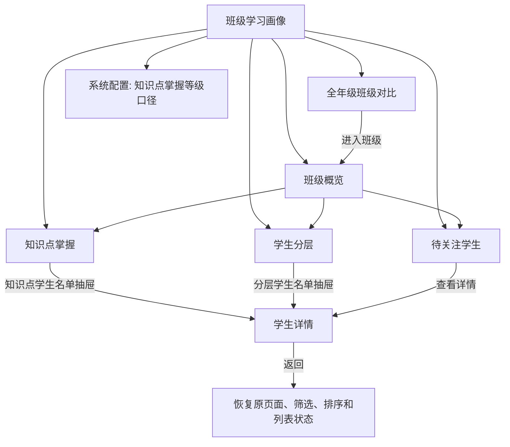

# 班级学习画像看板原型方案说明

> 产物类型：原型方案说明（非交互实现）  
> 对应需求：REQ-CLP-001  
> 目标端：PC 教师后台，兼容窄窗口；后续实现须在同一地址内支持简体中文 / English 切换。

## 设计原则

- 首屏直接进入实际班级运营页面，不增加介绍页、需求说明或流程叙事。
- 班主任默认进入本人第一个有权限的班级；年级管理员默认进入全年级对比，也可以进入任一有权限班级。
- 页面围绕四个问题组织：班级状态、薄弱知识点、学生分层、待关注学生。
- 汇总、知识点、分层、待关注名单、学生详情和 CSV 导出使用同一班级、科目、时间范围和练习类型。
- 所有指标名称、口径和阈值以 PRD 为准；原型不得自行改名或改变分母。
- 指标卡和指标列右上角固定展示“口径”角标，角标是实际产品能力，不显示“PRD”或“需求说明”字样。
- 学生姓名、学生标识可见，手机号、邮箱、监护人和地址完全隐藏。
- 只有知识点掌握率支持排序；其他表格不增加排序入口。

## 页面清单

| 页面 / 视图 | 入口 | 主要用户 | 页面目标 |
|---|---|---|---|
| 班级概览 | 班级运营 → 班级学习画像 | 班主任、年级管理员 | 一屏查看四项指标、薄弱知识点、学生分层和待关注学生摘要 |
| 知识点掌握 | 概览内区块；可独立切页 | 班主任、年级管理员 | 比较知识点掌握程度并下钻对应学生名单 |
| 学生分层 | 概览内区块；可独立切页 | 班主任、年级管理员 | 查看四类学生人数、占比及对应名单 |
| 待关注学生 | 概览内区块；可通过“查看全部”进入 | 班主任、年级管理员 | 查看关注原因、进入详情、标记已关注、导出关注名单 |
| 学生详情 | 点击学生行或“查看详情” | 班主任、年级管理员 | 查看成绩趋势、完成情况、薄弱知识点和历史学习记录 |
| 全年级班级对比 | 年级管理员页签 | 教研 / 年级管理员 | 对比所属年级各班级指标并进入单班画像 |
| 知识点掌握等级口径 | 系统配置 → 知识点掌握等级口径 | 教研 / 年级管理员 | 按年级、科目维护掌握等级阈值 |

## 信息架构与跳转

- 页面切换不重置当前班级、科目、时间范围和练习类型。
- 从知识点或分层抽屉进入学生详情时，返回路径必须回到原抽屉及其滚动位置。
- 从待关注列表进入详情时，返回后保留关注状态和当前页。
- 全年级对比仅覆盖当前账号所属年级；点击班级进入对应班级概览。
- 无权限班级不出现在主导航、筛选候选、搜索结果或错误提示中。

## 全局页面框架

### 桌面布局

| 区域 | 建议尺寸 / 位置 | 内容 |
|---|---|---|
| 顶部栏 | 高度 56–64px | 教师后台 Logo、产品导航、账号菜单、语言切换 `中 / EN` |
| 二级导航 | 左侧固定导航栏 | `班级运营 → 班级学习画像` |
| 页面标题区 | 内容区顶部 | 页面标题、统计时间、全年级对比入口（管理员）、导出入口 |
| 筛选区 | 标题区下方，单行或两行自适应 | 班级、科目、时间范围、练习类型、查询、重置 |
| 指标区 | 四列等宽 | 班级平均得分、作业完成率、知识点掌握率、待关注学生数 |
| 分析区 | 2 列，建议 60% / 40% | 左侧知识点掌握，右侧学生分层 |
| 待关注区 | 整行 | 待关注学生摘要列表，可展开查看全部 |
| 页脚提示 | 内容区底部 | 统计口径入口、数据更新时间、隐私提示 |

### 窄屏布局

- 窗口宽度小于 900px 时，指标卡改为两列，分析与名单区改为单列。
- 表格允许横向滚动，固定首列学生姓名或知识点名称，操作列保持可见。
- 不把关键操作折叠到不可发现的悬浮按钮中。
- 语言切换、口径角标、返回路径和导出入口在窄屏仍保持可见。

## 班级概览页

### 页面头部

- 标题：`班级学习画像`。
- 班级和科目作为页面上下文，筛选后显示“三年级 2 班 · 数学”。
- 右侧展示统一统计时间：`数据统计至 2026-11-18 10:15（GMT+8）`。
- 年级管理员额外展示 `全年级对比` 页签。
- 班主任展示 `导出班级名单`。

### 筛选区

筛选顺序固定为：

`班级 → 科目 → 时间范围 → 练习类型 → 查询 → 重置`

- 班级：班主任只显示本人所带班级；管理员显示所属年级内班级。
- 科目：`全部科目 / 数学 / 语文 / 英语`，后续以实际科目枚举为准。
- 时间范围：起止日期，默认最近 30 个自然日；结束日期早于开始日期时禁止查询。
- 练习类型：`全部 / 作业 / 测验 / 课堂练习`。
- 修改筛选后，所有区块同时刷新，不保留上一筛选的学生数据。
- 查询中展示统一加载态，不逐个区块展示与新筛选不匹配的旧值。

### 四项指标卡

| 指标卡 | 主数值 | 辅助信息 | 口径角标 |
|---|---|---|---|
| 班级平均得分 | 一位小数，范围 0–100 | 显示“有效学生 N 人” | 学生等权平均；分子为各学生个人平均分之和，分母为有效学生数 |
| 作业完成率 | 百分比，一位小数 | 显示“已完成 X / 应完成 Y” | 学生-练习唯一对；已完成对数 / 应完成对数 |
| 知识点掌握率 | 百分比，一位小数 | 显示“已掌握 X · 待巩固 Y · 未掌握 Z” | 有有效数据知识点掌握率的等权平均；点击角标展示完整口径 |
| 待关注学生数 | 整数人数 | 显示“占班级学生 N%”及数据不完整人数 | 按学生 ID 去重；命中任一关注规则即计入 |

- 指标卡右上角使用问号或信息图标，`aria-label` 为“查看班级平均得分口径”。
- 点击或键盘聚焦后打开指标口径浮层；不在页面常驻大段公式。
- 分母为 0 时主数值显示 `—`，辅助信息显示“暂无有效数据”。
- 指标值旁可展示数据完整状态，如“部分数据缺失”，但不得把缺失值补成 0。

### 页面中的口径浮层

每个口径浮层至少包含：

`指标名称、分子、分母、单位、统计范围、时间字段、去重键、零值规则、数据时间`

- 浮层只解释当前指标，不重复整页统计说明。
- 浮层可关闭，也支持键盘 `Esc`。
- 知识点等级口径来自当前年级、科目及批次快照，显示生效版本。

### 知识点掌握区

区块标题：`知识点掌握`，右侧提供“查看全部”。

- 默认展示掌握率最低的 5 个知识点，帮助快速定位薄弱项。
- 表格列：`知识点名称 → 掌握率 → 班级平均得分 → 掌握等级 → 数据状态 → 操作`。
- 掌握率支持升序、降序；默认降序，空值固定末位。
- 掌握等级用文字和颜色共同表达：`已掌握`、`待巩固`、`未掌握`；无数据时不显示等级。
- 点击知识点名称或“查看学生”打开右侧学生名单抽屉。
- 每个指标列标题右上角有“口径”角标。

### 学生分层区

区块标题：`学生分层`。

- 以四张并列分层条目展示：优秀、稳定、波动、待关注。
- 每项展示人数和占班级学生总数比例。
- 点击任一层进入该层学生名单抽屉。
- `待关注` 条目必须同时展示系统识别人数和数据不完整人数，避免把数据缺失与学习表现偏低混为一谈。
- 分层口径角标展示触发阈值，不提供学生标签编辑入口。

### 待关注摘要区

区块标题：`待关注学生`，右侧提供“查看全部”和“导出关注名单”。

- 默认展示 5 名优先学生。
- 列表列：`学生姓名 → 最近作业得分 → 作业完成率 → 连续未完成次数 → 薄弱知识点 → 关注原因 → 关注状态 → 操作`。
- 关注原因按 PRD 顺序合并，例如“完成率偏低、连续未完成”。
- 薄弱知识点最多展示 3 个，超出显示“等 N 个”。
- 操作：`查看详情`、`标记已关注`；已标记后显示状态、操作人和时间。
- 标记已关注只改变状态，不减少待关注人数，不删除系统识别结果。

## 知识点掌握页

### 页面结构

- 沿用全局筛选和统计时间。
- 顶部为“掌握概览”：已掌握知识点数、待巩固数、未掌握数。
- 主表显示全部有课程标签的知识点。
- 主表列：`知识点名称 → 掌握率 → 班级平均得分 → 掌握等级 → 数据状态 → 操作`。
- 表格默认按掌握率降序；只允许掌握率列排序。
- 无有效题目数据的知识点保留名称并显示“暂无数据”，不参与掌握率平均值。
- 每行提供“查看学生”。

### 学生名单抽屉

从知识点行打开，标题为知识点名称。

抽屉内包含：

- 当前筛选摘要。
- 搜索学生姓名或学生标识。
- 表格：学生姓名、学生标识、个人知识点掌握率、最近得分、完成率、数据状态。
- 默认按个人掌握率升序，优先展示薄弱学生。
- 点击学生行或“查看详情”进入学生详情。
- 抽屉可关闭；关闭后回到原知识点表和原滚动位置。

## 学生分层页 / 抽屉

### 分层条

使用四个可切换条目：

`优秀 → 稳定 → 波动 → 待关注`

- 每个条目展示人数、占比。
- 切换条目只改变下方学生列表，不重置全局筛选。
- `待关注` 条目增加数据不完整提示，不将缺失数据当作普通低分。

### 学生列表

列顺序：

`学生姓名 → 学生标识 → 平均得分 → 完成率 → 最近作业得分 → 连续未完成次数 → 薄弱知识点 → 数据状态 → 操作`

- 学生姓名、学生标识用于识别；不展示联系方式。
- 点击行或“查看详情”进入学生详情页。
- 不提供修改分层、批量改标签或强制移出待关注的能力。
- 点击分层区块进入列表时，可以使用右侧抽屉；进入独立页时保留同一表格结构。

## 待关注学生页

### 页面结构

- 标题：`待关注学生`。
- 顶部展示当前筛选摘要、待关注总人数、数据不完整人数、已关注人数。
- 支持按学生姓名或学生标识搜索；不扩大字段权限。
- 主表列与 PRD 一致。
- 默认按“关注优先级 → 连续未完成次数降序 → 最近作业得分升序”组织展示；不增加用户可操作排序入口。
- 已关注学生默认继续展示，增加“已关注”状态。

### 行内操作

- `查看详情`：进入学生详情。
- `标记已关注`：打开确认弹窗。
- 已关注状态：显示操作人和时间，操作变为不可重复提交。
- 不提供“移除”“忽略”“删除”按钮。

### 导出关注名单

入口：页面右侧 `导出关注名单`。

- 打开导出抽屉，展示当前筛选、预计行数、脱敏说明和 CSV 格式。
- 超过 500 条时禁用导出，提示缩小筛选范围。
- 导出字段严格使用 PRD 固定顺序。
- 导出成功后显示任务完成提示；导出不阻断当前页面操作。

## 学生详情页

### 头部

- 返回原页面。
- 学生姓名、学生标识、所属班级、年级、当前科目。
- 数据状态：完整 / 部分缺失 / 暂无数据。
- 页面不展示手机号、邮箱、监护人、地址或其它完整隐私联系方式。

### 内容区

| 区块 | 内容 |
|---|---|
| 学习概览 | 学生平均得分、完成率、最近作业得分、连续未完成次数 |
| 成绩趋势 | 按练习时间展示归一化得分折线；无得分点显示空态 |
| 完成情况 | 应完成、已完成、完成率和未完成练习列表 |
| 薄弱知识点 | 知识点名称、个人掌握率、等级、最近相关练习 |
| 历史学习记录 | 练习名称、类型、布置时间、提交时间、得分、状态、知识点 |
| 数据说明 | 缺失字段显示“—”，并说明缺失原因类别 |

### 返回规则

- 从知识点抽屉进入时，返回后重新打开原抽屉。
- 从分层列表进入时，返回当前分层页签。
- 从待关注列表进入时，返回当前分页和搜索条件。
- 不通过浏览器后退触发两次筛选请求或清空筛选。

## 全年级班级对比

仅教研 / 年级管理员可见。

### 页面结构

- 标题：`全年级班级对比`。
- 筛选：科目、时间范围、练习类型；年级由账号范围固定，不允许跨年级查询。
- 顶部展示全年级班级数、有效学习数据班级数、待关注学生合计。
- 对比表列：`班级 → 班级平均得分 → 作业完成率 → 知识点掌握率 → 待关注学生数 → 数据不完整人数 → 操作`。
- 点击班级进入该班班级概览。
- 不展示学生明细或联系方式。
- 指标列右上角带口径角标。

## 知识点掌握等级口径配置

入口：`系统配置 → 知识点掌握等级口径`。

### 页面结构

- 筛选：年级、科目。
- 阈值输入：待巩固下限、已掌握下限。
- 页面实时展示三个区间：

  - 未掌握：`0% ≤ 掌握率 < 待巩固下限`
  - 待巩固：`待巩固下限 ≤ 掌握率 < 已掌握下限`
  - 已掌握：`已掌握下限 ≤ 掌握率 ≤ 100%`

- 保存前展示影响范围：当前年级、科目、之后生成的统计批次。
- 校验失败时在字段附近提示，不提交。
- 保存成功后保留当前筛选，刷新统计时间和掌握等级角标。
- 不提供题目、题库、知识点映射或学生标签编辑入口。

## 弹窗与抽屉

| 类型 | 名称 | 触发 | 内容与操作 | 关闭 / 返回 |
|---|---|---|---|---|
| 浮层 | 指标口径 | 点击指标“口径”角标 | 名称、分子、分母、单位、范围、时间、去重、零值规则 | `Esc`、关闭按钮 |
| 抽屉 | 知识点学生名单 | 点击知识点或“查看学生” | 学生表格、搜索、查看详情 | 返回恢复原知识点排序和滚动位置 |
| 抽屉 | 分层学生名单 | 点击某一分层 | 当前分层学生列表、查看详情 | 返回当前分层和筛选 |
| 抽屉 | 导出名单 | 点击导出 | 筛选摘要、预计行数、脱敏说明、CSV 说明、确认按钮 | 取消或成功关闭 |
| 对话框 | 标记已关注确认 | 点击“标记已关注” | 学生摘要、操作说明、确认 / 取消 | 确认后更新行状态 |
| 提示条 | 数据不完整 | 当前统计存在缺失 | 说明缺失范围和影响字段 | 可关闭提示，不遮挡页面数据 |

## 页面状态

| 状态 | 指标区 | 分析区 | 名单区 | 可执行操作 |
|---|---|---|---|---|
| 默认态 | 显示四项指标 | 知识点、分层、待关注 | 显示摘要 | 筛选、口径、下钻、导出 |
| 加载态 | 骨架卡，不显示上一个班级数据 | 骨架行 | 骨架表 | 可取消页面进入；查询按钮显示加载 |
| 班级无学习数据 | 显示 `—`，显示空态说明 | 显示“暂无可分析知识点” | 显示空态 | 调整时间或切换班级 |
| 筛选无结果 | 指标显示 `—` | 显示“暂无数据，请调整时间范围” | 显示无结果 | 修改筛选、重置 |
| 部分指标失败 | 成功指标正常展示 | 失败模块显示错误和重试 | 失败区域不展示旧数据 | 单模块重试 |
| 页面级错误 | 保留页面框架 | 显示统计失败和统计时间 | 隐藏旧学生名单 | 重试 |
| 权限不足 | 不显示指标 | 不渲染敏感区块 | 不返回学生数据 | 返回有权限页面 |
| 数据不完整 | 显示可用值和缺失标记 | 对应知识点/学生带标记 | 行内显示“数据不完整” | 查看详情、调整时间 |
| 导出超限 | — | — | 导出抽屉提示行数 | 缩小筛选范围 |
| 导出失败 | — | — | 页面保持可用 | 重新导出 |

## 关键交互

1. 进入页面：读取当前账号首个有权限班级，应用默认最近 30 个自然日与全部科目、全部练习类型。
2. 修改筛选：点击查询后整页进入加载态；成功后四项指标、知识点、分层、待关注和统计时间同步更新。
3. 查看口径：点击指标角标打开浮层；焦点可进入浮层，关闭后回到原角标。
4. 查看薄弱知识点：默认展示低掌握知识点；排序只改变知识点表，不改变顶部指标。
5. 知识点下钻：打开学生名单抽屉；搜索、查看学生详情、返回均保留知识点筛选和排序。
6. 学生分层：点击分层条目切换名单；不修改系统标签，不将数据不完整学生隐藏。
7. 待关注学生：查看详情、标记已关注、导出关注名单；已关注状态不改变待关注人数。
8. 学生详情：展示可用数据；返回原来源页面时恢复筛选、页签、分页、抽屉和滚动位置。
9. 全年级对比：管理员切换班级进入单班画像；不进入跨年级数据。
10. 口径配置：修改阈值后只影响后续统计批次；页面显示新的统计时间。
11. 导出：二次校验权限和筛选范围；CSV 不含隐私联系方式，失败不生成空文件。
12. 语言切换：切换文案不重载业务数据，不重置筛选、分页、抽屉或已选班级。

## 中英文与可访问性

- 页面默认简体中文，顶部提供 `中 / EN` 切换。
- 中文“业务线”若后续出现，统一英文为 `Business Line`；本项目页面优先使用“班级、年级、科目”，不引入错误地域语义。
- 指标名称、指标口径、状态、按钮、表头、筛选、空态、错误态、权限态和导出说明全部翻译。
- 学生姓名、学生标识、班级名称等业务数据保持原值。
- 所有图标按钮必须有可见标签或 `aria-label`。
- 口径浮层、抽屉和确认框支持键盘操作与 `Esc` 关闭。
- 颜色不能单独表达掌握等级或关注状态，必须同时显示文字。

## 指标与原型展示对应

| PRD 指标 | 页面展示 | 辅助展示 |
|---|---|---|
| 班级平均得分 | 指标卡、全年级对比表 | 有效学生数、口径角标 |
| 作业完成率 | 指标卡、学生列、全年级对比表 | 完成数 / 应完成数 |
| 知识点掌握率 | 指标卡、知识点表、全年级对比表 | 已掌握 / 待巩固 / 未掌握数量、口径角标 |
| 待关注学生数 | 指标卡、全年级对比表 | 占班级人数比例、数据不完整人数 |
| 单知识点掌握率 | 知识点表 | 得分 / 满分、掌握等级、口径角标 |
| 知识点班级平均得分 | 知识点表 | 有效学生数、口径角标 |
| 学生平均得分 | 学生分层与待关注列表 | 个人有效练习数 |
| 学生完成率 | 待关注和学生详情 | 完成数 / 应完成数 |
| 连续未完成次数 | 待关注和学生详情 | 当前练习类型 |

以上名称、公式、筛选范围和去重口径必须与 PRD 逐项一致。交互原型落地前，若 PRD 待确认项改变阈值或分母，本方案中的对应文案、角标和状态需同步更新。
