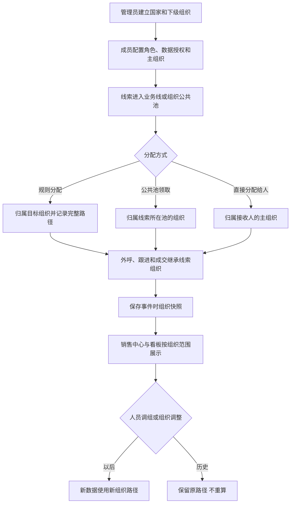

# CRM账号&权限体系优化

> 一句话结论：将 CRM 从一级业务线权限升级为最多四级的组织树权限，成员只有一个人角色、一条数据授权和一个主组织，线索及后续作业按发生时点的组织路径归属。
> 版本 / 需求编号：V1.0 / REQ-RBAC-002
> 需求类型：权限与审计
> 更新时间：2026-11-11

> 📌
> - **组织**：业务线根节点下设区、部、组，最多四层。
> - **成员**：一人一个功能角色、一条数据授权、一个主组织。
> - **数据**：线索、外呼、跟进和成交记录事件时组织快照；组织变化不回写历史。
> - **不做**：不新增审批、HR 组织同步、跨组织业绩分摊、复杂共享规则或新经营指标。

## 交互原型

[打开完整交互原型](https://h3-ai-lab.github.io/hhhprd/projects/crm-account-permissions/prototype/)

原型覆盖组织树维护、成员授权、角色权限、销售线索和管理看板。

## 要解决什么

当前账号的数据权限主要以一级业务线为边界。同一业务线下的区和部需要独立查看客户、线索和业绩时，只能依赖线索标签或扩大管理者范围，既无法稳定隔离同级团队，也无法解释数据为什么可见。

本期建立一套简单、可解释的账号与权限底座：组织树负责数据归属，功能角色负责能执行什么，数据授权负责能操作哪些组织，主组织负责人员归属。业务数据在发生时记录所属组织，后续组织调整只影响新数据。

## 本期目标

| 目标 | 结果 |
|---|---|
| 支持多级管理 | 同一业务线可建立区、部、组，实现同级数据隔离 |
| 简化账号配置 | 每个人只有一个功能角色、一条数据授权和一个主组织 |
| 统一数据归属 | 每条线索只属于一个当前组织，不做多主管复制 |
| 保持历史稳定 | 人员调组、组织改名或调整后，历史业务口径不变化 |
| 权限可解释 | 页面、列表、候选、看板、下钻和导出使用同一组织范围 |

## 范围

**做**

- 将现有“数据分组”升级为最多四级的组织架构。
- 成员账号配置唯一功能角色、按业务线的数据授权和唯一主组织。
- 线索分配、公共池领取、转派、外呼、跟进和成交记录组织路径快照。
- 现有销售中心和管理看板增加组织维度，并按当前账号数据范围限制。
- 一级业务线存量数据保留原路径，不做批量倒推。
- 组织、成员授权和数据归属变化记录操作日志。

**不做**

- 不改线索状态、外呼结果、预约、订单和支付判定。
- 不新增组织审批流、岗位体系或外部 HR 同步。
- 不增加跨组织业绩分摊、联合作战或线索多主责。
- 不增加新的经营指标、报表页签或导出格式。
- 不把历史一级业务线数据自动拆分到新组织。

## 核心模型

| 对象 | 规则 |
|---|---|
| 功能角色 | 决定菜单、页面和动作权限；一名成员只能选择一个角色 |
| 数据授权 | 决定可操作哪些组织的数据；同一业务线可一次选择 A、B 等多个节点并包含全部下级 |
| 主组织 | 人员唯一行政归属；可以是国家、区、部或组，不要求是最末级 |
| 线索运营归属 | 线索唯一当前负责组织，保存完整路径 |
| 组织快照 | 线索、外呼、跟进和成交在发生时保存组织 ID、路径和名称快照 |

业务线是国家根节点。组织路径最多为：

```text
国家
└── 区
    └── 部
        └── 组
```

国家、区、部、组均可直接承接线索和产生业绩。没有“必须落到组”的限制。

超级管理员是系统内置账号，拥有全部业务线和组织范围；该全局范围不开放给普通成员的数据授权选项。

## 主流程



### 线索归属

1. 线索命中某组织分配规则或来自某组织公共池时，归属该组织。
2. 直接分配给个人且没有组织来源时，归属接收人的主组织。
3. 接收人没有有效主组织时，不能完成直接分配。
4. 线索只保留一个当前运营归属；数据授权包含 A+B 不代表线索同时属于 A+B。
5. 转派成功后更新当前归属，历史转派记录保留原组织。

### 作业与业绩

- 外呼、跟进和预约沿用线索当前组织，不在单次操作时重复选择组织。
- 成交业绩按支付时线索运营归属组织统计。
- 人员调组只影响之后新分配的数据。
- 组织改名后展示新名称，历史快照保留原组织 ID 和名称。

## 页面与交互

### 组织架构

入口：`系统管理 → 系统配置 → 组织架构`。

页面使用左侧组织树和右侧组织列表：

```text
[业务线筛选]                         [新增下级组织]
[组织树]       [组织名称] [层级] [上级] [负责人] [成员数] [状态] [操作]
```

规则：

- 默认选中当前账号可管理的最上级组织。
- 组织层级由国家根节点向下计算，最多四级。
- 新增组织必须选择上级组织，层级由上级自动确定。
- 当前操作人的上级组织、负责人和可管理节点候选均受其数据授权限制；无权组织不展示。
- 国家根节点不可删除、停用或改变业务线归属。
- 有成员、线索、作业记录或下级的组织只能停用，不能删除。
- 停用组织不再接收新线索或新成员，历史数据保留。
- 组织名称在同一上级下不可重复。
- 负责人从已获得该组织所属业务线数据授权的启用成员中选择，可暂不设置。
- 负责人身份不自动增加数据或功能权限。

### 成员账号

入口：`系统管理 → 系统配置 → 成员账号`。

成员编辑按以下顺序展示：

```text
基本信息
姓名 → 登录邮箱 → 人员类型

权限配置
功能角色 → 数据授权 → 主组织
```

规则：

- 功能角色单选且必填。
- 数据授权至少一条；同一业务线只能出现一次。
- 数据范围为“本人”“指定组织及下级”“业务线全部”。
- “指定组织及下级”使用组织树级联多选控件，可同时选择 A、B 等多个节点。
- 选择父节点后自动覆盖全部下级；下级显示为已包含的只读选中状态，取消父节点后重新独立选择。
- 切换业务线时清空不属于新业务线的已选组织，并重新加载对应组织树。
- 主组织单选且必填，必须是账号已授权业务线中的有效组织。
- 一个成员不能同时配置多个主组织。
- 组织管理员只能选择自己数据授权内的组织；主组织、数据授权和负责人候选中均不得出现无权组织。
- 组织管理员不能将成员配置到越权组织，也不能通过成员授权扩大自己的数据范围。
- 修改角色、数据授权或主组织即时生效。
- 人员调组不回写已有线索记录；未结束线索按现有转派规则处理。

### 角色权限

入口：`系统管理 → 系统配置 → 角色权限`。

角色只展示和配置功能权限，不再承载业务线或组织数据范围。成员数据范围统一在“成员账号”维护。

### 操作日志

入口：`系统管理 → 系统配置 → 操作日志`。

系统配置中的组织、成员和角色写入操作均记录日志：

- 组织新增、编辑、更换上级、启用和停用。
- 成员新增、编辑、角色变更、数据授权变更、主组织变更、启用和停用。
- 角色新增、编辑和删除。
- 保存成功、保存失败和未授权的写入尝试。

每条日志至少展示操作时间、模块、操作行为、操作对象、操作人、结果和变更内容。变更内容包含变更前后值；失败记录展示失败原因。日志不可由普通管理员编辑或删除。

### 销售中心

入口：`销售管理 → 销售中心`。

- 列表增加“归属组织”，展示线索当前完整组织路径。
- 在现有“国家”之后、“CC”之前增加“组织架构”筛选。
- 组织筛选项只能出现当前账号数据授权内的组织。
- 公共池线索按所在组织分池；销售只能领取主组织及自身数据范围内的公共池线索。
- 线索分配、转派、领取后同步更新当前组织并保留历史。
- 搜索、筛选候选、详情、通话记录和导出与列表使用相同数据范围。

### 管理看板

入口：`管理看板`。

- 在现有“业务线”之后、“当前 CC”之前增加“组织架构”筛选。
- 组织选项受当前账号数据范围限制。
- 现有指标的名称、公式、分子分母、日期口径和页签不改变。
- 当前作业指标使用线索当前组织；过程指标使用事件发生时的组织快照；业绩指标使用支付时的组织快照。
- 父组织汇总包含自身直属数据和全部下级数据。
- 汇总、下钻和导出使用同一组织范围及业务唯一标识去重。

## 字段与排序

### 字段顺序比对

| 现状顺序 | 字段 | 现状位置 | 比对结果 | 目标顺序/位置 | 变更原因 |
|---|---|---|---|---|---|
| 1 | 角色名称、职责说明、数据权限、成员数、操作 | 角色列表 | 修改 | 角色名称、职责说明、成员数、操作 | 功能角色与数据授权解耦 |
| 1 | 分组名称、业务线、负责人、成员数、状态、操作 | 数据分组列表 | 改名并升级 | 组织名称、业务线、上级组织、层级、负责人、成员数、状态、操作 | 数据分组升级为四级组织树 |
| 1 | 邮箱/昵称搜索、业务线、数据分组、角色、状态 | 成员账号筛选区 | 修改 | 邮箱/昵称搜索、业务线、组织架构、角色、状态 | 数据分组筛选改为组织筛选，保持原位置 |
| 1–9 | 姓名、邮箱、人员类型、业务线/数据权限、功能角色、状态、最近登录、外呼能力、操作 | 成员账号列表 | 保留并插入 | 姓名、邮箱、人员类型、业务线/数据权限、功能角色、主组织、状态、最近登录、外呼能力、操作 | 增加唯一主组织，其他列顺序不变 |
| 1–6 | 姓名、登录邮箱、人员类型、功能角色、业务线/数据范围、所属组 | 成员编辑表单 | 修改 | 姓名、登录邮箱、人员类型、功能角色、数据授权、主组织 | 所属组升级为主组织，并增加组织多选授权 |
| 历史列 | 用户 ID 至渠道来源-App、国家、预约外呼、注册时间、CC、外呼情况、操作 | 销售中心列表 | 保留并插入 | 原顺序不变；在“国家”后插入“归属组织” | 展示线索组织归属 |
| 1–3 | 搜索、国家、CC | 销售中心筛选区 | 保留并插入 | 搜索、国家、组织架构、CC | 组织筛选与国家同属业务归属维度 |
| 1–3 | 业务线、当前 CC、日期 | 管理看板筛选区 | 保留并插入 | 业务线、组织架构、当前 CC、日期 | 组织筛选与国家/业务线同组 |

### 字段字典

| 字段 | 含义 | 类型/枚举 | 必填/默认 | 来源 | 可编辑规则 | 异常展示 | 排序结论 |
|---|---|---|---|---|---|---|---|
| 组织名称 | 组织节点展示名 | 文本 | 新增必填；同上级唯一 | 管理员维护 | 管理员可编辑 | 空值不保存 | 不支持；用于识别和搜索 |
| 业务线/国家 | 组织所属根节点 | 枚举 | 必填 | 现有业务线 | 编辑组织时不可跨根变更 | 无权限业务线不展示 | 条件排序；沿用现有业务线业务顺序，不支持按名称排序 |
| 上级组织 | 直接父节点 | 组织树选择 | 新增必填 | 组织树 | 上级须有效且移动后不超过四级 | 无有效上级时只能创建根节点 | 不支持；用于结构识别 |
| 层级 | 国家/区/部/组 | 枚举 | 自动 | 由组织路径计算 | 不可直接编辑 | 超过四级不可保存 | 条件排序；按国家→区→部→组业务顺序 |
| 负责人 | 组织负责人记录 | 成员单选 | 非必填 | 启用成员 | 须拥有该业务线数据授权 | 离职保留名称快照并标记停用 | 不支持；名称用于识别 |
| 成员数 | 当前有效成员归属数 | 整数 | 自动 | 成员主组织 | 不可编辑 | 停用成员不计入有效成员数 | 不支持；保持现有分组列表无排序 |
| 状态 | 组织可用性 | 启用/停用 | 默认启用 | 管理员维护 | 管理员可启停 | 停用后不能接收新业务 | 不支持；用于筛选 |
| 功能角色 | 功能权限集合 | 角色单选 | 必填 | 角色配置 | 每个成员只能选择一个 | 无角色不可保存 | 不支持；用于筛选 |
| 数据授权 | 可操作的数据范围 | 本人/指定组织及下级/业务线全部 | 至少一条 | 成员编辑 | 按业务线分别配置；“指定组织及下级”为级联多选组织树 | 无权组织不展示 | 不支持；用于筛选和权限 |
| 主组织 | 成员唯一行政归属 | 组织树单选 | 必填 | 成员编辑 | 成员只有一个 | 无有效主组织不能接收新线索 | 不支持；用于筛选和识别 |
| 组织架构筛选 | 按组织过滤作业数据或看板 | 组织树选择 | 非必填 | 当前账号数据范围 | 只能选择授权节点 | 无权限节点不展示 | 条件排序；展示顺序与组织树及业务顺序一致 |
| 归属组织 | 线索当前完整组织路径 | 组织路径文本 | 系统生成 | 分配或领取事件 | 前端不可直接编辑 | 历史缺失显示 `—` | 条件排序；按组织树业务顺序，不按文本排序 |

## RBAC 权限数据

### 功能权限

| 页面/资源 | 操作 | 业务含义 | 默认角色 | 数据范围 | 审计 |
|---|---|---|---|---|---|
| 系统配置 → 组织架构 | 查看 | 查看组织树和组织详情 | 超级管理员、业务线管理员、区域管理员 | 授权组织 | 不记录普通查看 |
| 系统配置 → 组织架构 | 新增下级 | 在授权节点下新增组织 | 超级管理员、业务线管理员、区域管理员 | 已授权组织及下级 | 记录 |
| 系统配置 → 组织架构 | 编辑 | 修改名称、负责人和上级 | 超级管理员、业务线管理员、区域管理员 | 已授权组织及下级 | 记录 |
| 系统配置 → 组织架构 | 启用/停用 | 改变组织接收新业务状态 | 超级管理员、业务线管理员、区域管理员 | 已授权组织及下级 | 记录 |
| 系统配置 → 成员账号 | 查看 | 查看成员角色、授权和主组织 | 超级管理员、业务线管理员、区域管理员 | 授权组织内成员 | 不记录普通查看 |
| 系统配置 → 成员账号 | 新增/编辑 | 配置唯一角色、数据授权和主组织 | 超级管理员、业务线管理员、区域管理员 | 授权组织内成员 | 记录 |
| 系统配置 → 角色权限 | 查看 | 查看角色功能权限 | 超级管理员、业务线管理员、区域管理员 | 授权范围 | 不新增 |
| 系统配置 → 角色权限 | 新增/编辑/删除 | 维护功能权限模板 | 超级管理员 | 全局 | 记录 |
| 系统配置 → 操作日志 | 查看 | 查看系统配置变更记录 | 超级管理员、业务线管理员、区域管理员 | 授权组织及下级 | 不记录普通查看 |
| 销售中心 | 查看线索 | 查看授权组织内线索 | 销售、区域管理员、业务线管理员、超级管理员 | 成员数据授权 | 普通查看不记录 |
| 销售中心 | 领取 | 领取授权组织公共池线索 | 销售、区域管理员 | 本人或节点范围 | 记录 |
| 销售中心 | 分配/转派 | 修改线索负责人和当前组织 | 区域管理员、业务线管理员、超级管理员 | 授权组织和目标成员 | 记录 |
| 管理看板 | 查看 | 查看现有看板和组织范围指标 | 区域管理员、业务线管理员、超级管理员 | 成员数据授权 | 普通查看不记录 |
| 管理看板 | 下钻 | 查看与汇总同口径明细 | 同上 | 与汇总一致 | 不单独记录 |
| 管理看板 | 导出 | 导出当前筛选和组织范围 | 需单独导出权限 | 与查看范围取交集 | 记录 |

### 字段与数据权限

| 字段组/列表 | 可见角色 | 编辑角色 | 脱敏/隐藏 | 可导出 | 候选范围限制 |
|---|---|---|---|---|---|
| 组织树、组织名称、层级、上级、负责人、成员数、状态 | 有组织查看权限的角色 | 有组织编辑权限的角色 | 无权组织完全隐藏 | 本期不新增组织导出 | 仅数据授权范围 |
| 成员角色、数据授权、主组织 | 有成员查看权限的角色 | 有成员编辑权限的角色 | 保留现有邮箱和账号字段权限 | 沿用现有成员导出权限 | 仅授权组织内成员和组织 |
| 线索归属组织 | 有线索查看权限的角色 | 无；由分配事件更新 | 无权组织线索不可见 | 需现有销售导出权限 | 与线索数据范围一致 |
| 销售中心手机号、录音、客户资料 | 沿用现有销售字段权限 | 沿用现有跟进权限 | 沿用现有脱敏规则 | 沿用现有导出权限 | 与线索及组织范围一致 |
| 看板指标、分子分母、更新时间 | 有管理看板查看权限的角色 | 无 | 不展示无权组织及客户明细 | 需看板导出权限 | 与组织筛选和现有 CC 范围一致 |

### 权限数据变更

| 变更类型 | 权限层级 | 权限项 | 业务说明 | 默认角色/数据范围 | 是否新增审计 |
|---|---|---|---|---|---|
| 新增 | 菜单 | 系统配置 → 组织架构 | 替代数据分组页签 | 超级管理员、业务线管理员、区域管理员 | 是 |
| 新增 | 页面 | 组织架构查看 | 查看组织树和组织列表 | 同上，按数据授权 | 是 |
| 新增 | 动作 | 新增、编辑、启停组织 | 维护组织生命周期 | 同上，按数据授权 | 是 |
| 修改 | 页面 | 成员账号编辑 | 增加唯一角色、数据授权和主组织校验 | 组织管理员和超级管理员 | 是 |
| 修改 | 数据 | 角色不再承载组织范围 | 数据范围统一由成员账号配置 | 全部存量角色 | 是 |
| 修改 | 数据 | 线索、作业和业绩增加组织路径快照 | 用于范围过滤和历史统计 | 全部新事件 | 是 |
| 复用 | 数据 | 本人/业务线全部 | 保留现有数据范围语义 | 销售/业务线管理员 | 否 |
| 新增 | 数据 | 指定组织及下级 | 支持一次选择多个组织节点 | 区域管理员、业务线管理员 | 是 |
| 新增 | 动作 | 系统配置写入日志 | 记录组织、成员、角色配置的成功、失败和未授权尝试 | 系统配置写入操作 | 是 |
| 复用 | 页面 | 销售中心、管理看板 | 不新增页面，只增加组织筛选和组织范围 | 现有角色 | 否 |

## 数据与依赖

| 数据/系统 | 用途 | 唯一标识 | 时效/失败处理 |
|---|---|---|---|
| 组织架构 | 节点、父子关系和状态 | `org_id` | 修改后下一次请求生效；保存失败保留原结构 |
| 成员账号 | 功能角色、数据授权和主组织 | `user_id` | 保存后即时刷新权限 |
| 线索归属 | 当前组织、负责人和历史事件 | `lead_id` | 分配失败保持原负责人和组织 |
| 外呼与跟进 | 作业组织快照 | `call_id`、`followup_id` | 事件失败不生成不完整记录 |
| 订单支付 | 业绩组织快照 | `order_id` | 支付失败不进入业绩统计 |
| 管理看板 | 组织维度汇总和下钻 | 原业务唯一标识 | 数据延迟显示最近更新时间 |

## 历史数据与员工变化

- 现有只有一级业务线的数据保留原一级路径和负责人，不批量分配新组织。
- 新组织上线后产生的新线索和新作业使用新组织。
- 人员调组后已有线索不自动改归属；需要交接时使用现有转派流程。
- 账号停用后立即失去登录和新线索接收能力；已有线索和历史记录保留，待交接线索按现有回收流程处理。
- 离职人员历史业绩保留原负责人和组织快照，不重算。
- 组织停用后历史数据仍按原路径显示。
- 组织管理员保存成员时，系统再次校验全部候选组织；提交越权组织时拒绝保存。

## 用户故事

```text
超管打开组织架构
→ 在越南业务线下创建1区、A部、A1组
→ 为区域管理员选择唯一角色、A+B数据授权和1区主组织
→ 区域管理员从A部公共池领取线索
→ 线索记录越南业务线/1区/A部及负责人
→ 区域管理员外呼、跟进和成交
→ 作业与业绩记录同一组织路径
→ 管理看板按A部筛选并下钻
→ 后续人员调组，历史路径保持不变
```

## 异常与边界

- **超过四级**：不能保存新增或移动，提示选择更高层级。
- **跨根移动**：组织不能移动到其他国家根节点。
- **同名组织**：同一上级下名称重复时不能保存。
- **无主组织**：成员可以保留历史查看，但不能接收新线索。
- **主组织无授权**：不能保存成员配置。
- **数据授权节点失效**：保留历史，新操作不再命中，管理员需重新配置。
- **组织停用**：停止新分配、领取和新增成员，历史仍可查看。
- **并发修改**：保存时发现组织或成员已变化，提示刷新后重试。
- **历史组织缺失**：显示 `—`，不使用当前组织回填。
