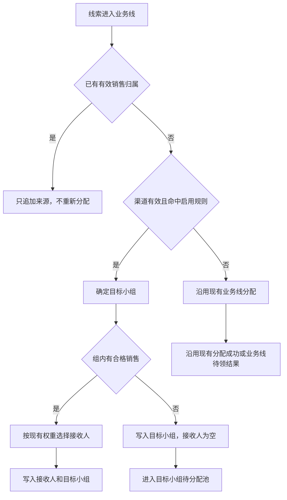

# CRM渠道线索自动分配到小组

> 在现有“分配与掉库设置”中按渠道选择目标小组，再沿用现有销售权重在组内落人。
> 需求编号：REQ-ASSIGN-001｜状态：待上传｜更新时间：2026-11-24
> 需求类型：规则、状态与数据｜补充类型：表单、字段与列表；权限与审计
> 依赖项目：REQ-ORG-002《CRM组织数据权限二期》

> 📌
> - **配置入口**：在现有“分配与掉库设置”内增加“分组规则”页签。
> - **分配方式**：先按渠道确定目标小组，再在组内按现有销售权重分配。
> - **不做**：不新增页面、看板、导出、模拟器或其他匹配维度。

## 交互原型

[打开完整交互原型](https://h3-ai-lab.github.io/hhhprd/projects/crm-channel-lead-routing/prototype/)

## 目标与范围

**目标**

让运营按稳定渠道把新线索自动路由到目标小组，同时保留现有销售权重、掉库、领取和转派能力。

**做**

- 在现有设置面板内按业务线维护渠道到小组的规则。
- 支持新增、编辑、启用、停用和删除规则。
- 命中规则后先确定目标小组，再从组内合格销售中按现有权重分配。
- 未命中和无接收人时使用明确、可追溯的兜底结果。

**不做**

- 不新增菜单、页面或独立规则中心。
- 不增加规则名称、优先级、说明、生效时间或规则模拟。
- 不新增第二套人员权重。
- 不按渠道重新分配已有线索或已有销售归属。
- 不改变人工领取、重新分配、转派、掉库和付费跟进流程。
- 不新增指标卡、报表或下载。

## 业务流程

## 配置面板

### 入口与结构

入口：`销售管理 → 销售中心 → 分配与掉库设置`。

面板顺序：

`所属业务线 → 分组规则 / 销售权重 / 掉库规则 → 取消 / 保存`

- 默认打开“分组规则”，业务线默认当前销售中心所选业务线。
- 三个页签都用同一面板的底部“取消 / 保存”；保存时统一提交当前草稿。
- 切换业务线、页签或语言时保留未保存的配置。
- 点击关闭或取消后放弃未保存配置；保存失败时保留草稿并展示错误。
- 面板不展示规则摘要、业务介绍或效果说明。

### 分组规则

- 页签标题右侧提供“新增规则”按钮。
- 规则表列为：`渠道 → 目标小组 → 接收状态 → 启用 → 操作`。
- 新增和编辑使用表格上方的内联表单，不叠加二级弹窗。
- 内联表单字段顺序为：`渠道 → 目标小组 → 保存规则 / 取消`。
- 渠道与目标小组均必填；保存单条规则后回到规则表，完整配置仍需点击面板底部“保存”后生效。
- 面板底部“保存”会先校验并提交当前已填写的内联规则，不会丢弃尚未单独保存的规则表单。
- 渠道展示渠道名称和稳定 Code；匹配使用稳定 ID/Code，不使用名称。
- 目标小组只展示当前业务线下启用的组级节点。
- 同一业务线内同一渠道只能存在一条规则；编辑时排除自身后重复则阻止保存。
- 新规则默认启用。启用开关变更先进入草稿，面板保存后生效。
- 目标小组没有合格销售时，接收状态显示“无接收人”，允许保存；运行分配时进入该小组待分配池。
- 删除规则时在该行内二次确认；取消确认不改变草稿。
- 无规则时展示空表状态和“新增规则”入口。

### 销售权重与掉库规则

- “销售权重”沿用现有领取人、分配权重和 Email 字段及权重为 0 不参与分配的规则。
- “掉库规则”沿用现有开关和“领取后超过 N 分钟无跟进记录”规则。
- 两个页签不因本需求改变字段、默认值和保存权限。
- 目标小组确定后，只从主组织直接位于该组、账号启用、具备销售跟进能力且权重大于 0 的成员中分配。

## 业务规则

| 场景 | 规则 | 结果 |
|---|---|---|
| 渠道缺失或无启用规则 | 不进入渠道路由 | 沿用现有业务线分配 |
| 命中一条启用规则 | 按业务线 + 稳定渠道唯一匹配 | 当前业务归属写入目标小组 |
| 组内有合格销售 | 使用现有正权重随机选择 | 写入接收人和目标小组 |
| 组内无合格销售 | 不跨组寻找接收人 | 接收人为空，进入目标小组待分配池 |
| 已有有效销售归属 | 新渠道只追加来源 | 不重新分配、不改变当前小组 |
| 线索掉库或回收 | 保留原当前业务归属小组 | 只在原组内重分配，不重新匹配渠道 |
| 账号停用、离职或调岗 | 仅影响后续候选 | 已有线索按 REQ-ORG-002 的交接规则处理 |
| 小组停用 | 规则不再用于新线索 | 关联规则停用并提示影响；新线索走现有兜底 |
| 组织改名或移动 | 以稳定组织 ID 保留目标关系 | 历史路径快照不回写 |

补充规则：

- 渠道规则只作用于规则保存成功后新进入未分配态的线索。
- 同一线索只产生一个成功分配结果；重复或并发请求返回原结果。
- 一个线索只能有一个当前业务归属小组。
- 未匹配渠道继续走现有业务线规则，不新增隐藏默认小组。
- 目标小组无接收人时，小组待分配线索仅对该小组有处理权限的人可见和领取，不扩大到其他小组。
- 配置保存失败、渠道或小组失效时不改变已保存规则。

## 字段与排序

当前设置面板实际顺序为：`所属业务线 → 掉库规则 → 线索分配比例`。本需求将原有设置拆入页签，并新增分组规则；不改变现有权重和掉库字段的业务含义。

| 现状顺序 | 字段 | 现状位置 | 比对结果 | 目标顺序/位置 | 变更原因 |
|---|---|---|---|---|---|
| 1 | 所属业务线 | 面板顶部 | 保留 | 面板顶部 | 分组规则和销售权重继续按业务线配置 |
| — | 分组规则 | 无 | 新增 | 页签 1 | 维护渠道到小组的映射 |
| 2 | 掉库规则 | 面板主体 | 调序 | 页签 3 | 与实时分配规则分开，减少同屏信息 |
| 3 | 线索分配比例 | 面板主体 | 调序、改名 | 页签 2“销售权重” | 保留原字段并明确其用于组内落人 |

设置列表没有用户排序入口，本需求不新增排序能力。以下字段均不支持排序。

| 字段 | 业务含义 | 类型/枚举 | 必填/默认值 | 可编辑规则 | 异常展示 | 排序要求 |
|---|---|---|---|---|---|---|
| 所属业务线 | 当前配置生效的业务线 | 当前操作人可管理的业务线 | 必填；默认当前销售中心所选业务线 | 切换后保留各业务线未保存草稿 | 失效业务线不允许保存 | 不支持；当前设置面板无排序能力 |
| 渠道 | 线索进入时的稳定来源 | 当前业务线有效渠道字典；显示名称和 Code | 必填 | 新增和编辑时可选；已被其他规则使用时不可重复 | 字典为空时禁用保存 | 不支持；当前设置列表无排序能力 |
| 目标小组 | 规则命中后的承接组 | 当前业务线启用组级节点 | 必填 | 新增和编辑时可选 | 无可用组时禁用保存 | 不支持；当前设置列表无排序能力 |
| 接收状态 | 目标组当前是否可自动接收 | 可分配 / 无接收人 | 只读 | 不直接编辑；由组员、主组织、账号和权重决定 | 无接收人时警示但允许保存 | 不支持；当前设置列表无排序能力 |
| 启用 | 规则是否参与新线索匹配 | 开 / 关 | 默认开 | 规则行内切换，面板保存后生效 | 小组停用后为关 | 不支持；当前设置列表无排序能力 |
| 操作 | 编辑或删除规则 | 编辑 / 删除 | — | 仅有规则编辑权限时可见 | 删除时行内确认 | 不支持；当前设置列表无排序能力 |
| 领取人 | 参与当前业务线分配的人员 | 业务线内销售成员 | 只读 | 沿用现有成员配置 | 停用或失去接收能力时按现有规则处理 | 不支持；当前设置面板无排序能力 |
| 分配权重 | 组内随机分配权重 | 大于等于 0 的整数 | 默认沿用现有值 | 沿用现有编辑权限 | 0 显示为不参与；负数或非整数不允许保存 | 不支持；当前设置面板无排序能力 |
| Email | 领取人登录邮箱 | 成员邮箱 | 只读 | 不可在设置面板修改 | 无邮箱显示“—” | 不支持；当前设置面板无排序能力 |
| 掉库规则 | 是否在超时无跟进后自动回池 | 开 / 关 | 沿用现有值 | 沿用现有编辑权限 | 关闭时分钟输入不可用 | 不支持；当前设置面板无排序能力 |
| 掉库时长 | 领取后无跟进记录的掉库阈值 | 30–10080 分钟整数 | 沿用现有值 | 沿用现有编辑权限；开启掉库时可编辑 | 越界值不允许保存 | 不支持；当前设置面板无排序能力 |

字段展示：

- 渠道名称用于识别，Code 用于稳定匹配；渠道改名不使规则失效。
- 目标小组展示完整路径，保存时保留当前组织 ID 和路径快照。
- 无接收人不阻止保存，但必须与“可分配”明确区分。
- 规则表按渠道字典顺序固定展示，不提供用户排序、筛选或分页。

## RBAC 权限数据

### 功能权限

| 页面 / 动作 | 默认角色 | 数据范围 | 审计 |
|---|---|---|---|
| 进入分配与掉库设置 | 超级管理员、管理员 | 现有可管理业务线 | 普通查看不记录 |
| 查看分组规则 | 超级管理员、业务线管理员 | 授权业务线内规则 | 普通查看不记录 |
| 新增、编辑、启停、删除分组规则 | 超级管理员、业务线管理员 | 仅授权业务线及其组节点 | 记录成功、失败和未授权尝试 |
| 查看和编辑销售权重 | 沿用现有权限项及角色 | 业务线范围 | 沿用现有审计 |
| 查看和编辑掉库规则 | 沿用现有权限项及角色 | 业务线范围 | 沿用现有审计 |

只有拥有分组规则编辑权限的人可以修改规则；查看设置不自动获得编辑权限。

### 字段与数据权限

| 字段组 / 数据 | 可见角色 | 编辑角色 | 隐藏 | 可导出 | 候选范围 |
|---|---|---|---|---|---|
| 分组规则 | 设置查看角色 | 分组规则编辑角色 | 无敏感字段 | 本需求不提供导出 | 仅当前操作人可管理业务线 |
| 渠道字典 | 设置查看角色 | 不在此页面编辑 | 无权业务线不可见 | 不提供导出 | 仅当前业务线有效渠道 |
| 目标小组 | 设置查看角色 | 分组规则编辑角色 | 无权组织不返回 | 不提供导出 | 当前业务线、启用、组级节点 |
| 销售权重和掉库规则 | 沿用现有设置权限 | 沿用现有编辑权限 | 沿用现有规则 | 沿用现有能力 | 当前业务线 |

规则配置权限不代表可以查看目标小组成员的线索、客户资料或导出数据。

### 权限数据变更

| 变更类型 | 权限层级 | 权限项 | 业务说明 | 默认角色 / 数据范围 | 是否新增审计 |
|---|---|---|---|---|---|
| 复用 | 动作 | 分配与掉库设置查看 | 进入现有设置面板 | 沿用当前设置查看角色 | 否 |
| 新增 | 动作 | `crm.sales.channel_assignment_rule.manage` | 新增、编辑、启停和删除分组规则 | 超级管理员、业务线管理员；业务线范围 | 是 |
| 复用 | 数据 | 现有业务线及组织管理范围 | 限制规则和候选小组 | 沿用成员账号数据授权 | 否 |
| 复用 | 动作 | 现有销售权重和掉库规则编辑权限 | 维护组内分配与掉库参数 | 沿用现有角色 | 沿用现有审计 |

审计记录操作人、业务线、渠道、目标小组、变更前后值、操作时间、结果和失败原因；成功与失败均不可由业务页面修改。

## 数据与依赖

| 数据 / 系统 | 来源 | 唯一标识 | 时效 / 失败处理 |
|---|---|---|---|
| 业务线 | CRM 现有业务线 | `business_line_id` | 实时；失效时不允许保存 |
| 渠道字典 | CRM 现有来源标准化数据 | 稳定渠道 ID / Code | 渠道名称仅展示；改名不改规则关系 |
| 小组 | REQ-ORG-002 组织树 | `organization_id` | 只允许启用组节点；停用后规则失效 |
| 成员主组织 | REQ-ORG-002 成员配置 | 业务线 + 成员 + 主组织 | 分配时实时判定；缺失主组织时不参与 |
| 销售权重 | 现有分配比例 | 业务线 + 成员 | 沿用现有正权重随机分配 |
| 线索渠道 | 线索首次有效来源快照 | 线索 ID | 后续追加来源不覆盖首次路由依据 |
| 分配事件 | CRM 分配历史 | 线索 ID + 分配事件 ID | 重复事件幂等；保存规则快照和目标组织 |

分配事件至少保留命中规则、渠道 Code、目标小组 ID 与名称快照、分配方式、候选范围和最终接收人，用于追溯。

## 异常与边界

- **无渠道字典**：渠道下拉为空，“保存规则”不可用。
- **无可用小组**：“新增规则”仍可打开表单，但目标小组为空且不能保存。
- **重复渠道**：阻止保存当前规则，并在渠道字段下提示“该渠道已配置目标小组”。
- **无接收人**：允许保存，规则行显示“无接收人”；新线索进入目标小组待分配池。
- **保存失败**：面板保持打开并保留全部草稿，提示重试。
- **并发修改**：其他人已先保存时，本次提交提示“配置已更新，请重新加载”，不静默覆盖。
- **重复分配**：按线索分配事件幂等，只保留一个成功结果。
- **规则停用**：不改变已分配线索和下一条已进入分配流程的结果。
- **组织变动**：小组停用前展示受影响分组规则数；历史线索、当前业务归属和历史组织快照不回写。
- **人员变动**：账号停用或调岗仅影响后续候选；已有线索、关联跟进、通话和任务按 REQ-ORG-002 处理。
- **历史数据**：规则上线前的线索不批量回填、不重新路由、不改变首位 CC 或已结束业绩。
