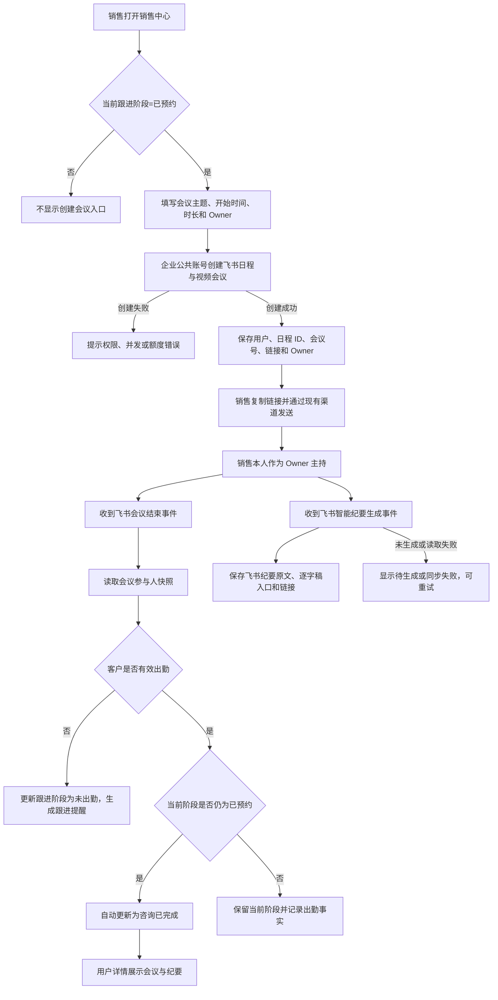

# Lark咨询会议与用户详情回写

> 一句话结论：销售为当前跟进阶段为“已预约”的用户创建飞书咨询会议并分享链接，会议结束后根据飞书参会事实自动判断出勤和咨询完成，同时保存飞书生成的智能纪要原文。
> 版本 / 需求 ID：1.0 / REQ-CONSULT-002
> 需求类型：集成与自动化｜补充类型：规则状态与数据、权限与审计
> 更新时间：2026-11-19

> 📌
> - **会议创建**：企业公共账号创建会议，销售本人作为会议 Owner，CRM 自动保存用户、日程和会议链接。
> - **状态回写**：会议结束事件触发结果判断，客户有效出勤后自动将 `已预约` 更新为 `咨询已完成`；客户未出勤时自动将当前跟进阶段更新为 `未出勤`。
> - **纪要存储**：只保存飞书生成的智能纪要原文、逐字稿入口和来源链接，不在 CRM 二次总结或分析。
> - **上线前置条件**：确认企业会议并发、高清会议用量、智能纪要额度及应用／账号权限。
> - **不做**：不重新生成会议摘要，不自动提取试课表现、购买意向或下一步建议，不自动向用户发送会议链接。

## 交互原型

[打开完整交互原型](https://h3-ai-lab.github.io/hhhprd/projects/crm-consultation-meeting/prototype/)

原型可在同一地址切换中文和英文，覆盖销售列表创建会议、复制链接、跟进阶段流转、用户详情会议记录和飞书纪要原文查看。

## 要解决什么

当前销售完成预约后，需要另行在飞书创建会议、复制链接并发送给用户。会议是否实际发生、客户是否出席以及咨询是否完成，仍依赖销售手工确认；飞书生成的会议纪要也没有沉淀到 CRM 用户档案。

本期把会议创建、链接分享、参会结果判断和纪要归档串成一条闭环，同时保持 CRM 对业务结果的判断可追溯。

## 范围

**做**

- 当前跟进阶段为 `已预约` 的用户显示 `创建 Lark 会议`。
- 企业公共账号创建带视频会议的日程，销售本人作为会议 Owner。
- 创建成功后保存会议链接、日程 ID、会议号和会议状态，并支持复制链接。
- 监听飞书会议结束事件，读取参会人快照，判断客户出勤和咨询完成。
- 符合条件时自动将当前跟进阶段从 `已预约` 更新为 `咨询已完成`。
- 客户未出勤时自动将当前跟进阶段更新为 `未出勤`。
- 监听飞书智能纪要生成事件，保存纪要原文、逐字稿入口和飞书链接。
- 用户详情增加 `咨询会议` 分组；销售可查看会议时间、Owner、参会结果、跟进阶段和纪要。
- 支持同步失败重试和出勤结果自动回写。

**不做**

- 不修改用户状态、购买意向、销售咨询预约或预约外呼字段。
- 不为销售列表新增会议相关默认列、筛选器或排序能力。
- 不将 `销售咨询预约=已预约` 当作会议创建条件。
- 不自动总结纪要，不输出试课评价、意向等级、购买概率或下一步建议。
- 不自动通过 WhatsApp、LINE、短信或其他渠道发送会议链接。
- 不自动回退已经进入付费、关闭或其他后续阶段的用户。
- 不保存录制音视频原文件。

## 主流程



## 现状核对

销售中心当前使用：

- 筛选字段：`当前跟进阶段`。
- 列表字段：`跟进阶段`。
- `用户状态`：表达未付费、体验中、已付费等用户状态，不是销售流程阶段。
- `销售咨询预约`：由用户预约记录派生，只表示是否提交过咨询预约。

本需求的入口条件只使用 `当前跟进阶段=已预约`。`销售咨询预约=已预约` 的用户仍可能是其他跟进阶段，不能据此显示创建会议入口。

线索未形成明确会议结果时，继续使用现有具体跟进阶段；会议结果判定为未出勤时，当前跟进阶段同步更新为新增的 `未出勤`。

## 需求一：创建并分享咨询会议

### 页面入口

- 销售中心 `我的跟进`、`公海` 或其他可见线索列表中，仅当用户的 `当前跟进阶段=已预约` 时，行操作区显示 `创建 Lark 会议`。
- 当前跟进阶段不是 `已预约` 时，不显示该入口。
- 同一用户存在待开始会议时，入口改为 `查看待开始会议`，避免继续创建重复会议。
- 用户详情 `咨询会议` 分组提供相同入口，权限和阶段条件与销售中心一致。

### 创建表单

| 字段 | 规则 |
|---|---|
| 用户 | 只读，取当前 CRM 用户 |
| 会议主题 | 默认“顾问咨询 - 用户姓名”，允许修改 |
| 开始时间 | 必填，默认取最近一次预约时间对应的业务日期；已过去的时间需重新选择 |
| 时长 | 必填，默认 30 分钟，可选 15、30、45、60 分钟 |
| 销售 Owner | 默认当前销售，只读；拥有跨团队创建权限的组长或管理员可选择当前业务线内销售 |
| 用户触达方式 | 只读显示当前可用的 WhatsApp、LINE 或其他已配置渠道，仅用于提醒销售复制链接后发送 |

### 创建结果

- 创建成功后显示会议主题、开始时间、销售 Owner、会议号和会议链接。
- 自动复制会议链接；浏览器禁止复制时展示链接和 `再次复制` 按钮。
- 提供 `打开 Lark 会议`。该按钮打开飞书官方会议链接，由客户端或浏览器承接。
- CRM 只创建和复制链接，不自动向用户发送。
- 创建成功后保存 `calendar_event_id`、会议号、会议链接和初始会议状态；实际 `meeting_id` 在会议开始或结束后补全。
- 同一用户允许创建多次历史会议，但一次提交只能生成一个日程。
- 创建失败时不保存半成品记录、不改变跟进阶段，并向销售展示失败原因。

### 会议状态

| 状态 | 判定 |
|---|---|
| 待开始 | 日程已创建，未收到会议开始事件 |
| 进行中 | 已收到会议开始事件，未收到结束事件 |
| 已结束待判断 | 已收到会议结束事件，尚未完成参会人判断 |
| 已出勤 | 客户有效参会且会议正常结束 |
| 未出勤 | 会议正常结束，但没有识别到客户有效参会 |
| 已取消 | 日程被取消，或会议未开始且已超过计划结束时间 |
| 同步失败 | 会议或纪要靠回查失败，等待重试 |

## 需求二：出勤和咨询完成判断

### 事件节点

- 飞书 `会议结束` 事件是参会结果判断的触发节点。
- CRM 收到结束事件后，以 `meeting_id` 查询会议参与人快照、实际开始时间和实际结束时间。
- 飞书 `智能纪要已生成` 事件只触发纪要同步，不能单独证明用户出勤，也不能触发跟进阶段变更。
- 飞书 `会议开始` 事件只用于把会议状态更新为 `进行中`，不改变跟进阶段。
- 重复事件按飞书事件 ID 去重；乱序到达时按业务发生时间更新，阶段更新只在当前阶段仍为 `已预约` 时执行。

### 客户出勤判定

每条会议链接只对应一个 CRM 用户。会议结束后，按下述顺序判断：

1. 能从飞书参与人身份稳定对应到 CRM 用户时，以该参与人的累计在会时长判断。
2. 客户没有飞书身份、以游客加入时，以本次唯一会议链接中的非销售 Owner 参与者判断。
3. 以本次唯一会议链接关联的全部非 Owner 参与者为统计范围，不因参与者身份无法逐一区分而进入人工确认。
4. 任一非 Owner 参与者累计在会时长大于 1 分钟，判定为 `已出勤`。
5. 没有任何非 Owner 参与者，或所有非 Owner 参与者累计在会时长均不超过 1 分钟，判定为 `未出勤`。

出勤仅由上述参会时长判定，不设置人工确认状态，也不由销售手工改写。

### 咨询完成与测试课完成

- 客户 `已出勤` 且会议正常结束，即满足本期 `咨询已完成` 判断。
- 客户 `未出勤` 时，不满足 `咨询已完成`。
- 本需求判断的是会议参与和咨询完成，不判断体验课是否完成。体验课完成仍以课程系统记录为准。
- 纪要是否生成不影响跟进阶段判断。

### 跟进阶段迁移

| 当前阶段 | 会议结果 | 目标阶段 | 其他处理 |
|---|---|---|---|
| 已预约 | 已出勤且会议正常结束 | 咨询已完成 | 保存会议结果；纪要到达后补充纪要 |
| 已预约 | 未出勤 | 未出勤 | 保存未出勤结果，更新当前跟进阶段，生成跟进提醒 |
| 咨询已完成或后续阶段 | 任意 | 保持当前阶段 | 只保存会议事实，不回退阶段 |
| 暂不跟进、已关闭、已付费 | 任意 | 保持当前阶段 | 只保存会议事实，不覆盖人工业务判断 |

自动更新只执行一次，不覆盖之后的销售人工流转。阶段更新成功和失败均记录审计。

## 需求三：保存飞书智能纪要

### 纪要来源

CRM 只接收飞书生成的智能纪要，支持保存：

- 纪要 ID 和来源会议 ID。
- 纪要标题。
- 飞书智能纪要正文原文。
- 飞书智能纪要链接。
- 逐字稿文档标识或逐字稿链接。
- 纪要生成时间和 CRM 最近同步时间。

销售可在用户详情打开纪要原文弹窗或跳转飞书文档查看。CRM 展示原文时不改写结构、不合并总结、不增加意向或试课结论。

### 同步规则

- 收到 `智能纪要已生成` 事件后同步一次。
- 用户主动打开纪要或点击 `重新同步` 时，可再次获取最新原文。
- 多数情况下以最后一次成功同步的原文快照展示；若飞书原文更新，保留来源链接并由同步操作刷新快照。
- 会议已结束但纪要未生成时显示 `纪要待生成`。
- 纪要接口无权限、被删除或读取失败时显示 `同步失败`，同时展示失败时间和重试入口。
- 多次打开或重复事件不能生成重复纪要记录；同一 `note_id` 只保留一条 CRM 纪要。

### 会议结果与纪要独立

- 没有纪要，仍可依据参会结果完成跟进阶段更新。
- 客户未出勤，即使飞书生成了纪要，也不自动进入 `咨询已完成`。
- 纪要内容不参与阶段判断，避免把 AI 文本当作业务事实。

## 需求四：用户详情展示

用户详情沿用现有页面的信息展示方式，不改造用户中心整体导航或基础资料结构：

- 页面顶部展示 `用户详情 · 用户姓名`，右上角保留 `返回销售中心`。
- `基本信息` 使用现有双列字段表，保留用户 ID、学生姓名、购买意向、用户状态、用户类型、年龄段、课程等级、登录账号、渠道来源-落地页、渠道 code、渠道来源-App、业务线、注册时间、CC、英语学习程度和学习目的。
- `咨询会议` 位于基本信息之后，使用同页表格展示会议主题、参会结果、计划时间、实际时间、客户在会时长、纪要和操作。
- 咨询会议按计划开始时间倒序展示；没有会议时展示 `暂无会议记录`。

咨询会议字段：

| 信息 | 展示规则 |
|---|---|
| 计划时间 | 计划开始和结束时间 |
| 实际时间 | 实际开始和结束时间；未开始时显示 `—` |
| 销售 Owner | 显示创建时销售姓名和账号状态，离职后保留快照 |
| 会议状态 | 待开始、进行中、已结束待判断、已出勤、未出勤、已取消、同步失败 |
| 跟进阶段 | 展示会议结果造成的当前跟进阶段，不保存阶段历史副本 |
| 时长 | 实际会议时长；无实际开始或结束时间显示 `—` |
| 纪要 | 纪要标题和 `查看纪要`；无纪要时显示 `待生成` 或 `同步失败` |
| 操作 | `查看会议链接`、`复制链接`、`重新同步` |

不展示对纪要内容的二次分析结果。不将飞书会议链接或纪要正文加入用户列表、销售列表默认列。

## 套餐权限与上线前置条件

上线前必须由企业飞书超级管理员、IT 管理员或采购负责人书面确认以下权益，并将确认结果作为项目上线材料归档：

| 确认项 | 要求 |
|---|---|
| 同时会议数 | 明确当前企业租户是否存在同时进行会议数的硬上限 |
| 高清视频会议用量 | 确认年度可用分钟数、增购规则和超量限制 |
| 单场参会人数 | 确认真实套餐下的单场设备数上限 |
| 智能纪要额度 | 确认企业级额度、账号范围、余量和超量规则 |
| 自动录音 / 纪要能力 | 分别确认是否开通，不能以自动录制代替智能纪要 |
| 应用权限 | 确认公共账号创建会议、设置销售为 Owner、读取会议和纪要均具备权限 |
| 销售账号权限 | 确认销售账号可以主持、查看纪要和转写内容 |

产品行为：

- 套餐能力未确认或额度和权限不满足时，本需求不得上线。
- 创建会议因并发、分钟额度或权限失败时，页面提示对应原因，不发送“会议已创建”。
- 套餐额度、并发达到上限时，不自动修改用户跟进阶段。
- 企业级开通不代表每场会议一定生成纪要；CRM 始终以是否收到纪要生成事件为准。

## RBAC 权限数据

### 功能权限

| 页面/资源 | 操作 | 业务含义 | 默认角色 | 数据范围 | 审计 |
|---|---|---|---|---|---|
| 销售中心咨询会议 | 查看 | 查看线索已有会议和会议链接 | 销售专员、销售组长、管理员、超级管理员 | 沿用销售中心线索数据权限 | 否 |
| 销售中心咨询会议 | 创建 | 为已预约用户创建飞书会议 | 销售专员、销售组长、管理员、超级管理员 | 仅归属本人；组长含团队；管理员及超级管理员按业务线权限 | 是 |
| 销售中心咨询会议 | 复制链接 | 复制会议链接进行现有渠道触达 | 有查看权限且为当前 Owner、组长或管理员 | 与查看权限一致 | 否 |
| 销售中心咨询会议 | 重新同步 | 重新获取会议和纪要 | 销售组长、管理员、超级管理员 | 与销售中心线索数据权限一致 | 是 |
| 用户详情咨询会议 | 查看 | 查看用户会议记录和飞书纪要原文 | 销售专员、销售组长、管理员、超级管理员 | 沿用用户详情和用户业务线范围 | 否 |
| 用户详情咨询会议 | 重新同步 | 重新获取会议和纪要 | 销售组长、管理员、超级管理员 | 与用户详情数据范围一致 | 是 |

### 字段与数据权限

| 字段组/列表 | 可见角色 | 编辑角色 | 脱敏/隐藏 | 可导出 | 候选范围限制 |
|---|---|---|---|---|---|
| 会议链接 | 有咨询会议查看权限的角色 | 不可编辑 | 无权时完全隐藏 | 本期不导出 | 仅当前权限范围内用户 |
| 会议时间、Owner、参会结果 | 有咨询会议查看权限的角色 | 不可编辑，参会结果由系统判定 | 无权时完全隐藏 | 本期不导出 | 仅当前权限范围内用户 |
| 飞书纪要原文、逐字稿入口 | 有用户详情或销售中心数据权限的角色 | 不可编辑 | 无权时完全隐藏 | 本期不导出 | 仅当前会议关联用户 |
| 跟进阶段变更结果 | 有销售中心查看权限的角色 | 系统自动更新或按销售阶段现有规则人工更新 | 不适用 | 沿用现有销售中心权限 | 仅当前权限范围内线索 |

### 权限数据变更

| 变更类型 | 权限层级 | 权限项 | 业务说明 | 默认角色/数据范围 | 是否新增审计 |
|---|---|---|---|---|---|
| 新增 | 动作 | `crm.sales_center.consultation_meeting.view` | 查看销售中心咨询会议 | 销售专员、销售组长、管理员、超级管理员；沿用线索数据权限 | 否 |
| 新增 | 动作 | `crm.sales_center.consultation_meeting.create` | 创建飞书咨询会议 | 销售专员、销售组长、管理员、超级管理员；按当前线索权限 | 是 |
| 新增 | 动作 | `crm.sales_center.consultation_meeting.resync` | 重试会议和纪要同步 | 销售组长、管理员、超级管理员 | 是 |
| 新增 | 动作 | `crm.user_center.consultation_meeting.view` | 在用户详情查看咨询会议 | 销售专员、销售组长、管理员、超级管理员；沿用用户数据权限 | 否 |
| 新增 | 动作 | `crm.user_center.consultation_meeting.resync` | 在用户详情重试同步 | 销售组长、管理员、超级管理员 | 是 |
| 复用 | 字段 | 现有 `当前跟进阶段` 编辑权限 | 自动写入 `咨询已完成` 或 `未出勤`，仍受阶段权限体系约束 | 现有销售角色与数据范围 | 是，记录系统来源 |

### 审计要求

- 记录会议创建、重新同步、系统出勤判定和自动阶段变更。
- 审计包含操作人或系统来源、时间、用户 ID、线索 ID、会议 ID、变更前后阶段、失败原因和外部事件 ID。
- 审计不可由业务人员修改或删除，保留时长沿用 CRM 操作日志策略。

## 数据与依赖

| 数据/系统 | 来源 | 唯一标识 | 时效/失败处理 |
|---|---|---|---|
| CRM 用户与线索 | 用户中心、销售中心 | `user_id`、`lead_id` | 关联失败时不创建会议 |
| 飞书日程 | 企业公共账号 | `calendar_id + calendar_event_id` | 创建失败不保存半成品，不修改阶段 |
| 飞书会议 | 会议结束事件及会议详情 | `meeting_id` | 结束后实时判断；回查失败进入同步失败并可重试 |
| 飞书会议开始事件 | 销售 Owner 的会议事件 | 飞书事件 ID | 重复事件去重，只更新进行中状态 |
| 飞书会议结束事件 | 销售 Owner 的会议事件 | 飞书事件 ID | 触发出勤判断；缺失时显示待判断并进入补偿 |
| 飞书智能纪要 | 纪要生成事件及纪要详情 | `note_id` | 独立于阶段判断；失败显示待生成或同步失败 |
| 企业套餐权益 | 飞书管理后台、合同及客户成功确认 | 租户 ID | 上线前确认；未确认不得上线 |

## 用户操作路径

```text
销售中心 → 找到当前跟进阶段=已预约的用户 → 创建 Lark 会议
       → 填写时间和时长 → 创建并复制链接 → 通过现有渠道发送给用户
       → 销售作为 Owner 主持 → 会议结束事件到达
       → CRM 判断客户出勤
       ├─ 有效出勤 → 自动进入咨询已完成
       └─ 未出勤 → 自动进入未出勤阶段
       → 飞书智能纪要生成 → 原文保存 → 用户详情查看
```

## 异常与边界

- **重复点击**：同一创建请求只生成一个日程；待开始会议存在时不重复创建。
- **创建并发**：同一用户同时发起两个创建请求时，仅一个成功，另一个提示已有待开始会议。
- **套餐或权限失败**：不显示创建成功，不保存会议链接，不修改阶段。
- **结束事件重复或乱序**：按飞书事件 ID 去重；阶段只在仍为 `已预约` 时自动更新。
- **会议未实际开始**：计划结束时间后仍无开始和结束事件时，标记 `已取消` 或 `未开始`，保留 `已预约`。
- **客户未出勤**：将当前跟进阶段更新为 `未出勤`，会议结果记录为 `未出勤`，生成跟进提醒。
- **客户身份无法逐一区分**：不阻断自动判定，统一按本次会议链接中的非 Owner 参与者累计在会时长判断。
- **阶段已被人工修改**：不覆盖、不回退当前阶段，只记录会议事实和驳回原因。
- **纪要延迟或缺席**：阶段仍按出勤事实更新；纪要显示 `待生成`，后续事件到达后补齐。
- **纪要权限失效**：保留失败状态和失败时间，不展示旧内容为新内容，允许有权限角色重试。
- **销售离职或停用**：历史会议保留原销售姓名和 ID 快照；停用账号立即失去操作权限，当前线索按现有流程转派，新 Owner 可继续创建后续会议。
- **历史数据**：上线前已存在的线下咨询和飞书会议不回填为自动判断结果，只在人工补录后展示。
