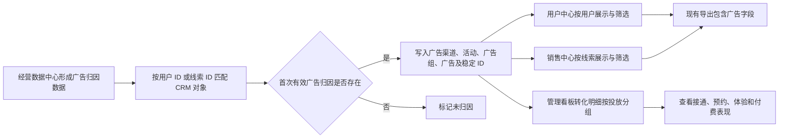
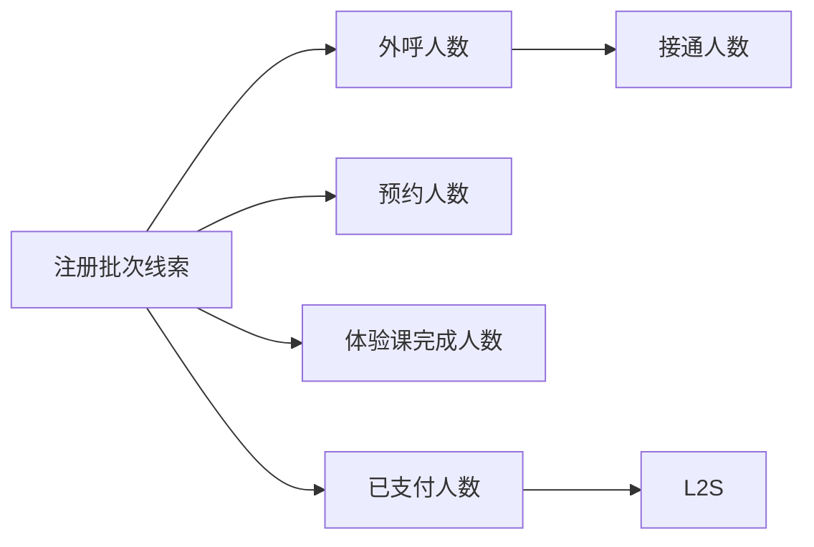

# CRM 线索质量分析

> 在 CRM 用户中心、销售中心和管理看板增加广告渠道、活动、广告组和广告归因，用同一批 Leads 的接通、预约、体验课完成和付费结果判断广告来源质量。
> 需求编号：REQ-LQA-001｜状态：评审后修订｜更新时间：2026-11-17
> 需求类型：看板与指标｜补充类型：表单字段列表、集成自动化、权限与审计
> 文档修订：v1.1｜基线：v1.0（2026-11-17）｜本页为本次变更评审版
> 标记说明：[新增/修改后] 红色表示本版现行内容；[删除/修改前] 删除线表示内容已失效。

## 交互原型

[打开完整交互原型](https://h3-ai-lab.github.io/hhhprd/projects/crm-lead-quality-analysis/prototype/)

原型包含用户中心、销售中心和管理看板三个入口，可在同一地址切换中文和英文。

## 目标与范围

### 业务目标

业务需要知道广告渠道、活动和广告带来的 Leads 在 CRM 中是否真正接通、预约、完成体验课并付费，而不是只看广告平台产生的安装或表单。

本需求建立一条可追溯链路：

`广告渠道 → 活动 → 广告组 → 广告 → CRM Leads → 外呼、预约、体验和付费结果`

### 本期做

- 在用户中心和销售中心增加广告四级筛选与只读字段；<ins>[新增] 四个广告筛选分别支持多选，业务线保持单选。</ins>
- 在管理看板“转化总览”和“销售跟进”的“转化明细”中，给“先按”和“再按”增加 `投放` 分组方式。
- 用户中心和销售中心现有导出包含广告归因字段。
- 保存广告稳定 ID、展示名称和首次有效归因时间。
- 历史数据在能够通过用户或线索稳定 ID 关联时回填；无法确认时显示“未归因”。

### 本期不做

- 不展示广告费用、曝光、点击、CTR、CPL、CPA、ROAS 或广告平台归因报表。
- 不在经营数据中心建设新页面，数据中心只作为 CRM 的广告归因数据来源。
- <del>[原] 不修改线索分配、领取、掉库、转派、跟进、预约、课程或订单规则。</del> <ins>[现行] 不改变线索分配策略；仅新增跨业务线批量分配校验，选中线索包含多个业务线时阻止提交。</ins>
- 不根据广告名称或手机号猜测归因关系。
- 不新增用户中心、销售中心或管理看板菜单。
- 不新增列表排序能力。
- <ins>[新增] 本期不建设按角色自定义筛选器可见性、字段自定义和默认折叠；筛选区拥挤问题后续单独立项。</ins>

## 端到端流程





同一批 Leads 可以跳过部分阶段，各阶段数量不强制逐级递减。

## 广告归因规则

### 归因对象

- 用户中心按 `user_id` 展示该用户首次有效广告归因。
- 销售中心按 `lead_id` 展示该线索继承的首次有效广告归因。
- 管理看板使用线索对应的广告归因，并沿用现有看板的用户 ID 去重口径。
- 同一用户产生多条线索时，每条线索必须有可确认的归因映射；不能仅凭用户当前广告字段批量覆盖全部历史线索。

### 首次有效归因

- 用户或线索首次获得完整且可验证的广告触点时，写入广告归因。
- 后续广告点击、再次留资或新渠道进入只追加来源，不覆盖首次有效广告归因。
- 归因必须能确认到至少一个稳定层级 ID；只有名称、没有稳定 ID 的数据不视为有效归因。
- 一次归因快照包含 `media_source`、活动、广告组、广告及各自稳定 ID。
- 广告名称后续修改时，历史归因关系不变；页面使用来源字典中的最新可见名称，导出同时保留名称快照和稳定 ID。

### 归因层级

| 业务名称 | 稳定标识 | 展示规则 |
|---|---|---|
| 广告渠道 | `media_source` | 展示渠道标准名称，如 Meta、TikTok、Google |
| 活动 | `campaign_id` | 展示 `campaign_name`，详情和导出保留 ID |
| 广告组 | `adset_id` | 展示 `adset_name`，详情和导出保留 ID |
| 广告 | `ad_id` | 展示 `ad_name`，详情和导出保留 ID |

广告层级按实际来源逐级填写。较高层级存在、较低层级缺失时，已有层级正常展示，缺失层级显示 `—`。广告渠道为空时统一显示“未归因”，不能自动归类为自然流量。

## 现状与字段顺序

现状核对基线为 2026-11-10 已归档页面快照；本需求不改变既有字段的相对顺序。

### 用户中心

现有筛选顺序：

`搜索 → 用户类型 → 注册方式 → 渠道来源-落地页 → 渠道来源-App → 业务线 → 用户状态 → 导出`

现有列表顺序：

`用户 ID → 学生姓名 → 用户状态 → 用户类型 → 年龄段 → 课程等级 → 注册方式 → 登录账号 → 短信验证码 → 渠道来源-落地页 → 操作`

目标筛选顺序：

`搜索 → 用户类型 → 注册方式 → 渠道来源-落地页 → 渠道来源-App → 广告渠道 → 活动 → 广告组 → 广告 → 业务线 → 用户状态 → 导出`

目标列表顺序：

`用户 ID → 学生姓名 → 用户状态 → 用户类型 → 年龄段 → 课程等级 → 注册方式 → 登录账号 → 短信验证码 → 渠道来源-落地页 → 广告渠道 → 活动 → 广告组 → 广告 → 操作`

### 销售中心

公海、我的跟进和已付费使用同一组广告筛选和字段。通话记录不在本需求新增广告字段。

现有筛选顺序：

- 第一行：`搜索 → 业务线 → 购买意向 → CC`
- 第二行：`当前跟进阶段 → 年龄段 → 课程等级 → 渠道来源-落地页 → 渠道来源-App`
- 第三行：`用户状态 → 销售咨询预约 → 预约外呼 → 注册日期 → 开始日期 → 结束日期`
- 操作区：`重置筛选 → 导入 leads → 下载数据`

现有列表顺序：

`用户 ID → 学生姓名 → 购买意向 → 用户状态 → 用户类型 → 年龄段 → 课程等级 → 登录账号 → 渠道来源-落地页 → 操作`

目标筛选顺序：

- 在第二行 `渠道来源-App` 之后增加：`广告渠道 → 活动 → 广告组 → 广告`
- 其余现有筛选保持原顺序。

目标列表顺序：

`用户 ID → 学生姓名 → 购买意向 → 用户状态 → 用户类型 → 年龄段 → 课程等级 → 登录账号 → 渠道来源-落地页 → 广告渠道 → 活动 → 广告组 → 广告 → 操作`

### 管理看板

现有筛选区顺序：

`业务线 → CC → 注册日期及起止日期`

现有“转化总览”页展示：

`线索数（含已付费）→ 外呼人数 → 接通人数 → 预约人数 → 体验课完成人数 → 已支付人数 → L2S`

现有“转化明细”分组方式：

- 先按：`注册日期 / 当前 CC`
- 再按：`不再细分 / 当前 CC`

目标分组方式：

- 先按：`注册日期 / 当前 CC / 投放`
- 再按：`不再细分 / 当前 CC / 投放`

“投放”放在现有“转化明细”的“先按 / 再按”选项组内，不新增顶部广告筛选行。选择“投放”后，在该选项旁显示投放层级：

`广告渠道 / 活动 / 广告组 / 广告`

“转化总览”和“销售跟进”均提供上述能力；支付结果页不新增投放分组。

### 字段顺序比对

| 页面 | 现有字段/位置 | 新增或调整 | 目标位置 | 变更原因 |
|---|---|---|---|---|
| 用户中心筛选 | 渠道来源-App 后为业务线 | 新增广告渠道、活动、广告组、广告 | 渠道来源-App 之后 | 与现有来源筛选归为同一组 |
| 用户中心列表 | 渠道来源-落地页后为操作 | 新增四个广告字段 | 渠道来源-落地页之后、操作之前 | 保持来源字段连续 |
| 销售中心筛选 | 渠道来源-App 后进入用户状态行 | 新增四个广告筛选 | 渠道来源-App 之后 | 保留现有业务筛选顺序 |
| 销售中心列表 | 渠道来源-落地页后为操作 | 新增四个广告字段 | 渠道来源-落地页之后、操作之前 | 保持来源字段连续 |
| 管理看板“转化明细”先按 | 注册日期、当前 CC | 新增投放 | 当前 CC 之后 | 支持以投放为主分组 |
| 管理看板“转化明细”再按 | 不再细分、当前 CC | 新增投放 | 当前 CC 之后 | 支持在首层分组下继续按投放细分 |
| 管理看板内容 | 现有六环和 L2S | 明细增加投放分组列 | 指标卡之后的转化明细 | 查看投放来源的业务表现 |

## 页面与交互

### 公共字段

| 字段 | 类型与来源 | 编辑规则 | 空值规则 | 权限 | 排序 |
|---|---|---|---|---|---|
| 广告渠道 | 标准枚举，来源 `media_source` | 只读；来自归因快照 | 无时显示“未归因” | 随页面查看权限 | 不支持；用户中心、销售中心和看板均不新增排序 |
| 活动 | 文本，来源 `campaign_name` + `campaign_id` | 只读 | 缺失显示 `—` | 随页面查看权限 | 不支持；页面未提供可排序表头 |
| 广告组 | 文本，来源 `adset_name` + `adset_id` | 只读 | 缺失显示 `—` | 随页面查看权限 | 不支持；页面未提供可排序表头 |
| 广告 | 文本，来源 `ad_name` + `ad_id` | 只读 | 缺失显示 `—` | 随页面查看权限 | 不支持；页面未提供可排序表头 |

### 筛选交互

- <ins>[新增] 广告渠道、活动、广告组、广告分别支持多选；业务线筛选保持单选。</ins>
- 四级筛选允许任意一级单独使用，也允许组合使用。
- 选择广告渠道后，活动候选仅包含该渠道数据；活动、广告组和广告依次联动。
- 修改上级筛选时，清空不再属于新范围的下级选择。
- 每级均提供“全部”选项；清空全部广告条件后恢复当前页面原有数据范围。
- 活动、广告组和广告名称通过搜索选择，不一次加载全部历史数据。
- 筛选候选只包含当前操作人业务线及数据范围内至少关联一条可见用户或线索的广告对象。
- 筛选条件在页签切换、翻页和语言切换时保留。
- 筛选无结果、无权限、加载失败和数据未同步使用不同状态。
- <ins>[新增] 多选项以标签展示已选值，支持逐个移除和一键清空；选择数量不改变当前页签和数据权限。</ins>

### 批量分配校验

- <ins>[新增] 批量选择线索执行分配时，先校验选中线索的业务线集合。</ins>
- <ins>[新增] 若选中线索跨越多个业务线，按当前分配规则无法确定唯一目标范围，阻止提交并提示用户缩小选择范围。</ins>
- <ins>[新增] 单一业务线的批量分配沿用现有规则，不改变分配策略、候选成员或掉库逻辑。</ins>

### 用户中心

- 用户列表展示首次有效广告归因。
- 广告字段位于现有“渠道来源-落地页”之后。
- 现有导出包含四个广告字段，并额外输出 `campaign_id`、`adset_id` 和 `ad_id`。
- 现有用户查询、资料与会员操作不因广告字段变化。

### 销售中心

- 公海、我的跟进和已付费均展示相同广告字段。
- 切换页签时保留广告筛选，并按新页签原有业务条件重新查询。
- 现有下载数据包含四个广告字段和三个稳定 ID。
- 广告字段为只读，不参与领取、分配、转派、跟进或外呼操作。

### 管理看板

- “转化总览”和“销售跟进”的“转化明细”保留现有“先按 / 再按”交互，只各增加一个 `投放` 选项。
- 选择“投放”后，在同组显示投放层级选择：广告渠道、活动、广告组或广告，默认选择广告渠道。
- “先按”和“再按”都选择“投放”时，两级投放层级必须不同；选择相同层级时不应用查询并提示调整。
- “再按”保持“不再细分”时，只展示“先按”分组。
- 投放分组列展示名称；活动、广告组和广告同时展示稳定 ID。
- 顶部业务线、CC、注册日期筛选保持原位置和原规则，不新增广告筛选器。
- 切换“转化总览”和“销售跟进”时保留当前先按、再按和投放层级选择。
- 支付结果页不增加投放分组。
- 指标卡和转化明细使用同一筛选集合，不展示任何媒体投放指标。

## 指标具体口径

### 公共统计口径

- **业务对象**：CRM 线索及其关联用户；用户中心和销售中心保留各自现有对象粒度，管理看板沿用现有注册批次口径。
- **统计范围**：业务线、CC、注册日期筛选后的线索集合，再按当前投放分组展开。
- **时间字段**：使用线索注册日期选择 cohort；日期起止均包含。
- **后续结果窗口**：从线索注册时间起统计至页面当前有效数据截止时间。
- **去重键**：管理看板全部指标沿用现有“按用户 ID 去重”口径；同一用户多次外呼、预约、体验或支付只计一次。
- **业务线时区**：按各业务线现行时区解释注册日期。
- **数据截止时间**：页面展示来源数据最近一次完整快照时间。
- **零分母**：显示 `—` 和 `0 / 0`，不显示 `0%`。
- **比率精度**：保留一位小数；异常超过 100% 时原样展示，不截断。

### 指标定义

| 指标 | 分子 | 分母 | 单位 | 页面与业务用途 |
|---|---|---|---:|---|
| 线索数 | 统计范围内去重的线索用户数 | — | 条 | 指标卡和转化明细；表示投放带来的线索规模 |
| 外呼人数 | 至少存在一条有效外呼记录的用户数 | — | 人 | 指标卡和转化明细；表示销售触达覆盖 |
| 接通人数 | 至少存在一条外呼结果为接通的用户数 | — | 人 | 指标卡和转化明细；表示广告线索可触达程度 |
| 预约人数 | 至少存在一次有效咨询预约的用户数 | — | 人 | 指标卡和转化明细；表示接通后的预约表现 |
| 体验课完成人数 | 至少完成一次有效体验课的用户数 | — | 人 | 指标卡和转化明细；表示体验履约表现 |
| 已支付人数 | 至少存在一笔有效已支付订单的用户数 | — | 人 | 指标卡和转化明细；表示最终付费表现 |
| L2S | 已支付人数 | 线索数 | 百分比 | 指标卡和转化明细；线索到付费转化 |

每个指标卡和指标列右上角提供“口径”角标，展示分子、分母、统计范围、时间字段、去重键和零分母规则。

指标允许阶段跳跃，例如未接通但已预约、未预约但完成体验课或直接付费；各阶段人数不强制小于上一阶段。

## 转化明细

| 先按分组 | 再按分组 | 线索数 | 外呼人数 | 接通人数 | 预约人数 | 体验课完成人数 | 已支付人数 | L2S |
|---|---|---:|---:|---:|---:|---:|---:|---:|
| 按所选主分组展示 | 按所选次分组展示；选择“不再细分”时隐藏本列 | 当前分组去重线索数 | 当前分组去重外呼人数 | 当前分组去重接通人数 | 当前分组去重预约人数 | 当前分组去重体验人数 | 当前分组去重已支付人数 | 已支付人数 / 线索数 |

分组列按“先按 → 再按”排列，并与指标列相邻。投放列在名称下显示稳定 ID；未归因数据单独成组；无匹配分组时不显示空行。

## 数据中心来源

### 来源范围

经营数据中心提供广告归因来源，不直接作为本需求的用户页面。

| 数据 | 最小内容 | 唯一标识 | 时效与失败处理 |
|---|---|---|---|
| 广告字典 | 渠道、活动、广告组、广告及各级名称 | 各级稳定 ID | 名称更新不改变 ID；加载失败保留最近成功字典 |
| 用户广告归因 | `user_id`、四级广告字段、首次归因时间 | `user_id` + 广告层级 ID | 同一用户只采用首次有效归因 |
| 线索广告归因 | `lead_id`、四级广告字段、首次归因时间 | `lead_id` + 广告层级 ID | 新事件重复或乱序不覆盖首次有效归因 |
| 数据快照时间 | 最近一次完整同步时间 | 快照 ID | 页面显示数据截止时间，不把未同步解释为零 |

### 同步与一致性

- 广告归因同步随数据中心有效快照更新。
- 同一业务事件重复同步产生相同结果，不重复写入。
- 同一用户或线索出现多个候选归因时，只采用首次有效广告归因；若首次有效时间相同且无法判定先后，保留原有已确认归因并进入数据异常处理。
- 广告 ID 无法映射到名称时，页面显示稳定 ID；不能在用户页面展示空名称。
- 来源数据完全不可用时，用户中心和销售中心保留最近成功的只读字段；管理看板展示最近完整快照及更新时间。

## RBAC 权限数据

### 功能权限

| 页面 / 动作 | 默认角色 | 数据范围 | 审计 |
|---|---|---|---|
| 用户中心查看广告字段与筛选 | 复用用户中心现有查看角色 | 现有业务线及用户数据范围 | 普通查询不记录 |
| 销售中心查看广告字段与筛选 | 复用销售中心现有查看角色 | 现有业务线、团队和本人线索范围 | 普通查询不记录 |
| 管理看板转化明细按投放分组 | 复用管理看板现有查看角色 | 现有业务线、团队和 CC 范围 | 普通查询不记录 |
| 用户中心导出 | 需现有用户中心导出权限 | 与用户中心查看范围取交集 | 记录操作人、筛选、行数和时间 |
| 销售中心下载数据 | 需现有销售中心导出权限 | 与销售中心查看范围取交集 | 记录操作人、筛选、行数和时间 |
| 管理看板查看指标口径 | 复用管理看板查看角色 | 与当前看板筛选范围一致 | 不单独记录 |

### 字段与数据权限

| 字段组 / 列表 | 可见角色 | 编辑 | 隐藏与异常 | 可导出 | 候选范围限制 |
|---|---|---|---|---|---|
| 用户中心广告归因字段组 | 具备用户中心查看权限的角色 | 无 | 无权限不返回；缺失显示未归因或 `—` | 需现有用户导出权限 | 当前业务线及可见用户范围 |
| 销售中心广告归因字段组 | 具备销售中心查看权限的角色 | 无 | 无权限不返回；缺失显示未归因或 `—` | 需现有销售下载权限 | 当前业务线及可见线索范围 |
| 管理看板投放分组与明细 | 具备“转化总览”或“销售跟进”查看权限的角色 | 无 | 无权限不展示投放选项与分组数据 | 不新增看板导出 | 当前业务线与 CC 数据范围 |
| 广告稳定 ID | 具备对应页面查看权限的角色 | 无 | 随详情和导出提供 | 与所属页面导出权限一致 | 同上 |

### 权限数据变更

| 变更类型 | 权限层级 | 权限项 | 业务说明 | 默认角色 / 数据范围 | 是否新增审计 |
|---|---|---|---|---|---|
| 复用 | 页面 | 用户中心现有查看权限 | 控制广告字段和筛选可见性 | 沿用用户中心当前角色与数据范围 | 否 |
| 复用 | 页面 | 销售中心现有查看权限 | 控制广告字段和筛选可见性 | 沿用销售中心当前角色与线索范围 | 否 |
| 复用 | 页面 | 管理看板现有查看权限 | 控制转化明细的投放分组、指标卡和明细 | 沿用当前角色、业务线和 CC 范围 | 否 |
| 修改 | 导出 | 用户中心现有导出字段清单 | 增加广告名称和稳定 ID | 需现有用户中心导出权限 | 是 |
| 修改 | 导出 | 销售中心现有下载字段清单 | 增加广告名称和稳定 ID | 需现有销售中心导出权限 | 是 |

本需求不新增菜单、页面或动作权限。无广告数据不等于无页面权限；无权限时字段、筛选项和指标均不得返回。

## 历史与员工状态

- 广告归因属于用户和线索的来源事实，不因线索转派、负责人调岗或账号停用而变化。
- 线索转派后，历史广告归因保持不变；管理看板按现有 CC 筛选口径限定线索集合，不重算广告来源。
- 离职或停用员工仍按现有管理看板规则保留在历史 CC 筛选和统计中，并显示现有停用状态。
- 员工离职后的线索交接沿用离职账号管理流程，不改变广告归因、外呼、预约、体验或付费历史。
- 新负责人获得当前线索处理权限，不继承被转派线索的广告来源变更能力。
- 账号停用后立即失去用户中心、销售中心和管理看板访问及导出权限；符合数据权限的现任管理者仍可查看历史业务数据。

## 异常与边界

| 场景 | 页面处理 |
|---|---|
| 无广告归因 | 显示“未归因”，不归入自然流量或任一广告 |
| 仅广告渠道存在 | 广告渠道正常显示，活动、广告组、广告显示 `—` |
| 广告名称为空 | 使用稳定 ID 展示，不隐藏该层级 |
| 广告改名 | ID 和归因关系不变，筛选历史线索仍命中同一广告 |
| 活动名称重复 | 使用稳定 ID 区分，下拉候选同时展示名称和 ID |
| 先按和再按选择同一投放层级 | 不应用查询，提示选择不同投放层级 |
| 用户多次触发广告 | 展示首次有效广告归因，后续触点不覆盖 |
| 历史无法回填 | 标记未归因；不得根据当前广告或用户轨迹推测 |
| 筛选无结果 | 展示筛选无结果状态，不修改筛选条件 |
| 数据同步失败 | 展示最近成功快照、更新时间及同步失败状态 |
| 零分母 | 比率显示 `—` 和 `0 / 0` |
| 比率高于 100% | 原样展示并提示核对阶段事件和数据同步 |
| 权限撤销 | 下一次请求立即隐藏广告字段、筛选、指标和导出 |

## 用户故事

```text
用户支持人员打开用户中心
→ 按一个或多个广告渠道或具体广告筛选
→ 查看用户首次广告归因及当前业务状态
→ 按现有权限导出结果

销售组长打开销售中心
→ 在公海或我的跟进多选广告活动/广告组/广告
→ 查看线索当前跟进阶段和广告来源
→ 批量分配时若选中多个业务线则被拦截

业务负责人打开管理看板
→ 选择业务线、CC和注册日期
→ 在转化明细的“先按”或“再按”选择投放
→ 选择广告渠道、活动、广告组或广告层级
→ 对比线索数、接通、预约、体验和付费表现
→ 打开指标口径确认计算规则
```

## 本次修订记录

| 编号 | 类型 | 位置 | 变更前 | 变更后 | 对开发的影响 |
|---|---|---|---|---|---|
| R-01 | 新增 | 用户中心与销售中心筛选 | 四级广告筛选未明确多选 | 广告渠道、活动、广告组、广告分别支持多选 | 筛选控件和查询参数改为多值 |
| R-02 | 修改 | 业务线筛选 | 与广告筛选规则未区分 | 业务线保持单选 | 业务线查询参数维持单值 |
| R-03 | 修改 | 线索分配边界 | 不修改任何分配规则 | 仅增加跨业务线批量分配拦截 | 批量分配提交前校验业务线集合 |
| R-04 | 新增 | 多选交互 | 仅提供“全部”和单值选择 | 展示已选标签，支持逐个移除和清空 | 增加多选状态展示和联动清理 |
| R-05 | 新增 | 本期边界 | 未说明筛选区拥挤方案 | 不进入按角色字段可见性、自定义字段和默认折叠 | 避免本期扩大页面配置范围 |
