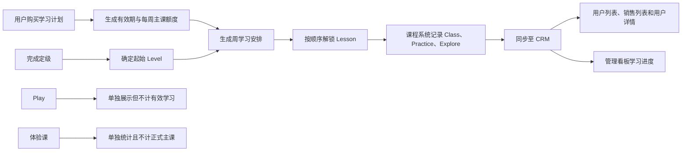

# CRM学习计划与课程进度

> 在用户列表、销售列表、用户详情和管理看板展示用户的学习计划、当前课程进度、学习活跃度与到期风险，帮助 CC 判断跟进节点，并让管理者掌握整体学习情况。
> 需求编号：REQ-LEARN-001｜状态：待评审｜更新时间：2026-11-17
> 需求类型：看板与指标｜补充类型：表单字段列表、集成自动化、权限与审计

## 交互原型

[打开完整交互原型](https://h3-ai-lab.github.io/hhhprd/projects/crm-learning-plan-progress/prototype/)

原型包含用户列表、销售列表、用户详情和管理看板内的学习进度页面，可在同一地址切换中文和英文。

## 目标与范围

### 业务目标

CC 在跟进用户时，需要快速判断当前应提醒学习、继续推进体验、维护学习习惯还是推动续费。管理者需要在不导出数据的情况下掌握学习计划使用率和学习活跃度。

### 本期做

- 用户列表增加学习计划、当前进度、本周进度、最近学习时间和学习状态。
- 销售列表增加同一组学习信息，并支持筛选。
- 用户详情增加完整学习计划、课程进度、学习时长、到期提醒和近期学习记录。
- 管理看板新增“学习进度”页签，展示学习计划、活跃学习、零学习、课次完成和到期预警。
- 统一学习计划、课程体系、周学习安排和 Lesson 的定义与展示。
- 支持用户列表、销售列表按学习计划、学习状态和到期范围筛选。

### 本期不做

- 不修改课程内容、课程顺序、定级规则和学习计划权益。
- 不回写课程系统，不从 CRM 修改学习进度。
- 不把 Play 游戏计入有效学习或课程完成。
- 不把体验课计入正式主课进度。
- 不新增用户、订单或支付流程。
- 不对用户列表和销售列表新增排序能力。
- 不在本需求计算销售业绩、员工绩效或现金奖励。

## 业务流程



## 统一术语

| 术语 | 定义 | 不应混用为 |
|---|---|---|
| 学习计划 | 用户购买的 Pro、Max 等有期限方案，决定有效期、每周主课额度和内容访问范围 | 某个 Level、Unit 或固定课时数量 |
| 周学习安排 | 学习计划在每一周生成的主课额度和练习安排 | 课程体系层级 |
| 课程体系 | 6 个 Level 组成的完整主课路径，共 864 个 Lesson | 学习计划 |
| Level | 能力级别，共 L1–L6；每个 Level 12 个 Unit、144 个 Lesson | 学习计划有效期 |
| Unit | 主题单元；每个 Unit 12 个 Lesson | 一周的学习额度 |
| Learning Cycle | 每 6 个 Lesson 组成的内容分组；每个 Unit 有 2 个 | 固定自然周 |
| Lesson | 最小正式主课课次，约 12–15 分钟，不可重上 | 课后 Practice 或 Play |
| 体验课 | 未购买学习计划用户的试听和定级内容，不属于 864 个正式 Lesson | 正式主课进度 |
| Practice | 课后复习，包含 Words & Sentences、Speaking、Listening 等 | 正式主课课次 |
| Explore | 与课程关联的拓展学习 | 正式主课课次 |
| Play | 单词对战、盲盒等游戏，不计有效学习 | Practice 或 Lesson |

学习计划与课程体系是两条独立数据：

- 学习计划决定用户何时可以学习、每周解锁多少 Lesson。
- 课程体系决定用户按哪个 Level、Unit、Lesson 顺序学习。

## 课程与解锁模型

```text
学习计划
└── 有效期 + 周学习安排

课程体系
└── Level 1–6
    └── Unit 1–12
        └── Learning Cycle 1–2
            └── Lesson 1–6
```

- 正式主课共 `6 × 12 × 12 = 864` 个 Lesson。
- 每个 Level 共 `12 × 12 = 144` 个 Lesson。
- Pro 每周解锁 3 个 Lesson，Max 每周解锁 5 个 Lesson。
- 主课按 Lesson 顺序学习；完成本周额度后，本周不再新增主课。
- Learning Cycle 是 6 个 Lesson 的内容分组，不等同于自然周。
- 按 4 个完整学习周计算，Pro 完成 12 个 Lesson，即 1 个 Unit；Max 完成 20 个 Lesson，即 1 个 Unit 加第 2 个 Unit 的 8 个 Lesson。

## 核心规则

- 用户完成定级后，从指定 Level 的 Unit 1 开始生成个人学习路径。
- 当前周学习安排以业务线时区计算，周起始沿用学习系统的现有规则。
- 本周可学主课数来自当前生效学习计划的周额度。
- 本周剩余可学主课数 = 本周已解锁主课数 − 本周已完成主课数，最小为 0。
- 学习计划到期或失效后，未使用额度不再解锁；已产生的学习历史保留。
- 用户同时只能存在一个有效学习计划；出现重叠有效计划时保留最新有效数据并标记数据异常。
- Lesson 完成、Practice、Explore 和 Play 分别记录，不能用任一行为替代其他行为。
- “正在上课”只采用课程系统明确返回的当前学习会话状态，不用最近学习时间推断。
- 页面时间字段按浏览器所在时区展示；学习周和学习活跃度按业务线时区计算。

## 学习状态

### 学习计划状态

| 状态 | 判定 |
|---|---|
| 未购买 | 用户没有学习计划记录 |
| 未开始 | 学习计划已创建，尚未到生效时间 |
| 生效中 | 当前时间位于学习计划有效期内 |
| 已到期 | 当前时间已超过学习计划结束时间 |
| 已取消 | 学习计划被撤销或退款 |

### 学习活跃状态

| 状态 | 判定 | CC 动作 |
|---|---|---|
| 未开课 | 学习计划生效未满 7 天，且尚无完成 Lesson 或有效学习记录 | 确认定级、首课安排和设备状态 |
| 正在上课 | 课程系统返回用户当前处于 Lesson 学习会话 | 不主动打扰 |
| 近 7 天活跃 | 最近 7 个自然日内至少产生一条有效学习记录 | 结合课程进度正常跟进 |
| 7 天未学习 | 学习计划已生效满 7 天，且最近 7 天没有有效学习记录 | 提醒学习并确认卡点 |
| 已到期 | 学习计划已到期 | 判断续费或停止跟进 |

状态优先级：`已到期 → 正在上课 → 未开课 → 近 7 天活跃 → 7 天未学习`。

### 有效学习

- Class、Practice、Explore 中被课程系统判定为有效完成的学习行为。
- Play 不计入有效学习。
- 体验课单独统计，不进入正式主课完成数。
- 同一学习事件重复回写时按事件 ID 去重。

## 现状与字段顺序

页面现状基于 2026-11-10 已归档 CRM 页面快照：

### 用户列表

现有列顺序：

`用户 ID → 学生姓名 → 用户状态 → 用户类型 → 年龄段 → 课程等级 → 注册方式 → 登录账号 → 短信验证码 → 渠道来源-落地页 → 操作`

目标列顺序：

`用户 ID → 学生姓名 → 用户状态 → 用户类型 → 年龄段 → 课程等级 → 当前学习进度 → 本周进度 → 学习计划 → 最近学习时间 → 学习状态 → 注册方式 → 登录账号 → 短信验证码 → 渠道来源-落地页 → 操作`

现有筛选顺序：

`搜索 → 用户类型 → 注册方式 → 渠道来源-落地页 → 渠道来源-App → 业务线 → 用户状态 → 导出`

目标筛选顺序：

`搜索 → 用户类型 → 注册方式 → 渠道来源-落地页 → 渠道来源-App → 业务线 → 用户状态 → 学习计划 → 学习状态 → 到期范围 → 导出`

### 销售列表

公海、我的跟进和已付费使用同一套学习字段与筛选。

现有列顺序：

`用户 ID → 学生姓名 → 购买意向 → 用户状态 → 用户类型 → 年龄段 → 课程等级 → 登录账号 → 渠道来源-落地页 → 操作`

目标列顺序：

`用户 ID → 学生姓名 → 购买意向 → 用户状态 → 用户类型 → 年龄段 → 课程等级 → 当前学习进度 → 本周进度 → 学习计划 → 最近学习时间 → 学习状态 → 登录账号 → 渠道来源-落地页 → 操作`

现有筛选布局：

- 第一行：搜索、业务线、购买意向、CC。
- 第二行：当前跟进阶段、年龄段、课程等级、渠道来源-落地页、渠道来源-App。
- 第三行：用户状态、销售咨询预约、预约外呼、注册日期及起止日期。

目标筛选布局：

- 在第三行用户状态之后增加：学习计划、学习状态、到期范围。
- 不改变现有筛选器的相对顺序。

### 用户详情

- 在现有用户基本信息之后增加“学习进度”分组。
- 学习进度分组包含学习计划、当前进度、本周安排、累计学习、到期提醒和近期学习记录。
- 用户联系方式、账号资料和原有操作保持原位。

### 管理看板

- 在现有页签“销售跟进”之后、“支付结果”之前增加“学习进度”。
- 新增页签使用独立的业务线、CC、学习计划和当前 Level 筛选。
- 原有“转化总览”“销售跟进”“支付结果”的筛选和指标不变。

### 字段顺序比对

| 页面 | 现有位置 | 新增或调整 | 目标位置 |
|---|---|---|---|
| 用户列表 | 课程等级之后为注册方式 | 学习进度摘要字段组 | 课程等级之后 |
| 用户筛选 | 用户状态之后为导出 | 学习计划、学习状态、到期范围 | 用户状态之后 |
| 销售列表 | 课程等级之后为登录账号 | 学习进度摘要字段组 | 课程等级之后 |
| 销售筛选 | 用户状态之后为销售咨询预约 | 学习计划、学习状态、到期范围 | 用户状态之后 |
| 用户详情 | 基本信息之后为原有操作信息 | 学习进度分组 | 基本信息之后 |
| 管理看板 | 销售跟进之后为支付结果 | 学习进度页签 | 销售跟进与支付结果之间 |

## 字段定义

| 字段 | 来源与含义 | 展示与空值 | 排序 |
|---|---|---|---|
| 学习计划 | 当前有效计划类型，如 Pro、Max | 无计划显示“未购买” | 不支持；列表没有排序入口 |
| 当前学习进度 | 当前 Level、Unit、Lesson 序号 | 未开始显示“未开课” | 不支持；列表没有排序入口 |
| 本周进度 | 本周已完成主课数 / 本周额度 | 无有效计划显示 `0 / 0` | 不支持；列表没有排序入口 |
| 最近学习时间 | 最近一条有效学习事件时间 | 无记录显示 `—` | 不支持；列表没有排序入口 |
| 学习状态 | 未开课、正在上课、近 7 天活跃、7 天未学习、已到期 | 无计划显示“未购买” | 不支持；列表没有排序入口 |
| 当前 Level | 正式课程当前级别 L1–L6 | 未开课显示定级结果或 `—` | 不支持；列表没有排序入口 |
| 当前 Unit | 当前正在学习或下一待学习的 Unit | 无进度显示 `—` | 不支持；列表没有排序入口 |
| 当前 Lesson | 当前正在学习或下一待学习的 Lesson | 无进度显示 `—` | 不支持；列表没有排序入口 |
| 本周课次额度 | Pro=3，Max=5 | 无有效计划显示 0 | 不支持；列表没有排序入口 |
| 本周已完成主课数 | 本周完成状态为完成的 Lesson 数 | 无记录显示 0 | 不支持；列表没有排序入口 |
| 本周剩余可学课次 | 本周额度和本周已完成的差值，最小为 0 | 无有效计划显示 0 | 不支持；列表没有排序入口 |
| 当前 Level 已完成主课数 | 当前 Level 完成 Lesson 数，最大 144 | 无记录显示 0 | 不支持；列表没有排序入口 |
| 当前 Level 剩余主课数 | 144 − 当前 Level 已完成主课数 | 无记录显示 144 | 不支持；列表没有排序入口 |
| 累计完成主课数 | 用户全部正式主课完成数，最大 864 | 无记录显示 0 | 不支持；列表没有排序入口 |
| 累计有效学习时长 | Class、Practice、Explore 的有效学习时长之和 | 无记录显示 `—` | 不支持；列表没有排序入口 |
| 学习计划到期时间 | 当前有效计划的结束日期 | 无计划显示 `—` | 不支持；列表没有排序入口 |
| 到期剩余天数 | 到期日与当前业务线自然日差值 | 已到期显示 0 | 不支持；列表没有排序入口 |

“已完成课程”统一改称“已完成主课课次”。Unit 和 Level 完成度必须使用各自完整名称，不使用模糊的“课程数”。

## 用户详情

学习进度分组包含：

### 学习计划

- 计划类型：Pro、Max。
- 计划状态。
- 有效期开始和结束时间。
- 到期剩余天数。
- 每周主课额度。

### 当前进度

- 当前 Level。
- 当前 Unit 和 Unit 完成数，如 `Unit 3，7 / 12`。
- 当前 Lesson 名称、Lesson 类型和状态。
- 当前 Level 完成数，如 `32 / 144`。
- 累计完成主课数，如 `32 / 864`。

### 本周安排

- 本周课次额度。
- 本周已完成主课数。
- 本周剩余可学课次。
- 下一待学习 Lesson。
- 最近一次解锁时间。

### 学习表现

- 最近学习时间。
- 近 7 天有效学习事件数。
- 近 7 天学习天数。
- 累计有效学习时长。
- 正在上课状态及数据更新时间。

### 近期学习记录

- 按时间倒序展示最近学习事件。
- 每条记录展示时间、模块、Level/Unit/Lesson、结果和有效学习时长。
- Play 可展示为游戏行为，但标记“不计有效学习”。

## 管理看板

入口：`管理看板 → 学习进度`。

### 筛选

| 筛选项 | 规则 |
|---|---|
| 业务线 | 沿用当前角色数据权限 |
| 当前 CC | 当前线索归属人；候选受业务线和团队范围限制 |
| 学习计划 | 全部、Pro、Max、未购买 |
| 当前 Level | 全部、L1–L6、未开课 |
| 活跃窗口 | 近 7 天、近 14 天、近 30 天；默认近 7 天 |

### 指标卡

| 指标 | 分子 | 分母 | 单位 | 时间与去重 |
|---|---|---|---:|---|
| 生效学习计划用户数 | 当前学习计划状态为生效中的用户数 | — | 人 | 当前快照；按用户 ID 去重 |
| 正在上课人数 | 课程系统当前状态为正在上课的用户数 | — | 人 | 当前快照；按用户 ID 去重 |
| 近 7 天活跃学习者 | 近 7 个业务线自然日内至少有一条有效学习记录的用户数 | — | 人 | 当前生效计划用户集合；按用户 ID 去重 |
| 近 7 天零学习用户 | 学习计划生效已满 7 天，且近 7 个业务线自然日无有效学习记录的用户数 | — | 人 | 不含生效不足 7 天用户；按用户 ID 去重 |
| 本周完成主课课次 | 当前学习周内完成状态为完成的 Lesson 数 | — | 节 | 主课按 Lesson ID 去重 |
| 7 天内到期用户 | 当前生效计划在 0–7 个业务线自然日内到期的用户数 | — | 人 | 当前快照；按用户 ID 去重 |
| 学习活跃率 | 近 7 天活跃学习者数 | 近 7 天活跃学习者数 + 近 7 天零学习用户数 | 百分比 | 分母为 0 时显示 `—` |

每个指标右上角提供“口径”角标，展示分子、分母、单位、统计范围、时间字段、去重键和零值规则。

### 分组明细

页面下方展示按 `业务线 → 学习计划 → 当前 Level` 分组的明细：

| 分组 | 生效学习计划用户数 | 正在上课人数 | 近 7 天活跃学习者 | 近 7 天零学习用户 | 本周完成主课课次 | 7 天内到期用户 | 学习活跃率 |
|---|---:|---:|---:|---:|---:|---:|---:|
| 当前业务线、学习计划和 Level | 当前分组用户数 | 当前分组在课用户数 | 当前分组活跃用户数 | 当前分组零学习用户数 | 当前分组完成课次数 | 当前分组临期用户数 | 活跃用户 / 有效观察用户 |

同一用户只计入一个当前学习计划和一个当前 Level，不跨组重复统计。

## 列表与筛选

- 用户中心、销售中心和团队监控只展示只读学习数据。
- 用户列表和销售列表的筛选组合同时生效。
- 学习状态筛选使用当前学习活跃状态。
- 学习计划筛选使用当前有效计划；无有效计划归入“未购买”或“已到期”状态。
- 到期范围支持不限制、7 天内、30 天内和已到期。
- 列表切换页签、翻页和筛选后保持当前筛选。
- 空数据和无权限使用不同状态；课程系统同步失败时展示最近成功值及更新时间。

## 导出

用户中心和销售中心继续使用现有导出入口。

导出字段增加：

`learning_plan_type、learning_plan_status、learning_plan_start_at、learning_plan_end_at、current_level、current_unit、current_lesson、level_completed_lessons、level_total_lessons、weekly_quota、weekly_completed_lessons、weekly_remaining_lessons、last_learning_at、learning_activity_status、learning_days_7d、effective_learning_minutes`

- 导出使用当前筛选范围，不受分页影响。
- 时间字段在 CSV 中保留完整时间值和时区偏移。
- 查看权限与导出权限分别校验。
- 导出操作记录操作人、筛选条件、数据范围、行数和生成时间。

## RBAC 权限数据

### 功能权限

| 页面 / 动作 | 默认角色 | 数据范围 | 审计 |
|---|---|---|---|
| 用户中心查看学习字段与筛选 | 沿用用户中心现有查看角色 | 现有业务线及用户数据范围 | 普通查询不记录 |
| 销售中心查看学习字段与筛选 | 沿用销售中心现有查看角色 | 现有业务线、团队和本人线索范围 | 普通查询不记录 |
| 用户详情查看学习进度 | 沿用用户详情现有查看角色 | 与用户查看范围一致 | 普通查询不记录 |
| 管理看板“学习进度”查看 | 超级管理员、管理员；已具备管理看板权限的角色 | 授权业务线和团队范围 | 普通查询不记录 |
| 用户中心导出 | 需现有用户中心导出权限 | 与用户中心查看范围取交集 | 记录筛选、行数和时间 |
| 销售中心下载数据 | 需现有销售中心导出权限 | 与销售中心查看范围取交集 | 记录筛选、行数和时间 |

### 字段与数据权限

| 字段组 / 页面 | 可见角色 | 编辑 | 隐藏与异常 | 可导出 |
|---|---|---|---|---|
| 学习计划与有效期 | 有对应用户或线索查看权限的角色 | 无 | 无权限不返回；缺失显示未购买或 `—` | 需现有导出权限 |
| 课程进度与课次 | 有对应用户或线索查看权限的角色 | 无 | 无权限不返回；数据延迟显示更新时间 | 需现有导出权限 |
| 学习活跃度与时长 | 有对应用户或线索查看权限的角色 | 无 | Play 不进入有效学习 | 需现有导出权限 |
| 管理看板学习指标与明细 | 具备学习进度页签权限的角色 | 无 | 无权限不展示页签、筛选或数据 | 沿用看板现有导出权限 |

### 权限数据变更

| 变更类型 | 权限层级 | 权限项 | 业务说明 | 默认角色 / 数据范围 | 新增审计 |
|---|---|---|---|---|---|
| 新增 | 页面 | `管理看板 → 学习进度` | 进入学习进度页签 | 超级管理员、管理员及当前拥有管理看板权限的角色 | 否 |
| 复用 | 页面 | 用户中心查看 | 控制用户学习字段与筛选 | 沿用用户中心角色和用户范围 | 否 |
| 复用 | 页面 | 销售中心查看 | 控制销售列表学习字段与筛选 | 沿用销售中心角色和线索范围 | 否 |
| 复用 | 页面 | 用户详情查看 | 控制学习进度分组 | 沿用用户详情现有角色 | 否 |
| 修改 | 导出 | 用户中心现有导出字段清单 | 增加学习计划与课程进度字段 | 需现有用户导出权限 | 是 |
| 修改 | 导出 | 销售中心现有下载字段清单 | 增加学习计划与课程进度字段 | 需现有销售导出权限 | 是 |

## 数据来源与同步

| 数据 | 来源 | 唯一标识 | 时效与失败处理 |
|---|---|---|---|
| 学习计划购买与有效期 | 订单、支付和学习计划权益 | `learning_plan_id` | 状态变化进入操作记录；失败保留最近成功值 |
| 学习计划类型与周额度 | 学习计划配置 | `learning_plan_type` | Pro=3、Max=5；配置异常时展示未知 |
| 当前 Level/Unit/Lesson | 课程系统 | `level_id`、`unit_id`、`lesson_id` | 按用户最新有效进度更新 |
| Lesson 完成状态 | 课程系统学习记录 | `lesson_id` + 完成事件 ID | 重复、乱序事件不重复计数 |
| 学习会话与实时在课状态 | 课程系统 | `learning_session_id` | 仅采用明确的在课状态；异常时不清空最近成功值 |
| Practice/Explore 学习记录 | 课程系统 | `learning_event_id` | 计入有效学习；Play 单独标记且不计入 |
| 学习时长 | 课程系统 | `learning_session_id` | 排除 Play；重复事件去重 |
| 数据快照时间 | 课程系统同步任务 | 快照 ID | 页面展示最近一次完整更新时间 |

同一用户的数据以最早可验证的 Level 起点为基础，课程事件按顺序回放；不能根据当前单元反推已完成 Lesson 数。

## 离职、停用与调岗

- 用户学习计划、课程进度和学习历史不因 CC 转派、离职或调岗而消失。
- CC 离职后的线索交接沿用现有离职账号管理流程；新 CC 获得当前线索跟进权限后，可查看该用户的学习信息。
- 管理看板的“当前 CC”沿用现有销售归属；历史 CC 和当前 CC 的具体统计规则不因本需求改变。
- 停用账号立即失去 CRM 查看和导出权限，其名下客户数据按现有流程交接。
- 历史学习时长、课程完成数和到期时间不因负责人变化重算。

## 异常与边界

| 场景 | 页面处理 |
|---|---|
| 无学习计划 | 展示“未购买”，学习额度和课程进度显示 `—` 或 0 |
| 计划到期 | 保留历史进度，不再展示新的周额度 |
| 计划生效不足 7 天 | 不进入“近 7 天零学习用户”，避免误判 |
| 课程系统延迟 | 展示最近成功进度和更新时间 |
| 无法确认是否正在上课 | 不展示“正在上课”，保留最近学习状态 |
| 同一用户多个学习计划 | 只展示一个当前有效计划；重叠计划进入数据异常 |
| 体验课 | 单独展示，不计正式 Level、Unit、Lesson 完成数 |
| Play | 可展示活跃时间，但不计有效学习时长 |
| 课程完成事件重复 | 按 Lesson/事件 ID 去重 |
| 用户没有当前 Level | 显示“未定级”，不显示 L1 |
| 无权限 | 不返回学习字段、筛选候选、指标或导出数据 |

## 用户故事

```text
CC 打开销售中心
→ 按学习状态筛选“7 天未学习”
→ 查看用户最近学习时间和当前课程位置
→ 联系用户确认学习卡点

CC 打开用户详情
→ 查看学习计划、Level/Unit/Lesson、本周额度和到期时间
→ 判断当前应提醒学习、继续跟进还是推动续费

管理者打开管理看板
→ 进入“学习进度”
→ 按业务线、CC、学习计划和 Level 筛选
→ 查看活跃率、零学习用户、本周完成课次和 7 天内到期用户
```
