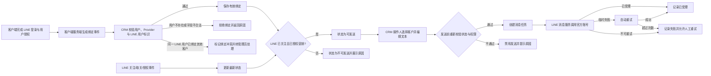

# crm-LINE 消息发送

> 从客户端接收经 LINE 校验的客户绑定与授权事件，在 CRM 形成“可发送客户”状态，并由有权限的角色发送单人文本消息。
> 需求编号：REQ-LINE-001｜状态：待评审｜更新时间：2026-11-13
> 需求类型：集成与自动化｜补充类型：规则、状态与数据；权限与审计

## 交互原型

[打开完整交互原型](https://h3-ai-lab.github.io/hhhprd/projects/crm-line-messaging/prototype/)

## 目标与范围

**目标**

- 用稳定用户标识把 dinoAI 客户与其 LINE 官方账号身份唯一绑定，不以姓名、头像或手机号猜测关注人。
- 在 CRM 内明确区分“已绑定、已关注、已授权、可发送”，避免向无法接收或未授权的客户发送消息。
- 支持有权限的 CRM 角色向单个客户发送文本消息，并追踪消息是否已被 LINE 受理、失败原因及重试结果。

**做**

- 接收客户端或客户端服务端产生的客户绑定事件，保存 dinoAI 用户 ID、LINE Provider、LINE 用户 ID、关注状态和营销授权。
- 接收关注、取关和授权变化事件，按时间与幂等键维护最新状态。
- 新增 `用户管理 → LINE消息` 工作台，支持查找客户、查看 LINE 绑定状态、编辑并发送单人文本消息、查看消息记录和人工重试。
- 向无绑定、未关注、未授权或账号异常的客户禁用发送，并明确展示阻塞原因。
- 为绑定变更、发送、重试、解绑和越权尝试提供 RBAC 与审计。

**不做**

- 不设计或实现客户端 LINE 登录、关注引导、授权弹窗和客户端交互。
- 不向客户端下发或从客户端接收 LINE Login Access Token、Refresh Token、Messaging API Channel Access Token。
- 不通过姓名、头像、LINE ID、手机号或关注时间反查关注人。
- 不支持批量群发、定时发送、自动化营销、模板审批、富文本、图片、视频或 Flex Message。
- 不提供消息送达、已读、点击或回复状态；LINE 接口受理不等于用户已阅读。
- 不支持 CRM 手工创建 LINE 绑定，只允许管理员解除错误绑定后由客户端重新绑定。
- 不处理消息中的业务审批，发送人须对自己提交的内容负责。

## 角色与系统边界

| 角色或系统 | 责任 |
|---|---|
| dinoAI 客户端或客户端服务端 | 完成 LINE 登录与用户授权；取得并提交可用于绑定的用户标识、LINE 用户标识、关注状态和营销授权 |
| dinoAI LINE 消息服务 | 持有官方账号 Channel Access Token；接收 CRM 消息任务并调用 LINE；向 CRM 回传关注、取关和受理结果 |
| CRM | 维护绑定关系、可发送状态、消息内容与历史；执行数据权限、发送校验、失败处理和审计 |
| LINE Platform | 返回关注关系与接口受理结果；实际投递和终端展示不由 CRM 控制 |
| CC | 查找本人负责的客户，查看 LINE 状态并发送消息 |
| 销售组长、运营/商业化、管理员、超级管理员 | 在授权团队或业务线范围内查看、发送、重试或解除绑定 |

## 业务流程



## 客户端必须提供的信息

CRM 不需要客户端提供的 LINE 登录实现，但绑定和发送必须取得以下业务信息。客户端前端不得直接携带服务密钥调用 CRM；这些信息应由客户端或其受信任服务端提交。

| 信息 | 必填 | 业务含义 | 取值与来源 |
|---|---|---|---|
| `event_id` | 是 | 绑定或状态变化事件的幂等标识 | 客户端服务端每次事件唯一生成；重复提交返回原结果 |
| `event_type` | 是 | 事件类型 | `BINDING_UPSERT`、`FRIEND_STATUS_CHANGED`、`MARKETING_CONSENT_CHANGED`、`UNBINDING_CHANGED` |
| `user_id` | 是 | dinoAI 用户稳定 ID，与 CRM 用户中心一致 | 客户端登录用户对应账号；不得使用手机号代替 |
| `provider_id` | 是 | LINE 用户 ID 的命名空间 | 由 LINE Messaging API 与 LINE Login Channel 所属 Provider 确定 |
| `line_user_id` | 是 | 用于绑定关注人和发送消息的 LINE 用户 ID | 必须由 LINE 登录身份信息获得，格式为 `U` 加 32 位十六进制字符；不得人工填写 |
| `friend_status` | 是 | 事件发生时客户与 dinoAI 官方账号的关系 | `FOLLOWING`、`NOT_FOLLOWING`、`UNKNOWN`；由 LINE 状态查询或关注回调得出 |
| `marketing_consent` | 是 | 客户是否同意接收 CRM 发起的营销或服务消息 | `CONSENTED`、`WITHDRAWN`、`UNKNOWN`；来自独立、可撤回的用户授权 |
| `consent_version` | 是 | 客户同意的文本版本 | 客户端当前展示的授权条款版本 |
| `consent_at` | 是 | 最近一次同意或撤回发生时间 | ISO 8601 时间，包含时区 |
| `event_at` | 是 | 本次状态事件的业务发生时间 | 服务端时间；用于拒绝乱序旧事件 |
| `line_display_name` | 否 | LINE 展示名，仅用于辅助识别 | 可变字段，不参与客户身份判断 |
| `client_version` | 否 | 客户端版本 | 用于定位接入问题 |

客户端不需要向 CRM 提供：

- Messaging API Channel Access Token、Channel Secret 或 LINE Login Channel Secret。
- 用户 LINE Login Access Token、Refresh Token 或 LIFF Access Token。
- 手机号、姓名或关注时间供 CRM 反查关注人。
- 完整的官方账号关注人列表。

推荐的最小绑定信息是：

```text
user_id + provider_id + line_user_id + friend_status + marketing_consent
```

CRM 接收后必须再次校验用户存在、字段格式、Provider 与当前 dinoAI 官方账号一致；客户端提交的关注和授权仅是业务事件，不能代替 CRM 的发送前状态检查。

## 业务规则

### 绑定

- 一个 CRM 用户在同一 Provider 下最多存在一条有效绑定。
- 同一个 `provider_id + line_user_id` 在有效状态下只能绑定一个 CRM 用户。
- 相同 `event_id` 重复提交不得创建第二条绑定或重复修改状态。
- 同一有效绑定下，晚到的旧 `event_at` 不覆盖较新的关注或授权状态；相同时间按事件类型固定顺序处理。
- CRM 用户不存在、Provider 不匹配或 `line_user_id` 格式非法时拒绝绑定，保留失败原因供排查。
- 客户更换 LINE 账号或同一 LINE 账号转给另一客户时，先由管理员解除旧绑定，再由客户端产生新绑定。
- 解绑不删除历史绑定、消息和审计；旧绑定显示“已解除”，不可继续发送。
- 绑定存在但未关注、未授权或状态未知时允许保留，不允许发送。

### 发送资格

同时满足以下条件才显示为“可发送”：

1. 绑定状态为“有效”。
2. 当前关注状态为“已关注”。
3. 营销授权为“已同意”。
4. CRM 用户存在、账号正常且属于操作人的数据范围。
5. 发送前状态刷新成功，未被 LINE 或关注事件更新为取关、拉黑或不可访问。

任一条件不满足时禁用发送：

- 未绑定 LINE：`未绑定 LINE`
- 已绑定未关注：`客户尚未关注官方账号`
- 已关注但未授权：`客户未授权接收消息`
- 状态无法确认：`LINE 状态暂时无法确认`
- 绑定冲突：`绑定存在异常，请联系管理员`
- 无数据权限：`无权向该客户发送消息`

### 消息发送

- 本期只支持向单个客户发送一段文本，正文必填，支持 1–5,000 个字符，首尾空白不自动删除。
- 发送前展示客户姓名、用户 ID、业务线、脱敏 LINE 用户 ID、当前关注与授权状态及正文摘要。
- 每个发送请求生成唯一消息 ID；重复点击或网络重试不得生成两条消息。
- LINE 返回接口成功后，状态记为“LINE 已受理”，不得展示为“已送达”或“已读”。
- 临时网络错误、LINE 服务异常或请求限流可自动重试，最多 3 次，整个过程不超过 10 分钟。
- 未绑定、未关注、未授权、绑定冲突、权限不足和内容参数错误不自动重试。
- 自动重试仍失败后可人工重试；人工重试沿用原消息 ID，不得创建重复消息。
- 客户在消息创建后失去发送资格时，未发出的任务终止并记录原因；已经提交给 LINE 的消息不承诺撤回。

### 状态模型

| 对象 | 状态 | 含义 |
|---|---|---|
| 绑定 | `ACTIVE` | 有效绑定，可继续校验关注与授权 |
| 绑定 | `CONFLICT` | 同一客户或 LINE 用户存在冲突，不可发送 |
| 绑定 | `RELEASED` | 已由管理员解除，历史保留 |
| 关注 | `FOLLOWING` | 当前为官方账号好友 |
| 关注 | `NOT_FOLLOWING` | 未关注、已取关或已拉黑 |
| 关注 | `UNKNOWN` | 最近查询失败，不能确认 |
| 授权 | `CONSENTED` | 当前同意接收消息 |
| 授权 | `WITHDRAWN` | 已撤回或拒绝授权 |
| 授权 | `UNKNOWN` | 未取得明确授权，不可发送 |
| 消息 | `PENDING` | 已创建，尚未提交 LINE |
| 消息 | `RETRYING` | 临时失败，等待或正在重试 |
| 消息 | `ACCEPTED` | LINE 已受理，不代表已送达 |
| 消息 | `FAILED` | 最终失败，可查看原因并人工重试 |

## 对象、字段与排序

### 客户绑定

| 字段 | 业务规则 |
|---|---|
| CRM 用户 | 展示用户 ID 和姓名，来自现有用户中心 |
| 业务线 | 继承 CRM 用户业务线，不由客户端覆盖 |
| LINE 绑定状态 | 有效、绑定冲突、已解除、未绑定 |
| 关注状态 | 已关注、未关注、未知；展示最近确认时间 |
| 营销授权 | 已同意、已撤回、未知；展示条款版本和授权时间 |
| 可发送状态 | 由绑定、关注、授权、账号和数据权限共同计算，不可手工编辑 |
| LINE 用户 ID | 服务端保存完整值；列表仅展示脱敏值 |
| 最近状态来源 | 客户端绑定、LINE 关注事件、LINE 取关事件、发送前查询或管理员解绑 |
| 绑定时间 | 首次有效绑定时间；重新绑定生成新绑定周期 |
| 更新时间 | 最近一次有效状态变化时间 |

### 消息记录

| 字段 | 业务规则 |
|---|---|
| 消息 ID | 系统唯一生成，重试不变 |
| 客户 | 用户 ID、姓名、业务线快照 |
| 操作人 | 发起发送的 CRM 账号和姓名快照 |
| 消息正文 | 保存原文、字符数和内容摘要 |
| 创建时间 | 首次创建消息任务的时间 |
| 最近尝试时间 | 最近一次向 LINE 提交的时间 |
| 状态 | 待发送、重试中、LINE 已受理、发送失败 |
| 失败原因 | 使用可理解的标准原因，保留接口请求标识 |
| 重试次数 | 同一条消息累计自动与人工重试次数 |

客户列表固定按最近绑定或状态更新时间倒序展示，不支持手工排序。消息记录固定按创建时间倒序展示，不支持手工排序。关注时间、授权时间、LINE 用户 ID、姓名、业务线和状态均不提供排序交互。

## 页面、列表与筛选

入口：`用户管理 → LINE消息`。

页面分为顶部状态概览、客户筛选与列表、客户详情与发送区。

### 客户列表

默认列顺序：

`用户 ID → 客户姓名 → 业务线 → LINE 绑定状态 → 关注状态 → 营销授权 → 可发送状态 → 最近更新时间`

筛选区顺序：

`用户 ID/姓名/手机号搜索 → 业务线 → LINE 绑定状态 → 关注状态 → 营销授权 → 可发送状态`

筛选规则：

- 搜索支持用户 ID、姓名和手机号；手机号仅在操作人拥有现有用户敏感字段查看权限时可搜索。
- 所有筛选使用操作人现有数据范围，不能通过搜索看到无权的客户。
- 客户列表分页，切换分页保留已应用筛选。
- 无结果、加载失败、LINE 状态查询失败和权限不足分别展示不同状态，不能都显示为空数据。

### 客户详情与发送

选择客户后展示：

- 客户姓名、用户 ID、业务线、账号状态。
- LINE 绑定状态、关注状态、营销授权、最近确认时间和脱敏 LINE 用户 ID。
- “可发送”或具体阻塞原因。
- 文本输入框、字数统计、当前发送内容摘要和发送按钮。
- 最近 20 条消息记录；支持展开查看完整正文和失败原因。

发送交互：

- 可发送客户展示“发送消息”；不可发送客户按钮置灰并展示原因。
- 点击发送前进行二次确认，确认后按钮进入处理中状态，禁止重复提交。
- 消息正在发送时关闭详情，重新打开仍展示该客户的进行中消息。
- 失败记录展示“重试”；不满足发送资格时重试入口改为“查看原因”。
- 管理员可见“解除绑定”，必须填写原因并二次确认。

## 指标具体口径

公共范围：当前操作人数据权限内、应用业务线与状态筛选后的客户；消息指标使用同一客户范围。时间均按操作人所在业务线时区展示。

| 指标 | 分子 | 分母 | 单位 | 统计范围 | 时间字段 | 去重键 | 零值 |
|---|---|---|---:|---|---|---|---|
| 已绑定客户数 | 绑定状态为有效的客户数 | — | 位 | 当前筛选范围 | 最近更新时间 | `user_id` | 显示 0 |
| 可发送客户数 | 同时满足有效绑定、当前已关注、营销已同意且状态在 24 小时内确认的客户数 | — | 位 | 当前筛选范围 | 最近关注状态确认时间 | `user_id` | 显示 0 |
| 近 30 天消息受理率 | 状态为“LINE 已受理”的消息数 | 已进入 LINE 消息服务的消息数 | % | 当前客户范围，最近 30 个自然日 | 消息最近尝试时间 | `message_id` | 分母为 0 时显示“—” |

受理率保留一位小数。重试不增加分母，同一条消息只统计一次；业务校验未通过、从未进入消息服务的发送尝试不进入分母。

## RBAC 权限数据

### 功能权限

| 页面 / 动作 | 默认角色 | 数据范围 | 审计 |
|---|---|---|---|
| LINE 消息工作台查看 | CC、销售组长、运营/商业化、管理员、超级管理员 | CC 本人；组长团队；运营授权业务线；管理员授权业务线或全量 | 权限变更记录审计 |
| 发送消息 | CC、销售组长、运营/商业化、管理员、超级管理员 | 与查看范围一致，发送前再次校验客户归属 | 记录操作人、客户、正文摘要和结果 |
| 人工重试 | 销售组长、运营/商业化、管理员、超级管理员 | 与查看范围一致 | 记录原因、原状态、重试次数和结果 |
| 刷新 LINE 状态 | CC、销售组长、运营/商业化、管理员、超级管理员 | 与查看范围一致 | 记录来源、前后状态和结果 |
| 解除绑定 | 管理员、超级管理员 | 当前授权业务线 | 记录原因、原 LINE 用户 ID 和前后状态 |

### 字段与数据权限

| 字段组 / 列表 | 可见角色 | 编辑角色 | 脱敏 / 隐藏 | 可导出 | 候选范围限制 |
|---|---|---|---|---|---|
| 客户基础信息、业务线、绑定与授权状态 | 拥有 LINE 消息查看权限的角色 | 系统写入；管理员仅可解绑 | 无权客户不显示 | 否 | 现有用户数据范围 |
| LINE 用户 ID | 同工作台查看权限 | 不可编辑 | 列表脱敏；详情显示前后各 4 位 | 否 | 不提供反向搜索 |
| 手机号 | 现有用户手机号权限 | 不可编辑 | 无权限时完全隐藏；可搜索时仍脱敏展示 | 否 | 精确搜索且受数据范围限制 |
| 消息正文、失败原因和请求标识 | 同工作台查看权限 | 发送时由操作人编辑 | 不可见的客户不显示历史 | 否 | 与客户范围一致 |
| Channel Access Token、Channel Secret、用户 Access Token | 无 CRM 前台角色 | 不可编辑 | 不进入 CRM 用户可见数据 | 否 | 由消息服务密钥系统管理 |

### 权限数据变更

| 变更类型 | 权限层级 | 权限项 | 业务说明 | 默认角色 / 数据范围 | 新增审计 |
|---|---|---|---|---|---|
| 新增 | 菜单 / 页面 | `line_message.view` | 进入 LINE 消息工作台并查看客户与消息 | CC、销售组长、运营/商业化、管理员、超级管理员 | 权限变更 |
| 新增 | 动作 | `line_message.send` | 向可发送客户提交单人文本消息 | CC 本人、组长团队、运营授权业务线、管理员 | 是 |
| 新增 | 动作 | `line_message.retry` | 人工重试最终失败消息 | 销售组长、运营/商业化、管理员、超级管理员 | 是 |
| 新增 | 动作 | `line_binding.refresh` | 重新确认关注和授权状态 | 同工作台查看角色 | 是 |
| 新增 | 动作 | `line_binding.release` | 解除错误或过期绑定 | 管理员、超级管理员；授权业务线 | 是 |
| 复用 | 数据 | 用户数据范围与组织范围 | 工作台只返回操作人可见客户 | 沿用现有 RBAC | 否 |
| 复用 | 字段 | 手机号与用户敏感字段权限 | 控制手机号搜索与展示 | 沿用现有字段权限 | 否 |

账号停用后立即失去工作台、发送、重试和状态刷新权限。历史消息保留原操作人姓名和 ID 快照；待处理失败的发送任务转为“系统失败”状态，由团队负责人或管理员处理，不自动转给其他员工继续发送。

## 数据依赖、异常与补偿

| 场景 | 处理 |
|---|---|
| 客户端重复提交绑定事件 | 按 `event_id` 幂等，返回现有绑定及最新状态 |
| 绑定事件乱序到达 | 比较 `event_at`；旧事件不覆盖新状态，保留事件日志 |
| CRM 用户不存在 | 拒绝绑定并返回“用户不存在或尚未进入 CRM”；不创建占位用户 |
| Provider 与 dinoAI 官方账号不一致 | 拒绝绑定，不写入 LINE 用户 ID |
| 同一 LINE 用户已绑定其他客户 | 标记绑定冲突，禁止发送，管理员核对后解除错误绑定 |
| 客户取关、拉黑或取消授权 | CRM 停止新发送；失败任务不再自动重试 |
| 关注状态超过 24 小时未确认 | 客户显示“待确认”，可查看但不可发送；点击发送时实时刷新 |
| LINE 状态查询超时 | 保留最近成功状态并标注“暂时无法确认”；阻断发送 |
| 消息接口限流或临时异常 | 自动重试，使用同一消息 ID；超过 3 次或超过 10 分钟转失败 |
| LINE 接口已受理但 CRM 未收到结果 | 先查询原消息结果再重试，避免重复发送 |
| 客户在发送前失权或归属变化 | 发送校验失败，任务不进入 LINE，保留失败原因 |
| 消息内容超限或为空 | 前端阻止提交；后端校验失败时不创建正式消息记录 |
| 消息服务不可用 | 客户和绑定仍可查看；发送、重试显示对应错误，不伪装成成功 |
| 管理员解除绑定 | 指定绑定转为已解除；未发送任务终止，历史消息保留 |
| 历史绑定信息缺失 | 显示“历史未知”或“未绑定”，不通过关注时间和姓名猜测 |

## 审计与数据保留

以下操作必须记录且不可由普通用户修改：

- 绑定创建、绑定冲突、绑定解除和状态来源变化。
- 营销同意、授权撤回及条款版本变化。
- 消息创建、发送、自动重试、人工重试、成功受理和最终失败。
- 关注状态刷新及前后值。
- 无权限查看、发送、重试或解绑尝试。

审计至少包含操作人或系统来源、时间、客户用户 ID、绑定 ID、消息 ID、操作类型、变更前状态、变更后状态、失败原因、请求标识和操作人数据范围。绑定、消息和审计记录至少保留 2 年；解除绑定和客户离线不删除历史发送记录。

## 依赖与上线边界

- 客户端必须已能产出本 PRD 定义的绑定事件；本项目不补齐客户端登录与授权实现。
- dinoAI LINE 消息服务必须已配置同一 Provider 下的 LINE Login 与 Messaging API Channel，并能保持关注状态和渠道凭证有效。
- 官方账号必须满足 LINE 当前接口、配额和内容政策；CRM 不保证消息已送达、已读或不会因用户拉黑而失败。
- 消息发送前必须以最新关注和授权状态为准；任何客户端缓存状态都不能单独作为最终发送依据。
- 一期以单人文本消息闭环为目标，批量、自动化和富消息必须另行评审。
