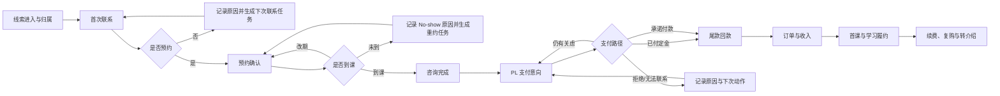

# CC日待办leads列表

> 将客户事件和到期任务按优先级汇总为 CC 日待办列表，让 CC 从任务进入客户上下文并完成结果回填。
> 项目编号：PROG-CRM-001｜状态：规划｜更新时间：2026-11-23
> 需求类型：业务流程｜补充类型：权限与审计、看板与指标

## 交互原型

[打开完整交互原型](https://h3-ai-lab.github.io/hhhprd/projects/crm-operating-closure/prototype/)

## 要解决的问题

业务已经通过线下表管理 CC 的接通、预约、到课、咨询、PL、定金、尾款和收入，说明经营重点不是最终 GMV，而是从线索到回款的完整过程。

当前主要断点：

- 客户事件分散在线索、通话、预约、会议、订单和学习系统中，CC 接续沟通需要重新拼上下文。
- 系统展示状态，但没有持续回答 CC“今天先处理谁、为什么、下一步做什么”。
- 管理者能看到部分结果，却难以快速定位目标卡在哪个环节、谁需要帮助以及问题是否重复发生。
- PL、定金、尾款和学习风险没有形成统一任务，成交与客户价值容易在节点后断线。
- 来源、业务线、归属、时间和指标口径不一致，业务无法围绕同一事实开展复盘。

**目标结果**

- CC 打开系统后直接进入个人行动队列，并在处理完成后得到下一个明确任务。
- 管理者从团队经营摘要进入卡点、人员、客户和重复问题，并记录干预与效果。
- 每个客户的核心业务事件可追溯，任务、看板、日报和下载使用同一口径。

## 角色与业务对象

| 角色 | 核心问题 | 可执行动作 |
|---|---|---|
| CC | 今天处理谁、为什么处理、下一步做什么 | 联系客户、预约和确认、回填到课与咨询、推进 PL、跟进回款、学习关怀、交接和求助 |
| 团队管理者 | 团队卡在哪、谁需要帮助、什么问题在重复 | 查看团队经营摘要、定位异常、钻取客户与任务、分配或交接、发起干预、复查结果 |
| 业务负责人 | 经营目标是否达成、问题属于流程还是人员 | 配置目标与规则、查看跨团队趋势、确认跨系统依赖、复盘阶段结果 |
| 系统 | 如何把事件转换为任务和洞察 | 接收业务事件、生成任务、计算指标、更新状态、形成日报和预警 |

核心业务对象：

`Lead`、`Customer`、`Call`、`Appointment`、`Trial`、`Consultation`、`PL`、`Order`、`Payment`、`LearningProgress`、`FollowTask`、`ManagerIntervention`

所有对象使用稳定业务 ID 关联；姓名、手机号、展示名称不作为跨系统主键。

## 端到端业务流程

异常与恢复：

- 联系失败：保存联系结果和原因，生成用户指定的下一次联系时间；没有明确时间时进入次日待办。
- 重复预约或重复提交：按预约业务 ID 和提交幂等键去重，保留最后一次有效结果并记录操作来源。
- 会议取消或改期：原预约保留历史，创建新预约并继承客户、CC 和业务线。
- No-show：记录结构化原因；客户仍可跟进时生成重约任务，不再允许不设置下一动作直接关闭。
- PL 变更：每次保存等级、原因、最近联系结果和下一动作；历史等级保留。
- 支付回调延迟或失败：保留订单当前状态和最近同步时间，生成人工核实任务，不根据页面状态反写支付事实。
- 离职或停用：立即停止接收新线索和新任务；当前客户、预约、回款和学习任务转入主管托管或转派，历史归属和操作记录不覆盖。

## 经营规则

### 行动生成

优先进入 CC 今日行动队列的事件：

1. 已过承诺时间或任务截止时间的跟进。
2. 今日及未来 24 小时内即将开始且尚未确认的预约。
3. 已到到课时间但尚未回填结果的体验课。
4. PL 80 或 PL 50 已到下一次承诺跟进时间的客户。
5. 定金或尾款已到期、逾期或支付状态待核实的客户。
6. 首课未激活、学习持续中断或进入续费窗口的已付费客户。
7. 新分配且尚未完成首次联系 SLA 的线索。

同一客户存在多个任务时，按“逾期回款 → 即将预约/待回填 → PL 承诺到期 → 首跟超时 → 学习风险”的顺序展示最紧急动作；被合并的其他动作在客户详情中保留。

### 预约、到课与咨询

- 预约必须有预约时间、负责人和会议信息。
- 预约确认结果使用“已确认”和“未确认”；未确认预约在开始前进入提醒任务。
- 到课状态使用“已到课且咨询完成”“已到课但咨询未完成”“改期”“取消”。
- No-show 与到课分离，使用独立原因并触发重约任务。
- 到课不代表咨询完成，咨询结果单独使用“已完成”“未完成”“待继续”。
- 已到课但咨询未完成必须设置下一次动作。

### PL 与回款

- PL 100：客户已支付定金。
- PL 80：客户明确承诺付款，必须记录付款时间、拟购套餐和支付方式。
- PL 50：客户仍有顾虑但未明确拒绝，必须记录主要顾虑和下一次联系时间。
- Pending：多次联系不上，保留联系记录和下一次尝试时间。
- Rejection：客户明确拒绝，记录原因；不得自动删除客户。
- Follow Up：尚未形成上述等级，但已明确需要继续跟进。
- 定金、剩余定金、预计全款时间和实际全款时间分别记录。
- 到期未付生成回款任务；逾期只影响任务优先级和预警，不自动改写订单或支付事实。

### 管理干预

管理者执行干预时必须记录：

`问题对象 → 判断依据 → 管理动作 → 负责人 → 截止时间 → 预期改善指标`

干预记录与客户或 CC 关联；效果复查使用干预前后的同一指标、同一范围和同一时间窗口，不使用其他口径的指标证明改善。

## 角色工作台

### CC 今日行动

首屏展示：

- 按优先级排序的客户任务。
- 每条任务的客户、原因、当前阶段、承诺时间或截止时间。
- 可直接进入的联系、预约、回填、PL、回款和学习操作。
- 当前筛选范围内的任务数、逾期数和今日预约数。

客户详情提供统一时间线，覆盖来源、分配、外呼、消息、预约、会议、到课、咨询、PL、订单、支付和学习事件。处理结果保存后，系统刷新当前任务并生成下一动作。

### 管理者经营摘要

首屏展示：

- 线索、接通、预约、到课、咨询、PL、订单、收入的核心结果和异常任务。
- 团队在当前阶段最明显的目标 Gap。
- 需要帮助的 CC 和对应原因。
- 重复出现的问题及受影响客户范围。

管理者可从指标进入团队、CC、客户和任务明细，并执行受权限控制的转派、交接、目标查看和干预记录。经营摘要不替代明细，所有汇总值必须能回溯到同一筛选范围的事件和任务。

### 经营日报

CC 日报自动汇总：

- 今日计划与实际处理任务。
- 完成、逾期和未处理任务。
- 客户卡点、处理结果和明日优先事项。

管理者日报自动汇总：

- 目标与实际、主要 Gap 和异常任务。
- 需要帮助的人员及原因。
- 重复发生的问题。
- 已采取干预、负责人、截止时间和待复查结果。

日报只汇总系统已记录的客户事件与任务结果，不要求重复填写。

## 分阶段建设范围

| 阶段 | 建设内容 | 业务结果 |
|---|---|---|
| P0｜销售执行与回款闭环 | 统一客户时间线、今日行动、首次联系、预约确认、到课与咨询、PL、定金、尾款、支付一致性、管理者目标 Gap 与异常队列 | CC 不再自行寻找客户；每个客户有负责人、状态、下一动作和时间；管理者能定位具体卡点 |
| P1｜管理干预与经营效率 | CC 分层与异常预警、重复问题聚类、干预闭环、自动经营日报、辅导建议 | 管理者能回答团队卡在哪、谁需要帮助、什么问题重复发生，并追踪改善 |
| P2｜客户经营扩展 | 首课激活、学习风险、续费窗口、服务交接、转介绍和奖励、AI 话术与通话辅助 | 客户价值从一次成交延伸到持续履约、续费和增长 |

本期不包含：

- 不替代支付、课程、广告和电话线路等外部系统的主数据与执行能力。
- 不以单一 GMV 定义 CC 等级。
- 不为未确认业务规则的自动分配或自动退款新增能力。
- 不继续新增与销售行动闭环无关的跨域配置页面。

## 关键指标

公共范围：

- 指标随业务线、团队/CC、时间范围和数据权限筛选。
- 时间范围以各指标声明的业务时间字段为准，起止时间包含开始、排除结束。
- 比率分母为 0 时显示“—”，不显示 0%。
- 百分比保留一位小数；金额使用订单币种原值，不跨币种直接相加。

| 指标 | 用途 | 分子 | 分母 | 单位 | 时间字段 / 去重 / 零值 |
|---|---|---|---|---|---|
| 首跟及时率 | CC 是否按 SLA 完成首次联系 | 首次有效跟进时间不晚于分配时间加业务线 SLA 的去重 Lead 数 | 统计范围内成功分配的去重 Lead 数 | % | 以分配时间进入统计范围；按 Lead ID 去重；分母为 0 显示“—” |
| 接通线索数 | 识别被有效触达的客户规模 | 至少有一条接通 Call 的去重 Lead 数 | — | 条 | 以接通时间进入范围；按 Lead ID 去重；无结果为 0 |
| 接通率 | 判断外呼执行质量 | 状态为接通的 Call 数 | 已发起的 Call 数 | % | 以呼叫发起时间进入范围；按 Call ID 去重；分母为 0 显示“—” |
| 预约确认率 | 判断预约是否进入可履约状态 | 预约结果为已确认的 Appointment 数 | 统计范围内创建的 Appointment 数 | % | 以预约创建时间进入范围；按 Appointment ID 去重；分母为 0 显示“—” |
| 到课率 | 判断体验课是否真实发生 | 到课状态为已到课的 Trial 数 | 预约时间落在统计范围内且状态已结束的 Trial 数 | % | 以计划开始时间进入范围；按 Trial ID 去重；分母为 0 显示“—” |
| 咨询完成率 | 区分到课与咨询结果 | 咨询状态为已完成的 Consultation 数 | 已到课的 Trial 数 | % | 以咨询完成时间进入范围；按 Consultation ID 去重；分母为 0 显示“—” |
| PL 转化率 | 判断高意向客户进入订单的效率 | 订单创建前最近有效 PL 为 PL 80 或 PL 100 且已创建支付成功订单的去重 Lead 数 | 订单创建前最近有效 PL 为 PL 80 或 PL 100 的去重 Lead 数 | % | 以 PL 变更时间进入范围；同一 Lead 取订单创建前最近有效 PL；分母为 0 显示“—” |
| 待收金额 | 识别回款风险 | 已确认应收金额减已确认实收金额 | — | 订单币种金额 | 以应收到期时间进入范围；按 Payment 计划项去重；无待收为 0 |
| 异常任务按时关闭率 | 判断团队是否及时处理经营风险 | 在截止时间前关闭的去重 FollowTask 数 | 在统计时间内到期的去重 FollowTask 数 | % | 以任务到期时间进入范围；按 Task ID 去重；分母为 0 显示“—” |

## RBAC 权限数据

### 功能权限

| 页面 / 资源 | 操作 | 业务含义 | 默认角色 | 数据范围 | 审计 |
|---|---|---|---|---|---|
| 今日行动 | 查看 | 查看个人待办与客户上下文 | CC、团队管理者 | CC 为本人；管理者为授权组织范围 | 否 |
| 客户任务 | 更新结果、创建下一任务 | 记录联系、预约、到课、咨询、PL 和学习处理结果 | CC、团队管理者 | 当前负责人及授权交接范围 | 是 |
| 预约会议 | 创建、确认、改期、取消 | 推进预约和体验课 | CC、团队管理者 | 本人或授权组织范围 | 是 |
| PL 与回款 | 更新意向、核对回款 | 推进成交和回款任务 | CC、团队管理者 | 当前负责人及授权组织范围；支付事实只读 | 是 |
| 管理经营摘要 | 查看、下钻 | 查看目标、Gap、团队与客户明细 | 团队管理者、业务负责人 | 授权业务线与组织子树 | 是 |
| 任务分配与交接 | 分配、转派、批量交接 | 调整当前业务处理权 | 团队管理者 | 授权组织范围 | 是 |
| 干预记录 | 新增、编辑、关闭、复查 | 记录管理动作与效果 | 团队管理者、业务负责人 | 授权组织范围 | 是 |
| 目标与规则配置 | 查看、新增、编辑、停用 | 配置业务线目标和任务规则 | 业务负责人 | 被授权业务线 | 是 |
| 经营报告 | 查看 | 查看 CC 与管理者日报 | CC、团队管理者、业务负责人 | 与本人角色数据范围一致 | 是 |
| 数据导出 | 导出 | 导出当前权限和筛选范围内的业务明细 | 独立的导出授权角色 | 与页面、字段和筛选权限一致 | 是 |

### 字段与数据权限

| 字段组 / 列表 | 可见角色 | 编辑角色 | 脱敏 / 隐藏 | 可导出 | 候选范围限制 |
|---|---|---|---|---|---|
| 客户基础资料 | CC、团队管理者、业务负责人 | 不通过本项目编辑 | 手机号按现有敏感字段规则脱敏 | 需独立导出权限 | 仅授权业务线和组织范围 |
| 通话与消息记录 | CC、团队管理者 | 不编辑历史记录 | 录音与逐字稿按现有权限控制 | 需独立导出权限 | 仅客户当前或历史授权范围 |
| 预约、到课与咨询 | CC、团队管理者、业务负责人 | CC、团队管理者 | 无 | 需独立导出权限 | 仅授权组织子树的客户 |
| PL 与回款 | CC、团队管理者、业务负责人 | CC、团队管理者 | 金额按角色展示，不向无权角色暴露 | 需独立导出权限 | 仅授权组织和业务线 |
| 学习计划与进度 | CC、团队管理者、业务负责人 | 只读 | 无 | 需独立导出权限 | 仅授权组织子树的客户 |
| 目标、异常和干预 | 团队管理者、业务负责人 | 团队管理者、业务负责人 | 不向 CC 展示其他 CC 的辅导记录 | 需独立导出权限 | 仅授权组织子树 |

### 权限数据变更

| 变更类型 | 权限层级 | 权限项 | 业务说明 | 默认角色 / 数据范围 | 是否新增审计 |
|---|---|---|---|---|---|
| 新增 | 页面 | `crm.workspace.today_task.view` | 查看今日行动 | CC；本人 | 否 |
| 新增 | 动作 | `crm.workspace.task.result.update` | 回填任务结果并生成下一任务 | CC；当前负责人 | 是 |
| 新增 | 动作 | `crm.appointment.manage` | 创建、确认、改期和取消预约 | CC；当前负责人 | 是 |
| 新增 | 动作 | `crm.pipeline.pl.update` | 更新 PL 与下一动作 | CC；当前负责人 | 是 |
| 新增 | 页面 | `crm.management.operating_summary.view` | 查看管理经营摘要 | 团队管理者；组织子树 | 是 |
| 新增 | 动作 | `crm.assignment.handover` | 分配、转派和批量交接 | 团队管理者；组织子树 | 是 |
| 新增 | 动作 | `crm.management.intervention.manage` | 创建、编辑和复查管理干预 | 团队管理者、业务负责人；授权组织 | 是 |
| 新增 | 动作 | `crm.target.policy.manage` | 配置业务目标和任务规则 | 业务负责人；授权业务线 | 是 |
| 新增 | 动作 | `crm.operating_report.view` | 查看 CC 和管理者经营日报 | 各角色；与本人数据范围一致 | 是 |
| 复用 | 数据 | 现有线索、客户、订单、学习数据权限 | 所有页面、下钻、导出使用同一数据范围 | 现有角色与组织子树 | 否 |
| 复用 | 导出 | 现有敏感数据导出权限 | 查看不等于导出，未授权不展示导出入口 | 独立导出角色 | 是 |

审计记录至少包含操作人、操作时间、业务对象、动作、筛选范围、变更前后值、操作原因和来源。分配、交接、支付回款核对、目标调整、干预和导出为强制审计动作；成功、失败和未授权尝试均记录。

## 数据依赖与异常

| 数据 / 能力 | 责任方 | CRM 使用方式 | 失败处理 |
|---|---|---|---|
| 用户与线索 | 客户中心、线索接入 | 建立客户时间线和归属 | 保留最近成功同步值并标记同步状态 |
| 外呼与消息 | 联络中心、消息通道 | 接收联系结果和下一动作 | 失败进入待重试或人工核实，不伪造成功 |
| 预约与 Lark 会议 | 会议系统 | 展示预约、加入会议、回写参与事实 | 会议创建失败保留预约并提供重试 |
| 订单、支付与权益 | 交易后台 | 只读展示支付事实与待收金额 | 回调延迟时生成核对任务，不以页面状态反写支付 |
| 学习计划与进度 | 学习后台 | 提供首课、进度、风险与续费上下文 | 同步失败显示最近成功时间，不使用猜测值 |
| 指标与导出任务 | 数据与集成后台 | 提供统一指标、快照和导出 | 失败可重试，不生成空文件或部分文件 |

多时区与多语言：

- 后端保存统一标准时间和原始时区偏移。
- 业务时间字段按客户所在业务线时区解释；页面展示明确当前时区。
- 导出保留原始时间值和时区，不因浏览器语言改变业务值。
- 中文和英文只改变界面表达，不改变状态、口径和数据。
