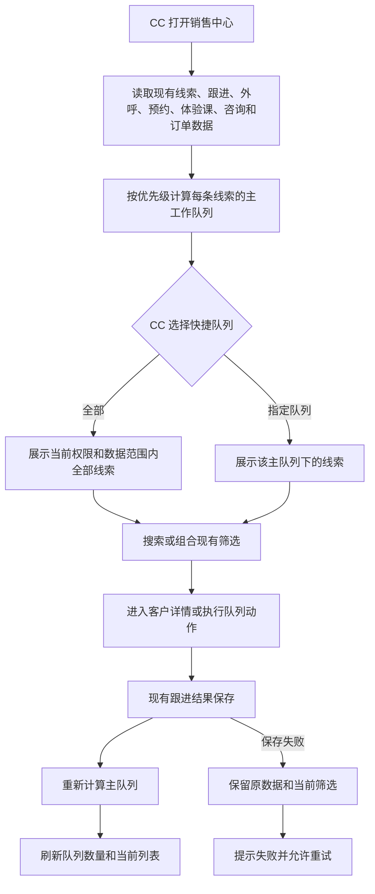

# CC 快捷工作队列

> 在现有销售中心列表顶部增加 6 个面向 CC 的快捷工作队列，让 CC 一次点击就进入当天应处理的客户集合，不新增页面、菜单、状态字段或独立任务系统。
> 项目编号：PROG-CRM-001｜状态：待上传｜更新时间：2026-11-23
> 需求类型：表单、字段与列表｜补充类型：规则、状态与数据、权限与审计

> 📌
> - **快捷筛选**：体验课待付费、体验课未完成、今日预约、未到课待改期、待接通、已接通未预约。
> - **不新增架构**：沿用销售中心列表、现有跟进阶段、预约、体验课、咨询、外呼、订单和 PL 数据。
> - **单一队列**：同一线索只进入一个主工作队列，避免重复处理。
> - **本期不做**：不新增页面、菜单、后台任务中心、新状态字段、自动分配、自动提醒和经营看板。

## 交互原型

[打开完整交互原型](https://h3-ai-lab.github.io/hhhprd/projects/crm-operating-closure/prototype/)

原型覆盖快捷队列切换、搜索、业务线筛选、当前阶段筛选、队列内动作、处理结果回填、空态、重置和完整中英文切换。

## 要解决什么

CC 每天需要组合搜索、阶段和业务状态，才能判断“先联系谁、为什么联系、下一步做什么”。现有销售中心已有完整客户数据和操作入口，但缺少围绕当天工作结果的短路径。

本期只在现有销售中心列表上增加快捷队列，不改变数据属于哪个模块，也不新增另一套任务数据。

## 范围

**做**

- 在销售中心现有筛选区增加 6 个快捷队列标签，并显示各队列的去重 Lead 数。
- 支持“全部”和单队列选择；快捷队列与现有搜索、业务线、当前跟进阶段按 AND 组合。
- 根据现有业务数据实时判断线索当前主队列。
- 队列切换后沿用现有列表、列、行操作和客户详情。
- 处理结果保存后刷新当前队列数量与列表。
- 保持现有业务线时区、数据权限和导出权限不变。

**不做**

- 不新增页面、菜单、独立待办中心或看板。
- 不新增持久化“队列字段”或人工维护的任务状态。
- 不自动发送消息、自动外呼、自动改期、自动退款或自动关闭线索。
- 不改变分配、领取、转派、掉库、回池和重新激活规则。
- 不调整现有销售列表默认列、列顺序和排序能力。
- 不在本期新增导出、批量修改、提醒或员工绩效功能。
- 不将付费后正式首课与未付费体验课混用；本需求中的“首课”仅指销售阶段里的体验课。

## 现有页面与字段顺序

当前环境无法建立 CRM 实时页面读取。本节依据 2026-11-23 已保存的销售中心页面截图和现有 `REQ-CC-002` 页面记录整理，属于非实时辅助证据；上线前由开发在真实页面逐项复核，不据此推测当前权限或真实行数。

现有销售中心列表为：

`用户 → 业务线 → 购买意向 → 用户状态 → 跟进阶段 → 当前 CC → 操作`

现有可见筛选为：

`搜索 → 业务线 → 当前跟进阶段`

本期不调整上述字段和列顺序，只在现有筛选字段下方增加一行快捷队列。

| 现状顺序 | 内容 | 现状位置 | 比对结果 | 目标位置 | 变更原因 |
|---|---|---|---|---|---|
| 1 | 搜索 | 销售中心筛选区第一行 | 保留 | 原位置 | 继续按手机号、用户 ID、姓名查找 |
| 2 | 业务线 | 销售中心筛选区第一行 | 保留 | 原位置 | 保持现有数据范围筛选 |
| 3 | 当前跟进阶段 | 销售中心筛选区第一行 | 保留 | 原位置 | 与快捷队列组合使用 |
| 新增 1 | 全部 | 无 | 新增 | 筛选区第二行首位 | 清除快捷队列并查看全部当前线索 |
| 新增 2 | 体验课已完课 · 待付费 | 无 | 新增 | “全部”之后第 1 个 | P0 成交推进 |
| 新增 3 | 体验课未完成 · 待跟进 | 无 | 新增 | “全部”之后第 2 个 | P1 原因补齐 |
| 新增 4 | 今日预约 · 待到课 | 无 | 新增 | “全部”之后第 3 个 | P2 当日履约 |
| 新增 5 | 预约未到课 · 待改期 | 无 | 新增 | “全部”之后第 4 个 | P3 No-show 恢复 |
| 新增 6 | 待接通 | 无 | 新增 | “全部”之后第 5 个 | 合并 P4 今日待外呼与 P6 历史未接通 |
| 新增 7 | 已接通 · 未预约 | 无 | 新增 | “全部”之后第 6 个 | P5 继续推进预约 |

## 主流程



## 队列规则

### 公共范围

- 所有队列只统计当前角色数据权限内的去重 `Lead`。
- 队列按业务线当地工作日和时区判断“今日”“预约时间已过”。
- 已付费、已拒绝、已关闭的线索不进入 P0–P6；具体跟进阶段是否保留由现有阶段规则决定。
- 同一线索同时满足多个条件时，只归入优先级最高的一个主队列。
- 队列数量为去重 Lead 数，不是外呼次数、预约次数或跟进记录数。
- 队列按以下顺序计算优先级：P0 → P1 → P2 → P3 → P4 → P5 → P6。

### P0：体验课已完课 · 待付费

- 进入条件：体验课状态为“已到课且完成”，且没有支付成功订单，当前不属于终态。
- 页面含义：客户已完成体验，需要继续沟通课程方案、顾虑和付款。
- 主操作：打开现有更新跟进弹窗，填写购买意向、跟进说明、下一步和承诺付款时间。
- P0 优先于后续所有队列；一次处理保存后，如果仍未付费，可以保留在 P0，并更新下一次跟进时间。

### P1：体验课未完成 · 待跟进

- 进入条件：已到课但咨询未完成，或体验课结果为“已到课但未完成”，且不属于 P0。
- 页面含义：客户已参加体验课，但咨询结果或下一步尚未完成。
- 主操作：补齐未完成原因、咨询结果和下一次跟进时间。
- 改期和取消不进入 P1；预约时间已过且未到课进入 P3。

### P2：今日预约 · 待到课

- 进入条件：预约日期为业务线当地今天，预约未取消、未改期，且尚未产生有效到课结果。
- 页面含义：今天必须确认和跟进的预约。
- 主操作：确认预约、发送现有会议信息、查看待开始会议或回填到课结果。
- 预约开始时点前显示确认动作；预约开始时点后仍无结果时显示到课回填动作。

### P3：预约未到课 · 待改期

- 进入条件：预约时间已经过去，没有有效到课结果，也未标记取消，且不属于 P2。
- 页面含义：客户失约，需要记录原因并重新预约。
- 主操作：记录 No-show 原因并创建新预约。
- 新预约创建成功后离开 P3；预约日期为今天时，进入 P2。

### 待接通：P4 + P6

为减少一级标签数量，“今日分配待外呼”和“历史分配未接通”合并为一个“待接通”入口，并保留两个子队列：

- **P4 今日分配**：今天成功分配，且分配后没有有效外呼记录。
- **P6 历史未接通**：在今天之前分配，历史上没有任何接通记录，且不属于 P0–P5。
- 两个子队列的主操作都是发起或继续外呼。
- 点击“待接通”默认同时展示 P4 和 P6；可进一步切换“全部待接通 / 今日分配 / 历史未接通”。
- 外呼接通后离开“待接通”；若仍未预约，进入 P5。

### P5：已接通 · 未预约

- 进入条件：历史至少有一次接通，当前没有有效预约，且不属于 P0–P4。
- 页面含义：客户已经被触达，但没有形成预约。
- 主操作：继续沟通意向并创建预约；如明确无意愿，按现有规则标记拒绝或暂不跟进。

### 队列判定表

| 场景 | P0 | P1 | P2 | P3 | 待接通 | P5 | 主结果 |
|---|---:|---:|---:|---:|---:|---:|---|
| 体验课完成、未付费 | 命中 | — | — | — | — | — | P0 |
| 已到课但咨询未完成 | — | 命中 | — | — | — | — | P1 |
| 今天有未完成预约 | — | — | 命中 | — | — | — | P2 |
| 预约过去且未到课 | — | — | — | 命中 | — | — | P3 |
| 今天分配且未外呼 | — | — | — | — | P4 | — | 待接通 |
| 以前分配且从未接通 | — | — | — | — | P6 | — | 待接通 |
| 曾经接通但未预约 | — | — | — | — | — | 命中 | P5 |
| 已付费、已拒绝或已关闭 | — | — | — | — | — | — | 不进入快捷队列 |

## 页面与交互

### 快捷队列区

- 位置：现有“搜索 / 业务线 / 当前跟进阶段”筛选行下方、当前线索列表上方。
- 默认选择“全部”。
- 每个标签同时显示名称、优先级辅助信息和数量。
- 数量为 0 时仍展示为 `0`，标签可点击并进入对应空态。
- 再次点击已选队列返回“全部”。
- 选择快捷队列不清空搜索、业务线或当前跟进阶段。
- “待接通”选中后展开三级子筛选，默认“全部待接通”。
- 快捷队列和现有筛选按 AND 组合；无结果时显示筛选无结果，而不是数据为空。
- 加载时标签保留位置并显示数量占位；加载失败显示“队列暂时不可用”和重试入口。

### 队列处理规则

| 队列 | 主要动作 | 保存后结果 |
|---|---|---|
| P0 体验课已完课 | 更新购买意向、PL、下一步和付款时间 | 保持 P0 或按现有规则离开 |
| P1 体验课未完成 | 补齐原因、咨询状态和下次跟进 | 按最新阶段重新判定 |
| P2 今日预约 | 确认预约、查看会议、回填到课 | 到课进入 P0/P1；未到课进入 P3 |
| P3 预约未到课 | 记录原因并改期 | 新预约进入 P2 或离开 |
| 待接通 | 外呼及记录通话结果 | 接通进入 P5；未接通留在对应子队列 |
| P5 已接通未预约 | 创建预约或标记结果 | 预约后进入 P2；拒绝后离开 |

## 字段与排序

本期不新增列表字段。快捷队列是查询条件，不写入线索记录。

| 字段/元素 | 业务含义 | 排序结论 | 排序理由 |
|---|---|---|---|
| 全部 | 清除快捷队列条件 | 不支持排序 | 当前销售中心没有排序入口或可排序表头 |
| P0–P5 名称与数量 | 快捷队列筛选和数量 | 不支持排序 | 只用于筛选，不允许用户对标签排序 |
| 待接通子筛选 | P4/P6 切换 | 不支持排序 | 固定按“全部 → 今日分配 → 历史未接通”展示 |
| 用户 | 客户身份 | 不支持排序 | 当前列表未提供排序能力 |
| 业务线 | 数据范围 | 不支持排序 | 当前列表未提供排序能力 |
| 购买意向 | 客户意向 | 不支持排序 | 当前列表未提供排序能力 |
| 用户状态 | 付费和体验状态 | 不支持排序 | 当前列表未提供排序能力 |
| 跟进阶段 | 现有销售阶段 | 不支持排序 | 当前列表未提供排序能力 |
| 当前 CC | 当前负责人 | 不支持排序 | 当前列表未提供排序能力 |

## 搜索、筛选与导出

- 搜索继续覆盖手机号、用户 ID 和姓名。
- 快捷队列只接受单选；不与另一个快捷队列并列。
- 业务线、当前跟进阶段与快捷队列使用 AND。
- 切换队列、搜索和翻页均保留当前筛选。
- 点击“重置筛选”恢复全部队列、全部业务线、全部阶段和空搜索。
- 本期不新增下载入口；现有下载能力如存在，使用当前筛选结果，普通数据导出继续使用 `.xls`，范围和权限与列表一致。

## RBAC 权限数据

### 功能权限

| 页面/资源 | 操作 | 业务含义 | 默认角色 | 数据范围 | 审计 |
|---|---|---|---|---|---|
| 销售中心 | 查看和选择快捷队列 | 按当前主工作队列查看线索 | 销售专员、销售组长、系统管理员、超级管理员，以及已有销售中心查看权限的自定义角色 | 复用现有销售中心线索数据权限 | 否 |
| 销售中心 | 执行队列内现有动作 | 使用现有跟进、外呼、预约和到课操作 | 与现有动作权限一致 | 当前可见线索 | 沿用现有动作审计 |

### 字段与数据权限

| 字段组/列表 | 可见角色 | 编辑角色 | 脱敏/隐藏 | 可导出 | 候选范围限制 |
|---|---|---|---|---|---|
| 快捷队列名称与数量 | 有销售中心查看权限的角色 | 无 | 不适用 | 不作为独立字段导出 | 只统计当前数据权限内线索 |
| 现有销售列表字段 | 不扩大现有可见范围 | 沿用现有字段编辑权限 | 沿用现有手机号等敏感字段规则 | 沿用现有导出权限 | 沿用现有业务线和组织范围 |

### 权限数据变更

| 变更类型 | 权限层级 | 权限项 | 业务说明 | 默认角色/数据范围 | 是否新增审计 |
|---|---|---|---|---|---|
| 复用 | 页面 | 销售中心查看权限 | 快捷队列不单独开放销售中心 | 现有销售中心角色 | 否 |
| 复用 | 数据 | 现有线索数据范围 | 队列数量、列表和操作使用同一数据范围 | 本人、团队或授权组织范围 | 否 |
| 复用 | 动作 | 现有跟进、外呼、预约、到课和订单权限 | 队列只提供入口，不扩大动作权限 | 现有动作授权 | 沿用现有审计 |
| 复用 | 导出 | 现有销售列表导出权限 | 不新增导出能力和权限 | 现有导出角色 | 沿用现有审计 |

## 数据与异常

| 数据/场景 | 处理 |
|---|---|
| 分配、外呼、预约、体验课和 PL 数据 | 读取现有业务记录，按 `Lead ID` 去重；队列不复制数据 |
| 多条接通或多条预约 | 采用当前有效记录；全部历史只用于判断“是否曾接通” |
| 今日边界 | 按线索所属业务线时区的自然日计算 |
| 数据源不可用 | 队列数量显示 `—`，当前列表保留；提示刷新或重试，不显示错误的 0 |
| 多条规则同时命中 | 按 P0 → P6 优先级只归入一个主队列 |
| 处理成功 | 刷新数量、当前列表和当前客户；客户离开旧队列时从当前结果中移除 |
| 处理失败 | 保留原数据和筛选，显示失败原因并允许重试 |
| 并发修改 | 使用最新业务状态重新判定队列；后提交者提示数据已变化并刷新 |
| 权限被撤销 | 下次请求立即失去列表、数量和动作访问 |
| 员工停用或调岗 | 当前线索和待处理队列按现有交接规则转派；历史归属和事件保留 |
| 历史缺失 | 缺少接通、预约或体验结果时不推测命中，只按已确认事实判定 |

## 用户故事

```text
打开销售中心 → 选择“今日预约” → 查看今天客户 → 进入现有跟进操作
                                      ↘ 无客户 → 查看明确的空态 → 切换其他队列

选择“待接通” → 默认查看今日和历史未接通 → 发起外呼 → 记录结果
                                            ↘ 接通未预约 → 进入 P5
```
