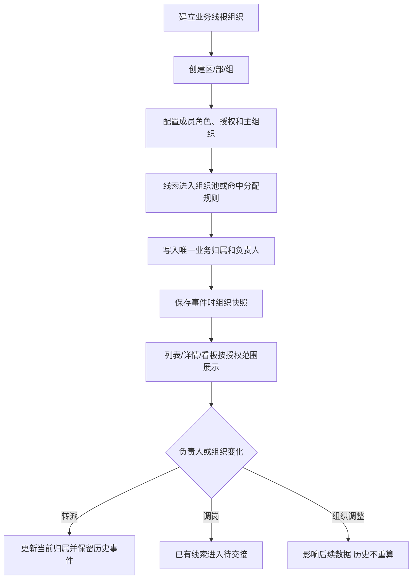

# CRM组织架构&数据权限

> 将一级业务线数据权限升级为最多四级的组织树；成员按功能角色获得操作能力、按数据授权获得数据范围、按主组织确定行政归属，业务数据按事件发生时的组织快照归属。
> 需求编号：REQ-ORG-001｜状态：待评审｜更新时间：2026-11-11
> 需求类型：权限与审计｜补充类型：业务流程、规则与状态、表单与列表

## 交互原型

[打开完整交互原型](https://h3-ai-lab.github.io/hhhprd/projects/crm-org-data-permissions/prototype/)

## 目标与范围

**目标**

同一业务线下支持区、部、组等组织层级，实现同级团队数据隔离；管理者按授权组织及下级查看数据；人员调组、转派和组织调整不影响已发生业务的历史归属。

**做**

- 将一级业务线升级为最多四级的组织树。
- 成员在每个业务线配置一个功能角色、一条数据授权和一个主组织。
- 支持“本人”“指定组织及下级”“本业务线全部”三种数据范围。
- 线索、通话、跟进和订单使用当前业务归属与事件时组织快照。
- 销售中心、用户中心、订单中心、通话、看板、搜索、下钻和导出使用同一数据边界。
- 组织、授权、调岗、转派和导出操作接入审计。
- 迁移一级业务线存量数据，并保留历史口径。

**不做**

- 不建设完整 HR 系统，不接入外部人事组织同步。
- 不保留“数据分组”和“组织树”两套并行团队模型。
- 不将业务分类标签作为数据权限依据。
- 不支持一条线索同时归属多个组织。
- 不首期建设跨组织业绩分摊或复杂协作贡献。
- 不新增经营指标、看板页签或导出格式。

## 核心模型

| 概念 | 作用 | 不负责 |
|---|---|---|
| 业务线 | 组织树根节点，也是时区、分配和看板的主边界 | 不自动展示其他业务线 |
| 组织节点 | 承载人员、线索、规则和业绩归属，最多四级 | 不替代功能角色 |
| 功能角色 | 决定菜单、页面和动作权限 | 不决定数据范围 |
| 数据授权 | 决定本人、组织子树或整条业务线可见范围 | 不决定是否能编辑或导出 |
| 主组织 | 人员行政归属，用于展示、筛选和默认分配 | 不自动授予管理和数据权限 |
| 当前业务归属 | 线索当前负责的唯一组织节点 | 不复制到多个组织 |
| 组织快照 | 事件发生时保存组织 ID、名称和完整路径 | 不随组织改名或人员调岗回写 |

组织层级固定为：

```text
业务线
└── 区
    └── 部
        └── 组
```

不要求每条分支都建满四层；任意层级均可直接承接线索。

## 权限原则

- 功能角色、数据授权、主组织和业务归属分别维护。
- “本业务线全部”只指当前选中的业务线，不包含其他业务线。
- “指定组织及下级”包含所选节点及全部下级，不包含父节点和兄弟节点。
- 同一业务线内的多条数据授权取并集；不同业务线分别判断。
- 组织负责人只表示管理关系，不自动获得数据、转派或配置权限。
- 成员没有有效主组织时可以查看已有授权数据，但不能接收新分配线索。
- 查看、编辑、转派、配置、导出分别校验，页面可见不等于可以批量导出。
- 菜单、列表、筛选候选、详情、搜索、下钻和下载使用同一数据范围。

## 主流程



## 组织架构

入口：`系统管理 → 系统配置 → 组织架构`。

- 组织树按“业务线 → 下级节点”展示，最多四级。
- 新增节点必须选择有效上级；层级由上级自动确定。
- 同一上级下组织名称不可重复；重命名保留稳定组织 ID。
- 有成员、线索、规则或下级的节点只能停用，不能直接删除。
- 更换上级、合并或停用前展示受影响成员、线索和规则数量，并要求填写原因。
- 停用节点停止接收新成员、授权和分配，历史数据仍可查看。
- 组织负责人是成员单选，不自动附带任何功能或数据权限。
- 空节点可以删除；跨业务线根节点移动默认禁止。

## 成员与功能角色

入口：`系统管理 → 系统配置 → 成员账号`。

- 每个业务线只能配置一个功能角色、一个主组织；数据授权按业务线配置。
- “本人”只看本人负责且业务规则允许查看的数据。
- “指定组织及下级”使用组织树多选，可同时授权 A、B 多个节点。
- “本业务线全部”仅覆盖当前业务线；全局范围只属于超级管理员内置能力。
- 主组织必须属于该成员已授权业务线，且必须位于其可管理组织范围内。
- 一个成员不能在同一业务线拥有多个主组织。
- 数据授权不改变主组织；主组织也不自动扩大数据授权。
- 角色关闭后立即影响对应动作和页面，不改变历史数据归属。

## 线索与数据归属

| 事件 | 当前负责人 | 当前业务归属 | 历史快照 |
|---|---|---|---|
| 自动分配 | 目标成员 | 分配规则目标组织 | 记录原分配事件 |
| 公海领取 | 领取人 | 领取入口所属组织 | 记录领取事件 |
| 直接分配给个人 | 接收人 | 接收人主组织 | 无来源时使用主组织 |
| 转派 | 新接收人 | 目标成员主组织或指定目标组织 | 保留原负责人和原组织 |
| 退回公海 | 清空 | 原组织池或业务线待分配池 | 保留退回原因 |
| 人员调岗 | 暂不自动改变 | 已有线索保持原组织 | 进入待交接清单 |
| 组织改名或移动 | 不改变 | 当前归属节点 ID 不变 | 历史名称和路径快照不变 |

- 外呼、跟进、预约和成交继承线索当前业务归属，不在每次操作时重复选择组织。
- 线索只保留一个当前业务归属；数据授权包含 A+B 不代表线索同时归属 A+B。
- 成交业绩按支付时组织快照统计；历史订单不因当前组织变化重算。
- 过程数据按事件发生时的组织快照统计；当前存量视图按当前归属展示。
- 父节点汇总包含自身直属数据和全部下级，对象只统计一次。

## 数据范围落地

| 模块 | 数据对象 | 范围规则 |
|---|---|---|
| 销售中心 | 公海、我的跟进、已付费、通话记录 | 当前业务归属位于授权子树或本人负责 |
| 用户中心 | 用户及关联线索、订单、学习信息 | 只能查看与有权线索或订单关联的用户部分 |
| 订单中心 | 订单、退款、续费 | 本人、组织子树或业务线授权，与线索范围一致 |
| 管理看板 | 汇总、筛选候选、明细、下钻 | 汇总和明细同范围；无权组织不进入筛选项 |
| 营销配置 | 渠道、产品、落地页 | 仍以业务线为配置边界，节点权限不自动扩大配置权 |
| 导入导出 | 批量导入、下载、外发文件 | 使用当前范围；导出权限独立控制并记录审计 |

## 字段与排序

当前系统配置、成员账号和销售中心列表均没有排序入口或可排序表头，本需求不新增排序能力。所有新增或调整字段均不支持排序。

| 字段 | 业务规则 | 排序要求 |
|---|---|---|
| 业务线 | 组织树根节点，也是数据授权边界 | 不支持；当前配置页无排序能力 |
| 组织名称 | 节点展示名称，同上级唯一 | 不支持；用于识别和树形定位 |
| 上级组织 | 直接父节点 | 不支持；用于层级识别 |
| 层级 | 业务线/区/部/组，由路径自动计算 | 不支持；用于结构展示 |
| 负责人 | 组织负责人记录，不自动授予权限 | 不支持；用于识别 |
| 成员数 | 当前主组织为该节点的有效成员数 | 不支持；当前列表无排序入口 |
| 组织状态 | 启用或停用 | 不支持；通过筛选查看 |
| 功能角色 | 成员唯一的页面与动作权限集合 | 不支持；通过筛选查看 |
| 数据授权 | 本人/指定组织及下级/本业务线全部 | 不支持；通过筛选和详情查看 |
| 主组织 | 成员在该业务线唯一行政归属 | 不支持；用于识别和候选过滤 |
| 归属组织 | 线索当前完整组织路径 | 不支持；用于识别和筛选 |
| 组织架构筛选 | 按授权组织过滤数据 | 不适用；筛选项不参与排序 |

## 列表与筛选

- 成员账号：原“数据分组”筛选改为“组织架构”，位置保持不变；候选仅包含当前账号可管理节点。
- 销售中心：在“业务线”之后、“CC”之前增加“组织架构”筛选。
- 管理看板：在“业务线”之后、“当前 CC”之前增加“组织架构”筛选。
- 用户中心、订单中心和通话记录的组织筛选沿用各自现有筛选区，不改变原字段位置。
- 公共池按组织分池；一线销售只展示主组织及数据授权内的可领取线索。
- 切换页签、翻页和返回列表时保留当前组织筛选。

## RBAC 权限数据

### 功能权限

| 页面 / 动作 | 默认角色 | 数据范围 | 审计 |
|---|---|---|---|
| 组织架构查看 | 超级管理员、业务线管理员、区域管理员 | 授权节点及下级 | 不记录普通查看 |
| 组织新增、编辑、启停 | 同上 | 不得超出授权节点和四级限制 | 必须记录 |
| 成员账号查看 | 同上 | 授权节点内成员 | 不记录普通查看 |
| 成员角色、数据授权、主组织编辑 | 同上 | 不得配置越权角色或组织 | 必须记录 |
| 角色功能权限维护 | 超级管理员 | 全局；其他管理员只读 | 必须记录 |
| 销售中心查看 | 现有销售中心角色 | 本人或授权组织子树 | 普通查看不记录 |
| 线索领取、分配、转派 | 区域管理员、业务线管理员、超级管理员 | 源线索与目标成员均须在授权范围 | 必须记录 |
| 管理看板查看、下钻 | 现有看板角色 | 与组织及 CC 数据范围一致 | 普通查看不记录 |
| 导出 | 需独立导出权限 | 与查看权限取交集 | 必须记录 |

### 字段与数据权限

| 资源 | 可见范围 | 编辑 | 导出 |
|---|---|---|---|
| 组织树、负责人、成员数、状态 | 授权组织及下级 | 有管理动作权限的角色 | 本期不新增组织导出 |
| 成员角色、数据授权、主组织 | 授权组织内成员 | 有成员编辑权限的角色 | 沿用现有成员导出权限 |
| 线索归属组织 | 授权组织内线索 | 由领取、分配或转派事件更新 | 需现有销售导出权限 |
| 手机号、录音、客户资料 | 沿用现有销售字段权限 | 沿用现有跟进权限 | 沿用现有脱敏和导出限制 |
| 看板汇总及下钻明细 | 授权组织及现有 CC 范围 | 无 | 需看板导出权限 |

### 权限数据变更

| 变更类型 | 权限层级 | 权限项 | 默认授权 |
|---|---|---|---|
| 新增 | 菜单 | 系统配置 → 组织架构 | 超级管理员、业务线管理员、区域管理员 |
| 新增 | 页面 | 组织架构查看 | 同上，按数据授权 |
| 新增 | 动作 | 新增、编辑、启停组织 | 同上，按数据授权 |
| 修改 | 数据 | 角色不再承载组织数据范围 | 数据范围统一由成员账号配置 |
| 新增 | 数据 | 指定组织及下级 | 按成员或业务线单独授权 |
| 修改 | 数据 | 线索、通话、跟进、订单增加组织快照 | 后续新事件全部适用 |
| 新增 | 动作 | 组织与授权变更审计 | 系统配置写入操作 |

组织负责人、角色名称和成员职级都不能绕过上述权限项。

## 组织调整与离职

- 人员调岗只影响后续新分配数据，已有线索不自动迁移并进入待交接清单。
- 账号停用后立即失去登录、新增分配、领取、查询和导出权限。
- 停用成员当前持有线索由主管处理转派、回收或托管，不静默改归属。
- 历史负责人、组织路径、作业和业绩保持原快照，并显示“已停用”。
- 组织合并或拆分先展示影响范围；只迁移当前未结数据，已结束历史不重算。
- 组织负责人变更不自动改变成员权限；需要管理员显式授权。

## 历史迁移

- 以正式切换时间区分旧一级业务线口径和新组织树口径。
- 每个现有业务线建立根组织，现有数据分组映射为组织节点。
- 可靠历史事件直接映射；无法确认的历史数据保留业务线级或进入历史未归属。
- 未结线索可按迁移时负责人主组织建立当前归属，并标记为“迁移时归属”。
- 已结束线索、通话、跟进和订单不批量倒推组织。
- 迁移前输出账号权限差异、历史未归属清单和看板差异。
- 无法确认权限时默认不扩大范围，由管理员人工确认。

## 数据依赖与异常

| 数据 / 场景 | 处理 |
|---|---|
| 组织树 | 使用稳定组织 ID；改名不改 ID，移动改变后续子树范围 |
| 成员授权 | 仅以成员账号数据授权为准，不从角色或负责人头衔推断 |
| 线索归属 | 由成功分配、领取或转派事件更新 |
| 组织快照 | 保存组织 ID、名称和完整路径，后续改名不回写 |
| 超过四级 | 禁止新增或移动，提示先调整下级 |
| 同名组织 | 同一上级下禁止保存 |
| 无主组织成员 | 可查看已有授权，不进入新线索分配候选 |
| 组织停用 | 停止新增成员、授权和分配，历史数据保留 |
| 并发修改 | 保存时组织或成员已变化则拒绝并要求刷新 |
| 权限撤销 | 下一次请求立即生效，列表、详情、下钻和导出同步收紧 |

## 用户故事

```text
超管建立业务线和区/部/组
→ 为区域管理员配置一个角色、一条数据授权和一个主组织
→ 区域管理员从授权组织池领取线索
→ 线索记录唯一业务归属并产生组织快照
→ 销售、用户、订单、通话、看板按同一范围展示
→ 人员调岗或组织调整时保留历史，只处理后续数据
```
