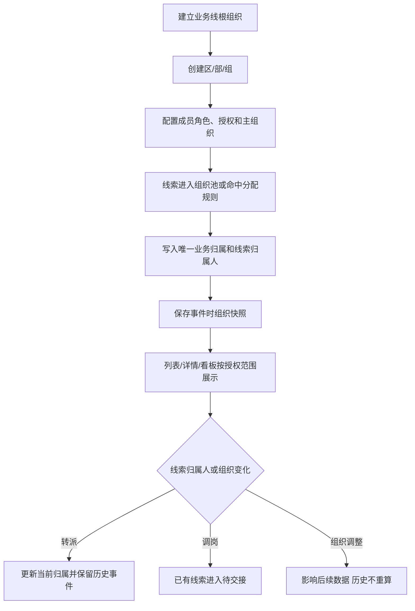

# CRM组织架构&数据权限

> 将一级业务线数据权限升级为最多四级的组织树；成员按功能角色获得操作能力、按数据授权获得数据范围、按主组织确定行政归属，业务数据按事件发生时的组织快照归属。
> 需求编号：REQ-ORG-001｜状态：待评审｜更新时间：2026-11-12
> 需求类型：权限与审计｜补充类型：业务流程、规则与状态、表单与列表

## 交互原型

[打开完整交互原型](https://h3-ai-lab.github.io/hhhprd/projects/crm-org-data-permissions/prototype/)

## 目标与范围

**目标**

同一业务线下支持区、部、组等组织层级，实现同级团队数据隔离；管理者按授权组织及下级查看数据；人员调组、转派和组织调整不影响已发生业务的历史归属。

**做**

- 将一级业务线升级为最多四级的组织树。
- 支持在系统配置中新增业务线，并将其初始化为组织树一级节点。
- 一个成员配置一个功能角色，并可同时选择一个或多个业务线；每条业务线分别配置一条数据授权和一个主组织。
- 支持“本人”“指定组织及下级”“本业务线全部”三种数据范围。
- 线索、通话、跟进和订单使用当前业务归属与事件时组织快照。
- 销售中心、用户中心、订单中心、通话、看板、搜索、下钻和导出使用同一数据边界。
- 组织、授权、调岗、转派和导出操作接入审计。
- 迁移一级业务线存量数据，并保留历史口径。

**不做**

- 不建设完整 HR 系统，不接入外部人事组织同步。
- 不保留“数据分组”和“组织树”两套并行团队模型。
- 不将业务分类标签作为数据权限依据。
- 不支持一条线索同时归属多个组织。
- 不首期建设跨组织业绩分摊或复杂协作贡献。
- 不新增经营指标、看板页签或导出格式。

### 建议版本切分

| 版本 | 范围 | 是否切换线上数据权限 |
|---|---|---|
| V1 配置底座 | 业务线、组织树、成员多业务线授权、主组织、角色功能权限、操作日志、存量账号映射、权限影子对比 | 否；仅完成配置和差异验证 |
| V2 权限切换 | 销售中心、用户中心、订单中心、通话、搜索、筛选候选、看板、下钻、导入导出及历史兼容 | 是；所有客户数据入口统一切换 |
| V3 管理增强 | 批量调岗、批量交接、组织合并/拆分辅助和权限异常修复工具 | 沿用 V2 权限 |

V2 不按页面拆成多次线上切换，避免销售中心已隔离但用户搜索、订单或导出仍可越权访问。

## 核心模型

| 概念 | 作用 | 不负责 |
|---|---|---|
| 业务线 | 组织树根节点，也是时区、分配和看板的主边界 | 不自动展示其他业务线 |
| 组织节点 | 承载人员、线索、规则和业绩归属，最多四级 | 不替代功能角色 |
| 功能角色 | 决定菜单、页面和动作权限 | 不决定数据范围 |
| 数据授权 | 决定本人、组织子树或整条业务线可见范围 | 不决定是否能编辑或导出 |
| 主组织 | 人员在每条业务线内的行政归属，用于展示、筛选和该业务线默认分配 | 不跨业务线复用，不自动授予管理和数据权限 |
| 当前业务归属 | 线索当前负责的唯一组织节点 | 不复制到多个组织 |
| 线索归属人 | 当前处理该线索的成员账号，可以是 CC 或管理者 | 不是组织节点的行政责任角色，不通过组织节点自动任命 |
| 组织快照 | 事件发生时保存组织 ID、名称和完整路径 | 不随组织改名或人员调岗回写 |

组织层级固定为：

```text
业务线
└── 区
    └── 部
        └── 组
```

不要求每条分支都建满四层；任意层级均可直接承接线索。

## 权限原则

- 功能角色、数据授权、主组织和业务归属分别维护。
- “本业务线全部”只指当前选中的业务线，不包含其他业务线。
- “指定组织及下级”包含所选节点及全部下级，不包含父节点和兄弟节点。
- 同一业务线内的多条数据授权取并集；不同业务线分别判断。
- 成员没有有效主组织时可以查看已有授权数据，但不能接收新分配线索。
- 查看、编辑、转派、配置、导出分别校验，页面可见不等于可以批量导出。
- 菜单、列表、筛选候选、详情、搜索、下钻和下载使用同一数据范围。

## 主流程



## 组织架构

入口：`系统管理 → 系统配置 → 组织架构`。

- 页面提供“新增业务线”动作，仅超级管理员可用。
- 新增业务线填写业务线名称和状态；保存后自动生成一级业务线根节点，不单独填写上级组织或组织层级。
- 业务线名称不可重复；创建成功后出现在组织树及业务线筛选项中。
- 组织树按“业务线 → 区 → 部 → 组”展示，最多四级。
- 页面提供“新增组织”动作；必须选择有效上级，选择一级业务线作为上级时创建“区”，选择区则创建“部”，选择部则创建“组”。
- 组织表单和列表不展示“组织层级”字段，层级仅根据完整组织路径自动推导。
- 同一上级下组织名称不可重复；重命名保留稳定组织 ID。
- 有成员、线索、规则或下级的节点只能停用，不能直接删除。
- 列表提供独立的“更换上级”“合并”“停用”入口，不通过编辑组织名称或状态隐式完成。
- 更换上级、合并或停用保存前展示受影响成员、线索、分配规则数量和涉及组织节点数，并明确说明本次调整对后续数据的影响。
- 操作原因必填；未填写原因时不能提交，取消确认不改变组织和业务数据。
- 停用节点停止接收新成员、授权和分配，历史数据仍可查看。
- 空节点可以删除；跨业务线根节点移动默认禁止。

### 当前操作人的组织树范围

- 操作人可见组织树为“数据授权节点及其全部下级 + 从授权节点到业务线根节点的必要祖先路径”。
- 必要祖先只用于展示完整路径、定位子节点和维护树形结构，不产生数据查看、成员查询、组织编辑或新增权限。
- 祖先节点在树中显示为只读；只有位于操作人数据授权子树内的节点才允许编辑、启停或新增下级。
- 新增“区”时，一级业务线必须出现在父节点候选中。只有操作人有权管理该一级业务线根节点时才允许保存。
- 组织管理员不能通过祖先路径查看或操作兄弟节点。

### 系统配置操作日志

- 业务线新增、编辑和启停必须记录日志。
- 组织新增、编辑、更换上级、合并、停用和启用必须记录日志。
- 成员新增、编辑、角色变更、数据授权变更、主组织变更和启停必须记录日志。
- 角色新增、编辑和删除必须记录日志。
- 日志记录操作时间、模块、操作行为、操作对象、操作原因、操作人、操作结果及变更前后内容；失败和未授权写入尝试同样记录失败原因。
- 普通管理员不能修改或删除日志。

## 成员与功能角色

入口：`系统管理 → 系统配置 → 成员账号`。

- 功能角色全账号唯一，不随业务线重复配置。
- 成员可以多选业务线；每条业务线只能出现一次，并分别配置一条数据授权和一个主组织。
- 新增业务线授权时，数据范围默认“本人”。
- “本人”仅包含当前线索归属人为本人账号的线索，以及通过该线索直接关联的用户、订单、通话和跟进；不包含无归属人的公共池线索或其他成员负责的线索。
- 公共池领取入口由功能角色和主组织决定；领取成功后线索归属人变为本人，才进入本人数据范围。
- “本人”数据范围仍需与功能角色、字段权限和导出权限取交集，功能角色决定能看到哪些页面和执行哪些动作。
- “指定组织及下级”使用组织树多选，可同时授权 A、B 多个节点。
- “本业务线全部”仅覆盖当前选中的业务线，并可配置给该业务线的业务线管理员；跨所有业务线的全局范围属于独立的全局能力，不等同于任何一条业务线的“本业务线全部”。
- 只有获得该业务线根节点可管理权限的操作人才能为成员授予“本业务线全部”。
- 数据范围选择“本业务线全部”时，主组织默认自动选择该业务线根节点，仍可由管理员调整为主组织范围内的其他节点。
- “指定组织及下级”的组织候选从业务线下级开始，不展示或选择业务线根节点。
- 每条业务线的主组织必须属于该业务线，且必须位于当前操作人的可管理组织范围内。
- 主组织和“指定组织及下级”的可选节点均受当前操作人组织树范围限制；必要祖先只用于展示路径，不可被选择。
- 一个成员不能在同一业务线拥有多个主组织；不同业务线可以分别拥有一个主组织。
- 数据授权不改变主组织；主组织也不自动扩大数据授权。
- 移除某条业务线时，同时移除该业务线的数据授权和主组织；至少保留一条业务线。
- 角色关闭后立即影响对应动作和页面，不改变历史数据归属。
- 编辑成员时展示简短说明：功能角色决定可用功能，数据授权决定可操作数据范围，主组织决定人员行政归属且不自动产生数据或管理权限。

### 数据范围语义

| 数据范围 | 覆盖对象 | 主组织默认值 | 与其他范围的关系 |
|---|---|---|---|
| 本人 | 当前线索归属人为本人账号的线索及直接关联的用户、订单、通话和跟进；不含公共池和其他成员线索 | 保留当前选择；未选择时要求手动选择 | 新增业务线时默认该项 |
| 指定组织及下级 | 仅所选业务线下级节点及其全部下级，不含业务线根节点直属数据 | 保留当前选择或由管理员选择 | 选择全部现有下级不等于业务线全部，因为不包含根节点直属数据及未来新增节点 |
| 本业务线全部 | 业务线根节点直属数据及全部现有和未来下级节点 | 自动默认业务线根节点，可调整 | 是唯一的整条业务线范围入口 |

主组织只表示人员行政归属。即使主组织选择业务线根节点，配置“指定组织及下级”也不会自动扩大为“业务线全部”。

## 角色与功能影响

角色名称表示功能权限模板，不自动代表数据范围。一个人只有一个功能角色，可以同时拥有多个业务线授权。

| 角色 | 功能权限 | 数据范围来源 |
|---|---|---|
| 超级管理员 | 全局配置、组织和成员管理、全量业务查看 | 系统内置全部业务线 |
| 业务线经理 | 授权业务线内组织、成员、销售和看板操作 | 成员账号中的业务线数据授权 |
| 主管 | 授权节点内的成员、线索和看板操作 | 成员账号中的组织节点及下级授权 |
| CC | 本人线索领取、外呼、跟进和转派权限按角色配置 | 本人及主组织公共池 |

### 功能操作影响

下表是角色权限的示例配置，不是固定岗位预设。每个动作是否开放由功能角色的权限项决定；数据授权只限制该动作可作用的数据范围。

| 页面/功能 | 超管 | 业务线经理（示例） | 主管（示例） | CC（示例） | 变化 |
|---|---|---|---|---|---|
| 新增业务线 | 可新增 | 无权限 | 无权限 | 无权限 | 新增 |
| 组织架构 | 全局管理 | 授权业务线内管理 | 授权节点内管理 | 无权限 | 新增 |
| 成员账号 | 全局管理 | 授权业务线内管理 | 授权节点内管理 | 无权限 | 修改 |
| 角色权限 | 管理 | 只读或按现有功能授权 | 只读或无权限 | 无权限 | 修改 |
| 操作日志 | 全局查看 | 授权范围内查看 | 授权范围内查看 | 无权限 | 修改 |
| 销售中心查看、领取、跟进 | 按权限查看全部 | 授权业务线内操作 | 授权节点内操作 | 本人操作 | 收紧或复用 |
| 分配线索 | 按权限全局操作 | 业务线内操作 | 节点内操作 | 按角色配置 | 复用 |
| 转派线索 | 按权限全局操作 | 业务线内操作 | 节点内操作 | 角色开启转派权限即可执行，目标候选仍受数据授权限制 | 复用 |
| 回公海、掉库 | 按权限全局操作 | 业务线内操作 | 节点内操作 | 按角色配置 | 复用 |
| 用户、订单、通话查看 | 按权限查看全部 | 授权业务线内查看 | 授权节点内查看 | 仅本人客户 | 收紧或复用 |
| 管理看板查看、下钻 | 全量查看 | 业务线范围查看 | 节点范围查看 | 仅个人数据 | 复用并收紧 |
| 导入、导出 | 独立授权 | 独立授权 | 独立授权 | 默认关闭 | 收紧 |

### 数据归属影响

| 功能 | 涉及数据 | 写入/变更规则 |
|---|---|---|
| 新增业务线 | 业务线根组织 | 创建一级根节点，成为后续数据授权边界 |
| 新增或调整组织 | 组织 ID、父子关系和完整路径 | 后续业务归属使用新路径，历史快照不回写 |
| 编辑成员 | 功能角色、逐业务线数据授权、逐业务线主组织 | 只改变后续操作能力和新数据默认归属 |
| 新 Leads 分配 | 线索归属人、当前业务归属 | 规则分配写入目标组织；直接分配使用接收人在该业务线的主组织 |
| 公共池领取 | 线索归属人、当前业务归属 | 归属领取入口所在组织 |
| 转派 | 线索归属人、当前业务归属、分配历史 | 保留原线索归属人和原组织事件 |
| 主组织变更 | 人员归属、待处理线索 | 由当前操作人选择直接带走或留在原组织自动分配 |
| 外呼、跟进、预约 | 事件时组织快照 | 继承线索当前业务归属 |
| 支付成交 | 业绩组织快照 | 按支付时线索业务归属统计，历史不重算 |
| 退回公海、掉库 | 线索归属人、公共池组织 | 按线索当前业务线进入对应组织池 |

### 数据可见性影响

| 资源/页面 | 超管 | 业务线经理 | 主管 | CC |
|---|---|---|---|---|
| 组织树 | 全部 | 授权业务线子树及必要祖先 | 授权节点子树及必要祖先 | 无 |
| 成员账号 | 全部 | 授权业务线成员 | 授权节点成员 | 无 |
| 线索列表与详情 | 全部 | 业务线范围 | 节点子树范围 | 本人及主组织公共池 |
| 用户和订单 | 全部 | 关联有权线索或订单的范围 | 节点子树关联范围 | 本人关联范围 |
| 通话与录音 | 全部 | 业务线范围 | 节点子树范围 | 本人线索范围 |
| 筛选和人员候选 | 全部 | 授权业务线及节点 | 授权节点及下级 | 本人主组织及授权范围 |
| 看板汇总与下钻 | 全部 | 业务线汇总 | 节点子树汇总 | 个人汇总 |
| 导出 | 查看范围与导出权限的交集 | 查看范围与导出权限的交集 | 查看范围与导出权限的交集 | 默认关闭 |
| 手机号、录音、附件 | 独立字段权限 | 独立字段权限 | 独立字段权限 | 独立字段权限 |

组织树中的必要祖先只用于路径定位，不产生任何业务数据查看或编辑权限。筛选候选、搜索结果、聚合看板、明细下钻和导出必须与对应资源的数据范围一致。

## 线索与数据归属

| 事件 | 当前线索归属人 | 当前业务归属 | 历史快照 |
|---|---|---|---|
| 自动分配 | 目标成员 | 分配规则目标组织 | 记录原分配事件 |
| 公海领取 | 领取人 | 领取入口所属组织 | 记录领取事件 |
| 直接分配给个人 | 接收人 | 接收人在该业务线的主组织 | 先确认业务线，再使用该业务线主组织 |
| 转派 | 新接收人 | 目标成员在该业务线的主组织或指定目标组织 | 保留原线索归属人和原组织 |
| 退回公海 | 清空 | 原组织池或业务线待分配池 | 保留退回原因 |
| 人员调岗 | 暂不自动改变 | 已有线索保持原组织 | 进入待交接清单 |
| 组织改名或移动 | 不改变 | 当前归属节点 ID 不变 | 历史名称和路径快照不变 |

- 外呼、跟进、预约和成交继承线索当前业务归属，不在每次操作时重复选择组织。
- 线索只保留一个当前业务归属；数据授权包含 A+B 不代表线索同时归属 A+B。
- 成交业绩按支付时组织快照统计；历史订单不因当前组织变化重算。
- 过程数据按事件发生时的组织快照统计；当前存量视图按当前归属展示。
- 父节点汇总包含自身直属数据和全部下级，对象只统计一次。

## 数据范围落地

| 模块 | 数据对象 | 范围规则 |
|---|---|---|
| 销售中心 | 公海、我的跟进、已付费、通话记录 | 当前业务归属位于授权子树或本人负责 |
| 用户中心 | 用户及关联线索、订单、学习信息 | 只能查看与有权线索或订单关联的用户部分 |
| 订单中心 | 订单、退款、续费 | 本人、组织子树或业务线授权，与线索范围一致 |
| 管理看板 | 汇总、筛选候选、明细、下钻 | 汇总和明细同范围；无权组织不进入筛选项 |
| 营销配置 | 渠道、产品、落地页 | 仍以业务线为配置边界，节点权限不自动扩大配置权 |
| 导入导出 | 批量导入、下载、外发文件 | 使用当前范围；导出权限独立控制并记录审计 |

## 字段与排序

当前系统配置、成员账号和销售中心列表均没有排序入口或可排序表头，本需求不新增排序能力。所有新增或调整字段均不支持排序。

### 组织架构字段现状与变更

| 现状顺序 | 字段 | 现状位置 | 比对结果 | 目标顺序/位置 | 变更原因 |
|---|---|---|---|---|---|
| 1 | 分组名称 | 数据分组列表 | 改名并升级 | 组织名称 | 支持组织树节点展示 |
| 2 | 业务线 | 数据分组列表 | 保留 | 所属业务线 | 标识一级业务线根节点 |
| — | 上级组织 | 数据分组列表无此字段 | 新增 | 所属业务线之后 | 展示树形父子关系 |
| — | 组织层级 | 原计划字段 | 删除 | 不在表单和列表展示 | 层级仅由完整组织路径自动推导 |
| 3 | 组织行政责任字段（历史字段，已移除） | 数据分组列表 | 删除 | 不在组织表单和列表展示 | 组织节点不配置行政责任角色，管理和操作权限由成员角色与数据授权决定 |
| 4 | 成员数 | 数据分组列表 | 保留 | 上级组织之后 | 保留现有成员汇总 |
| 5 | 状态 | 数据分组列表 | 保留 | 成员数之后 | 保留启停状态 |
| 6 | 操作 | 数据分组列表 | 保留 | 列表最右 | 编辑及新增下级 |

### 成员表单字段现状与变更

| 现状顺序 | 字段 | 比对结果 | 目标顺序/位置 | 变更原因 |
|---|---|---|---|---|
| 1 | 姓名 | 保留 | 基本信息第 1 项 | 不改变现有录入顺序 |
| 2 | 登录邮箱 | 保留 | 基本信息第 2 项 | 不改变现有录入顺序 |
| 3 | 人员类型 | 保留 | 基本信息第 3 项 | 保留现有分类 |
| 4 | 功能角色 | 保留 | 权限配置第 1 项 | 全账号唯一 |
| 5 | 业务线/数据范围 | 修改 | 权限配置第 2 项 | 业务线改为多选，并为每条业务线生成授权配置 |
| 6 | 所属组 | 改名并升级 | 逐业务线授权中的主组织 | 每个业务线选择一个行政主组织 |

| 字段 | 业务规则 | 排序要求 |
|---|---|---|
| 业务线 | 组织树根节点，也是数据授权边界 | 不支持；当前配置页无排序能力 |
| 组织名称 | 节点展示名称，同上级唯一 | 不支持；用于识别和树形定位 |
| 上级组织 | 直接父节点 | 不支持；用于层级识别 |
| 成员数 | 任一业务线主组织为该节点的有效成员数，按成员去重 | 不支持；当前列表无排序入口 |
| 组织状态 | 启用或停用 | 不支持；通过筛选查看 |
| 功能角色 | 成员唯一的页面与动作权限集合 | 不支持；通过筛选查看 |
| 业务线 | 成员可同时选择一条或多条业务线 | 条件排序；沿用业务线业务顺序 |
| 数据授权 | 每条业务线分别配置本人/指定组织及下级/本业务线全部；新增时默认本人 | 不支持；通过筛选和详情查看 |
| 主组织 | 成员在每条业务线唯一的行政归属 | 不支持；用于识别和该业务线候选过滤 |
| 归属组织 | 线索当前完整组织路径 | 不支持；用于识别和筛选 |
| 组织架构筛选 | 按授权组织过滤数据 | 不适用；筛选项不参与排序 |

## 列表与筛选

- 成员账号：原“数据分组”筛选改为“组织架构”，位置保持不变；候选仅包含当前账号可管理节点。
- 销售中心：在“业务线”之后、“CC”之前增加“组织架构”筛选。
- 管理看板：在“业务线”之后、“当前 CC”之前增加“组织架构”筛选。
- 用户中心、订单中心和通话记录的组织筛选沿用各自现有筛选区，不改变原字段位置。
- 公共池按组织分池；一线销售只展示主组织及数据授权内的可领取线索。
- 切换页签、翻页和返回列表时保留当前组织筛选。

## RBAC 权限数据

### 功能权限

| 页面 / 动作 | 默认角色 | 数据范围 | 审计 |
|---|---|---|---|
| 新增业务线 | 超级管理员 | 全局 | 必须记录 |
| 组织架构查看 | 超级管理员、业务线管理员、区域管理员 | 授权节点及下级 | 不记录普通查看 |
| 组织新增、编辑、更换上级、合并、停用和启用 | 同上 | 不得超出授权节点和四级限制；调整前展示影响并要求原因 | 必须记录操作原因和变更前后内容 |
| 成员账号查看 | 同上 | 授权节点内成员 | 不记录普通查看 |
| 成员角色、数据授权、主组织编辑 | 同上 | 不得配置越权角色或组织 | 必须记录 |
| 角色功能权限维护 | 超级管理员 | 全局；其他管理员只读 | 必须记录 |
| 销售中心查看 | 现有销售中心角色 | 本人或授权组织子树 | 普通查看不记录 |
| 线索领取 | CC、区域管理员、业务线管理员、超级管理员 | 来源线索和领取组织须在授权范围 | 必须记录 |
| 线索分配 | 区域管理员、业务线管理员、超级管理员 | 来源线索与目标成员均须在授权范围 | 必须记录 |
| 线索转派 | 任意开通“转派线索”动作权限的角色，包括 CC、主管、业务线管理员和超级管理员 | 源线索、目标成员和组织候选均须在数据授权范围 | 必须记录 |
| 管理看板查看、下钻 | 现有看板角色 | 与组织及 CC 数据范围一致 | 普通查看不记录 |
| 导出 | 需独立导出权限 | 与查看权限取交集 | 必须记录 |

### 字段与数据权限

| 资源 | 可见范围 | 编辑 | 导出 |
|---|---|---|---|
| 组织树、成员数、状态 | 授权组织及下级 | 有管理动作权限的角色 | 本期不新增组织导出 |
| 成员角色、数据授权、主组织 | 授权组织内成员 | 有成员编辑权限的角色 | 沿用现有成员导出权限 |
| 线索归属组织 | 授权组织内线索 | 由领取、分配或转派事件更新 | 需现有销售导出权限 |
| 手机号、录音、客户资料 | 沿用现有销售字段权限 | 沿用现有跟进权限 | 沿用现有脱敏和导出限制 |
| 看板汇总及下钻明细 | 授权组织及现有 CC 范围 | 无 | 需看板导出权限 |

### 权限数据变更

| 变更类型 | 权限层级 | 权限项 | 默认授权 |
|---|---|---|---|
| 新增 | 动作 | 系统配置 → 新增业务线 | 超级管理员 |
| 新增 | 菜单 | 系统配置 → 组织架构 | 超级管理员、业务线管理员、区域管理员 |
| 新增 | 页面 | 组织架构查看 | 同上，按数据授权 |
| 新增 | 动作 | 新增、编辑、启停组织 | 同上，按数据授权 |
| 修改 | 数据 | 角色不再承载组织数据范围 | 数据范围统一由成员账号配置 |
| 新增 | 数据 | 指定组织及下级 | 按成员或业务线单独授权 |
| 修改 | 数据 | 线索、通话、跟进、订单增加组织快照 | 后续新事件全部适用 |
| 新增 | 动作 | 业务线、组织与授权变更审计 | 系统配置写入操作 |

角色名称和成员职级都不能绕过上述权限项。

## 组织调整与离职

- 人员调岗仅处理其已有线索的业务归属，不改变功能角色、数据授权或其他配置。
- 修改人员某条业务线的主组织时，如该人员名下存在该业务线的线索，保存前必须提示当前操作人选择处理方式。
- 选择“直接带走”：保留当前线索归属人，并将这些线索的当前业务归属同步更新为人员在对应业务线的新主组织；历史分配事件和组织快照不回写。
- 选择“留在当前组织节点进行自动分配”：线索当前业务归属保持不变，原线索归属人清空，按原组织的现有分配规则重新分配；没有可用接收人时进入原组织待分配池。
- 两种方式都只处理发生主组织变更的对应业务线，不影响该人员在其它业务线的线索。
- 当前操作人未选择处理方式时不能保存主组织变更。
- 账号停用后立即失去登录、新增分配、领取、查询和导出权限。
- 停用成员当前持有线索由主管处理转派、回收或托管，不静默改归属。
- 历史线索归属人、组织路径、作业和业绩保持原快照，并显示“已停用”。
- 组织合并或拆分先展示影响范围；只迁移当前未结数据，已结束历史不重算。

## 历史迁移

- 以正式切换时间区分旧一级业务线口径和新组织树口径。
- 每个现有业务线建立根组织，现有数据分组映射为组织节点。
- 可靠历史事件直接映射；无法确认的历史数据保留业务线级或进入历史未归属。
- 未结线索可按迁移时线索归属人的主组织建立当前归属，并标记为“迁移时归属”。
- 已结束线索、通话、跟进和订单不批量倒推组织。
- 迁移前输出账号权限差异、历史未归属清单和看板差异。
- 无法确认权限时默认不扩大范围，由管理员人工确认。

## 数据依赖与异常

| 数据 / 场景 | 处理 |
|---|---|
| 组织树 | 使用稳定组织 ID；改名不改 ID，移动改变后续子树范围 |
| 成员授权 | 仅以成员账号数据授权为准，不从角色名称或成员职级推断 |
| 线索归属 | 由成功分配、领取或转派事件更新 |
| 组织快照 | 保存组织 ID、名称和完整路径，后续改名不回写 |
| 超过四级 | 禁止新增或移动，提示先调整下级 |
| 同名组织 | 同一上级下禁止保存 |
| 无主组织成员 | 可查看已有授权，不进入新线索分配候选 |
| 组织停用 | 停止新增成员、授权和分配，历史数据保留 |
| 并发修改 | 保存时组织或成员已变化则拒绝并要求刷新 |
| 权限撤销 | 下一次请求立即生效，列表、详情、下钻和导出同步收紧 |

## 用户故事

```text
超管建立业务线和区/部/组
→ 为区域管理员配置一个功能角色
→ 分别按越南、日本业务线配置数据授权和主组织
→ 区域管理员从授权组织池领取线索
→ 线索记录唯一业务归属并产生组织快照
→ 销售、用户、订单、通话、看板按同一范围展示
→ 人员调岗或组织调整时保留历史，只处理后续数据
```
