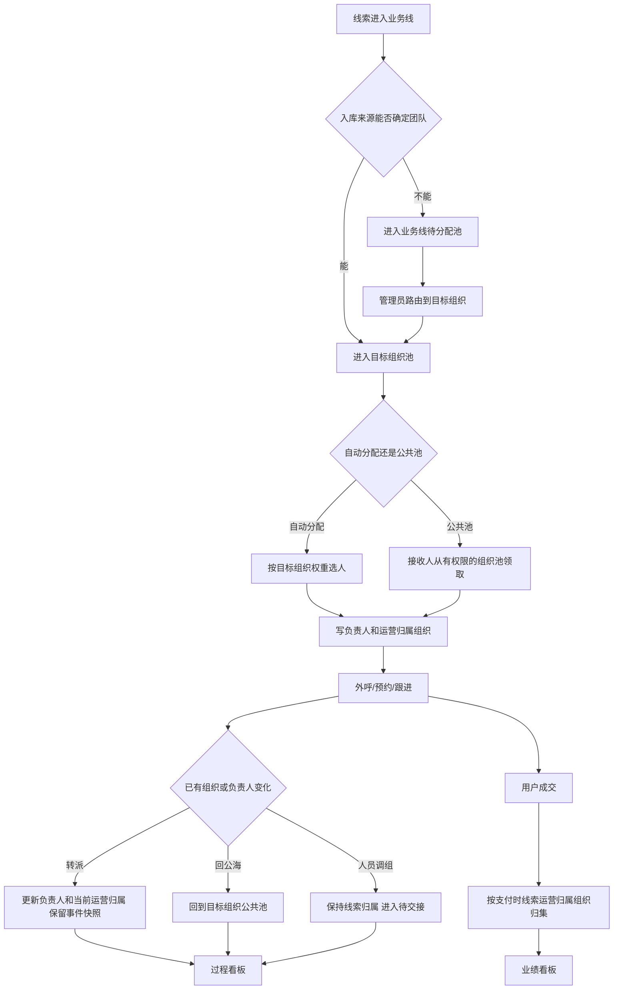

# 多级业务线：完整配置与数据口径模拟

> 目标：用一套可核算的场景，说明线索入库、分配、外呼/跟进，以及超管、组织管理员、销售在作业数据和看板上的可见范围与计算口径。

## 1. 模拟业务线

以“越南业务线”为例：

```text
越南业务线
├── 1区
│   ├── A部
│   │   ├── A1组
│   │   └── A2组
│   └── B部
│       ├── B1组
│       └── B2组
└── 2区
    └── C部
        └── C1组
```

组织节点本身就是数据归属对象。除了下级团队，每个节点也可以直接承接业务：

- 1区直接承接的线索，称为“1区直属”。
- A部直接承接、未落到 A1/A2 的线索，归 A部。
- B部直接承接、未落到 B1/B2 的线索，归 B部。

不额外创建“1区直属”“A部直属”等虚拟节点。页面可以显示“直属”标签，但数据仍归属原组织节点。

## 2. 配置原则

| 配置 | 作用 | 不负责 |
|---|---|---|
| 行政主组织 | 人员组织身份和入职归属 | 不决定所有线索归属 |
| 数据授权 | 可以查看和管理哪些组织的数据 | 不决定本次线索归哪个团队 |
| 功能角色 | 可以进入哪些页面、执行哪些动作 | 不决定数据范围 |
| 线索运营归属 | 线索当前由哪个组织负责 | 不复制成多个主责组织 |

## 3. 组织与负责人配置

| 组织节点 | 上级 | 负责人 | 说明 |
|---|---|---|---|
| 越南业务线 | 根 | 业务线负责人 | 业务线全部范围 |
| 1区 | 越南业务线 | U2 | 可直接承接区级业务 |
| A部 | 1区 | U2 兼管 | 可直接承接部门级业务 |
| A1组 | A部 | A部负责人兼管 | 一线销售组 |
| A2组 | A部 | A部负责人兼管 | 一线销售组 |
| B部 | 1区 | U2 兼管 | 可直接承接部门级业务 |
| B1组 | B部 | B部负责人兼管 | 一线销售组 |
| B2组 | B部 | B部负责人兼管 | 一线销售组 |
| 2区 | 越南业务线 | U3 | 独立区域管理员 |
| C部 | 2区 | U3 兼管 | 可直接承接部门级业务 |
| C1组 | C部 | C部负责人兼管 | 一线销售组 |

“负责人”只是组织记录，不自动产生数据权限、转派权限或配置权限。U2 的权限由成员账号和功能角色显式配置。

## 4. 成员与权限配置

### 4.1 示例成员

| 成员 | 行政主组织 | 功能角色 | 数据授权 |
|---|---|---|---|
| U0 超管 | 公司 | 超级管理员 | 全部业务线、全部组织 |
| U1 业务线管理员 | 越南业务线 | 业务线管理员 | 越南业务线全部 |
| U2 1区管理员兼销售 | 1区 | 1区管理员兼销售 | 1区及全部下级 |
| U3 2区管理员 | 2区 | 2区管理员 | 2区及全部下级 |
| S1 | A1组 | 销售 | 本人 |
| S2 | A2组 | 销售 | 本人 |
| S3 | B1组 | 销售 | 本人 |
| S4 | B2组 | 销售 | 本人 |
| S5 | C1组 | 销售 | 本人 |

U2 同时管理 A部、B部并亲自做业务，但只有一个行政主组织和一个功能角色。A/B 操作范围来自 1区及下级的数据授权；从 A/B 池或规则获得的线索按分配落地组织记录。

### 4.2 功能角色

| 功能 | 超级管理员 | 组织管理员 | 销售 |
|---|---|---|---|
| 管理业务线和组织树 | 全部 | 仅授权节点及下级 | 无 |
| 创建和编辑成员 | 全部 | 授权节点及下级成员 | 无 |
| 分配功能角色 | 全部 | 不授予超级管理员和上级组织角色 | 无 |
| 配置分配和掉库规则 | 全部 | 业务线级规则只读；节点内成员权重和休息日可编辑 | 无 |
| 查看线索列表和详情 | 全部 | 数据范围内 | 本人线索及本组公共池 |
| 领取公共池线索 | 全部 | 数据范围内 | 仅主归属组织公共池 |
| 重新分配线索 | 全部 | 数据范围内，且需转派权限 | 无 |
| 外呼 | 有对应外呼能力时可用 | 操作本人负责线索时可用 | 操作本人负责线索时可用 |
| 跟进记录 | 全部 | 查看范围内；编辑需明确权限，默认仅本人负责线索可编辑 | 本人负责线索 |
| 查看团队看板 | 全部 | 数据范围内 | 仅个人看板 |
| 导出 | 全部 | 默认关闭，需单独导出权限 | 默认关闭 |
| 查看操作日志 | 全部 | 授权范围内 | 无 |

组织管理员是一个功能角色。只有同时配置组织数据授权，才能查看和管理相应范围；仅设置“负责人”不会自动获得这些能力。

### 4.3 字段权限

| 字段/能力 | 超管 | 组织管理员 | 销售 |
|---|---|---|---|
| 姓名、阶段、标签、分配历史 | 全部 | 数据范围内明文 | 本人线索；公共池按领取预览展示 |
| 手机号 | 全部 | 数据范围内可查看；导出仍受独立权限控制 | 本人负责线索可查看；公共池领取前按规则脱敏 |
| 录音、文字稿 | 全量能力 | 数据范围内且有录音权限 | 本人负责线索且有权查看 |
| 客户附件 | 全量 | 数据范围内 | 本人负责线索 |
| 导出 | 单独权限 | 单独权限，默认关闭 | 默认关闭 |

数据范围解决“能看哪些客户”，字段权限解决“能看哪些敏感信息”，导出权限解决“是否能批量带走”。三者不能互相替代。

## 5. 线索入库与分配

### 5.1 线索进入

每条线索入库时记录：

| 信息 | 示例 |
|---|---|
| 业务线 | 越南业务线 |
| 来源 | A部活动、TikTok、人工导入 |
| 分配目标 | 业务线待分配池 / A部 / B部 |
| 当前运营归属 | 待分配池节点或指定组织 |
| 当前负责人 | 空 |
| 创建时间 | 2026-11-11 10:30，`Asia/Ho_Chi_Minh` |

入库来源能够确定团队时，直接进入对应组织池；无法确定时先进入业务线待分配池。

### 5.2 自动分配

示例规则：

| 目标组织 | 接收人 | 权重 | 休息日 |
|---|---:|---:|---|
| A部 | U2 | 20 | 周日 |
| A部 | S1 | 50 | 周一 |
| A部 | S2 | 30 | 周二 |
| B部 | U2 | 20 | 周日 |
| B部 | S3 | 50 | 周一 |
| B部 | S4 | 30 | 周二 |

规则：

- 先确定目标组织，再在该组织的合格人员中按权重分配。
- 接收人必须有该业务线、目标组织、销售跟进权限和有效账号。
- 分配成功时，线索负责人写入接收人，运营归属写入目标组织。
- U2 在 A 部分配中收到线索，归属 A部；在 B 部分配中收到线索，归属 B部。
- 不能因为 U2 的行政组织是 1区，就把 A/B 自动分配的线索归到 1区。

### 5.3 公共池领取

公共池按组织分池：

- A1组销售只能看到 A1组可领取线索。
- A2组销售只能看到 A2组可领取线索。
- U2 可查看并领取 1区、A部、B部范围内公共池线索。
- 从哪个池领取，线索就归哪个组织；领取后负责人变为当前用户。

公共池候选是领取能力，不是无限扩大“本人数据”。销售可以预览主归属组织公共池，但不能查看同组伙伴已经负责的线索。

### 5.4 手工转派

| 操作人 | 目标线索 | 目标人员 | 结果 |
|---|---|---|---|
| U2 | A1组线索 | A2组 S2 | 提示这是跨组转派；成功后归属 A2组 |
| U2 | A部线索 | A1组 S1 | 归属 A1组 |
| U2 | B1组线索 | A1组 S1 | 只有具备跨部转派权限时允许；成功后归属 A1组 |
| S1 | 本人线索 | A2组 S2 | 默认无转派权限；如开放只能选择规则允许的人员 |

转派成功必须记录来源组织、目标组织、原负责人、新负责人、操作人和原因。

## 6. 外呼与跟进

| 场景 | 规则 |
|---|---|
| 销售外呼本人线索 | 允许，产生通话记录 |
| 管理员查看团队通话记录 | 数据范围内允许 |
| 管理员未负责线索时直接外呼 | 默认不允许；先领取或分配给自己 |
| 管理员负责线索后外呼 | 允许，但必须存在对应外呼动作权限 |
| 更新跟进记录 | 默认只有当前负责人可编辑；管理员查看或代操作需单独授权 |
| 转派后的历史外呼 | 保留原外呼组织快照、外呼人和时间 |
| 线索回公海 | 负责人清空，运营归属更新到对应公共池组织 |
| 人员调组 | 已有线索不自动改组织，进入待交接清单 |

## 7. 作业数据可见性

### 7.1 角色矩阵

| 数据/操作 | 超管 U0 | 业务线管理员 U1 | 1区管理员 U2 | 销售 S1 |
|---|---|---|---|---|
| 越南业务线全部线索 | 可见 | 可见 | 否 | 否 |
| 1区及其下级线索 | 可见 | 可见 | 可见 | 否 |
| A部及下级线索 | 可见 | 可见 | 可见 | 否 |
| B部及下级线索 | 可见 | 可见 | 可见 | 否 |
| 2区及下级线索 | 可见 | 可见 | 否 | 否 |
| 同组伙伴负责的线索 | 可见 | 可见 | 可见 | 否 |
| 本人负责线索 | 可见 | 可见 | 可见 | 可见 |
| 主归属组织公共池 | 可见 | 可见 | 可见 | 可领取 |
| 其他部门公共池 | 可见 | 可见 | 范围内可见 | 否 |
| 范围内通话记录 | 可见 | 可见 | 可见 | 仅本人线索 |
| 组织与成员配置 | 全部 | 业务线内 | 1区内 | 否 |
| 角色权限配置 | 全部 | 不授予上级角色 | 不授予上级角色 | 否 |
| 导出 | 默认可用 | 需单独授权 | 需单独授权 | 默认不可用 |

### 7.2 管理范围与作业归属

U2 可以操作 A、B 两边线索，但每条线索仍只有一个运营归属：

| U2 动作 | 负责人 | 运营归属 | 进入谁的团队数据 |
|---|---|---|---|
| 从 A部自动分配获得 | U2 | A部 | A部及1区 |
| 从 B部自动分配获得 | U2 | B部 | B部及1区 |
| 在 A部创建线索 | U2 | A部 | A部及1区 |
| 在 B部领取线索 | U2 | B部 | B部及1区 |
| 处理区级直属线索 | U2 | 1区 | 1区直属及1区 |
| 把 B线索转给 A1销售 | A1销售 | A1组 | A1、A部、1区 |

U2 的个人视角可以把三种作业数据合并展示，但团队看板必须分别计入对应组织，不能在 A 和 B 各复制一次。

## 8. 端到端流程



## 9. 看板数据口径

### 9.1 看板分层

| 看板 | 回答的问题 | 使用哪个归属 |
|---|---|---|
| 当前作业看板 | 现在有哪些线索、由谁负责、在什么阶段 | 当前负责人、当前运营归属 |
| 过程看板 | 某段时间入库、分配、外呼、跟进和接通多少 | 事件发生当时的组织快照 |
| 业绩看板 | 某段时间成交多少订单、多少金额、来自谁 | 支付时线索运营归属组织 |
| 个人看板 | 本人亲自做了多少业务 | 本人负责的线索、通话和成交 |

### 9.2 指标定义

| 指标 | 计算规则 |
|---|---|
| 新入库线索 | 按 `lead_id` 去重，统计创建时间在范围内的线索 |
| 已分配线索 | 按 `lead_id` 去重，统计范围内首次或再次成功分配事件 |
| 未分配线索 | 当前负责人为空且仍在有效待分配池中的线索 |
| 分配率 | 已分配线索数 ÷ 新入库线索数；使用同一创建批次和业务线 |
| 外呼次数 | 按 `call_id` 去重，统计外呼开始时间在范围内且结果有效的通话 |
| 接通次数 | 同上，仅统计最终接通状态 |
| 接通率 | 接通次数 ÷ 外呼次数 |
| 跟进线索数 | 按 `lead_id` 去重，统计至少有一条有效跟进记录的线索 |
| 成交订单数 | 按 `order_id` 去重，统计支付时间在范围内且已支付订单 |
| 成交金额 | 按订单实际支付金额求和；不同币种不直接相加 |
| 线索成交率 | 成交线索数 ÷ 同一创建或分配口径的线索数 |

### 9.3 组织汇总

```text
1区汇总
= 1区直接承接
+ A部汇总
+ B部汇总

A部汇总
= A部直接承接
+ A1组
+ A2组
```

规则：

- 一条线索只在一个运营组织中被统计一次。
- 父节点汇总包含自身直接承接的数据和全部下级数据。
- 筛选 A部时，包含 A部直接承接、A1组和 A2组，不包含 B部和1区直属。
- 筛选1区时，包含1区直接承接、A部和B部。
- 工作数据、下钻、看板和导出使用同一组织范围。
- 数字下钻后按 `lead_id`、`call_id`、`order_id` 等业务唯一标识去重。

### 9.4 历史变化口径

- 人员调组后，历史过程数据不跟着人员移动到新组织。
- 线索转派后，未来事件按新组织统计，历史事件保留原组织快照。
- 支付完成后修改归属，需要显式业绩调整记录，不静默改写历史收入。
- 组织改名不改统计结果；组织移动会影响后续汇总路径，历史报表使用事件时的组织路径快照。

## 10. 数值模拟

模拟数据：

| 组织 | 新入库 | 已分配 | 外呼次数 | 接通次数 | 成交订单 |
|---|---:|---:|---:|---:|---:|
| A1组 | 10 | 9 | 24 | 12 | 2 |
| A2组 | 8 | 7 | 20 | 10 | 1 |
| A部直属，U2 | 2 | 2 | 8 | 4 | 1 |
| B1组 | 12 | 10 | 30 | 16 | 3 |
| B2组 | 6 | 5 | 15 | 7 | 1 |
| B部直属，U2 | 2 | 2 | 7 | 3 | 1 |
| 1区直属，U2 | 2 | 2 | 6 | 2 | 1 |
| C1组 | 5 | 4 | 10 | 5 | 2 |
| **合计** | **47** | **41** | **120** | **59** | **12** |

按组织汇总：

| 视图 | 新入库 | 已分配 | 外呼次数 | 接通次数 | 成交订单 |
|---|---:|---:|---:|---:|---:|
| A部 | 20 | 18 | 52 | 26 | 4 |
| B部 | 20 | 17 | 52 | 26 | 5 |
| 1区直属 | 2 | 2 | 6 | 2 | 1 |
| 1区 | 42 | 37 | 110 | 54 | 10 |
| 2区 | 5 | 4 | 10 | 5 | 2 |
| 越南业务线 | 47 | 41 | 120 | 59 | 12 |

U2 的个人数据：

| 个人口径 | 新入库 | 已分配 | 外呼次数 | 接通次数 | 成交订单 |
|---|---:|---:|---:|---:|---:|
| U2 本人负责总量 | 6 | 6 | 21 | 9 | 3 |
| 其中 A部直属 | 2 | 2 | 8 | 4 | 1 |
| 其中 B部直属 | 2 | 2 | 7 | 3 | 1 |
| 其中 1区直属 | 2 | 2 | 6 | 2 | 1 |

不同角色看到的结果：

| 查看人 | 可见范围 | 新入库 | 成交订单 | 说明 |
|---|---|---:|---:|---|
| U0 超管 | 全部业务线 | 47 | 12 | 当前模拟只有越南 |
| U1 业务线管理员 | 越南业务线全部 | 47 | 12 | 包含1区、2区 |
| U2 1区管理员 | 1区及下级 | 42 | 10 | A部、B部、区直属都包含，自己亲自产生的业绩也在内 |
| U2 个人视角 | 本人 | 6 | 3 | A部、B部、区直属分别可见来源 |
| S1 A1销售 | 本人 | 10 | 2 | 看不到 A2、B部和管理者直属数据 |
| S3 B1销售 | 本人 | 12 | 3 | 看不到 A部和管理者直属数据 |
| S5 C1销售 | 本人 | 5 | 2 | 看不到1区数据 |

这个模拟验证了：

- U2 从 A部池或 A部规则获得的线索，业绩计入 A部。
- U2 从 B部池或 B部规则获得的线索，业绩计入 B部。
- 无来源直接分给 U2 的线索，业绩计入其行政主组织1区。
- U2 的个人总量可以合并 A/B/区级数据，但团队汇总只计入各自组织一次。
- S1、S3 不会因 U2 管理范围较大而看到彼此线索。

## 11. 关键边界场景

| 场景 | 处理 |
|---|---|
| U2 有 A+B 数据权限 | 可以操作 A/B 线索；线索原有或分配目标组织不变 |
| U2 直接接收无来源线索 | 归属 U2 的行政主组织1区 |
| A线索转给 B1销售 | 成功后归属 B1组；历史分配仍显示原 A组织 |
| 人员从 A1 调到 A2 | 已有线索不自动迁组，进入待交接；新线索按新主组织 |
| 组织改名 | 当前显示新名称，历史快照保留原 ID 和名称 |
| 组织合并 | 先展示影响范围，明确迁移映射；历史报表不静默重算 |
| 权限撤销 | 下一次请求即时生效；筛选、详情、看板、下钻和导出同时失效 |
| 用户有看板权限但无明细权限 | 不允许通过看板下钻绕过；默认看板和明细范围保持一致 |

## 12. 建议最终配置

1. 业务线为组织树根节点，每个节点允许直接承接业务。
2. 成员维护一个功能角色、一条数据授权和一个行政主组织。
3. 有明确来源时按来源目标组织归属；直接分给个人且无来源时归行政主组织。
4. 线索只保留一个当前运营归属组织，分配来源决定默认值。
5. 组织管理员功能权限与数据范围分开配置，一个人只有一个功能角色。
6. 销售默认本人数据，公共池按主归属组织单独控制。
7. 看板分为当前作业、过程、业绩和个人四种口径。
8. 历史过程与业绩使用事件时组织快照，当前列表使用当前组织。
9. 父组织看板包含自身直属和全部下级。
10. 首期不做跨部门业绩分摊，所有业绩严格按线索成交时的运营归属组织统计。
