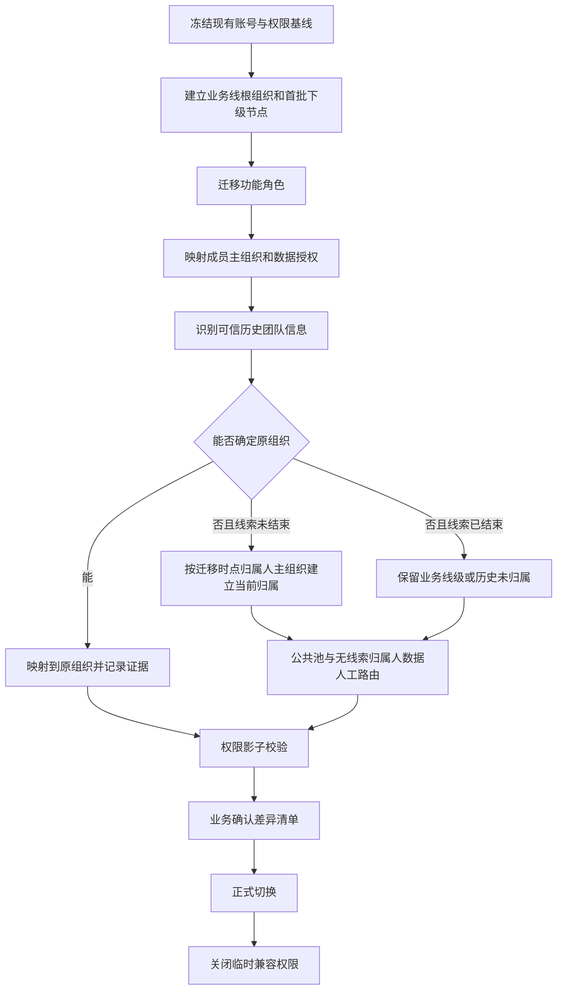

# 多级业务线：存量账号与历史数据处理方案

> 结论：存量账号先迁移功能和权限，再迁移现有作业归属；历史线索、通话、跟进和订单必须区分“可靠历史事实、迁移时的当前归属、无法确认的历史数据”，不能统一倒推成新组织节点。

## 1. 处理原则

| 原则 | 业务含义 |
|---|---|
| 新老口径分开 | 上线前数据保留原业务线和线索归属人；上线后数据使用新组织树 |
| 不用现在反推过去 | 当前线索归属人后来调组，不能改变历史作业和成交的组织归属 |
| 无证据不猜测 | 无法确认 A/B/C 的存量数据进入“历史未归属”，不随机塞入某个节点 |
| 当前存量可以做迁移快照 | 仍有效的线索可以按迁移时点线索归属人的主组织建立当前归属，并标记为“迁移归属” |
| 历史业绩不重算 | 已成交订单和已结束作业默认保留原业务线与业绩事实，不重新分配 |
| 权限先保业务连续 | 迁移期间允许使用短期兼容权限，避免组长突然看不到全部存量 |
| 全程可追溯 | 记录迁移来源、置信度、批次、操作人、原值和新值 |

## 2. 上线时的数据分界

建议以正式切换时间作为边界：

```text
切换前：原一级业务线口径
切换后：组织树 + 唯一运营归属 + 作业组织快照
```

切换后即使补录映射，也要保留切换前的事实，不覆盖原业务线。

## 3. 存量账号与权限迁移

### 3.1 先建立有效权限基线

当前系统没有组织数据配置，首先需要导出每个账号的当前实际权限：

| 盘点项 | 用途 |
|---|---|
| 账号和状态 | 判断哪些人仍在使用 |
| 当前功能角色 | 映射到新功能角色 |
| 当前业务线范围 | 保留业务线级权限 |
| 当前实际可见数据范围 | 作为迁移兼容依据，不按角色名称猜测 |
| 当前所属团队或分组 | 有依据时映射到组织节点 |
| 是否线索归属人或管理员 | 仅用于识别需要人工确认的账号 |
| 当前负责的存量线索 | 用于评估迁移影响 |

如果不同角色叠加后得到实际范围，应按最终有效范围迁移，避免新系统里重复叠加扩大权限。

### 3.2 建立组织根节点

- 每个当前一级业务线创建一个根组织。
- 已确认的部门、组挂到根组织下。
- 暂时无法确认归属的人员放入“历史账号待归属”节点。
- 待归属节点只用于迁移，不作为正式长期组织，不允许自动接收新线索。

### 3.3 账号映射

| 当前情况 | 迁移结果 |
|---|---|
| 已有明确团队和组 | 映射主组织为对应节点 |
| 只有业务线 | 先挂“历史账号待归属”，限制参与新分配 |
| 当前角色可以看整条业务线 | 临时迁移为业务线全部、只读或按业务确认的处理范围 |
| 当前只处理本人数据 | 迁移为本人 |
| 当前存在多个角色和范围 | 去重后迁移最终有效范围 |
| 无法判断实际权限 | 不扩大权限，进入人工确认 |

上线前必须补齐所有要接收新线索人员的组织节点。未配置人员可以登录和处理已有授权数据，但不进入自动分配候选。

## 4. 历史数据的分类

### 4.1 按数据阶段分类

| 数据 | 推荐处理 |
|---|---|
| 未结束且仍有线索归属人的线索 | 保留线索归属人；按迁移时点其主组织建立“当前运营归属” |
| 未结束的公共池线索 | 进入对应业务线或区域的“历史待分配池”，由管理员逐步路由 |
| 已结束、已流失或已关闭线索 | 保留原业务线、线索归属人和状态，不强行拆到 A/B/C |
| 历史通话与跟进 | 保留原线索归属人和原业务线；补充“历史组织未知”标记 |
| 已成交订单和业绩 | 保留支付事实和原业务线；不按当前组织重算 |
| 历史看板结果 | 保留原口径；新看板增加历史口径标识 |
| 已生成的导出文件 | 不追溯修改；再次下载时重新校验当前权限 |

### 4.2 按证据强度分类

| 证据等级 | 可用信息 | 迁移方式 |
|---|---|---|
| A 级：可靠历史事实 | 当时有团队事件、明确团队标签、分配记录、归属历史 | 直接映射到组织节点，保留证据来源 |
| B 级：迁移时点可确认 | 有当前线索归属人和已经确认的新组织，但没有历史组织记录 | 用于当前未结线索，标记“迁移时归属”，不作为历史事实 |
| C 级：仅有业务线 | 只有一级业务线和线索归属人，没有团队信息 | 保留业务线级或进入历史未归属 |
| D 级：冲突或不确定 | 多人归属冲突、标签与组织冲突 | 进入人工确认，不自动扩大权限 |

## 5. 历史线索的归属字段

建议为存量数据保留两类信息：

### 5.1 历史事实

- 原业务线。
- 原线索归属人。
- 原分配和跟进记录。
- 原线索状态。
- 原始线索标签。
- 历史创建、外呼、跟进、成交时间。

### 5.2 迁移后的当前运营归属

- 迁移时线索归属人。
- 迁移时主组织。
- 迁移时完整组织路径。
- 归属生效时间。
- 归属来源：可靠历史、迁移时推断、人工确认。
- 置信度和迁移批次。

这两种信息必须并存。不能把“迁移时当前组织”写成“线索创建时的历史组织”。

## 6. 推荐迁移流程



## 7. 历史看板怎么算

### 7.1 历史已结束业务

- 业务线总量保持不变。
- 线索归属人个人数据保持不变。
- 不因为当前组织映射而重新计算 A/B/C 部门业绩。
- 如果只有业务线口径，就显示“历史口径：业务线级”。

### 7.2 当前未结线索

可以按照迁移时点的主组织显示当前部门归属：

```text
迁移前：越南业务线 / 线索归属人 U2
迁移时：越南业务线 / 1区 / A部 / 线索归属人 U2
```

同时标注“当前归属建立于迁移时”，不宣称 2025 年这条线索属于 A部。

### 7.3 历史业绩可能有三种展示

| 展示方式 | 用途 |
|---|---|
| 按原始业务线 | 保证历史总量和各期报表不变 |
| 按当前线索归属人个人 | 支持个人历史业绩查询 |
| 按新组织路径 | 只展示有可靠映射的记录，并显示覆盖率和未归属量 |

历史组织口径必须显示：

- 已映射线索数。
- 历史未归属线索数。
- 映射覆盖率。
- 映射来源。

不能只展示一个看似完整、实际由推测补出的部门排名。

## 8. 历史数据权限

### 8.1 推荐可见性

| 角色 | 历史数据可见范围 |
|---|---|
| 超管 | 全部 |
| 业务线管理员 | 整条业务线 |
| 当前组织管理员 | 其新数据范围内，以及经确认映射到该范围的历史数据 |
| 销售 | 历史本人负责数据 |
| 历史数据未映射 | 仅超管、业务线管理员；需要时按迁移批次授权对应管理者 |

### 8.2 临时兼容权限

如果切换时大量历史线索尚未映射，可有期限地保留原管理者的业务线级只读权限：

- 只读，不可领取、转派、修改归属或导出；
- 只作用于切换前数据；
- 不与新组织权限叠加为永久权限；
- 设置明确结束时间；
- 到期前必须完成历史数据路由或获得新的正式授权。

这样可以避免旧组长一上线就看不到全部历史客户，同时不破坏新线索的 A/B 隔离。

## 9. 迁移后的组织调整

- 账号调组：新线索使用新组织，已有线索进入待交接。
- 组织改名：保留组织 ID，历史名称作为展示快照。
- 组织合并：先建立映射，已结束历史仍保留原组织，当前未结数据才迁移。
- 组织拆分：原历史不自动拆分，新增业务进入新组织；如业务要求拆分历史，使用独立迁移批次。
- 删除组织：有历史数据的节点只能停用，不能删除。

## 10. 需要产出的迁移材料

| 材料 | 内容 |
|---|---|
| 账号权限基线 | 每个账号的当前角色、业务线、实际可见范围 |
| 组织映射表 | 旧业务线/组到新组织节点的映射 |
| 成员映射表 | 旧账号到新主组织和数据授权 |
| 历史数据映射表 | 历史线索、订单与迁移后当前归属 |
| 未归属清单 | 无法确认组织的数据及原因 |
| 权限差异清单 | 新旧可见范围变化、扩大项和遗漏项 |
| 看板差异清单 | 按业务线、线索归属人、部门的历史数字变化 |
| 回滚方案 | 映射版本、切换前快照、旧权限恢复方式 |

## 11. 最终建议

1. 新账号配置在切换前完成，否则不接收新线索。
2. 新线索从切换时开始使用完整组织归属。
3. 未结存量线索按迁移时点线索归属人的主组织建立当前归属。
4. 已结束历史不强行拆到最小组织，保留原业务线与线索归属人事实。
5. 有可靠历史证据的数据才做历史部门映射。
6. 无法确定的数据进入“历史未归属”，并提供覆盖率和路由工具。
7. 历史看板优先保证业务线总量和线索归属人数据不变。
8. 只给旧管理者短期只读兼容权限，不允许借兼容权限继续操作新业务。
