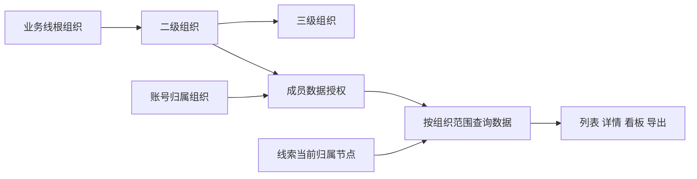

# 多级业务线

> 用 CRM 账号的组织归属和组织树替代“给每条线索叠加多级权限标签”，把数据权限统一收敛为“全部业务线 / 节点及下级 / 本人”三种范围。

| 项 | 内容 |
|---|---|
| 项目状态 | 前置分析，已并入正式项目 |
| 需求编号 | REQ-RBAC-001 |
| 主需求类型 | 权限与审计 |
| 来源方案 | [系统权限与线索分配需求](https://qjphu5vphyf4.jp.larksuite.com/wiki/BRUcwo6ZniAiBBkwH9xjEehVpHg) |
| 正式 PRD | [CRM组织架构&数据权限](../PRD.md) |
| 交互原型 | [打开完整交互原型](https://h3-ai-lab.github.io/hhhprd/projects/crm-org-data-permissions/prototype/) |
| 主要范围 | 组织树、成员归属、数据授权、线索组织归属、销售中心与关联数据隔离、迁移和审计 |

## 项目结论

- 核心配置基线：同一业务线内，一个功能角色、一条数据授权、一个行政主组织节点；一条数据授权可包含多个组织节点。
- 核心数据基线：线索、作业和业绩按发生时点的组织路径留快照；后续人员或组织变化只影响新数据，不回写历史。
- **第一性原则：权限按人配置，数据按组织归集；一人一角色，线索按分配组织归属，作业和业绩沿该组织统计，组织变化不回写历史。**
- 多级隔离不应通过“给每条线索打完整祖先标签”实现。线索只关联当前业务归属节点，层级关系由组织树维护。
- 业务线是组织树的根节点；二级、三级销售团队是该根节点下的组织节点。
- 功能角色决定“能做什么”，数据授权决定“能对哪些对象做”，归属组织决定“人员属于哪里”。三者必须分开。
- 推荐的数据范围是“本业务线全部 / 所选节点及其全部下级 / 本人”。跨业务线用户按业务线分别授权，全局范围只留给明确的超管能力。
- 人员调组不自动批量迁移已有线索；线索需要显式交接，避免客户责任和业绩归属被静默改变。
- 数据隔离必须同时覆盖线索、用户、订单、通话、看板、筛选候选、下钻、搜索、导入和导出；只改销售中心列表不能形成安全边界。

## 项目资料

| 文档 | 用途 |
|---|---|
| [需求分析](REQUIREMENT-ANALYSIS.md) | 现状判断、目标模型、权限规则、线索归属和迁移方案 |
| [影响评估](IMPACT-ASSESSMENT.md) | 对系统配置、销售、分配、看板、接口与现有项目的逐项影响 |
| [决策清单](DECISION-SHEET.md) | 已确认方向、建议冻结项、未决项和启动正式 PRD 的条件 |
| [市场研究](MARKET-RESEARCH.md) | 有赞、金蝶、阿里云、抖店及 Dataverse 的组织与数据权限模式对比 |
| [归属与业绩模型](ATTRIBUTION-MODEL.md) | 一人一角色、组织最多四层、线索与业绩按发生组织归集的简化规则 |
| [完整配置与看板模拟](CONFIGURATION-SIMULATION.md) | 超管、组织管理员、销售的线索作业与看板数据可见性和计算口径 |
| [历史数据迁移](HISTORICAL-MIGRATION.md) | 存量账号、一级业务线线索和已结束历史数据的迁移、权限与看板口径 |

## 当前边界

本文档保留需求推导、市场研究、配置模拟和迁移依据。正式产品定义与交互原型见 [CRM组织架构&数据权限](../PRD.md)。

## 推荐的最小闭环

