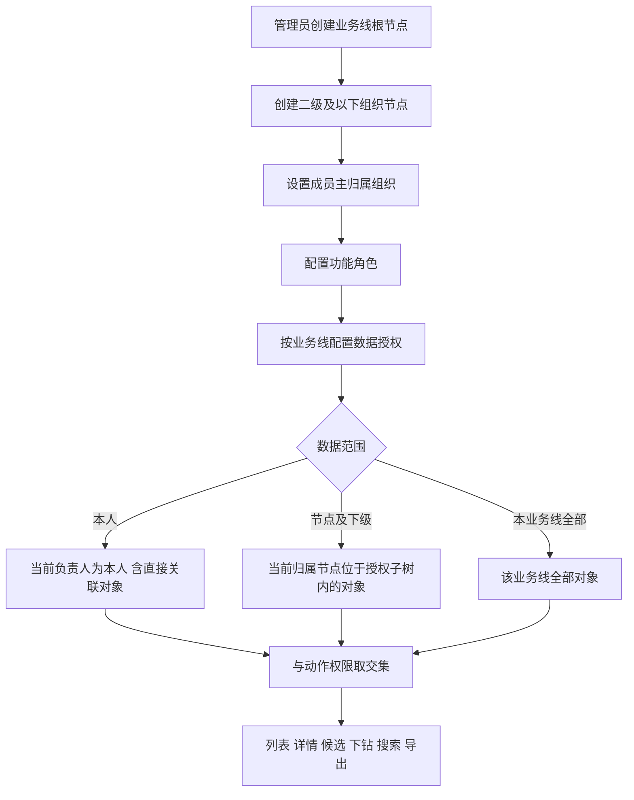

# 多级业务线：需求分析

> 结论：现有权限依赖线索标签时，团队层级一旦增加，标签必须重复表达业务线、团队路径和授权关系；改为“组织树 + 对象当前归属节点”后，线索只需记录一个当前组织节点，祖先范围和隔离关系由组织树统一解释。

## 1. 问题定义

当前业务线基本是一级结构。不同二级团队的管理者获得同一业务线数据权限后，可以看到彼此的客户，无法形成二级隔离。现有标签方案还会继续遇到以下问题：

| 标签方案的问题 | 业务影响 |
|---|---|
| 每条线索都要标记业务线、二级团队、三级团队，甚至多个可见组织 | 层级越深，标签规则越多，配置和维护成本指数上升 |
| 团队合并、拆分、改名或换上级时，需要批量改历史线索标签 | 数据容易漏改、错改，旧权限和新组织结构不一致 |
| 同一人员兼任多个团队时，需要给线索叠加多个授权标签 | 标签组合爆炸，难以解释“为什么他能看到” |
| 标签容易和业务分类混用 | 有人修改分类标签后，数据权限被意外扩大或收紧 |
| 标签只能说明“打了什么”，不能自然表达“节点及其全部下级” | 每次新增下级团队都要补规则 |

根因不是标签数量不足，而是把“组织层级”编码进了每一条业务数据。组织层级应由组织树维护，业务数据只保留当前归属节点。

## 2. 目标与原则

### 2.1 目标

1. 同一业务线下支持二级及更深组织，实现兄弟节点数据隔离。
2. 管理者可按“所选节点及其全部下级”查看数据，不需要新增团队时重复配置线索标签。
3. 普通销售默认只看本人数据；跨团队运营、总部角色可按业务需要显式授权。
4. 跨业务线用户按业务线分别授权，不发生一个业务线的“全部”自动扩散到其他业务线。
5. 人员、组织、线索归属和数据授权变化均可追溯，历史客户不会因组织调整而静默换负责人。

### 2.2 核心原则

| 原则 | 说明 |
|---|---|
| 权限默认最小化 | 未配置有效组织或数据授权时，不自动获得节点或业务线范围 |
| 功能与数据分离 | 角色只配置页面和动作；数据范围只在成员账号和授权记录中配置 |
| 归属与授权分离 | 成员“属于哪个组织”不自动等于“可以查看这个组织及全部下级” |
| 授权与负责人分离 | 组织负责人不会因为头衔自动获得数据、转派或配置权限 |
| 页面与数据一致 | 菜单、接口、筛选候选、下钻、导出使用同一套数据范围 |
| 标签不承担权限 | 标签继续表达意向、来源、营销分类等业务含义，不作为数据隔离依据 |
| 变更不静默迁移责任 | 人员调组不自动把已有客户转给新团队，必须经过明确交接 |

## 3. 目标模型

### 3.1 业务线与组织节点

- 业务线是组织树的根节点，例如“越南业务线”。
- 二级和三级团队是业务线下的组织节点，例如“越南北部”“北部一组”。
- 组织节点保留稳定 ID；改名不改变权限关系，移动上级会改变其所在子树。
- 组织节点只能属于一个业务线根节点。已有人员或数据的节点不允许直接跨业务线移动，避免历史归属被改写。
- “多级业务线”在界面上可以显示为多级名称，但权限语义统一按组织节点处理。

```text
越南业务线
├── 越南北部
│   ├── 北部一组
│   └── 北部二组
└── 越南南部
    ├── 南部一组
    └── 南部二组
```

### 3.2 四个独立概念

| 概念 | 回答的问题 | 不负责什么 |
|---|---|---|
| 归属组织 | 这个人员属于哪个团队 | 不自动授予该团队的数据范围 |
| 功能角色 | 这个人员能进入哪些页面、看到哪些按钮、执行哪些动作 | 不决定能看到哪些客户 |
| 数据授权 | 这个人员能看哪些业务线、组织节点或本人数据 | 不决定是否能编辑、转派或导出 |
| 线索当前归属节点 | 这条线索当前由哪个组织承接 | 不决定线索来源和业务分类 |

### 3.3 账号归属

- 成员可以在多个业务线任职，但建议每个业务线只有一个主归属组织。
- 兼任其他团队时，通过额外数据授权表达可见范围，不通过同一业务线内的多个“所属组”隐式扩大范围。
- 主归属组织用于人员展示、团队筛选、分配候选和默认线索归属；数据授权单独配置。
- 成员没有主归属组织时，可以登录和查看其已有授权，但不能接收新的自动分配或人工转派，直到管理员补齐组织归属。

### 3.4 数据范围

| 数据范围 | 作用对象 | 业务含义 | 推荐默认 |
|---|---|---|---|
| 本业务线全部 | 所选业务线 | 查看该业务线内全部数据 | 仅超级管理员、明确的业务线负责人和总部角色 |
| 节点及下级 | 所选组织节点 | 查看该节点及其全部下级节点承接的数据，不包含父节点和兄弟节点 | 二级、三级管理者按各自节点配置 |
| 本人 | 当前登录成员 | 当前负责人为本人账号的线索及直接关联用户、订单、通话和跟进；不含公共池及其他成员线索 | 一线销售、CC、TMK 默认 |
| 全局全部 | 全部业务线 | 跨所有业务线和组织节点 | 只作为独立超管能力，不混入业务线“全部” |

规则说明：

- “节点及下级”按授权时的组织树解释。组织树调整后，可见范围随新的子树关系变化，变更前必须提示影响。
- 同一业务线内的多条授权取并集；不同业务线分别计算，不因一条业务线的范围较大而扩大其他业务线。
- 获得父节点范围后自然包含全部下级节点；不需要再给每个下级单独授权。
- 查看范围与功能角色中的页面、编辑、转派、配置、字段和导出权限取交集。能看到线索不等于能编辑、转派或导出。
- 公共池领取由功能角色和主组织单独控制；未领取的公共池线索不属于“本人”数据，领取后才进入本人范围。
- 候选筛选项也只展示可授权或可查看的组织、成员和业务线，不能通过搜索探测无权对象。

### 3.5 数据对象归属

所有需要组织隔离的客户对象都必须有明确的业务归属，而不是依赖权限标签。至少包括：

| 对象 | 业务归属 | 数据范围判断 |
|---|---|---|
| 线索 | 业务线、当前归属组织节点、当前负责人 | 本人按负责人；节点按当前归属组织节点；业务线全部按业务线 |
| 用户 | 与线索、订单和业务线的稳定关联 | 只能通过有权访问的线索、订单或本人关系查看；不按姓名全局搜索越权用户 |
| 订单 | 业务线、销售负责人、关联线索或用户 | 本人、节点和业务线分别按订单所属组织及负责人判断 |
| 通话记录 | 通过线索或订单关联到业务归属 | 继承关联线索的数据范围，不单独扩大范围 |
| 看板与导出 | 同筛选范围内的聚合和明细 | 汇总、下钻和下载必须使用同一范围和去重口径 |

一个用户可能同时关联多个业务线或订单。涉及用户、订单等跨对象查看时，必须以具体线索或订单的归属关系判断，不能因为用户曾经属于某业务线就默认展示其全部关系。

## 4. 核心权限流程



### 4.1 可见性判定

判定顺序应稳定且可解释：

1. 先校验账号是否启用。
2. 再校验功能角色是否允许进入页面或执行动作。
3. 确定当前查询对象所属业务线。
4. 按该业务线的本人、节点或全部授权计算对象集合。
5. 字段脱敏和导出权限继续单独校验。

任一步骤不通过时，页面显示无权限，接口和导出同样拒绝；不能依靠隐藏菜单或前端筛选实现隔离。

### 4.2 示例

假设组织如下：

```text
越南业务线
├── 北部
│   ├── 北部一组
│   └── 北部二组
└── 南部
    └── 南部一组
```

| 人员 | 主归属 | 数据授权 | 能看什么 |
|---|---|---|---|
| 北部经理 | 北部 | 节点及下级：北部 | 北部一组、北部二组，不含南部 |
| 一组 CC | 北部一组 | 本人 | 只含本人负责的线索 |
| 南部经理 | 南部 | 节点及下级：南部 | 只含南部一组 |
| 越南运营 | 越南业务线 | 本业务线全部 | 越南业务线全部 |
| 总部负责人 | 无单一归属 | 越南、泰国分别授权 | 两条业务线各自按授权范围查看 |

如果北部二组的一条线索被成功转给南部一组，线索的当前归属节点同步变为南部一组。交接完成后，北部经理不再因节点范围看到该线索，南部经理获得可见性；历史分配记录仍保留原节点。

## 5. 线索归属生命周期

线索的组织归属必须由成功的分配事实驱动，不能只根据当前负责人反推。

| 事件 | 线索组织归属变化 | 负责人变化 | 历史记录 |
|---|---|---|---|
| 新建并自动分配 | 设为接收人的主归属组织 | 设为接收人 | 记录分配事件 |
| 公海领取 | 设为领取人的主归属组织 | 设为领取人 | 记录领取事件 |
| 重新分配 | 设为接收人的主归属组织 | 设为接收人 | 保留原节点和原负责人 |
| 退回公海 | 设为公海所属组织或业务线待分配节点 | 清空当前负责人 | 保留退回原因和原归属 |
| 掉库后重分配 | 设为新接收人的主归属组织 | 设为新接收人 | 保留掉库事件 |
| 人员调组 | 已有线索默认不变 | 默认不变 | 进入待交接列表 |
| 明确批量交接 | 更新为新接收人的主归属组织 | 更新为接收人 | 逐条或按批次审计 |

### 5.1 人员调组

人员从“北部一组”调到“北部二组”时：

- 新分配线索进入北部二组。
- 已有一组线索仍保持一组归属，避免一组经理突然失去全部可见性，也避免二组经理自动获得不属于其团队的历史客户。
- 系统生成待交接清单，由原团队、新团队或管理员按业务规则完成交接。
- 交接完成前，原一组经理按原节点范围可继续查看；该人员因本人负责人身份也可查看。
- 不自动转移业绩、首跟 CC、首次分配时间等历史事实。

### 5.2 同一成员同时属于多个组织

成员同时加入 A 组和 B 组时，不能把一条线索同时归到 A、B，否则会出现双负责人、重复统计和两个团队都可修改的冲突。

推荐规则：

- 每个成员在每个业务线只有一个主归属组织，其他团队关系作为额外数据授权或协作关系。
- 线索只保留一个当前运营归属节点。
- 自动分配按触发分配的团队或规则归属决定线索节点，例如命中 A 组的分配规则就归 A。
- 公海领取按领取入口所属节点决定，例如从 A 组公共池领取就归 A。
- 手动转派按目标团队或操作人明确选择的接收节点决定。
- 没有分配来源且无法判断归属时，使用接收人的主归属组织作为默认值。
- 接收人也没有主归属时，阻止自动分配或人工转派，要求先补齐组织配置。
- A 组归属的线索，A 组管理者按节点范围可见；接收成员按本人范围可见；B 组管理者默认不可见。
- 如果 B 组需要共同处理或共享业绩，应另建协作、共享或贡献记录，不能把线索复制成 A、B 两条归属。

### 5.2 离职与停用

- 账号停用后不能新增分配、领取、外呼和导出。
- 已有线索不能被静默转到任意同组人员；系统生成待交接清单。
- 停用前已经被授权导出的历史文件不自动撤回，但后续下载必须重新鉴权。
- 历史记录保留原负责人 ID 和姓名快照，并展示“已停用”。

## 6. 组织调整规则

| 操作 | 适用条件 | 对权限的影响 |
|---|---|---|
| 新建节点 | 必须属于一个业务线根节点且上级有效 | 新节点尚无成员和数据 |
| 重命名 | 任意有效节点 | 不改变已授权范围和对象归属 |
| 更换上级 | 不形成环、不跨业务线根节点 | 子树归属变化，相关成员节点范围同步变化 |
| 停用节点 | 可保留已有成员和数据 | 停止新增成员、授权、分配和候选；历史数据仍可查 |
| 合并节点 | 明确迁移映射和目标节点 | 成员、线索、规则和历史按映射迁移并形成审计 |
| 删除节点 | 仅允许无成员、无线索、无规则、无历史、无授权的空节点 | 不产生权限变化 |

更换上级、合并或停用会改变多人可见范围，必须展示受影响成员数、线索数、分配规则和看板范围，并要求填写原因。组织调整不能通过直接删除旧节点来实现，否则历史归属会丢失解释。

## 7. 与现有业务线/数据分组方案的关系

现有方案已经引入“业务线 + 数据范围 + 数据分组”，其方向可复用，但需要升级：

| 现有概念 | 多级业务线目标 |
|---|---|
| 业务线 | 组织树根节点；仍是业务隔离和时区、分配规则的主边界 |
| 数据分组 | 转为可嵌套的组织节点，不再作为与组织并行的第二套团队体系 |
| 所属组 | 转为成员在每个业务线下的主归属组织 |
| 指定组数据 | 转为“所选组织节点及全部下级” |
| 角色数据范围 | 从角色移出，避免角色与成员重复配置 |
| 分组负责人 | 保留为组织负责人记录；不自动授予数据或配置权限 |

现有文档中“本期不新增组织层级”的边界与本项目冲突。若两级团队方案已经进入开发，应优先确认是否直接扩展为组织树；不应并行维护“数据分组”和“组织节点”两套团队关系。

## 8. 存量迁移

### 8.1 组织迁移

1. 每个现有业务线建立一个根组织。
2. 现有数据分组按实际关系挂到根组织下，成为二级节点。
3. 已有成员归属去重后映射为主归属组织。
4. 现有分组负责人迁移为组织负责人，不额外授予权限。
5. 没有有效组织、存在多组冲突或跨业务线冲突的成员进入人工确认清单。

### 8.2 权限迁移

| 现有有效范围 | 迁移结果 |
|---|---|
| 本人数据 | “本人” |
| 指定组数据 | 映射后的所选节点及全部下级 |
| 业务线全部数据 | 该业务线根节点全部 |
| 角色带业务线范围且成员账号也带范围 | 按上线前实际有效结果去重后迁移，不叠加产生更大范围 |
| 无法确定实际可见范围 | 默认不扩大权限，进入人工确认 |

迁移不能按角色名称猜测范围，也不能因为账号叫“经理”就自动升级为节点或业务线全部。上线前应使用真实账号做只读影子校验，输出“旧范围 / 新范围差异清单”，确认无扩大和遗漏后再切换。

### 8.3 线索迁移

- 能从有效负责人、分配事件或现有组织关系确认归属的线索，写入当前组织节点。
- 只能从权限标签推断的线索不直接把标签继续作为新权限依据；标签用于辅助生成迁移候选并人工确认。
- 公共池线索归入明确的待分配节点，不能因无负责人而对所有节点管理者不可见。
- 历史组织节点 ID 应保留；无法确认的历史记录显示“历史归属未知”，不强行补成当前负责人所在组织。

## 9. 成功衡量

| 指标 | 目标含义 |
|---|---|
| 兄弟节点越权查看数 | 上线后应为 0，包括列表、搜索、详情、下钻和导出 |
| 权限配置所需线索标签规则数 | 与组织层级和成员数量相关，不随线索数量增长 |
| 有明确组织归属的在职销售占比 | 未归属人员不能接收新线索 |
| 调组后待交接线索量 | 可被业务管理者看见、处理和归零 |
| 权限变更与线索交接审计覆盖率 | 100% 覆盖授权、调组、转派、跨节点操作和导出 |
| 同范围下汇总与明细一致性 | 看板数字可通过同范围明细复核 |

## 10. 非目标

- 不在本项目中建设完整 HR 系统或自动同步外部人事组织。
- 不把业务分类标签、购买意向标签改造成权限标签。
- 不允许组织负责人仅凭头衔自动获得全部下级数据或配置权限。
- 不自动批量迁移人员调组后的已有客户责任。
- 不支持无审计的跨业务线、跨节点批量转移或组织合并。
