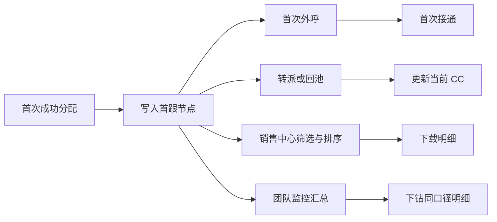

# 引入首跟节点&首跟看板-2

> 在线索首次成功分配时记录首跟 CC，后续转派不覆盖；销售中心支持首跟字段的筛选、排序和下载，团队监控提供按首跟 CC 的汇总与下钻。
> 需求编号：REQ-CC-002｜状态：待评审｜更新时间：2026-11-11
> 需求类型：表单、字段与列表｜补充类型：权限与审计、看板与指标

## 交互原型

[打开完整交互原型](https://h3-ai-lab.github.io/hhhprd/projects/first-contact/prototype/)

## 评审结论

| 项目 | 结论 |
|---|---|
| 要解决的问题 | 线索转派后无法批量识别最初承接人、首次联系进度和真实外呼产出 |
| 本期结果 | 首跟节点可追溯，销售中心可筛选、排序、下载，团队监控可汇总和下钻 |
| 核心原则 | 首跟 CC 只在第一次成功分配时写入，后续转派、回池和再次领取不覆盖 |
| 业务边界 | 不改变现有领取、分配、掉库和转派流程，不新增现金激励或绩效结算 |
| 适用范围 | 公海、我的跟进、已付费及新增的团队监控 |

## 范围

**做**

- 记录首跟 CC、首次分配时间、首次外呼时间和首次接通时间。
- 展示并筛选累计外呼次数、外呼接通次数。
- 销售中心支持字段排序，并按当前筛选和排序下载明细。
- 新增团队监控，按首跟 CC 汇总承接量、外呼量、接通量及覆盖率。
- 汇总支持下钻和导出，并接入完整 RBAC 权限。

**不做**

- 不改变现有线索生命周期和负责人转派规则。
- 不新增“是否已流转”字段，直接比较首跟 CC 与当前 CC。
- 不用当前 CC 或历史状态推测缺失的首跟 CC。
- 不执行个人绩效结算、员工评级或现金奖励。

## 业务流程

## 核心规则

- 自动分配、公海领取和组长直接分配成功，均视为首次取得归属。
- 并发领取只能有一个成功结果，仅成功分配事件写入首跟节点。
- 转派、掉库、回池、退款和订单状态变化不重置首跟 CC。
- 有有效外呼记录即写入首次外呼时间，不区分接通结果；产生接通记录后写入首次接通时间。
- 分配、外呼和跟进事件必须幂等，重复事件返回原结果。
- 历史数据只回填可验证事件，无法确认时显示“历史未知”。
- 列表、团队监控、下钻和下载使用同一权限、筛选和去重口径。

## 页面变化

| 页面 | 主要变化 |
|---|---|
| 销售中心 | 在现有来源字段后、操作列前增加首跟 CC、当前 CC、跟进阶段、3 个首次时间和 2 个次数字段 |
| 销售中心筛选 | 首跟 CC 紧邻现有 CC；日期类型增加首次分配时间；新增首次外呼、首次接通和次数区间筛选 |
| 团队监控 | 按国家、首跟 CC 和日期筛选，展示承接量、首次外呼量、首次接通量、外呼总量和接通总量 |

完整列顺序、筛选区位置和逐字段排序规则见 [DETAILS.md](DETAILS.md)。

## 核心指标

| 指标 | 口径 |
|---|---|
| 首跟覆盖率 | 首跟 CC 非空的线索数 ÷ 进入销售中心的线索数 |
| 首次外呼覆盖率 | 首跟线索中首次外呼时间非空的数量 ÷ 首跟 CC 非空线索数 |
| 首次接通覆盖率 | 首跟线索中首次接通时间非空的数量 ÷ 首跟 CC 非空线索数 |
| 外呼总量 | 筛选范围内外呼次数之和 |
| 接通总量 | 筛选范围内外呼接通次数之和 |
| 接通率 | 接通总量 ÷ 外呼总量；分母为 0 时显示“—” |

## 权限摘要

| 能力 | 默认角色 | 数据范围 |
|---|---|---|
| 查看首跟字段 | 沿用销售中心现有角色 | 现有线索数据权限 |
| 查看团队监控、筛选和下钻 | 超级管理员、系统管理员、销售组长、业务负责人 | 授权业务线、团队或本人范围 |
| 团队监控导出 | 需单独拥有导出权限 | 与查看权限取交集 |

菜单、页面、查询、下钻和导出分别校验权限。销售专员、推荐运营和自定义角色不自动获得团队监控权限。

完整的功能权限、字段权限和权限数据变更见 [DETAILS.md](DETAILS.md)。

## 研发展开

[查看研发与 AI 展开说明](DETAILS.md)

该文档包含完整字段字典、排序规则、筛选区顺序、下载字段、RBAC 矩阵、数据依赖和异常处理。
