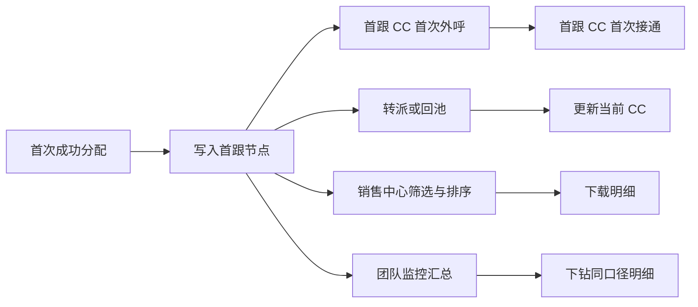

# 引入首跟节点&首跟看板-2

> 在线索首次成功分配时记录首跟 CC，后续转派不覆盖；销售中心支持首跟字段的筛选、排序和下载，团队监控按首跟 CC 展示承接、外呼和接通产出。
> 需求编号：REQ-CC-002｜状态：待评审｜更新时间：2026-11-11
> 需求类型：表单、字段与列表｜补充类型：权限与审计、看板与指标

## 交互原型

[打开完整交互原型](https://h3-ai-lab.github.io/hhhprd/projects/first-contact-concise/prototype/)

## 目标与范围

**目标**

线索转派后，业务人员仍能批量识别最初承接人、首次联系进度和真实外呼产出，并通过同一口径完成列表核对、下载和团队监控。

**做**

- 首次成功分配时写入首跟 CC 和首次分配时间，后续转派、回池或再次领取不覆盖。
- 记录首跟 CC 的首次外呼时间、首次接通时间和累计外呼/接通次数。
- 销售中心展示、筛选、排序和下载上述字段。
- 团队监控按首跟 CC 汇总承接量、首次外呼、首次接通、累计外呼、累计接通和覆盖率。
- 汇总支持下钻和导出，并接入完整 RBAC 权限。

**不做**

- 不改变现有领取、分配、掉库和转派规则。
- 不新增“是否已流转”字段，直接比较首跟 CC 与当前 CC。
- 不用当前 CC 或历史状态推测缺失的首跟 CC。
- 不执行个人绩效结算、员工评级或现金奖励。

## 业务流程

## 业务规则

- 自动分配、公海领取和组长直接分配成功，均视为首次取得归属。
- 并发领取只能有一个成功结果，仅成功分配事件写入首跟节点。
- 首跟 CC 和首次分配时间只写入一次，后续事件不覆盖。
- 首跟 CC 的第一条有效外呼记录写入首次外呼时间，不区分接通、拒接、无人接听或呼叫失败。
- 首跟 CC 的第一条接通记录写入首次接通时间。
- 分配、外呼、接通和跟进事件均按业务事件 ID 幂等处理。
- 历史数据只回填可验证事件，无法确认时显示“历史未知”。
- 列表、团队监控、下钻和下载使用相同筛选范围、时区和去重口径。

## 字段与排序

列表默认按首次分配时间倒序，并以用户 ID 作为稳定的次级排序。用户切换排序后，翻页、切换页签和下载保持当前排序。

| 字段 | 业务规则 | 排序要求 |
|---|---|---|
| 首跟 CC | 首次成功分配时的负责人；保存姓名快照和 CC ID，转派不覆盖 | 支持；姓名升序/降序，空值置后 |
| 当前 CC | 当前负责人；沿用现有领取和转派规则 | 支持；姓名升序/降序，空值置后 |
| 首次分配时间 | 首次成功取得归属的时间，带业务线时区 | 支持；升序/降序，空值置后；默认降序 |
| 首次外呼时间 | 首跟 CC 第一条外呼记录时间，不区分结果 | 支持；升序/降序，空值置后 |
| 首次接通时间 | 首跟 CC 第一条接通记录时间 | 支持；升序/降序，空值置后 |
| 外呼次数 | 线索关联且已同步的外呼记录总数 | 支持；数值升序/降序，空值按 0；默认降序 |
| 外呼接通次数 | 外呼记录中状态为接通的次数，不得大于外呼次数 | 支持；数值升序/降序，空值按 0 |
| 跟进阶段 | 沿用现有销售阶段及业务顺序 | 条件排序；按配置的业务顺序，不按文字 |
| 用户 ID | 用户唯一识别字段，用于搜索和核对 | 不支持；用于精确查找 |
| 手机号 | 联系方式，用于搜索和外呼 | 不支持；排序没有业务价值 |
| 学生姓名 | 用户识别字段 | 不支持；用于搜索 |
| 购买意向 | 现有意向分类 | 不支持默认排序；通过筛选查看 |
| 用户状态 | 现有付费/体验状态 | 不支持默认排序；通过筛选查看 |
| 用户类型 | 现有用户分类 | 不支持默认排序；通过筛选查看 |
| 年龄段 | 现有课程年龄分组 | 条件排序；按配置的业务年龄顺序 |
| 课程等级 | 现有课程等级 | 条件排序；按业务课程等级顺序 |
| 登录账号 | 用户识别字段 | 不支持；用于搜索 |
| 渠道来源 | 现有渠道来源及落地页 | 不支持默认排序；通过筛选比较 |

字段展示：

- 首跟 CC 离职或改名后保留原 CC ID 和姓名快照，并展示当前账号状态。
- 三个时间字段精确到分钟，按业务线时区展示。
- 无首次外呼或接通记录时显示“—”。
- 外呼次数和接通次数无记录时显示 0；数据未同步时显示最近成功值。
- 首跟 CC 和三个首次时间为只读事实字段。

## 列表与筛选

现有字段及顺序保持不变：

`用户 ID → 学生姓名 → 购买意向 → 用户状态 → 用户类型 → 年龄段 → 课程等级 → 登录账号 → 渠道来源-落地页`

在来源字段之后、操作列之前增加：

`首跟 CC → 当前 CC → 跟进阶段 → 首次分配时间 → 首次外呼时间 → 首次接通时间 → 外呼次数 → 外呼接通次数`

筛选区沿用现有 CRM 的位置和分组：

| 区域 | 现有内容 | 本期调整 |
|---|---|---|
| 第一行 | 搜索、业务线、购买意向、CC | 在 CC 前增加首跟 CC |
| 第二行 | 当前跟进阶段、年龄段、课程等级、渠道来源-落地页、渠道来源-App | 保持不变 |
| 第三行 | 用户状态、销售咨询预约、预约外呼、注册日期及起止日期 | 日期类型增加首次分配时间 |
| 第四行 | 无 | 增加首次外呼状态、首次接通状态、外呼次数区间、外呼接通次数区间 |

筛选规则：

- 搜索范围沿用手机号、用户 ID 和姓名，不扩大到新增字段。
- 业务线、首跟 CC、当前 CC、阶段、状态和次数区间同时生效。
- 次数支持大于等于 0 的整数区间，起止边界均包含。
- 首次分配时间未知的线索不命中任何首次分配时间范围。
- 切换页签、翻页和排序时保留已应用筛选。
- 无结果、无权限、加载失败和数据未同步分别展示对应状态。

## 指标具体口径

### 公共口径

- **统计范围**：当前业务线、首跟 CC、日期类型和日期范围筛选后的线索。
- **线索去重**：所有人数类指标按 Lead ID 去重；外呼和接通次数按 Call ID 去重。
- **时间字段**：选择注册日期时按注册时间筛选；选择首次分配时间时按首次分配时间筛选，起止日期均包含。
- **首跟集合**：首跟 CC 非空的线索；首次外呼、首次接通和次数类指标只统计该集合。
- **零值展示**：分母为 0 时显示“—”，不显示 0%。
- **百分比精度**：统一保留一位小数；数值超过 100% 时原样展示。

### 指标定义

| 指标 | 分子 | 分母 | 页面与说明 |
|---|---|---|---|
| 首跟承接量 | 首跟 CC 非空的去重 Lead 数 | — | 团队监控顶部；展示筛选范围内可确认首跟节点的线索量 |
| 首跟覆盖率 | 首跟 CC 非空的去重 Lead 数 | 筛选范围内全部去重 Lead 数 | 团队监控顶部；同步显示“分子 / 分母” |
| 首次外呼线索数 | 首跟集合中首次外呼时间非空的去重 Lead 数 | — | 团队监控“外呼与接通”和首跟 CC 明细 |
| 首次外呼覆盖率 | 首跟集合中首次外呼时间非空的去重 Lead 数 | 首跟集合去重 Lead 数 | 团队监控“外呼与接通”；同步显示“分子 / 分母” |
| 首次接通线索数 | 首跟集合中首次接通时间非空的去重 Lead 数 | — | 团队监控“外呼与接通”和首跟 CC 明细 |
| 首次接通覆盖率 | 首跟集合中首次接通时间非空的去重 Lead 数 | 首跟集合去重 Lead 数 | 团队监控“外呼与接通”；同步显示“分子 / 分母” |
| 外呼总量 | 首跟集合中所有外呼次数之和 | — | 团队监控顶部；计数单位是“通”，不是线索数 |
| 接通总量 | 首跟集合中所有外呼接通次数之和 | — | 团队监控顶部；必须是外呼总量的子集 |
| 外呼接通率 | 接通总量 | 外呼总量 | 团队监控顶部；外呼总量为 0 时显示“—” |

### 首跟 CC 明细口径

每位首跟 CC 分别计算：

- 首跟承接量：该 CC 作为首跟 CC 的去重 Lead 数。
- 首次外呼线索数及覆盖率。
- 首次接通线索数及覆盖率。
- 外呼总量和接通总量仍按该 CC 的首跟集合汇总。

指标名称、分子、分母和页面展示必须与上述定义一致，不能把“外呼线索数”和“外呼总次数”混用。

## 团队监控页面

入口：`销售管理 → 团队监控`。

页面展示：

- 顶部指标卡：首跟承接量、首跟覆盖率、外呼总量、接通总量及外呼接通率。
- 首跟 CC 明细表：承接量、首次外呼线索数、首次外呼覆盖率、首次接通线索数、首次接通覆盖率。
- 筛选条件：业务线、首跟 CC、日期类型、开始日期、结束日期。
- 每个指标同时展示分子和分母；汇总数字支持下钻到同口径销售中心明细。
- 导出使用当前筛选、排序、去重和权限范围。

## 下载

下载使用当前筛选和排序，不受分页限制。文件至少包含：

`lead_id、user_id、business_line、first_cc_id、first_cc_name、first_assigned_at、first_outbound_at、first_connected_at、outbound_count、outbound_connected_count、current_cc_id`

- 下载前展示行数、日期范围和时间口径。
- 下载失败时不生成空白或部分文件。
- 联系方式、录音等敏感字段沿用现有导出权限。
- 操作日志记录操作人、筛选条件、数据范围、行数和生成时间。

## RBAC 权限数据

### 功能权限

| 页面 / 动作 | 默认角色 | 数据范围 | 审计 |
|---|---|---|---|
| 团队监控菜单及查看 | 超级管理员、系统管理员、销售组长、业务负责人 | 角色现有业务线、团队或本人范围 | 权限变更记录审计 |
| 团队监控筛选和下钻 | 同上 | 与汇总查看一致；明细继续校验线索权限 | 不单独记录普通查询 |
| 团队监控导出 | 需单独拥有导出权限 | 与查看权限取交集 | 记录操作人、筛选条件、行数和时间 |
| 销售中心首跟字段查看与下载 | 沿用销售中心现有角色 | 沿用现有线索权限，不扩大范围 | 下载记录审计 |

销售专员、推荐运营和自定义角色不因本需求自动获得团队监控权限。系统内置角色新增成员时继承对应角色权限。

### 字段与数据权限

| 资源 | 可见范围 | 编辑 | 导出 |
|---|---|---|---|
| 首跟 CC、首次时间和外呼次数 | 拥有销售中心或团队监控对应查看权限的角色 | 不可编辑 | 需现有导出权限 |
| 用户 ID、联系方式、录音 | 不因本需求扩大可见范围 | 沿用现有规则 | 沿用现有脱敏和导出限制 |
| 团队监控汇总及下钻明细 | 授权业务线、团队或本人范围 | 无 | 需团队监控导出权限 |

历史补数只能通过可审计的数据修复流程完成，不允许直接编辑展示值。

### 权限数据变更

| 变更类型 | 权限层级 | 权限项 | 默认授权 |
|---|---|---|---|
| 新增 | 菜单 | `销售管理 → 团队监控` | 超级管理员、系统管理员、销售组长、业务负责人 |
| 新增 | 页面 | 团队监控查看 | 同上，按角色数据范围 |
| 新增 | 动作 | 团队监控下钻 | 同上，明细继续校验数据权限 |
| 新增 | 导出 | 团队监控导出 | 需显式导出权限 |
| 复用 | 数据 | 业务线、团队和本人范围 | 沿用成员账号现有数据权限 |

菜单、页面、查询、下钻和导出分别校验权限，不能只隐藏前端入口。

## 数据依赖与异常

| 数据 / 场景 | 处理 |
|---|---|
| 线索与当前负责人 | 实时读取；写入失败时保持原状态和已有分配历史 |
| 分配历史 | 首跟事件成功时同步写入；重复事件返回原结果 |
| 外呼记录 | 按 Call ID 去重；同步延迟显示最近成功值 |
| 导出任务 | 失败可重试，不提供空白或部分文件 |
| 老数据没有首跟事件 | 显示“历史未知”，不用当前 CC 倒推 |
| 两名 CC 并发领取 | 仅一个成功，仅成功事件写入首跟节点 |
| 外呼记录已到但未同步状态 | 写首次外呼时间，首次接通保持为空 |
| 首跟 CC 离职 | 保留名称快照和 CC ID，展示“已停用” |
| 权限被撤销 | 汇总、明细和导出在下次请求同时失效 |
| 大范围下载 | 沿用现有上限，超限时要求缩小日期范围 |
