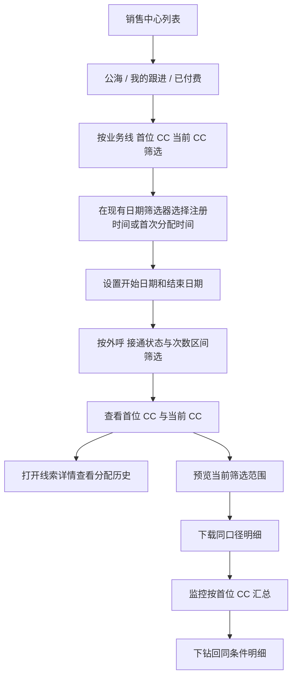

# 引入首跟节点&首跟看板

> 线索从首位 CC 交接给后续 CC 后，销售中心仍需保留“首位 CC”“首次分配时间”“首次外呼时间”“首次接通时间”和累计外呼次数，支持按联系人字段与次数区间筛选、下载并查看完整分配历史，用于规模化监控各业务线电话营销的触达量、工作量与生产力。
> 需求编号：REQ-CC-001｜状态：待评审｜更新时间：2026-11-11
> 需求类型：表单、字段与列表｜补充类型：权限与审计、看板与指标


> 📌
>
> - 首位 CC 是线索在销售中心第一次获得归属时记录的负责人，后续转派、掉库、回池和再领取都不能覆盖。
> - 在销售中心列表增加 `首位 CC`、`首次分配时间`、`首次外呼时间` 和 `首次接通时间`，并提供首位 CC 组合筛选与同范围下载。
> - 将 `外呼次数`、`外呼接通次数` 作为独立产出需求，支持次数区间筛选并纳入下载。
> - 需求覆盖各业务线；不设置单独的“是否流转”校验字段，业务方通过当前 CC 是否等于首位 CC 直接判断负责人是否发生变化。
> - 历史数据只从已有事件回填，无法确认的记录标记为“历史未知”。

> ⚠️ 来源：2026-11-10 需求方口述及同日字段确认；现状依据为 `01-current-state-and-boundaries.md`、`crm-manual/docs/sales/S-00.md` 和 `crm-manual/docs/system/A-01.md`。

## 可交互原型

[打开完整交互原型](https://h3-ai-lab.github.io/hhhprd/projects/first-contact/prototype/)

原型内可验证跨业务线销售中心列表、首位 CC 与次数区间筛选、筛选后导出、分配历史、团队监控、异常和历史数据边界。

## 要解决什么

当前存在两类常见的销售流程：

1. **CC 流程**：CC 承接线索、完成首次跟进，再根据业务规则继续销售或交接。
2. **电话营销流程**：首位 CC 完成本阶段工作后，将线索分配给第二位 CC 或电话营销团队。线索负责人变化后，团队无法在列表和下载数据中快速识别最初由谁承接、何时首次外呼及首次接通。

当前只能在单条线索的 `Lead > Update` 中查看分配历史，无法批量筛选或下载。这导致组长只能逐条抽查，不能快速回答“这段时间首位 CC 总共承接了多少线索、实际外呼了多少、接通了多少、哪些线索当前 CC 已不同于首位 CC、不同 CC 的产出差异是什么”。

## 本期目标与成功指标

本期要建立一条可批量核对的首位 CC 数据链：首次分配写入后保持不变，后续交接只更新当前负责人；列表、筛选、下载、监控和详情使用同一口径。负责人是否变化通过比较首位 CC 与当前 CC 直接判断。

| 指标        | 口径                                            | 用途            |
| --------- | --------------------------------------------- | ------------- |
| 首位 CC 覆盖率 | `first_cc_id` 非空线索数 ÷ 进入销售中心的线索数              | 判断数据是否可用于监控   |
| 首位 CC 承接量 | 按 `first_cc_id` 去重的线索数                        | 衡量各 CC 的工作量   |
| 首次外呼量     | `first_outbound_at` 非空的线索数，不区分外呼结果            | 衡量实际外呼规模      |
| 首次外呼覆盖率   | 首次外呼量 ÷ 首位 CC 承接量                             | 衡量按线索外呼的生产力   |
| 首次接通量     | `first_connected_at` 非空的线索数                   | 衡量实际接通规模      |
| 首次接通率     | 首次接通量 ÷ 首位 CC 承接量                             | 衡量接通转化        |
| 外呼总量      | 筛选范围内 `outbound_count` 之和                     | 计算累计外呼产出      |
| 接通总量      | 筛选范围内 `outbound_connected_count` 之和           | 计算累计接通产出      |
时间按各业务线现有展示时区规则呈现和筛选，导出保留时区偏移。跨业务线汇总时，组内明细使用原业务线时区，汇总边界按系统统一统计口径计算。上线首版先建立基线，未确认前不承诺具体提升目标。

## 范围

**做**

- 在首次分配、人工领取、直接分配或自动分配成功时写入首位 CC。
- 在所有业务线的销售中心列表展示首位 CC、首次分配时间、首次外呼时间、首次接通时间和当前 CC。
- 支持按首位 CC、首次分配时间、首次外呼状态、首次接通状态和当前 CC 筛选。
- 展示并可筛选外呼次数、外呼接通次数，用于个人工作产出计算。
- 下载当前筛选范围内的明细，字段与列表口径一致。
- 在线索详情中保留与展示完整分配历史。
- 为组长 / 管理员提供首位 CC 外呼产出的汇总监控；统计汇总统一由 `团队监控` 菜单承载。
- 在 `销售管理 → 团队监控` 新增菜单，并登记 RBAC 菜单、查看、下钻和导出权限。
- 为超级管理员、系统管理员、销售组长和业务负责人提供对应的默认自动授权。

**不做**

- 本期不改变现有线索领取、自动分配、掉库和转派规则。
- 不把首次外呼等同于首次接通；两者使用不同字段。
- 不自动判定首位 CC 的工作是否完成，也不自动触发向后续 CC 交接。
- 不新增独立的流转状态、流转时间或流转校验。
- 不在销售中心列表顶部新增统计卡片或汇总看板，避免与团队监控菜单重复。
- 不猜测或伪造历史首位 CC；无法从历史事件恢复的数据保持“历史未知”。
- 不在本需求中新增现金激励或个人绩效结算。

## 核心定义

| 字段          | 业务含义                   | 类型 / 枚举                    | 必填 / 默认       | 来源                    | 可编辑与异常展示                 |
| ----------- | ---------------------- | -------------------------- | ------------- | --------------------- | ------------------------ |
| 首位 CC       | 线索进入销售中心后第一次取得归属的 CC   | 用户；姓名 + CC ID + 名称快照       | 历史数据可空        | 首次分配事件                | 前端不可编辑；缺失显示“历史未知”        |
| 首次分配时间      | 线索首次分配至 CC的时间          | 日期时间，带业务线时区                | 历史数据可空        | 首次分配事件                | 前端不可编辑；缺失显示 `—`          |
| 首次外呼时间      | 首位 CC 第一条外呼记录的时间，不区分外呼状态 | 日期时间，带业务线时区                | 可空            | 外呼记录                  | 前端不可编辑；无记录显示 `—`         |
| 首次接通时间      | 首位 CC 第一次产生接通外呼记录的时间     | 日期时间，带业务线时区                | 可空            | 接通外呼记录                | 前端不可编辑；无接通显示 `—`         |
| 外呼次数        | 线索关联的外呼记录总数，不区分外呼状态    | 非负整数                       | 默认 0          | 累计外呼记录                | 只读；无记录显示 0，数据未同步时显示最近同步值 |
| 外呼接通次数      | 线索关联的外呼记录中状态为接通的总数     | 非负整数                       | 默认 0          | 累计接通记录                | 只读；无接通记录显示 0             |
| 当前 CC       | 线索当前负责人                | 用户；姓名 + CC ID              | 可空            | 现有负责人配置               | 沿用现有领取、转派规则；未分配显示“未分配”   |

### 字段现状与变更

现有销售中心默认列顺序为：用户 ID、学生姓名、购买意向、用户状态、用户类型、年龄段、课程等级、登录账号、渠道来源-落地页，操作列保持最右。部分页签展示额外的渠道来源字段。

| 现状位置 | 字段 | 比对结果 | 目标位置 | 说明 |
|---|---|---|---|---|
| 默认列 1–9 | 用户 ID 至渠道来源-落地页 | 保留 | 原位置 | 不重排现有列 |
| 现有业务字段 | 当前 CC、跟进阶段 | 复用并新增列 | 首位 CC 之后 | 用于和首位 CC 直接比较 |
| 现有业务字段 | 首位 CC、首次分配、首次外呼、首次接通、外呼次数、外呼接通次数 | 新增 | 现有来源列之后、操作列之前 | 时间与次数成组排列 |
| 操作列 | 拨号、更多 | 保留 | 最右 | 操作习惯不变 |

建议的判定顺序：

1. 自动分配到具体 CC、公海人工领取、组长直接分配，均视为取得归属。
2. 线索重新回池或再次领取，不重置首位 CC。
3. 用户后续离职或改名不改变首位 CC ID；列表展示当时名称快照，并提供当前账号状态。
4. 当前负责人与首位 CC 相同，表示负责人尚未变化；不同则表示当前 CC 已不同于首位 CC。
5. 负责人变化只通过两个负责人字段比较得出，不校验是否属于特定团队、销售阶段或流转类型。
6. 首次外呼不论是否接通、拒接、无人接听或呼叫失败，只要有外呼记录就写入时间；首次接通只在产生接通记录时写入。

## 查询与操作路径

不改变现有领取、转派和掉库流程；本需求在既有流程上补齐字段、查询、下载和监控能力。



| 首位 CC | 当前 CC    | 判断               |
| ----- | -------- | ---------------- |
| 有值    | ID 相同    | 负责人未变化           |
| 有值    | ID 不同    | 当前 CC 已不同于首位 CC  |
| 有值    | 为空 / 未分配 | 当前无人负责，不计算为负责人变化 |
| 历史未知  | 任意       | 无法判断负责人是否变化      |

### 异常场景

| 场景             | 系统处理                | 用户看到什么        | 恢复方式              |
| -------------- | ------------------- | ------------- | ----------------- |
| 两名 CC 并发领取同一线索 | 仅一个领取成功；仅成功事件写首位 CC | 另一人收到“线索已被领取” | 刷新列表，进入其他线索       |
| 写入首位 CC 后转派失败  | 保留首位 CC 和原分配历史      | 转派失败，原负责人不变   | 重新转派              |
| 历史线索缺少分配事件     | 首位 CC 显示“历史未知”      | 不显示推测姓名       | 有原始审计时补数；否则等待人工核对 |
| 外呼记录存在但状态未同步   | 写入首次外呼时间；首次接通时间保持为空 | 列表显示已外呼、未接通   | 状态同步后补写首次接通时间     |
| 下载任务超时         | 不生成不完整文件            | 提示任务失败，不展示成功  | 缩小范围或重试           |
| 首位 CC 离职       | 展示名称快照和“已停用”        | 历史归属仍可筛选      | 不做负责人替换           |

## 需求 1：保留首位 CC

规则：

- 首位 CC 和首次分配时间只在第一次成功归属时写入，转派、掉库、回池、再领取、退款或订单状态变化都不覆盖。
- 首位 CC 写入成功时必须同步生成分配历史；任一步失败时不得留下不完整记录。
- 当前 CC 仍使用现有字段和权限规则，不另建第二套负责人体系。
- 导入 leads 如果携带历史负责人，应先确认导入语义；默认只记录当前负责人，不据此推断首位 CC。
- 后续每次成功转派只更新当前 CC 和分配历史；业务方通过当前 CC 是否等于首位 CC 判断负责人是否发生变化。

## 需求 2：列表与筛选

在销售中心 `公海`、`我的跟进`、`已付费` 三个线索列表统一增加：

| 列          | 展示规则                              |
| ---------- | --------------------------------- |
| 首位 CC      | 姓名 + CC 标识；离职用户标记“已停用”；缺失显示“历史未知” |
| 首次分配时间     | 按业务线时区展示，精确到分钟                    |
| 首次外呼时间     | 首位 CC 的第一条外呼记录时间，不区分外呼状态；无记录显示 `—` |
| 首次接通时间     | 首位 CC 的第一条接通记录时间；无接通记录显示 `—`       |
| 当前 CC / 阶段 | 当前负责人和现有销售阶段，用于与首位 CC 直接比较        |

筛选项：

- 首位 CC：单选或多选，支持姓名、邮箱、CC ID 搜索。
- 日期筛选：复用列表现有“日期类型 + 开始日期 + 结束日期”控件，在日期类型中增加“首次分配时间”，保留“注册时间”，不新增独立的分配日期筛选器。
- 首次外呼状态：有外呼记录、无外呼记录、历史未知。
- 首次接通状态：已接通、未接通、历史未知。
- 外呼次数：支持填写最小值、最大值，边界均包含。
- 外呼接通次数：支持填写最小值、最大值，边界均包含。
- 当前 CC：沿用现有 CC 筛选。

#### 筛选区现状与目标位置

现有 CRM 销售中心筛选区按“搜索与业务归属 → 学生与渠道 → 用户状态与日期”排列。本次保持现有顺序，只在对应分组内增加条件。

| 分区 | 现有顺序 | 本次变更 | 目标位置 |
|---|---|---|---|
| 第一行 | 搜索电话号/用户 ID/姓名 → 国家 → 购买意向 → CC | 新增首位 CC | 紧邻现有 CC，位于 CC 之前 |
| 第二行 | 当前跟进阶段 → 年龄段 → 课程等级 → 渠道来源-落地页 → 渠道来源-App | 不新增，保持现有条件 | 原顺序不变 |
| 第三行 | 用户状态 → 销售咨询预约 → 预约外呼 → 注册日期及起止日期 | 在现有日期类型中增加首次分配时间 | 仍使用原日期控件和原位置，不单独新增日期筛选器 |
| 新增第四行 | 无 | 首次外呼状态、首次接通状态、外呼次数区间、外呼接通次数区间 | 紧随现有日期行，位于重置、导入和下载按钮之前 |

原型和最终页面必须体现上述筛选区顺序。新增条件不能脱离筛选区，也不能默认插到整个页面末尾。

销售中心页面只负责线索明细、筛选和操作，不展示顶部统计卡片。首位 CC 覆盖率、外呼总量、接通总量及分部汇总统一在 `销售管理 → 团队监控` 展示。

列表和筛选需满足：

- 搜索范围沿用当前列表的 Lead ID、User ID 和姓名；新增字段不扩大默认搜索范围。
- 默认列顺序遵循下方“销售列表列序”：现有 CRM 列不重排，首位 CC 与当前 CC 相邻，时间与次数成组追加，操作列保持最右。
- 排序和分页沿用销售中心现有规则；切换页签、翻页和排序时保留已应用筛选。
- 日期筛选按所选类型生效：选“注册时间”按用户注册日期筛选，选“首次分配时间”按 `first_assigned_at` 筛选；开始和结束日期均包含，时间按业务线时区切日。
- 首次分配时间未知的记录不命中任何“首次分配时间”范围条件；清空开始和结束日期后取消日期范围限制。
- 用户没有跨组数据权限时，首位 CC 候选项只能展示其有权查看的 CC。
- 筛选只影响当前列表和随后下载，不改变线索或分配历史。
- 不增加单独的“已流转”筛选或字段；用户直接比较列表中的首位 CC 与当前 CC。
- 外呼次数和接通次数筛选与其他条件同时生效，分页不改变筛选结果。
- `下载数据` 使用与当前列表相同的筛选、时区、去重键和权限，不允许绕过筛选下载全量。
- 无筛选结果时展示“当前条件无线索”；无权限、加载失败和外呼数据未同步使用现有对应提示，不伪装成空数据。

### 销售列表列序

当前 CRM `我的跟进`、`公海`、`已付费` 的既有列顺序以识别和业务状态为主：`用户ID → 学生姓名 → 购买意向 → 用户状态 → 用户类型 → 年龄段 → 课程等级 → 登录账号 → 渠道来源-落地页`，操作列保持在最右。部分页签还会展示 `渠道来源-App`、`渠道 code` 等现有来源字段。

本期不重排现有列，新增字段统一追加在现有来源字段之后、`操作` 之前：

| 顺序 | 字段     | 编排理由             |
| -- | ------ | ---------------- |
| 1  | 首位 CC  | 历史归属起点           |
| 2  | 当前 CC  | 与首位 CC 紧邻，便于直接比较 |
| 3  | 跟进阶段   | 保留现有跟进上下文        |
| 4  | 首次分配时间 | 按业务时间顺序展示        |
| 5  | 首次外呼时间 | 按业务时间顺序展示        |
| 6  | 首次接通时间 | 按业务时间顺序展示        |
| 7  | 外呼次数   | 与首次外呼相邻，便于核对总量   |
| 8  | 外呼接通次数 | 与接通时间和外呼次数相邻     |
| 9 | 操作 | 保持最右，不改变现有操作习惯 |

默认展示全部新增列。若列表宽度不足，使用横向滚动，不移除或压缩现有核心字段；后续如需列配置，沿用现有列设置能力，不改变本期默认顺序。

## 需求 3：外呼次数与接通次数筛选

这是一个独立的产出计算需求，用于在不逐条打开线索的情况下筛选和下载外呼工作量。

### 页面与交互

- 在现有筛选菜单新增 `外呼次数` 和 `外呼接通次数` 两组数值区间。
- 每组支持填写下限、上限，至少填写一项即可筛选；两项均可留空表示不限。
- 数值仅允许大于等于 0 的整数，下限不得高于上限；校验失败时保留当前结果并提示原因。
- 两组次数条件同时满足，并与业务线、首位 CC、当前 CC、外呼状态、接通状态以及现有日期筛选器所选日期类型和范围共同生效。
- 应用筛选后，列表、分页计数、下载预览行数和 CSV 文件必须使用同一结果集。
- `重置筛选` 同时清空两组次数区间。

### 规则

| 字段                                | 统计规则                                            | 展示            |
| --------------------------------- | ----------------------------------------------- | ------------- |
| 外呼次数 `outbound_count`             | 当前数据权限内，与线索关联且已同步到 CRM 的外呼记录总数；不区分接通、未接、拒接或呼叫失败 | 非负整数          |
| 外呼接通次数 `outbound_connected_count` | 上述外呼记录中，通话状态为接通的记录总数                            | 非负整数，且不大于外呼次数 |
| 外呼次数筛选                            | `outbound_count ∈ [下限, 上限]`；未填写的边界不限制           | 与其他筛选条件取交集    |
| 接通次数筛选                            | `outbound_connected_count ∈ [下限, 上限]`；未填写的边界不限制 | 与其他筛选条件取交集    |

计数约束：

- 同一 `call_id` 只能计数一次，重复回调或重复同步不得增加次数。
- `外呼次数` 按外呼记录计数，不按线索数计数；`外呼接通次数` 是 `外呼次数` 的子集。
- 无外呼记录显示 0，不显示空值。
- 外呼数据尚未同步时展示最近一次已同步值，并保留现有数据同步提示，不把未同步状态当作无外呼。
- 次数筛选只改变结果集，不写入或重新计算历史通话。

### 个人产出计算

```text
筛选数据范围（业务线 / 当前 CC 或首位 CC / 日期 / 次数区间）
→ 下载当前结果集
→ 汇总 outbound_count 得到外呼总量
→ 汇总 outbound_connected_count 得到接通总量
→ 用接通总量 ÷ 外呼总量计算接通率
```

导出明细至少包含以下次数字段：

| 字段                         | 说明     |
| -------------------------- | ------ |
| `outbound_count`           | 外呼次数   |
| `outbound_connected_count` | 外呼接通次数 |

下载行数、次数合计和筛选条件需要同时记录在导出任务中，便于复核个人产出。

## 需求 4：筛选后下载

下载文件沿用现有导出能力，新增以下列：

| 字段 | 必填 | 说明 |
|---|---|---|
| `lead_id` | 是 | 线索唯一 ID |
| `user_id` | 是 | 用户 ID |
| `first_cc_id` | 否 | 首位 CC ID；历史未知时为空 |
| `first_cc_name` | 否 | 首次分配时名称快照 |
| `first_assigned_at` | 否 | 首次分配时间，带时区 |
| `first_outbound_at` | 否 | 首位 CC 首次外呼时间，不区分外呼状态，带时区 |
| `first_connected_at` | 否 | 首位 CC 首次接通时间，带时区 |
| `outbound_count` | 是 | 线索累计外呼次数，不区分外呼状态 |
| `outbound_connected_count` | 是 | 线索累计外呼接通次数 |
| `current_cc_id` | 否 | 当前负责人；未分配时为空 |

下载要求：

- 先预览行数和时间范围，再生成文件；日期范围明确标注当前选择的是“注册时间”还是“首次分配时间”。
- 行数和列表当前筛选结果一致；列表分页不影响完整下载。
- 任务失败不能生成空白或部分列的文件。
- 联系方式、录音等敏感字段继续遵守现有权限和脱敏规则；本需求不扩大导出范围。
- 操作日志记录操作人、筛选条件、数据范围、行数和生成时间。

## 需求 5：团队监控

入口：`销售管理 → 团队监控`。该菜单是首位 CC 外呼产出的唯一汇总入口；为各业务线销售组长 / 管理员提供汇总视图：

```text
业务线 + 日期类型与时间范围
→ 首位 CC 承接线索
→ 有外呼 / 无外呼
→ 已接通 / 未接通
→ 外呼总量与接通总量
→ 点击数字查看同口径明细
```

页面至少展示：

- 首位 CC 承接量、首次外呼量、首次接通量和对应覆盖率。
- 每位首位 CC 的承接量、首次外呼量、首次接通量。
- 筛选范围内的外呼总量、接通总量和接通率。

所有汇总数字均可下钻到明细，并复用需求 2 和需求 3 的筛选口径。

## RBAC 权限数据

### 菜单与功能权限

| 页面 / 资源 | 操作 | 业务含义 | 默认角色 | 数据范围 | 审计 |
|---|---|---|---|---|---|
| 销售管理 → 团队监控 | 查看菜单 | 是否显示并允许进入团队监控 | 超级管理员、系统管理员、销售组长、业务负责人 | 按角色数据权限 | 权限配置变更留痕 |
| 团队监控 | 查看汇总 | 查看首位 CC 外呼产出和接通数据 | 同上 | 授权业务线 / 团队 | 普通查看不单独记录 |
| 团队监控 | 筛选 | 按业务线、日期、首位 CC 等条件查询 | 同上 | 与查看权限一致 | 不单独记录 |
| 团队监控 | 下钻明细 | 从汇总数字进入同口径线索明细 | 同上 | 下钻后继续受线索数据权限限制 | 不单独记录 |
| 团队监控 | 导出 | 下载当前筛选范围内的明细 | 需单独拥有导出权限 | 与查看权限取交集 | 必须记录 |

页面可见、菜单显示、接口查询和导出分别校验权限，不能只隐藏前端菜单。

### 默认角色与自动授权

| 角色 | 团队监控菜单 | 默认数据范围 | 导出 | 上线时自动授权 |
|---|---|---|---|---|
| 超级管理员 | 自动开通查看、筛选、下钻 | 全部业务线 | 自动开通 | 是 |
| 系统管理员（system manager） | 自动开通查看、筛选、下钻 | 所属业务线 | 沿用现有导出能力；未具备时默认关闭 | 是 |
| 销售组长 | 自动开通查看、筛选、下钻 | 所属团队 + 所属业务线 | 沿用现有导出能力；未具备时默认关闭 | 是 |
| 业务负责人 | 自动开通查看、筛选、下钻 | 已授权业务线 | 沿用现有导出能力；未具备时默认关闭 | 是 |
| 一线销售、CC_VN / CC_TH、后续 CC / 电话营销 | 不自动开通 | 继续使用销售中心本人线索范围 | 否 | 否 |
| 推荐运营 / 质检 | 不自动开通 | 无新增数据范围 | 否 | 否 |
| 自定义角色 | 不自动开通 | 无 | 否 | 否；需管理员显式配置 |

自动授权只影响系统内置或预定角色。新增成员加入上述角色后即时继承；自定义角色、测试专用角色及未来新建角色不自动获得团队监控权限。

### 字段与数据权限

| 字段组 / 列表 | 可见角色 | 编辑角色 | 脱敏 / 隐藏 | 可导出 | 候选范围限制 |
|---|---|---|---|---|---|
| 首位 CC、外呼与接通汇总 | 拥有团队监控查看权限的角色 | 无 | 不展示手机号、邮箱等敏感资料 | 需导出权限 | 业务线和团队范围 |
| 首位 CC 姓名、首次分配/外呼/接通时间 | 拥有团队监控查看权限的角色 | 无 | 离职用户保留名称快照并标记停用 | 需导出权限 | 与明细数据权限一致 |
| 外呼次数、外呼接通次数 | 拥有团队监控查看权限的角色 | 无 | 不额外增加敏感字段 | 需导出权限 | 与汇总筛选范围一致 |
| 普通销售中心列表 | 沿用现有销售中心数据权限 | 沿用现有跟进和转派权限 | 沿用现有手机号等字段权限 | 沿用现有导出权限 | 仅本人或团队授权范围 |

首位 CC、首次时间及次数均为只读事实或汇总字段。管理员修复历史数据必须走可审计的补数流程，不能直接编辑展示值。

### 权限数据变更

| 变更类型 | 权限层级 | 权限项 | 业务说明 | 默认角色 / 数据范围 | 是否新增审计 |
|---|---|---|---|---|---|
| 新增 | 菜单 | 团队监控菜单可见 | 在 RBAC 角色权限树中登记为 `销售管理 → 团队监控` | 超级管理员、系统管理员、销售组长、业务负责人 | 是 |
| 新增 | 页面 | 团队监控查看 | 可进入页面并查询汇总 | 同上，按角色数据范围 | 是 |
| 新增 | 动作 | 团队监控下钻 | 可从汇总进入明细 | 同上，明细继续校验数据权限 | 是 |
| 新增 | 导出 | 团队监控导出 | 下载当前筛选范围 | 需显式拥有导出权限 | 是 |
| 复用 | 数据 | 业务线 / 团队数据范围 | 控制可见汇总和明细 | 沿用现有成员账号数据权限 | 权限变更时记录 |

### 审计与生效

- 角色授权、撤销和自动授权初始化必须写入操作日志，包含操作人、角色、权限项、变更前后和生效时间。
- 团队监控导出记录操作人、筛选条件、业务线、团队、行数和生成时间。
- 无权限访问、越权查询和越权下钻应返回明确无权限状态，并记录失败尝试。
- 权限变更在成员下一次请求时即时生效；菜单隐藏、接口拒绝和数据范围同时更新。
- 权限撤销后，已生成的历史导出文件不自动删除，后续导出必须重新校验权限。
- 审计记录按现有操作日志策略保留，不允许普通管理员修改或删除。

## 数据与依赖

| 数据 / 系统  | 来源                   | 唯一标识                  | 时效 / 失败处理                    |
| -------- | -------------------- | --------------------- | ---------------------------- |
| 线索与当前负责人 | 现有 CRM 线索            | `lead_id`             | 实时；失败时保持原负责人和分配记录            |
| 分配历史     | `Lead > Update` 现有事件 | `assignment_event_id` | 新事件实时写入；旧事件按可用范围回填           |
| 外呼记录     | 现有外呼轻集成              | `call_id`             | 接收事件去重；首次外呼不区分结果，首次接通按接通状态写入 |
| 跟进记录     | 现有 CRM 跟进            | `followup_id`         | 首次有效记录幂等写入                   |
| 用户与团队    | 系统配置 / 组织角色          | `user_id`、`team_id`   | 用于数据权限与负责人展示，不用于判断是否流转       |
| 导出任务     | 现有下载能力               | `export_task_id`      | 失败重试；不得下发不完整文件               |

## 用户故事

```text
首位 CC 承接线索 → 产生首位 CC 的首次外呼时间
→ 产生首位 CC 的首次接通时间（如有）
→ 组长转派给后续 CC
→ 当前 CC 与阶段更新，首位 CC 保持不变
→ 业务方比较当前 CC 是否等于首位 CC
→ 组长按首位 CC 和时间筛选
→ 预览并下载当前范围
→ 下钻或另开线索查看 Lead > Update 分配历史
```

## 异常与边界

- **无首位 CC**：老数据没有可确认事件时显示“历史未知”，不能使用当前 CC 或最早可见事件猜测。
- **重复触发**：分配事件、外呼事件和跟进事件均使用幂等键；首位字段一经写入不覆盖。
- **并发领取**：系统保证同一线索只有一个成功领取者。
- **重复回池**：回池和二次领取只追加历史，不重置首位 CC。
- **负责人变化判断**：不设置额外的流转状态或时间；直接比较当前 CC ID 与首位 CC ID，相同表示负责人未变化，不同表示当前 CC 已不同于首位 CC。
- **用户离职或改名**：保留首位 CC ID 和首次名称快照，额外展示当前账号状态。
- **导入历史数据**：只接受已经核实并带来源的记录，导入文件需要保存批次号和操作人。
- **时区**：页面按各业务线现有展示时区设置，下载保留时间时区偏移；跨业务线汇总按系统统计边界处理。
- **大范围下载**：沿用现有导出上限；超限时提示缩小日期范围，不静默截断。

## 待确认

| 问题                  | 当前工作假设                 | 影响     | Owner       |
| ------------------- | ---------------------- | ------ | ----------- |
| 公海人工领取是否计入首位 CC     | 计入；自动分配、领取、直接分配都算取得归属  | 工作量分母  | 各业务线销售负责人   |
| 历史分配事件是否完整          | 只回填可验证数据，其余标历史未知       | 历史覆盖率  | CRM 技术      |
| 监控入口放在销售中心还是管理看板    | 首选销售中心组内视图，保留后续进入看板的可能 | 导航与权限  | CRM 产品      |
| 是否需要按团队而不是个人展示首位 CC | P0 保留个人明细，团队汇总作为筛选维度   | 权限和报表  | 业务负责人       |
| 跨业务线汇总使用哪个统一统计时区    | 明细保留原业务线时区，汇总按系统统一口径   | 日分组与导出 | CRM 产品 / 数据 |
