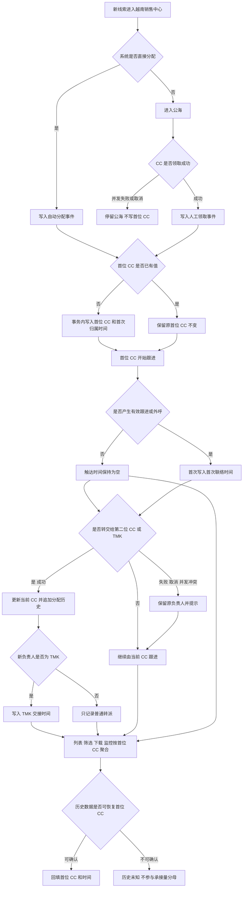

# 越南首位联系人（First Contact）

> 越南线索从首位 CC 交接给第二位 CC / TMK 后，销售中心仍需保留“首位 CC”和“首次联络时间”，支持按首位 CC 筛选、下载并查看完整分配历史，用于规模化监控电话营销的触达量、工作量与生产力。
> 需求编号：REQ-VN-001｜状态：待评审｜更新时间：2026-11-10

> 📌
> - 首位 CC 是线索在销售中心第一次获得归属时记录的负责人，后续转派、掉库、回池和再领取都不能覆盖。
> - 在销售中心列表增加 `首位 CC`、`首次联络时间` 和交接状态，并提供首位 CC 组合筛选与同范围下载。
> - 本期只覆盖越南业务流程；历史数据只从已有分配历史回填，无法确认的记录标记为“历史未知”。

> ⚠️ 来源：2026-11-10 需求方口述；现状依据为 `01-current-state-and-boundaries.md` 和 `crm-manual/docs/sales/S-00.md`。需求中的“首次客户关怀”“首次客户联络”是否完全同义，需要在评审时由业务确认。

## 可交互原型

[打开完整交互原型](https://h3-ai-lab.github.io/hhhprd/projects/first-contact/prototype/)

原型内可验证销售中心列表、首位 CC 筛选、筛选后导出、分配历史、团队监控、异常和历史数据边界。

## 要解决什么

越南当前存在两条销售流程：

1. **CC 流程**：CC 承接线索、完成首次跟进，再根据业务规则继续销售或交接。
2. **电话营销（TMK）流程**：首位 CC 完成本阶段工作后，将线索分配给第二位 CC / TMK。线索负责人变化后，团队无法在列表和下载数据中快速识别最初由谁承接、何时首次联络。

当前只能在单条线索的 `Lead > Update` 中查看分配历史，无法批量筛选或下载。这导致组长只能逐条抽查，不能快速回答“这段时间首位 CC 总共承接了多少线索、实际触达了多少、向 TMK 交接了多少、不同 CC 的产出差异是什么”。

## 本期目标与成功指标

本期要建立一条可批量核对的首位 CC 数据链：首次归属写入后保持不变，后续交接只更新当前负责人，列表、筛选、下载、监控和详情使用同一口径。

| 指标 | 口径 | 用途 |
|---|---|---|
| 首位 CC 覆盖率 | `first_cc_id` 非空线索数 ÷ 进入越南销售中心的线索数 | 判断数据是否可用于监控 |
| 首位 CC 承接量 | 按 `first_cc_id` 去重的线索数 | 衡量各 CC 的工作量 |
| 首位 CC 触达量 | 至少产生一次有效外呼尝试的线索数 | 衡量实际触达规模 |
| 首位 CC 触达覆盖率 | 首位 CC 触达量 ÷ 首位 CC 承接量 | 衡量按线索触达的生产力 |
| TMK 交接量 | 从非 TMK 负责人转给 TMK 的线索数 | 衡量电话营销输入规模 |
| TMK 触达量 | 由 TMK 角色在 CRM 产生至少一次有效外呼尝试的线索数 | 回答 TMK 过去触达了多少线索 |
| 下载一致率 | 下载明细行数 ÷ 同条件列表行数 | 验证导出与筛选口径一致 |

所有时间按 `Asia/Ho_Chi_Minh` 展示和筛选。上线首版先建立基线，未确认前不承诺具体提升目标。

## 范围

**做**

- 在首次分配、人工领取、直接分配或自动分配成功时写入首位 CC。
- 在销售中心列表展示首位 CC、首次联络时间、当前 CC 和 TMK 交接状态。
- 支持按首位 CC、首次联络时间、当前 CC、交接状态和历史完整度筛选。
- 下载当前筛选范围内的明细，字段与列表口径一致。
- 在线索详情中保留与展示完整分配历史。
- 为组长 / 管理员提供首位 CC 与 TMK 的汇总监控。

**不做**

- 本期不改变现有线索领取、自动分配、掉库和转派规则。
- 不把首个电话尝试直接当成本期已定义好的“有效接通”；两者使用不同字段。
- 不自动判定首位 CC 的工作是否完成，也不自动触发向 TMK 交接。
- 不覆盖泰国、马来西亚等其他业务线。
- 不猜测或伪造历史首位 CC；无法从历史事件恢复的数据保持“历史未知”。
- 不在本需求中新增现金激励或个人绩效结算。

## 核心定义

| 字段 | 定义 | 写入规则 |
|---|---|---|
| 首位 CC / First CC | 线索进入销售中心后，第一次取得线索归属的 CC 用户 | 首次归属事件成功后写入；仅当字段为空时写入 |
| 首次归属时间 | 首位 CC 取得线索归属的时间 | 与首次归属事件使用同一事务写入 |
| 首次联络时间 | 首位 CC 在线索上产生的第一条有效跟进或外呼记录时间 | 首次有效事件写入；后续事件不覆盖 |
| 当前 CC | 线索当前负责人 | 领取、转派、掉库、恢复时更新 |
| TMK 交接时间 | 当前负责人第一次从非 TMK 变为 TMK 角色的时间 | 由成功转派事件和角色组判断写入 |
| 历史完整度 | 是否可以确认首位 CC | 仅根据已有分配历史和通话 / 跟进记录回填；否则为历史未知 |

建议的判定顺序：

1. 自动分配到具体 CC、公海人工领取、组长直接分配，均视为取得归属。
2. 线索重新回池或再次领取，不重置首位 CC。
3. 用户后续离职或改名不改变首位 CC ID；列表展示当时名称快照，并提供当前账号状态。
4. 当前负责人与首位 CC 相同，表示尚未发生负责人交接；不同时不自动证明一定发生 TMK 交接。
5. 是否属于 TMK 以组织角色 / 岗位组配置为准，不能只凭姓名或当前阶段猜测。

## 业务流程图



### 异常场景

| 场景 | 系统处理 | 用户看到什么 | 恢复方式 |
|---|---|---|---|
| 两名 CC 并发领取同一线索 | 仅一个领取成功；仅成功事件写首位 CC | 另一人收到“线索已被领取” | 刷新列表，进入其他线索 |
| 写入首位 CC 后转派事务失败 | 首位 CC 与分配历史均回滚 | 转派失败，原负责人不变 | 重新转派 |
| 历史线索缺少分配事件 | 首位 CC 显示“历史未知” | 不显示推测姓名 | 有原始审计时补数；否则等待人工核对 |
| TMK 角色配置错误 | 保留普通转派记录，不写 TMK 交接时间 | 列表显示“待确认角色” | 修正角色后按事件重算 |
| 下载任务超时 | 不生成不完整文件 | 提示任务失败，不展示成功 | 缩小范围或重试 |
| 首位 CC 离职 | 展示名称快照和“已停用” | 历史归属仍可筛选 | 不做负责人替换 |

## 需求 1：保留首位 CC

线索每次成功获得负责人时执行：

```text
if lead.first_cc_id is empty:
    lead.first_cc_id = owner.id
    lead.first_cc_name_snapshot = owner.name
    lead.first_assigned_at = event_time
    lead.first_assignment_source = claim | direct_assign | auto_assign | import
append_assignment_history(lead, from_owner, to_owner, event_time, reason)
```

规则：

- 首位 CC 只在第一次成功归属时写入，转派、掉库、回池、再领取、退款或订单状态变化都不覆盖。
- 写入首位 CC 和分配历史必须在同一事务中完成；任何一步失败都不能留下半条记录。
- 当前 CC 仍使用现有字段和权限规则，不另建第二套负责人体系。
- 导入 leads 如果携带历史负责人，应先确认导入语义；默认只记录当前负责人，不据此推断首位 CC。

## 需求 2：列表与筛选

在销售中心 `公海`、`我的跟进`、`已付费` 三个线索列表统一增加：

| 列 | 展示规则 |
|---|---|
| 首位 CC | 姓名 + CC 标识；离职用户标记“已停用”；缺失显示“历史未知” |
| 首次归属时间 | `Asia/Ho_Chi_Minh`，精确到分钟 |
| 首次联络时间 | 无有效跟进时显示 `—`，不把空值显示成当天 |
| 当前 CC / 阶段 | 当前负责人和现有销售阶段 |
| TMK 交接 | `已交接`、`未交接`、`待确认角色`、`历史未知` |

筛选项：

- 首位 CC：单选或多选，支持姓名、邮箱、CC ID 搜索。
- 首位 CC 团队：按组长权限限定可选范围。
- 首次归属时间：开始日期、结束日期，首尾均包含。
- 首次联络状态：已触达、未触达、历史未知。
- 当前 CC：沿用现有 CC 筛选。
- TMK 交接状态：已交接、未交接、待确认角色。
- 历史完整度：完整、缺失。

列表和筛选需满足：

- 用户没有跨组数据权限时，首位 CC 候选项只能展示其有权查看的 CC。
- 筛选只影响当前列表和随后下载，不改变线索或分配历史。
- 刷新、翻页、排序和切换页签后保留当前筛选条件；离开销售中心后按现有系统行为重置。
- `下载数据` 使用与当前列表相同的筛选、时区、去重键和权限，不允许绕过筛选下载全量。

## 需求 3：筛选后下载

下载文件沿用现有导出能力，新增以下列：

| 字段 | 必填 | 说明 |
|---|---|---|
| `lead_id` | 是 | 线索唯一 ID |
| `user_id` | 是 | 用户 ID |
| `first_cc_id` | 否 | 首位 CC ID；历史未知时为空 |
| `first_cc_name` | 否 | 首次归属时名称快照 |
| `first_assigned_at` | 否 | 首位归属时间，带时区 |
| `first_contacted_at` | 否 | 首次有效联络时间，带时区 |
| `current_cc_id` | 是 | 当前负责人 |
| `tmk_handover_at` | 否 | TMK 首次交接时间 |
| `history_status` | 是 | `complete` / `missing` |

下载要求：

- 先预览行数和时间范围，再生成文件。
- 行数和列表当前筛选结果一致；列表分页不影响完整下载。
- 任务失败不能生成空白或部分列的文件。
- 联系方式、录音等敏感字段继续遵守现有权限和脱敏规则；本需求不扩大导出范围。
- 操作日志记录操作人、筛选条件、数据范围、行数和生成时间。

## 需求 4：团队监控

为越南销售组长 / 管理员增加首位 CC 与 TMK 的汇总视图：

```text
越南业务线 + 时间范围
→ 首位 CC 承接线索
→ 已触达 / 未触达
→ 当前仍在 CC / 已交接 TMK / 普通转派
→ TMK 已触达 / 待触达
→ 点击数字查看同口径明细
```

页面至少展示：

- 首位 CC 承接量、触达量和触达覆盖率。
- 每位首位 CC 的承接量、触达量、交接量和未触达数。
- TMK 接收量、已触达量和待触达量。
- 数据完整度与历史未知数量。

所有汇总数字均可下钻到明细，并复用需求 2 的筛选口径。

## 权限与数据范围

| 角色 / 条件 | 能看什么 | 能做什么 | 限制 |
|---|---|---|---|
| 普通 CC | 本人当前线索及对应首位 CC | 查看、跟进、按现有规则转派 | 不能筛选其他 CC 的全量 |
| 销售组长 | 有权限的团队和业务线数据 | 查看监控、筛选、下载授权范围 | 下载需现有导出权限 |
| TMK / 第二位 CC | 分配给本人或本组的线索 | 查看首位 CC 与交接历史、跟进 | 不能修改首位 CC |
| 推荐运营 / 质检 | 授权业务线数据 | 只读查看、筛选 | 不进入销售操作 |
| 管理员 / 超级管理员 | 越南业务线全量 | 查看、导出、处理历史缺失 | 导出和敏感字段继续审计 |

首位 CC 是历史事实字段，所有角色均不可在前端直接编辑。管理员修复历史数据必须走可审计的补数流程。

## 数据与依赖

| 数据 / 系统 | 来源 | 唯一标识 | 时效 / 失败处理 |
|---|---|---|---|
| 线索与当前负责人 | 现有 CRM 线索表 | `lead_id` | 实时；事务失败回滚 |
| 分配历史 | `Lead > Update` 现有事件 | `assignment_event_id` | 新事件实时写入；旧事件按可用范围回填 |
| 外呼记录 | 现有外呼轻集成 | `call_id` | 接收事件去重；未同步时首次联络时间保持为空 |
| 跟进记录 | 现有 CRM 跟进 | `followup_id` | 首次有效记录幂等写入 |
| 用户与团队 | 系统配置 / 组织角色 | `user_id`、`team_id` | TMK 角色变化保留历史交接时点 |
| 导出任务 | 现有下载能力 | `export_task_id` | 失败重试；不得下发不完整文件 |

## 用户怎么走

```text
首位 CC 承接线索 → 完成首次联络
→ 组长转派给第二位 CC / TMK
→ 当前 CC 与阶段更新，首位 CC 保持不变
→ 组长按首位 CC 和时间筛选
→ 预览并下载当前范围
→ 下钻或另开线索查看 Lead > Update 分配历史
```

## 异常与边界

- **无首位 CC**：老数据没有可确认事件时显示“历史未知”，不能使用当前 CC 或最早可见事件猜测。
- **重复触发**：分配事件、外呼事件和跟进事件均使用幂等键；首位字段一经写入不覆盖。
- **并发领取**：数据库唯一约束和事务保证只有一个成功领取者。
- **重复回池**：回池和二次领取只追加历史，不重置首位 CC。
- **普通转派与 TMK 交接**：只有新负责人被确认属于 TMK 角色组时才写 TMK 交接时间；角色无法确认时显示“待确认角色”。
- **用户离职或改名**：保留首位 CC ID 和首次名称快照，额外展示当前账号状态。
- **导入历史数据**：只接受已经核实并带来源的记录，导入文件需要保存批次号和操作人。
- **时区**：页面和下载统一使用 `Asia/Ho_Chi_Minh`；跨日以本地日期切分。
- **大范围下载**：沿用现有导出上限；超限时提示缩小日期范围，不静默截断。

## 验收

### 首位 CC 写入与保留

1. 新线索自动分配给 Linh Pham 后，列表出现 Linh Pham 作为首位 CC，首次归属时间与分配事件一致。
2. 同一线索从 Linh Pham 转给 TMK Minh 后，当前 CC 变为 TMK Minh，首位 CC 仍为 Linh Pham。
3. 线索退回公海并被另一名 CC 再次领取后，首位 CC 不重置。
4. 两名 CC 同时领取同一线索，只有一人成功，分配历史和首位 CC 只出现一次。
5. 转派事务失败时，负责人、首位 CC 和分配历史均保持原值。

### 列表、筛选与下载

6. 普通 CC 只能看到本人范围，组长可以按授权团队内的首位 CC 筛选。
7. 按“首位 CC = Linh Pham + 首次联络状态 = 未触达”筛选后，列表只显示符合两项条件的线索。
8. 切到下一页、排序或刷新后，当前筛选仍保留。
9. 下载行数与同条件列表一致，包含全部指定字段和 `Asia/Ho_Chi_Minh` 时间。
10. 下载只包含当前用户有权查看的数据；操作日志出现筛选条件、行数和时间。

### 监控、异常与历史

11. 监控页首位 CC 承接量、触达量和交接量可以与明细逐条核对。
12. 点击任一汇总数字可打开相同筛选条件的明细。
13. 历史分配记录缺失的线索显示“历史未知”，不参与首位 CC 承接量分母。
14. 用户离职后仍可按其历史首位 CC 名称筛选，列表标记“已停用”。
15. 首位 CC 或 TMK 角色配置调整后，历史交接时点不被覆盖。

## 待确认

| 问题 | 当前工作假设 | 影响 | Owner |
|---|---|---|---|
| 首次联络是否等同第一次外呼尝试 | 以 CRM 成功创建的外呼尝试为准；接通和有效沟通另算 | 触达量口径 | 越南销售负责人 |
| 公海人工领取是否计入首位 CC | 计入；自动分配、领取、直接分配都算取得归属 | 工作量分母 | 越南销售负责人 |
| TMK 是否通过角色组识别 | 使用系统角色 / 岗位组，不按姓名或阶段猜 | 交接量口径 | CRM 产品 / 越南销售 |
| 历史分配事件是否完整 | 只回填可验证数据，其余标历史未知 | 历史覆盖率 | CRM 技术 |
| 监控入口放在销售中心还是管理看板 | 首选销售中心组内视图，保留后续进入看板的可能 | 导航与权限 | CRM 产品 |
| 是否需要按团队而不是个人展示首位 CC | P0 保留个人明细，团队汇总作为筛选维度 | 权限和报表 | 业务负责人 |

## 写作检查

- 只出现一个交互原型主地址。
- 首位 CC、首次联络时间、当前 CC 和 TMK 交接没有混成一个字段。
- 主图覆盖领取、并发、转派、回池、历史缺失和下载。
- 列表、筛选、下载和监控使用同一时间变量与去重键。
- 权限同时覆盖页面、候选项、数据范围和下载。
- 验收可以直接在原型或测试数据上执行。
