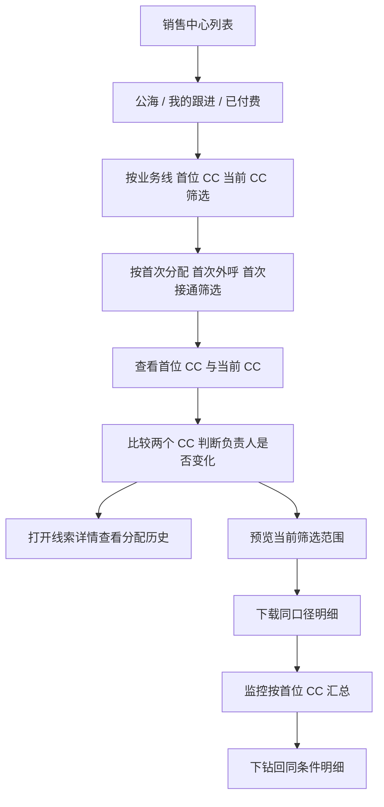

# 首位联系人（First Contact）

> 线索从首位 CC 交接给后续 CC 后，销售中心仍需保留“首位 CC”“首次分配时间”“首次外呼时间”和“首次接通时间”，支持按首位 CC 筛选、下载并查看完整分配历史，用于规模化监控各业务线电话营销的触达量、工作量与生产力。
> 需求编号：REQ-CC-001｜状态：待评审｜更新时间：2026-11-10
> 需求类型：表单、字段与列表｜补充类型：权限与审计、看板与指标
> 生成提示词：`prompts/02-form-field-list.md`｜补充提示词：`prompts/04-permission-audit.md`、`prompts/06-dashboard-metrics.md`

> 📌
> - 首位 CC 是线索在销售中心第一次获得归属时记录的负责人，后续转派、掉库、回池和再领取都不能覆盖。
> - 在销售中心列表增加 `首位 CC`、`首次分配时间`、`首次外呼时间` 和 `首次接通时间`，并提供首位 CC 组合筛选与同范围下载。
> - 需求覆盖各业务线；不设置单独的“是否流转”校验字段，业务方通过当前 CC 是否等于首位 CC 直接判断负责人是否发生变化。
> - 历史数据只从已有事件回填，无法确认的记录标记为“历史未知”。

> ⚠️ 来源：2026-11-10 需求方口述及同日字段确认；现状依据为 `01-current-state-and-boundaries.md` 和 `crm-manual/docs/sales/S-00.md`。

## 可交互原型

[打开完整交互原型](https://h3-ai-lab.github.io/hhhprd/projects/first-contact/prototype/)

原型内可验证跨业务线销售中心列表、首位 CC 筛选、筛选后导出、分配历史、团队监控、异常和历史数据边界。

## 要解决什么

当前存在两类常见的销售流程：

1. **CC 流程**：CC 承接线索、完成首次跟进，再根据业务规则继续销售或交接。
2. **电话营销流程**：首位 CC 完成本阶段工作后，将线索分配给第二位 CC 或电话营销团队。线索负责人变化后，团队无法在列表和下载数据中快速识别最初由谁承接、何时首次外呼及首次接通。

当前只能在单条线索的 `Lead > Update` 中查看分配历史，无法批量筛选或下载。这导致组长只能逐条抽查，不能快速回答“这段时间首位 CC 总共承接了多少线索、实际外呼了多少、接通了多少、哪些线索当前 CC 已不同于首位 CC、不同 CC 的产出差异是什么”。

## 本期目标与成功指标

本期要建立一条可批量核对的首位 CC 数据链：首次分配写入后保持不变，后续交接只更新当前负责人；列表、筛选、下载、监控和详情使用同一口径。负责人是否变化通过 `current_cc_id != first_cc_id` 直接判断。

| 指标 | 口径 | 用途 |
|---|---|---|
| 首位 CC 覆盖率 | `first_cc_id` 非空线索数 ÷ 进入销售中心的线索数 | 判断数据是否可用于监控 |
| 首位 CC 承接量 | 按 `first_cc_id` 去重的线索数 | 衡量各 CC 的工作量 |
| 首次外呼量 | `first_outbound_at` 非空的线索数，不区分外呼结果 | 衡量实际外呼规模 |
| 首次外呼覆盖率 | 首次外呼量 ÷ 首位 CC 承接量 | 衡量按线索外呼的生产力 |
| 首次接通量 | `first_connected_at` 非空的线索数 | 衡量实际接通规模 |
| 首次接通率 | 首次接通量 ÷ 首位 CC 承接量 | 衡量接通转化 |
| 负责人变化量 | `current_cc_id != first_cc_id` 的线索数，不需要额外流转校验 | 衡量已发生负责人变化的规模 |
| 下载一致率 | 下载明细行数 ÷ 同条件列表行数 | 验证导出与筛选口径一致 |

时间按各业务线现有展示时区规则呈现和筛选，导出保留时区偏移。跨业务线汇总时，组内明细使用原业务线时区，汇总边界按系统统一统计口径计算。上线首版先建立基线，未确认前不承诺具体提升目标。

## 范围

**做**

- 在首次分配、人工领取、直接分配或自动分配成功时写入首位 CC。
- 在所有业务线的销售中心列表展示首位 CC、首次分配时间、首次外呼时间、首次接通时间和当前 CC。
- 支持按首位 CC、首次分配时间、首次外呼状态、首次接通状态、当前 CC 和历史完整度筛选。
- 下载当前筛选范围内的明细，字段与列表口径一致。
- 在线索详情中保留与展示完整分配历史。
- 为组长 / 管理员提供首位 CC 与负责人变化的汇总监控。

**不做**

- 本期不改变现有线索领取、自动分配、掉库和转派规则。
- 不把首次外呼等同于首次接通；两者使用不同字段。
- 不自动判定首位 CC 的工作是否完成，也不自动触发向后续 CC 交接。
- 不新增独立的流转状态、流转时间或流转校验。
- 不猜测或伪造历史首位 CC；无法从历史事件恢复的数据保持“历史未知”。
- 不在本需求中新增现金激励或个人绩效结算。

## 核心定义

| 字段 | 业务含义 | 类型 / 枚举 | 必填 / 默认 | 来源 | 可编辑与异常展示 |
|---|---|---|---|---|---|
| 首位 CC | 线索进入销售中心后第一次取得归属的 CC | 用户；姓名 + CC ID + 名称快照 | 历史数据可空 | 首次分配事件 | 前端不可编辑；缺失显示“历史未知” |
| 首次分配时间 | 首位 CC 取得线索归属的时间 | 日期时间，带业务线时区 | 历史数据可空 | 首次分配事件 | 前端不可编辑；缺失显示 `—` |
| 首次外呼时间 | 线索第一条外呼记录的时间，不区分外呼状态 | 日期时间，带业务线时区 | 可空 | 外呼记录 | 前端不可编辑；无记录显示 `—` |
| 首次接通时间 | 线索第一次产生接通外呼记录的时间 | 日期时间，带业务线时区 | 可空 | 接通外呼记录 | 前端不可编辑；无接通显示 `—` |
| 当前 CC | 线索当前负责人 | 用户；姓名 + CC ID | 可空 | 现有负责人配置 | 沿用现有领取、转派规则；未分配显示“未分配” |
| 负责人是否变化 | 当前 CC 是否不同于首位 CC | 是 / 否 / 历史未知 | 不单独存储 | 首位 CC 与当前 CC 实时比较 | 只读；首位 CC 缺失时显示“历史未知” |
| 历史完整度 | 是否可以确认首位 CC 及首次时间 | `complete` / `missing` | `missing` | 分配、外呼和通话记录 | 只读；历史缺失不得用当前 CC 倒推 |

建议的判定顺序：

1. 自动分配到具体 CC、公海人工领取、组长直接分配，均视为取得归属。
2. 线索重新回池或再次领取，不重置首位 CC。
3. 用户后续离职或改名不改变首位 CC ID；列表展示当时名称快照，并提供当前账号状态。
4. 当前负责人与首位 CC 相同，表示负责人尚未变化；不同则表示当前 CC 已不同于首位 CC。
5. 负责人变化只通过两个负责人字段比较得出，不校验是否属于特定团队、销售阶段或流转类型。
6. 首次外呼不论是否接通、拒接、无人接听或呼叫失败，只要有外呼记录就写入时间；首次接通只在产生接通记录时写入。

## 查询与操作路径

不改变现有领取、转派和掉库流程；本需求在既有流程上补齐字段、查询、下载和监控能力。



| 首位 CC | 当前 CC | 判断 |
|---|---|---|
| 有值 | ID 相同 | 负责人未变化 |
| 有值 | ID 不同 | 当前 CC 已不同于首位 CC |
| 有值 | 为空 / 未分配 | 当前无人负责，不计算为负责人变化 |
| 历史未知 | 任意 | 无法判断负责人是否变化 |

### 异常场景

| 场景 | 系统处理 | 用户看到什么 | 恢复方式 |
|---|---|---|---|
| 两名 CC 并发领取同一线索 | 仅一个领取成功；仅成功事件写首位 CC | 另一人收到“线索已被领取” | 刷新列表，进入其他线索 |
| 写入首位 CC 后转派失败 | 保留首位 CC 和原分配历史 | 转派失败，原负责人不变 | 重新转派 |
| 历史线索缺少分配事件 | 首位 CC 显示“历史未知” | 不显示推测姓名 | 有原始审计时补数；否则等待人工核对 |
| 外呼记录存在但状态未同步 | 写入首次外呼时间；首次接通时间保持为空 | 列表显示已外呼、未接通 | 状态同步后补写首次接通时间 |
| 下载任务超时 | 不生成不完整文件 | 提示任务失败，不展示成功 | 缩小范围或重试 |
| 首位 CC 离职 | 展示名称快照和“已停用” | 历史归属仍可筛选 | 不做负责人替换 |

## 需求 1：保留首位 CC

规则：

- 首位 CC 和首次分配时间只在第一次成功归属时写入，转派、掉库、回池、再领取、退款或订单状态变化都不覆盖。
- 首位 CC 写入成功时必须同步生成分配历史；任一步失败时不得留下不完整记录。
- 当前 CC 仍使用现有字段和权限规则，不另建第二套负责人体系。
- 导入 leads 如果携带历史负责人，应先确认导入语义；默认只记录当前负责人，不据此推断首位 CC。
- 后续每次成功转派只更新当前 CC 和分配历史；业务方通过当前 CC 是否等于首位 CC 判断负责人是否发生变化。

## 需求 2：列表与筛选

在销售中心 `公海`、`我的跟进`、`已付费` 三个线索列表统一增加：

| 列 | 展示规则 |
|---|---|
| 首位 CC | 姓名 + CC 标识；离职用户标记“已停用”；缺失显示“历史未知” |
| 首次分配时间 | 按业务线时区展示，精确到分钟 |
| 首次外呼时间 | 第一条外呼记录时间，不区分外呼状态；无记录显示 `—` |
| 首次接通时间 | 第一条接通记录时间；无接通记录显示 `—` |
| 当前 CC / 阶段 | 当前负责人和现有销售阶段，用于与首位 CC 直接比较 |

筛选项：

- 首位 CC：单选或多选，支持姓名、邮箱、CC ID 搜索。
- 首位 CC 团队：按组长权限限定可选范围。
- 首次分配时间：开始日期、结束日期，首尾均包含。
- 首次外呼状态：有外呼记录、无外呼记录、历史未知。
- 首次接通状态：已接通、未接通、历史未知。
- 当前 CC：沿用现有 CC 筛选。
- 历史完整度：完整、缺失。

列表和筛选需满足：

- 搜索范围沿用当前列表的 Lead ID、User ID 和姓名；新增字段不扩大默认搜索范围。
- 默认列顺序沿用现有列表，在首位 CC 后依次展示首次分配时间、首次外呼时间、首次接通时间，再由当前 CC 与阶段承接业务操作。
- 排序和分页沿用销售中心现有规则；切换页签、翻页和排序时保留已应用筛选。
- 用户没有跨组数据权限时，首位 CC 候选项只能展示其有权查看的 CC。
- 筛选只影响当前列表和随后下载，不改变线索或分配历史。
- 不增加单独的“已流转”筛选或字段；用户直接比较列表中的首位 CC 与当前 CC。
- `下载数据` 使用与当前列表相同的筛选、时区、去重键和权限，不允许绕过筛选下载全量。
- 无筛选结果时展示“当前条件无线索”；无权限、加载失败和外呼数据未同步使用现有对应提示，不伪装成空数据。

## 需求 3：筛选后下载

下载文件沿用现有导出能力，新增以下列：

| 字段 | 必填 | 说明 |
|---|---|---|
| `lead_id` | 是 | 线索唯一 ID |
| `user_id` | 是 | 用户 ID |
| `first_cc_id` | 否 | 首位 CC ID；历史未知时为空 |
| `first_cc_name` | 否 | 首次分配时名称快照 |
| `first_assigned_at` | 否 | 首次分配时间，带时区 |
| `first_outbound_at` | 否 | 首次外呼时间，不区分外呼状态，带时区 |
| `first_connected_at` | 否 | 首次接通时间，带时区 |
| `current_cc_id` | 否 | 当前负责人；未分配时为空 |
| `history_status` | 是 | `complete` / `missing` |

下载要求：

- 先预览行数和时间范围，再生成文件。
- 行数和列表当前筛选结果一致；列表分页不影响完整下载。
- 任务失败不能生成空白或部分列的文件。
- 联系方式、录音等敏感字段继续遵守现有权限和脱敏规则；本需求不扩大导出范围。
- 操作日志记录操作人、筛选条件、数据范围、行数和生成时间。

## 需求 4：团队监控

为各业务线销售组长 / 管理员增加首位 CC 与负责人变化的汇总视图：

```text
业务线 + 时间范围
→ 首位 CC 承接线索
→ 有外呼 / 无外呼
→ 已接通 / 未接通
→ 当前 CC 与首位 CC 相同 / 不同
→ 点击数字查看同口径明细
```

页面至少展示：

- 首位 CC 承接量、首次外呼量、首次接通量和对应覆盖率。
- 每位首位 CC 的承接量、首次外呼量、首次接通量和负责人变化量。
- 当前 CC 与首位 CC 不同的线索数量和占比。
- 数据完整度与历史未知数量。

所有汇总数字均可下钻到明细，并复用需求 2 的筛选口径。

## 权限与数据范围

| 角色 / 条件 | 能看什么 | 能做什么 | 限制 |
|---|---|---|---|
| 普通 CC | 本人当前线索及对应首位 CC | 查看、跟进、按现有规则转派 | 不能筛选其他 CC 的全量 |
| 销售组长 | 有权限的团队和业务线数据 | 查看监控、筛选、下载授权范围 | 下载需现有导出权限 |
| 后续 CC / 电话营销 | 分配给本人或本组的线索 | 查看首位 CC 与分配历史、跟进 | 不能修改首位 CC |
| 推荐运营 / 质检 | 授权业务线数据 | 只读查看、筛选 | 不进入销售操作 |
| 管理员 / 超级管理员 | 授权业务线全量 | 查看、导出、处理历史缺失 | 导出和敏感字段继续审计 |

首位 CC 是历史事实字段，所有角色均不可在前端直接编辑。管理员修复历史数据必须走可审计的补数流程。

## 数据与依赖

| 数据 / 系统 | 来源 | 唯一标识 | 时效 / 失败处理 |
|---|---|---|---|
| 线索与当前负责人 | 现有 CRM 线索 | `lead_id` | 实时；失败时保持原负责人和分配记录 |
| 分配历史 | `Lead > Update` 现有事件 | `assignment_event_id` | 新事件实时写入；旧事件按可用范围回填 |
| 外呼记录 | 现有外呼轻集成 | `call_id` | 接收事件去重；首次外呼不区分结果，首次接通按接通状态写入 |
| 跟进记录 | 现有 CRM 跟进 | `followup_id` | 首次有效记录幂等写入 |
| 用户与团队 | 系统配置 / 组织角色 | `user_id`、`team_id` | 用于数据权限与负责人展示，不用于判断是否流转 |
| 导出任务 | 现有下载能力 | `export_task_id` | 失败重试；不得下发不完整文件 |

## 用户怎么走

```text
首位 CC 承接线索 → 产生首次外呼时间
→ 产生首次接通时间（如有）
→ 组长转派给后续 CC
→ 当前 CC 与阶段更新，首位 CC 保持不变
→ 业务方比较当前 CC 是否等于首位 CC
→ 组长按首位 CC 和时间筛选
→ 预览并下载当前范围
→ 下钻或另开线索查看 Lead > Update 分配历史
```

## 异常与边界

- **无首位 CC**：老数据没有可确认事件时显示“历史未知”，不能使用当前 CC 或最早可见事件猜测。
- **重复触发**：分配事件、外呼事件和跟进事件均使用幂等键；首位字段一经写入不覆盖。
- **并发领取**：系统保证同一线索只有一个成功领取者。
- **重复回池**：回池和二次领取只追加历史，不重置首位 CC。
- **负责人变化判断**：不设置额外的流转状态或时间；直接比较当前 CC ID 与首位 CC ID，相同表示负责人未变化，不同表示当前 CC 已不同于首位 CC。
- **用户离职或改名**：保留首位 CC ID 和首次名称快照，额外展示当前账号状态。
- **导入历史数据**：只接受已经核实并带来源的记录，导入文件需要保存批次号和操作人。
- **时区**：页面按各业务线现有展示时区设置，下载保留时间时区偏移；跨业务线汇总按系统统计边界处理。
- **大范围下载**：沿用现有导出上限；超限时提示缩小日期范围，不静默截断。

## 待确认

| 问题 | 当前工作假设 | 影响 | Owner |
|---|---|---|---|
| 公海人工领取是否计入首位 CC | 计入；自动分配、领取、直接分配都算取得归属 | 工作量分母 | 各业务线销售负责人 |
| 历史分配事件是否完整 | 只回填可验证数据，其余标历史未知 | 历史覆盖率 | CRM 技术 |
| 监控入口放在销售中心还是管理看板 | 首选销售中心组内视图，保留后续进入看板的可能 | 导航与权限 | CRM 产品 |
| 是否需要按团队而不是个人展示首位 CC | P0 保留个人明细，团队汇总作为筛选维度 | 权限和报表 | 业务负责人 |
| 跨业务线汇总使用哪个统一统计时区 | 明细保留原业务线时区，汇总按系统统一口径 | 日分组与导出 | CRM 产品 / 数据 |
