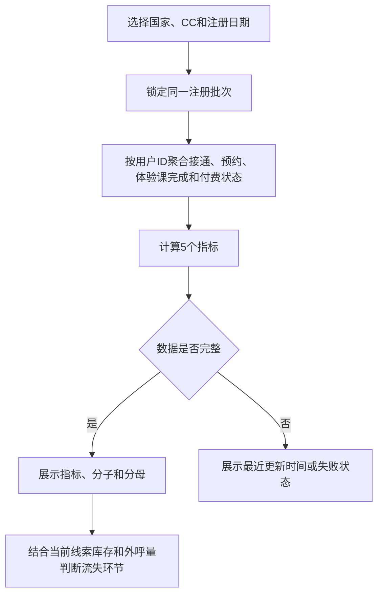
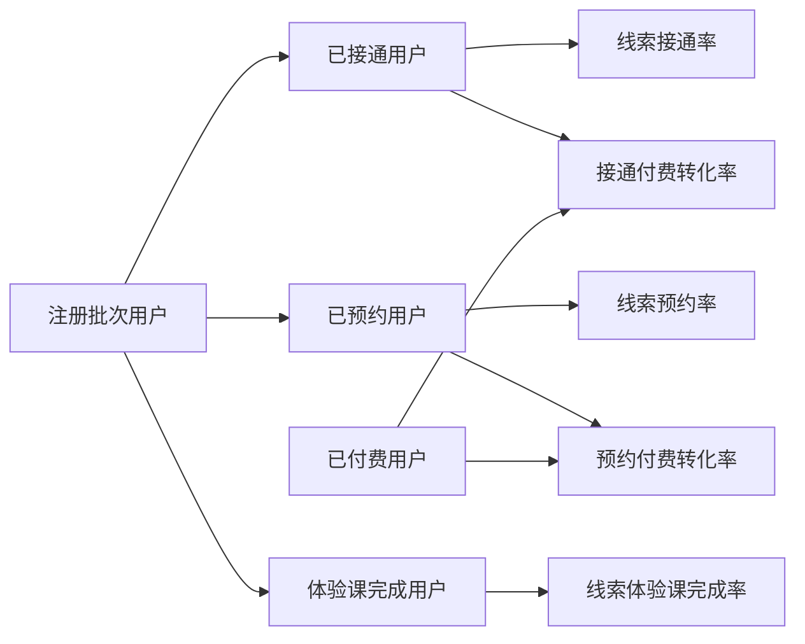

# 销售跟进漏斗指标

> 在管理看板的“销售跟进”页签增加 5 个跟进转化指标，帮助管理员定位线索在接通、预约、体验课完成和付费之间的流失。
> 版本 / 需求编号：V1.0 / REQ-DASH-007
> 需求类型：看板与指标
> 更新时间：2026-11-11

> 📌
> - **新增指标**：线索接通率、线索预约率、线索体验课完成率、接通付费转化率、预约付费转化率。
> - **统一口径**：复用现有注册批次、用户 ID 去重、国家/CC 筛选和数据权限。
> - **不做**：不修改销售阶段、预约、课程、订单或 CC 归属规则。

> 来源：[CRM Request No. 7](https://qjphu5vphyf4.jp.larksuite.com/base/VmMrbK4uva0lbOsnnXSjBy9rpLK?table=tbl6ewjzW1j648cj&view=vewEIikg2C)。需求方于 2026-10-21 提出，2026-11-10 确认本期只增加 5 个漏斗指标。

## 交互原型

[打开完整交互原型](https://h3-ai-lab.github.io/hhhprd/projects/follow-up-funnel/prototype/)

原型可验证国家、CC、注册日期筛选，3 个看板页签，5 个指标及分子分母，以及统计口径弹窗。

## 要解决什么

当前“销售跟进”页签能查看当前线索库存、外呼量和接通量，但不能直接判断线索进入跟进流程后主要损失在接通、预约、体验课完成还是付费环节。

本期补充 5 个转化指标，让管理员在不切换页签、不手工计算的情况下发现异常环节，并与“转化总览”使用同一注册批次口径。

## 本期目标与成功指标

本期先建立可解释、可核对的跟进转化基线。首版不设具体业务目标值。

| 目标 | 成功标志 |
|---|---|
| 指标可直接使用 | 5 个指标在销售跟进页签直接展示 |
| 避免误读 | 每个百分比同时展示分子和分母 |
| 口径一致 | 5 个指标与转化总览使用同一注册批次和用户去重规则 |
| 可判断异常 | 管理员能通过指标定位主要流失环节 |
| 可核对 | 页面展示数据更新时间，并保留统计口径入口 |

## 已确认、工作假设与待确认

| 类型 | 内容 |
|---|---|
| 已确认 | 本期只增加 5 个指标。 |
| 已确认 | 体验课完成人数来自课程记录，不使用预约或销售出席状态代替。 |
| 已确认 | 线索、接通、预约、体验课完成和付费结果均按用户 ID 去重。 |
| 工作假设 | 目标页面是管理看板中的“销售跟进”页签，而不是销售中心的“我的跟进”列表。 |
| 工作假设 | 日期筛选按注册日期选择同一批次，后续结果统计至当前。 |
| 待确认 | `Connected-Paid%` 和 `Appt-Paid%` 是“阶段转付费”还是“已付费用户中的阶段覆盖”。 |
| 待确认 | 退款、取消预约、测试用户和跨业务线用户的纳入规则。 |

## 范围

**做**

- 在管理看板“销售跟进”页签增加 5 个指标卡片。
- 展示百分比、分子、分母和数据更新时间。
- 复用国家、CC、注册日期筛选和现有管理看板数据权限。
- 在“统计口径”入口补充 5 个指标的正式定义。
- 保持当前线索库存、当前状态和外呼量原有统计规则。

**不做**

- 不增加收入、订单量、AOV、退款金额、趋势、目标或预测。
- 不增加新的明细下载或批量导出能力。
- 不改变接通、预约、体验课完成和付费的判定规则。
- 不改变 CC 分配、首次 CC、当前 CC 或业绩归属。
- 不改造销售中心“我的跟进”列表。

## 主流程与指标关系





同一注册批次内的用户可以跳过部分阶段，例如未接通但已预约、未预约但完成体验课或直接付费。因此各阶段人数不强制逐级递减。

## 指标定义

定义以下集合，所有集合均来自同一筛选后的注册批次：

- `L`：注册批次中的唯一用户。
- `C`：至少有一次成功接通的用户。
- `A`：至少有一次有效预约的用户。
- `T`：至少完成一次有效体验课的用户。
- `P`：至少有一笔有效已支付订单的用户。

| 页面名称 | 指标标识 | 分子 | 分母 | 业务用途 |
|---|---|---|---:|---|
| 线索接通率 | `Lead-Connect%` | 已接通用户数 | 注册批次线索数 | 判断线索触达能力 |
| 线索预约率 | `Lead-Appt%` | 已预约用户数 | 注册批次线索数 | 判断线索到预约的转化 |
| 线索体验课完成率 | `Lead-Completed%` | 体验课完成用户数 | 注册批次线索数 | 判断线索到体验课完成的转化 |
| 接通付费转化率 | `Connected-Paid%` | 既接通又已付费的用户数 | 已接通用户数 | 判断接通后的付费转化 |
| 预约付费转化率 | `Appt-Paid%` | 既预约又已付费的用户数 | 已预约用户数 | 判断预约后的付费转化 |

计算规则：

- 同一用户在同一指标中只计一次，不按通话、预约或订单次数重复计数。
- 百分比为分子除以分母，页面保留一位小数。
- 分母为零时显示 `—` 和 `0 / 0`，不显示 `0%`。
- 比率允许超过 100%；系统不得截断，应原样展示并提示可能存在数据异常。
- 用户未到达某阶段时，不得用当前线索状态倒推历史阶段。
- 当前线索库存和当前外呼状态不计入转化指标分子或分母。

## 页面与交互

入口：管理看板 → 销售跟进。

位置：放在“当前线索库存”和“外呼”之间，不改变现有页面结构。

```text
[国家] [CC] [注册日期]
[当前线索库存]
[跟进转化：5个指标]
[外呼]
```

### 现有筛选区比对

现有管理看板的筛选区顺序为：国家 → CC → 注册日期及起止日期。本需求不新增筛选项，也不改变筛选区位置和排列。

| 现状顺序 | 筛选项 | 比对结果 | 目标位置 |
|---|---|---|---|
| 1 | 国家 | 保留 | 原位置 |
| 2 | CC | 保留 | 原位置 |
| 3 | 注册日期及起止日期 | 保留 | 原位置；继续决定注册批次 |

新增内容只出现在筛选区之后的“跟进转化”指标组，不插入日期区间或改变现有筛选器顺序。

展示规则：

- 页面标题、页签、筛选、状态和提示使用简体中文。
- 5 个指标默认同一行展示；空间不足时自动换行，不隐藏指标。
- 每个指标展示中文名称、指标标识、百分比和 `分子 / 分母`。
- “统计口径”弹窗说明 5 个指标的公式、体验课数据来源和用户去重规则。
- 切换国家、CC 或注册日期后，指标、分子和分母同步刷新。
- 当前线索库存不受注册日期影响；当前外呼状态同样不受注册日期影响，外呼人数和接通人数按活动日期统计。
- 切换至其他看板页签后返回，保留当前筛选条件。
- 加载中显示占位状态，不先展示 `0%`；加载失败显示失败提示，不伪装成无数据。
- 数据延迟时展示最近一次完整更新的数据，并标明更新时间。

## 筛选与时间口径

| 项目 | 规则 |
|---|---|
| 国家 | 使用现有国家筛选，决定业务线和币种范围 |
| CC | 使用现有 CC 筛选；候选范围受数据权限限制 |
| 注册日期 | 选定注册批次；起止日期均包含 |
| 后续结果 | 从注册时间起统计至当前 |
| 去重 | 接通、预约、体验课完成和付费均按用户 ID 去重 |
| 时间展示 | 沿用管理看板业务线时区；越南当前显示 `Asia/Saigon (UTC+7)` |
| 更新时间 | 展示最近一次完整数据更新时间 |

## RBAC 权限数据

### 功能权限

| 页面 / 资源 | 操作 | 业务含义 | 默认角色 | 数据范围 | 审计 |
|---|---|---|---|---|---|
| 管理看板 | 查看 | 进入管理看板 | 管理员、超级管理员 | 授权业务线 | 不新增操作审计 |
| 销售跟进 | 查看 | 查看销售跟进页签 | 管理员、超级管理员 | 授权业务线和 CC | 不新增操作审计 |
| 跟进转化指标 | 查看 | 查看 5 个聚合指标及分子分母 | 管理员、超级管理员 | 与销售跟进页签一致 | 不新增操作审计 |
| 统计口径 | 查看 | 查看指标定义 | 管理员、超级管理员 | 无额外数据 | 不新增操作审计 |

销售组长默认不因本需求获得管理看板权限；如果当前部署已经通过现有角色配置向其开放管理看板，则复用原权限，不扩大数据范围。

### 字段与数据权限

| 字段组 / 列表 | 可见角色 | 编辑角色 | 脱敏 / 隐藏 | 可导出 | 候选范围限制 |
|---|---|---|---|---|---|
| 5 个聚合指标及分子分母 | 管理员、超级管理员 | 无 | 不展示手机号、姓名、录音或订单明细 | 本期不新增导出 | 仅授权业务线 |
| 国家筛选 | 管理员、超级管理员 | 无 | 不展示无权业务线 | 不适用 | 现有业务线数据权限 |
| CC 筛选 | 管理员、超级管理员 | 无 | 不展示无权 CC | 不适用 | 现有团队和 CC 数据权限 |
| 线索、预约、课程和订单明细 | 不因本需求新增可见范围 | 无 | 本需求不展示明细 | 不新增 | 沿用现有明细权限 |

### 权限数据变更

| 变更类型 | 权限层级 | 权限项 | 业务说明 | 默认角色 / 数据范围 | 是否新增审计 |
|---|---|---|---|---|---|
| 新增 | 页面 | 管理看板 > 销售跟进 > 跟进转化指标 | 查看新增指标组 | 管理员、超级管理员；授权业务线和 CC | 否 |
| 复用 | 页面 | 管理看板 > 销售跟进 > 查看 | 进入销售跟进页签 | 沿用现有角色配置 | 否 |
| 复用 | 数据 | 国家 / 业务线数据权限 | 限制可查看的国家和业务线 | 沿用现有数据权限 | 否 |
| 复用 | 数据 | CC / 团队数据权限 | 限制筛选和汇总范围 | 沿用现有数据权限 | 否 |
| 复用 | 字段 | 聚合指标查看 | 查看百分比及分子分母 | 具备销售跟进查看权限的角色 | 否 |
| 不新增 | 导出 | 跟进转化指标明细导出 | 本期不提供新的明细下载 | 无 | 不适用 |

没有权限时，用户沿用现有看板无权限状态。无权数据不得通过分子、分母、筛选项或更新时间间接暴露。

## 数据与依赖

| 数据 / 系统 | 用途 | 唯一标识 | 时效 / 失败处理 |
|---|---|---|---|
| 注册用户与业务线 | 注册批次、线索分母、国家范围 | 用户 ID | 批次数据失败时整组指标显示失败 |
| 外呼记录 | 已接通用户 | 用户 ID、通话记录 ID | 外呼延迟时保留最近成功数据并显示更新时间 |
| 预约记录 | 已预约用户 | 用户 ID、预约记录 ID | 不使用通话小结代替预约状态 |
| 课程学习记录 | 体验课完成用户 | 用户 ID、课程完成记录 ID | 不使用预约或出席状态代替完成状态 |
| 订单 / 支付记录 | 已付费用户 | 用户 ID、订单 ID | 支付同步延迟时不手工补齐 |
| 管理看板刷新任务 | 指标聚合和更新时间 | 业务线、日期、CC | 失败时保留最近成功快照并明确提示 |

5 个指标复用“转化总览”已有的批次、用户去重和阶段判定，不建立独立口径。

## 用户故事

```text
管理员打开管理看板
→ 进入销售跟进
→ 选择国家、CC和注册日期
→ 查看5个转化指标及分子分母
→ 打开统计口径确认计算规则
→ 结合当前线索库存和外呼量判断主要流失环节
```

主要判断场景：

- 线索接通率偏低：检查线索质量、外呼覆盖、线路和首次联系时效。
- 线索预约率偏低：检查接通后的预约话术、可用时段和预约阻力。
- 线索体验课完成率偏低：检查预约后的提醒、出席和课程履约。
- 接通付费转化率偏低：检查课程匹配、销售跟进和报价。
- 预约付费转化率偏低：检查预约质量、到场后成交和体验课后的购买转化。

## 异常与边界

- **无数据**：显示无数据状态，不保留上一次筛选的数值。
- **零分母**：显示 `—` 和 `0 / 0`，不显示 `0%`。
- **比率异常**：超过 100% 时原样展示并提示核对批次、退款或状态同步。
- **阶段跳跃**：允许未接通但预约、未预约但完成体验课或直接付费。
- **重复记录**：同一用户多次接通、预约、完成或支付只计一次。
- **历史数据缺失**：没有可靠事件时标记缺失，不使用当前状态倒推历史阶段。
- **数据延迟**：保留最近成功快照并展示更新时间，不把未同步数据解释为零。
- **权限变化**：重新进入页面或刷新后按最新权限生效。
- **退款和取消**：本期沿用管理看板现有有效订单和有效预约规则，独立规则另行确认。

## 待确认

| 问题 | 默认假设 | 影响 | Owner |
|---|---|---|---|
| `Connected-Paid%` 的方向 | 采用 `Paid ∩ Connected ÷ Connected` | 若采用原消息中的 `Connected ÷ Paid`，应改名为“已付费用户的接通覆盖率” | 需求方 |
| `Appt-Paid%` 的方向 | 采用 `Paid ∩ Appt ÷ Appt` | 若采用原消息中的 `Appt ÷ Paid`，应改名为“已付费用户的预约覆盖率” | 需求方 |
| “有效预约”和“有效体验课完成”的最终状态 | 预约取至少一次有效预约；完成取课程记录中的真实完成状态 | 影响指标分子和分母 | 需求方、技术 |
| 退款、取消预约、测试用户和跨业务线用户是否计入 | 沿用管理看板现有统一口径 | 影响所有指标的可比性 | 产品、数据、业务 |
| CC 转派后的团队归属 | 沿用当前管理看板归属规则 | 影响团队比较和筛选结果 | 产品、业务 |
