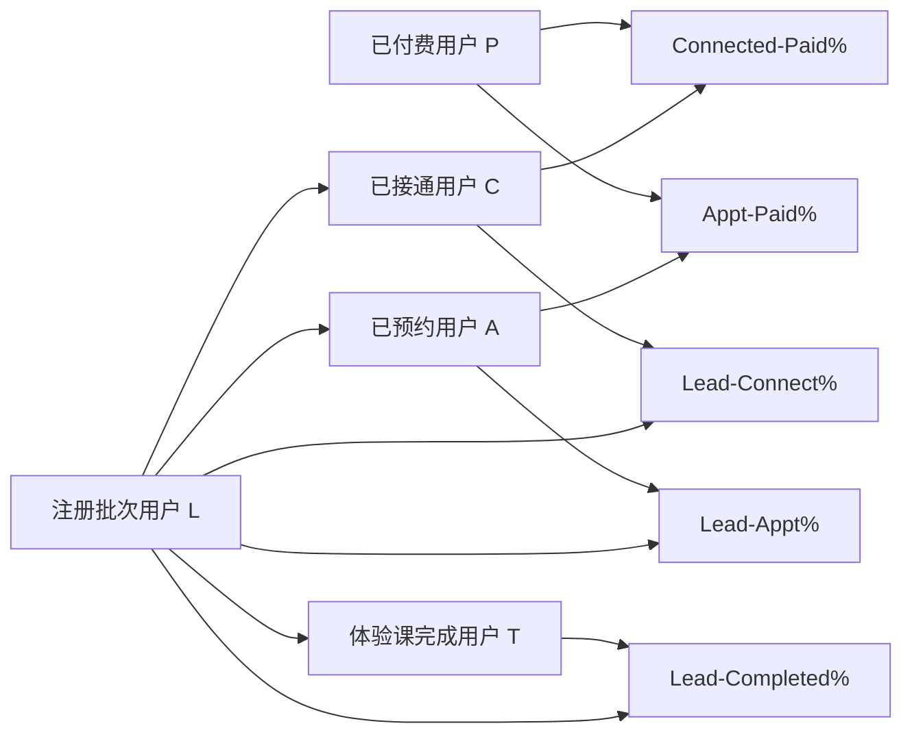

# 销售跟进漏斗指标（Follow-up Funnel Metrics）

> 在管理看板 `Sales follow-up` 页签增加 5 个漏斗指标，让管理员和销售组长能够看到线索进入销售流程后的接通、预约、体验课完成和付费结果。
> 需求编号：REQ-DASH-007｜状态：待评审｜更新时间：2026-11-10
> 需求类型：看板与指标

> 📌
> - 本期只新增 `Lead-Connect%`、`Lead-Appt%`、`Lead-Completed%`、`Connected-Paid%`、`Appt-Paid%`。
> - 复用管理看板现有的注册批次、用户 ID 去重和筛选规则，不新建第二套漏斗数据。
> - 不改变线索状态、预约、体验课、订单或 CC 归属逻辑。

> ⚠️ 来源：[CRM Request No. 7](https://qjphu5vphyf4.jp.larksuite.com/base/VmMrbK4uva0lbOsnnXSjBy9rpLK?table=tbl6ewjzW1j648cj&view=vewEIikg2C)；需求方于 2026-11-10 确认 5 个指标名称和口径。原消息中 `Connected-Paid%`、`Appt-Paid%` 的分子分母方向与指标名称及漏斗语义相反，本文先按建议的漏斗方向编写，并在“待确认”中标出。

## 交互原型

[打开完整交互原型](../projects/follow-up-funnel/prototype/index.html)

原型可验证国家、CC 和注册日期筛选，5 个指标卡、分子分母说明、Cards/Compare 两种查看方式，以及与 Current lead inventory、Calling 的页面关系。

## 要解决什么

当前 `Sales follow-up` 主要展示当前线索库存、外呼量和接通量，能够看到执行过程，但不能直接回答线索在接通、预约、体验课完成和付费之间损失在哪里。

本期增加 5 个转化指标，让管理者在不切换页签、不手工计算结果的情况下识别主要流失环节；点击统计口径时仍能看到分子、分母和计算范围。

## 本期目标与成功指标

本期目标是让 `Sales follow-up` 具备与 `Conversion overview` 一致的转化判断能力，首版重点是统一口径和建立基线。

| 目标 | 成功标志 |
|---|---|
| 补齐关键转化结果 | 5 个指标在页面中可直接查看 |
| 避免误读 | 每个百分比同时展示分子和分母 |
| 保持全页一致 | 5 个指标使用同一注册批次、筛选范围和用户去重规则 |
| 可核对 | 页面展示数据更新时间，并与现有转化总览和底层明细保持一致 |
| 可建立基线 | 首版允许不设置目标值，但能持续观察变化 |

## 已确认、工作假设与待确认

| 类型 | 内容 |
|---|---|
| 已确认 | 本期只增加 5 个指标；`Lead`、`Connected`、`Booking`、`Trial completed`、`Paid user` 是核心统计对象 |
| 已确认 | `Lead-Completed%` 的完成人数来自体验课完成记录，不使用预约或出席状态代替 |
| 工作假设 | 目标页面是截图中的 `Management dashboard > Sales follow-up`，而不是销售中心 `My Follow-ups` 列表 |
| 工作假设 | 5 个指标沿用 `Conversion overview` 的注册批次口径，按用户 ID 去重，结果统计至当前 |
| 待确认 | `Connected-Paid%`、`Appt-Paid%` 是“阶段转付费”还是“已付费用户中的阶段覆盖率” |
| 待确认 | 退款、取消预约、测试用户和跨业务线用户是否从分母中排除 |

## 范围

**做**

- 在 `Sales follow-up` 增加 5 个漏斗指标卡片。
- 每个指标展示百分比、分子、分母和统计口径提示。
- 复用国家、CC、日期筛选及现有角色数据权限。
- 复用现有注册批次、业务时间和数据更新时间规则。
- 无数据、零分母、加载失败和数据延迟时提供明确状态。

**不做**

- 不新增或修改销售阶段、接通判定、预约状态、体验课完成状态和支付状态。
- 不改变 CC 分配、首位 CC、当前 CC 或业绩归属规则。
- 不新增收入、AOV、退款金额、转化趋势、目标值或预测。
- 不改造 `Conversion overview`、支付结果页签或销售中心列表。
- 本需求不包含新的明细下载能力；现有下载能力保持原样。

## 指标关系



同一注册批次内的用户可以跳过部分阶段，例如没有接通记录但完成体验课或付款。因此各阶段人数不强制逐级递减，指标不得通过前端强制把下游人数截断为上游人数。

## 指标定义

定义以下集合，所有集合均来自同一筛选后的注册批次：

- `L`：注册批次中的唯一用户。
- `C`：至少有一次成功接通的用户。
- `A`：至少有一次有效预约的用户。
- `T`：至少完成一次有效体验课的用户。
- `P`：至少有一笔有效已支付订单的用户。

| 指标 | 建议计算公式 | 业务用途 |
|---|---:|---|
| Lead-Connect% | `C ÷ L` | 判断线索触达能力 |
| Lead-Appt% | `A ÷ L` | 判断从线索到预约的转化 |
| Lead-Completed% | `T ÷ L` | 判断从线索到体验课完成的转化 |
| Connected-Paid% | `(P ∩ C) ÷ C` | 判断已接通用户的付费转化 |
| Appt-Paid% | `(P ∩ A) ÷ A` | 判断已预约用户的付费转化 |

计算规则：

- 同一用户在同一指标中只计一次，不按通话、预约或订单次数重复计数。
- `Connected-Paid%` 的分子只统计既已接通又已付费的用户。
- `Appt-Paid%` 的分子只统计既已预约又已付费的用户。
- 百分比按分子除以分母计算，页面展示保留一位小数，具体分子和分母以整数展示。
- 分母为零时显示 `—`，不显示 `0%`。
- 数据允许出现分子大于分母或比率超过 100%；系统不得截断，应原样展示并提示可能存在数据口径异常。
- 取消、退款、测试用户和跨业务线记录是否纳入，沿用管理看板现有规则，本期不单独改变。

如果业务确认原消息中的公式为最终定义，则 `Connected-Paid%` 与 `Appt-Paid%` 实际表示“已付费用户中有接通/预约记录的比例”，应同步调整指标名称，避免与常规漏斗方向混淆。

## 页面设计

位置：`Management dashboard > Sales follow-up`，放在 `Current lead inventory` 与 `Calling` 之间。

```text
[国家] [CC] [Activity dates]
[现有说明：当前库存和当前状态不受日期筛选影响]

Current lead inventory

Follow-up conversion                        数据截至 YYYY-MM-DD HH:mm
[Lead-Connect%] [Lead-Appt%] [Lead-Completed%]
[Connected-Paid%] [Appt-Paid%]
[统计口径 ⓘ]

Calling
```

页面规则：

- 五个指标使用统一尺寸的卡片，宽度不足时自动换行，不隐藏指标。
- 卡片主信息为指标名称和百分比，次信息为 `分子 / 分母`。
- 桌面端默认单行显示前三个指标、单行显示后两个指标；移动端按单列或双列展示。
- 页面切换至 `Conversion overview` 或 `Payments` 后返回，保留本次筛选条件。
- 指标加载中显示加载状态，不先展示 `0%`。
- 指标加载失败时显示失败提示和重试入口，不把失败状态表现为无数据。
- 数据延迟时继续展示最近成功更新的数据，并明确标注更新时间。

### 筛选与时间口径

| 项目 | 规则 |
|---|---|
| 国家 | 沿用页面现有国家筛选 |
| CC | 沿用页面现有 CC 筛选及权限范围 |
| 日期 | 选择同一注册批次；日期范围按用户注册时间界定 |
| 后续结果 | 从注册时间起统计至当前，不受日期结束之后发生的接通、预约、体验课或支付限制 |
| 去重 | 各指标按用户 ID 去重 |
| 时区 | 沿用当前看板业务时区规则；截图中为 `Asia/Saigon（UTC+7）` |
| 更新时间 | 页面展示最近一次完整数据更新时间 |

`Current lead inventory` 和 `Current status` 继续按“截至现在”计算；新增的 5 个指标按注册批次计算。页面说明需要把两类口径分开，避免用户认为切换日期会同时改写当前库存。

## 权限与数据范围

| 角色 / 条件 | 能看什么 | 能做什么 | 限制 |
|---|---|---|---|
| 管理员 / 超级管理员 | 授权业务线内的 5 个指标 | 切换筛选、查看口径和更新时间 | 不扩大现有敏感数据权限 |
| 销售组长 | 有权限团队范围内的 5 个指标 | 按现有 CC 和日期维度查看 | 不得看到其他团队汇总或明细 |
| 其他管理看板角色 | 沿用现有看板权限 | 只读查看 | 不因新增指标获得新的用户、订单或通话数据 |

新增指标不引入新的权限体系。用户无权限时沿用当前看板的无权限状态，不得通过指标分子/分母暴露无权访问的数据量。

## 数据与依赖

| 数据 / 系统 | 用途 | 关键规则 | 失败处理 |
|---|---|---|---|
| 注册批次 / 用户 | `Lead` 分母及国家、CC 范围 | 一个注册用户只计一次；沿用现有业务线和归属口径 | 批次数据失败时整组指标显示失败状态 |
| 外呼记录 | `Connected` | 至少一次成功接通；不把外呼、未接或线路失败算作接通 | 外呼数据延迟时保留最近成功快照 |
| 预约记录 | `Booking` | 至少一次有效预约；取消预约是否计入沿用现有口径 | 预约状态异常时不以通话小结代替 |
| 课程学习记录 | `Trial completed` | 至少一次有效体验课完成，不使用预约或出席代替 | 课程记录延迟时保留最近成功快照 |
| 订单 / 支付记录 | `Paid user` | 至少一笔有效已支付订单；按用户 ID 去重 | 支付同步延迟时展示更新时间，不手工补齐 |

5 个指标应复用 `Conversion overview` 已有的批次、用户去重和阶段判定，不单独复制一套计算定义。指标显示的是管理分析结果，不用于直接修改线索、预约、课程或订单。

## 用户怎么走

```text
管理员打开 Sales follow-up
→ 选择国家、CC 和注册日期
→ 查看 5 个漏斗百分比及分子/分母
→ 通过统计口径确认计算范围
→ 结合 Current lead inventory 和 Calling 判断问题环节
→ 切换筛选进行团队或时间段比较
```

主要决策场景：

- `Lead-Connect%` 偏低：优先检查线索质量、外呼覆盖、线路和首次联系时效。
- `Lead-Appt%` 偏低：重点看接通后的预约话术、可用时段和预约阻力。
- `Lead-Completed%` 偏低：检查预约后的提醒、出席和体验课履约。
- `Connected-Paid%` 偏低：检查接通用户的课程匹配、销售跟进和报价。
- `Appt-Paid%` 偏低：检查预约质量、到场后成交和体验课后的购买转化。

## 异常与边界

- **零分母**：显示 `—` 和 `0 / 0`，不显示 `0%`。
- **分子大于分母**：保留原始比率并提示异常，不截断为 100%。
- **阶段跳跃**：允许未接通但预约、未预约但完成体验课或直接付费，人数不做逐级强制递减。
- **重复记录**：同一用户多次接通、预约、完成或支付只计一次。
- **历史数据缺失**：沿用当前看板状态；没有可靠事件时不使用当前状态倒推历史阶段。
- **数据延迟**：显示最近成功更新时间和数据范围，不把未同步数据解释为零。
- **权限变化**：返回页面或重新查询后按最新权限生效；无权数据不计入用户可见的汇总。
- **筛选为空**：五个指标统一显示无数据状态，不保留上一次筛选的数值。

## 待确认

| 问题 | 默认假设 | 影响 | Owner |
|---|---|---|---|
| `Connected-Paid%` 是已付费用户占已接通用户，还是已接通用户占已付费用户 | 按指标名称采用 `Paid ∩ Connected ÷ Connected` | 决定指标是否为漏斗转化率；反向公式可能产生超过 100% 的结果 | 需求方 |
| `Appt-Paid%` 是已付费用户占已预约用户，还是已预约用户占已付费用户 | 按指标名称采用 `Paid ∩ Appt ÷ Appt` | 决定预约到付费的判断方向 | 需求方 |
| “有效预约”和“有效体验课完成”的最终状态定义 | 预约取至少一次有效预约；完成取课程记录中的真实完成状态 | 影响两个分子和两个分母 | 需求方、技术 |
| 退款、取消预约、测试用户和跨业务线用户是否计入 | 沿用管理看板现有统一口径 | 影响所有指标的可比性 | 产品、数据、业务 |
| CC 转派后指标按首次 CC 还是当前 CC 归属 | 沿用当前管理看板归属规则 | 影响团队和个人比较 | 产品、业务 |
