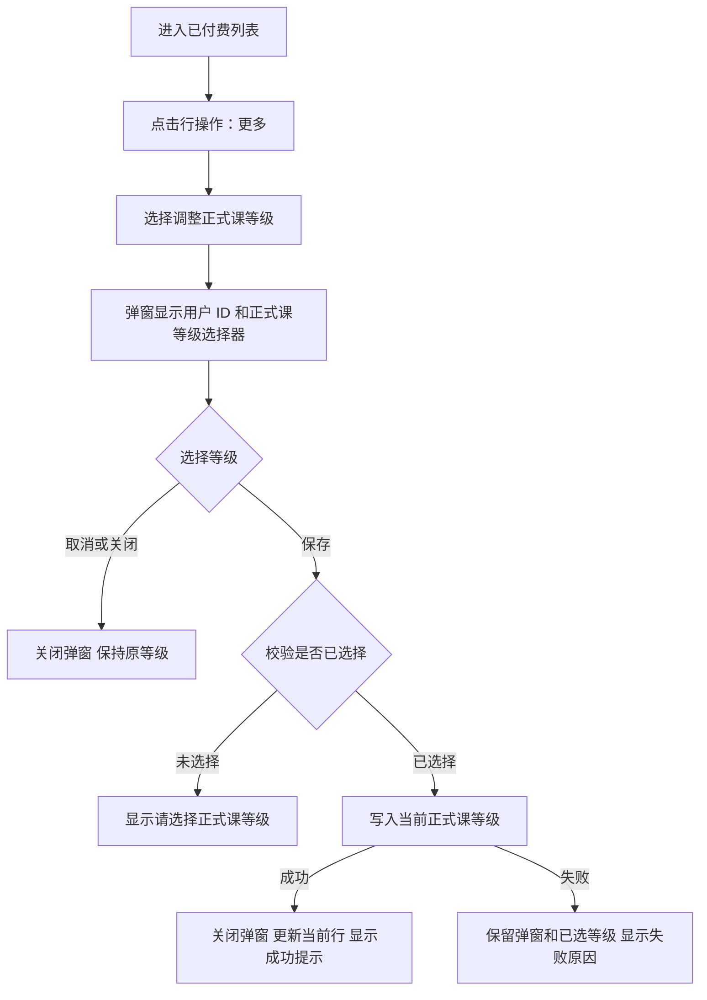

# 已付费列表调整正式课等级

> 在销售中心“已付费”列表的行操作中增加“调整正式课等级”，沿用现有“修改试听课等级”的单字段弹窗交互。
> 项目编号：REQ-LEVEL-001｜状态：待上传｜更新时间：2026-11-24
> 需求类型：表单、字段与列表｜补充类型：权限与审计

> 📌
> - **入口**：销售中心 → 已付费 → 更多 → 调整正式课等级。
> - **范围**：只调整用户当前正式课等级，不改列表列、筛选项、下载入口和其他行操作。
> - **数据隔离**：正式课等级与试听课等级分别保存，互不覆盖。
> - **历史保留**：不改写历史学习记录、订单、会员有效期和付款信息。

## 交互原型

[打开完整交互原型](https://h3-ai-lab.github.io/hhhprd/projects/formal-course-level/prototype/)

## 目标与范围

**目标**

让有权限的一线销售在已付费列表中直接完成正式课等级调整，不需要离开当前列表或进入用户中心。

**做**

- 在“已付费”列表“更多”菜单中增加“调整正式课等级”。
- 打开正式课等级弹窗，选择 L1–L6 中一个等级并保存。
- 保存成功后关闭弹窗、刷新当前行课程等级并显示成功提示。
- 为动作配置独立 RBAC 权限，并记录操作审计。

**不做**

- 不新增页面、列、筛选项、批量操作或导出入口。
- 不修改试听课等级、订单、会员权益、会员有效期、付款信息或历史学习记录。
- 不新增列表排序能力。
- 不使用正式课等级调整修改线索分配、归属或跟进阶段。

## 现有页面与目标差异

当前页面依据 2026-11-24 用户提供的已付费列表截图和试听课等级弹窗截图；只对截图中可见的字段、菜单和交互作出现状结论。

当前列表：

`勾选 → 用户 ID → 学生姓名 → 购买意向 → 用户状态 → 用户类型 → 年龄段 → 课程等级 → 登录账号 → 渠道来源-落地页 → 操作`

目标列表保持完全相同的列顺序，不新增列。

当前“更多”菜单：

`试听课报告 → 更新跟进 → 重新分配线索 → 添加会员时长`

目标“更多”菜单：

`试听课报告 → 更新跟进 → 调整正式课等级 → 重新分配线索 → 添加会员时长`

| 现状顺序 | 内容 | 现状位置 | 比对结果 | 目标位置 | 变更原因 |
|---|---|---|---|---|---|
| 1–10 | 勾选、用户 ID、学生姓名、购买意向、用户状态、用户类型、年龄段、课程等级、登录账号、渠道来源-落地页 | 列表列 | 保留 | 原顺序不变 | 本需求不调整列表结构 |
| 11 | 拨号、更多 | 操作列 | 保留 | 原位置不变 | 保留现有行操作 |
| 菜单 1 | 试听课报告 | 更多菜单第 1 项 | 保留 | 原位置 | 与正式课等级无关 |
| 菜单 2 | 更新跟进 | 更多菜单第 2 项 | 保留 | 原位置 | 保留现有跟进入口 |
| 菜单 3 | 调整正式课等级 | 无 | 新增 | 更新跟进之后 | 课程定级属于用户资料调整，放在重新分配线索之前 |
| 菜单 4 | 重新分配线索 | 更多菜单第 3 项 | 保留 | 调整正式课等级之后 | 保持现有操作 |
| 菜单 5 | 添加会员时长 | 更多菜单第 4 项 | 保留 | 原位置 | 与正式课等级无关 |

## 业务流程

## 字段定义

| 字段 | 业务含义 | 类型与枚举 | 必填 | 默认值 | 可编辑规则 | 异常展示 | 排序要求 |
|---|---|---|---|---|---|---|---|
| 正式课等级 | 用户当前使用的正式课程能力级别 | 单选；L1、L2、L3、L4、L5、L6 | 是 | 不预选，显示“请选择正式课等级” | 有调整权限的用户可在已付费列表弹窗中修改 | 未选择时提示“请选择正式课等级”；课级目录加载失败时禁止保存并允许重试 | 不支持；当前列表没有排序入口 |

规则：

- 下拉选项只返回当前有效且可分配的正式课等级。
- 正式课等级与试听课等级分别保存。
- 已付费列表“课程等级”列展示当前正式课等级。
- 等级目录不可用时，弹窗保留，选择器禁用，保存按钮不可提交，并提供重试。

## 页面与交互

### 已付费列表

- 默认打开“已付费”页签，保持现有筛选项、列、下载入口和行操作顺序。
- 每一行“更多”菜单增加“调整正式课等级”。
- 没有调整权限的角色不显示该菜单项。
- 点击菜单项时关闭“更多”菜单并打开正式课等级弹窗。

### 正式课等级弹窗

- 标题：`调整正式课等级 · {用户 ID}`。
- 内容只包含必填字段“正式课等级”。
- 选择器初始显示占位文案“请选择正式课等级”。
- 底部操作固定为“取消”和“保存”。
- 点击取消、右上角关闭或点击遮罩关闭弹窗，不保存修改。
- 点击保存且未选择等级时，在选择器下方显示“请选择正式课等级”，弹窗保持打开。
- 保存成功后关闭弹窗，当前行“课程等级”立即更新，并提示“正式课等级已更新”。
- 保存失败时保留弹窗、已选等级和当前页面状态，展示失败原因并允许重试。
- 保存过程中防止重复提交。

### 数据影响

- 更新成功后，当前用户的正式课等级立即成为新值。
- 已完成课程、课次、学习记录和历史定级快照保持在原等级，不随本次调整重写。
- 后续正式课程内容按新的当前正式课等级使用。
- 试听课等级、订单、支付记录、会员有效期、线索归属和跟进阶段不变。

## 搜索、筛选与导出

- 搜索、筛选、日期、下载按钮和结果范围保持现状。
- 本需求不新增筛选器，也不调整筛选项位置。
- 下载范围与当前筛选一致；如现有导出包含“课程等级”，导出更新后的正式课等级。
- 当前列表没有排序入口，本需求所有字段均不支持排序，不新增表头排序。

## RBAC 权限数据

### 功能权限

| 页面/资源 | 操作 | 业务含义 | 默认角色 | 数据范围 | 审计 |
|---|---|---|---|---|---|
| 销售中心 → 已付费 | 查看和搜索列表 | 查看正式课等级及现有已付费信息 | 销售专员、销售组长、系统管理员、超级管理员及已有销售中心查看权限的自定义角色 | 复用现有销售中心数据范围 | 否 |
| 销售中心 → 已付费 → 更多 | 调整正式课等级 | 修改用户当前正式课等级 | 销售专员、销售组长、系统管理员、超级管理员 | 仅可操作当前可见且属于现有权限范围的用户 | 是 |
| 销售中心 → 已付费 | 下载数据 | 下载当前筛选范围 | 沿用现有下载权限 | 与列表查看范围取交集 | 沿用现有下载审计 |

### 字段与数据权限

| 字段组/列表 | 可见角色 | 编辑角色 | 脱敏/隐藏 | 可导出 | 候选范围限制 |
|---|---|---|---|---|---|
| 课程等级 | 有已付费列表查看权限的角色 | 无；只通过独立动作修改 | 无权限时不展示菜单项 | 沿用现有导出权限 | — |
| 正式课等级选项 | 有调整动作权限的角色 | 不允许编辑选项目录 | 无权限时不返回选项 | 不作为独立字段导出 | 只返回当前有效正式课等级 L1–L6 |
| 已付费列表其他字段 | 不因本需求扩大可见范围 | 沿用现有规则 | 沿用现有手机号等敏感字段规则 | 沿用现有导出权限 | 沿用现有业务线和组织范围 |

### 权限数据变更

| 变更类型 | 权限层级 | 权限项 | 业务说明 | 默认角色/数据范围 | 是否新增审计 |
|---|---|---|---|---|---|
| 新增 | 动作 | `crm.sales.paid_list.formal_course_level.update` | 在已付费列表中调整正式课等级 | 销售专员、销售组长、系统管理员、超级管理员；继承现有数据范围 | 是 |
| 复用 | 页面 | 销售中心已付费列表查看 | 可进入列表并看到课程等级 | 现有销售中心角色 | 否 |
| 复用 | 数据 | 销售中心线索和用户数据范围 | 菜单可见、写入对象和保存校验使用同一范围 | 本人、团队或授权组织范围 | 否 |
| 复用 | 导出 | 销售中心现有下载权限 | 不因调整等级自动获得导出能力 | 现有导出角色 | 沿用现有审计 |

审计至少记录：操作人、操作时间、用户 ID、业务线、调整前后的正式课等级、操作结果和失败原因。审计记录只追加，不因用户停用或离职删除。

## 数据与异常

| 数据/场景 | 处理 |
|---|---|
| 未选择等级 | 阻止保存，显示“请选择正式课等级” |
| 选择等级与当前等级相同 | 允许保存，返回成功，记录一次无差异的操作结果 |
| 等级目录加载中 | 选择器显示加载状态，禁止保存 |
| 等级目录加载失败 | 保留弹窗，选择器禁用，提供重试 |
| 保存失败 | 保留弹窗和已选值，显示失败原因，允许重试 |
| 重复提交 | 保存处理中禁用保存按钮，不产生重复记录 |
| 用户状态在弹窗打开后变化 | 保存时重新校验已付费状态和操作权限；不满足时阻止保存并提示刷新列表 |
| 权限被撤销 | 菜单、弹窗和保存动作在下次请求同时失效 |
| 用户离职或账号停用 | 不影响用户正式课等级调整；执行人权限按账号生命周期规则失效 |
| 数据并发生效 | 以最后一次成功保存为准；后保存者提示等级已变化并刷新当前值 |
