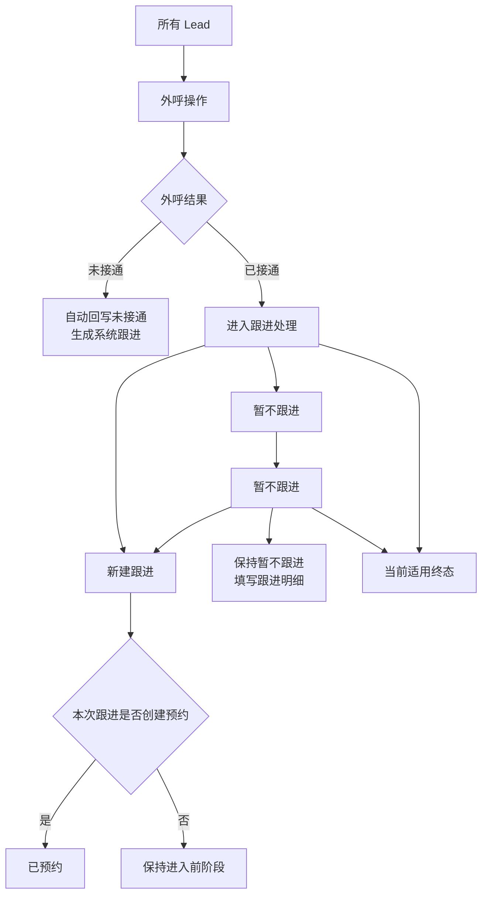

# 跟进流程简化

> 一句话结论：外呼操作与跟进状态分离；未接通自动回写，暂不跟进可直接新建跟进，暂停原因新增语音信箱。
> 版本 / 需求 ID：1.2 / REQ-FOLLOW-001
> 需求类型：规则、状态与数据｜补充类型：表单交互、权限与审计
> 更新时间：2026-11-23

> 📌
> - **操作与跟进分离**：外呼是所有 Lead 都可执行的业务操作；跟进说明是内容；只有预约、暂停、拒绝、关闭等业务结果才影响当前跟进阶段。
> - **未接通自动回写**：外呼未接通后自动进入 `未接通` 并生成系统跟进记录，不强制打开人工跟进表单。
> - **暂不跟进可直出**：移除 `恢复跟进`，暂停态可直接新建跟进、保持暂不跟进或执行当前终态。
> - **新增暂停原因**：暂停原因增加 `语音信箱`。
> - **不做**：不改列表字段、筛选、排序、导出、线索归属、预约后的出勤与咨询结果处理。

## 交互原型

[打开完整交互原型](https://h3-ai-lab.github.io/hhhprd/projects/paused-follow-up-direct-outcome/prototype/)

原型初始数据覆盖全部当前跟进阶段；可验证所有 Lead 外呼、未接通自动回写、已接通跟进、暂不跟进直接新建跟进、保持暂停、终态动作、语音信箱和双语切换。

## 要解决什么

外呼是销售动作，跟进项是业务结果，跟进说明是本次记录内容。当前外呼未接通仍会进入人工跟进流程，且暂不跟进线索需要先恢复跟进才能继续操作，导致操作、内容和状态混在一起。

本期只解决三个问题：

1. 未接通不再强制跟进。
2. 暂不跟进直接开放新建跟进和保持暂不跟进，不再需要恢复跟进。
3. 暂停原因增加语音信箱。

## 范围

**做**

- 所有 Lead 都可通过外呼操作发起通话；是否可拨打仍受现有外呼权限、手机号有效性、线路和账号状态约束。
- 待外呼、未接通或暂不跟进的 Lead 外呼未接通时，自动回写 `未接通`，生成系统跟进记录，不弹出人工跟进表单。
- 外呼已接通时，结束通话后进入跟进处理，与手动新建跟进使用同一套跟进项。
- 所有新入口移除 `恢复跟进`。
- `暂不跟进` 默认选择保持暂不跟进，也可直接新建跟进或执行当前终态。
- 暂停原因增加 `语音信箱`。
- 跟进状态严格按用户确认的阶段动作矩阵执行。

**不做**

- 不把 `新建跟进`、`记录沟通` 或跟进说明定义成跟进状态。
- 不为历史恢复跟进记录删除、改写或补造数据。
- 不新增列表字段、筛选器、排序能力或导出。
- 不改变现有外呼权限、手机号校验、线路选择、录音和通话记录规则。
- 不改变线索归属、首跟 CC、当前 CC 或业绩归属。

## 操作、跟进与状态

三层对象必须分开：

| 层级 | 内容 | 是否直接作为当前阶段 |
|---|---|---|
| 操作 | 外呼、新建跟进、新建预约、改期、取消预约等 | 否 |
| 跟进内容 | 购买意向、本次跟进说明、原因、客户反馈、下一步安排 | 否 |
| 当前跟进状态 | 待外呼、未接通、已接通 · 待预约、已预约、未出勤、咨询未完成、咨询已完成 · 待支付、暂不跟进、已拒绝、已关闭 | 是 |

业务动作可以产生状态结果，但动作名称和说明内容不能替代状态本身。

## 阶段动作矩阵

### 外呼操作

- 所有 Lead 均显示外呼操作，不受当前跟进阶段限制。
- 手机号为空、账号停用、角色无外呼权限或号码不符合外呼条件时，沿用现有操作限制。
- 外呼结果作为通话事实单独记录。

### 跟进项

| 当前阶段 | 可操作跟进项 | 结果与说明 |
|---|---|---|
| 待外呼 | 新建跟进、暂不跟进、已拒绝 | 新建跟进为记录动作；形成预约后进入 `已预约` |
| 未接通 | 新建跟进、暂不跟进、已拒绝 | 新建跟进不要求先外呼成功 |
| 已接通 · 待预约 | 新建跟进、暂不跟进、已拒绝 | 新建跟进可记录说明或形成预约 |
| 已预约 | 记录沟通继续跟进、改期创建新预约、取消当前预约、未出勤、已出勤咨询完成、已出勤咨询未完成、已关闭 | 保留现网全部预约结果动作 |
| 未出勤 | 新建跟进、暂不跟进、已关闭 | 新建跟进形成预约后进入 `已预约` |
| 咨询未完成 | 新建跟进、暂不跟进、已关闭 | 新建跟进形成预约后进入 `已预约` |
| 咨询已完成 · 待支付 | 记录沟通继续跟进、暂不跟进、已关闭 | 记录沟通只追加内容，不改变阶段 |
| 暂不跟进 | 新建跟进、暂不跟进、已拒绝 | 默认 `暂不跟进`；新建跟进形成预约后进入 `已预约` |
| 已拒绝 | 重新激活线索 | 沿用现网重新激活规则 |
| 已关闭 | 重新激活线索 | 沿用现网重新激活规则 |

动作结果：

- `新建跟进`：创建一条跟进记录，本身不改变当前阶段；若本次跟进创建预约，则阶段更新为 `已预约`。
- `记录沟通继续跟进`：追加本次说明，当前阶段不变。
- `暂不跟进`：进入或保持 `暂不跟进`。
- `已拒绝`：进入 `已拒绝`。
- `已关闭`：进入 `已关闭`。
- `重新激活线索`：恢复为现网允许的跟进阶段。

## 状态与流程

## 未接通自动回写

- 当前阶段为待外呼、未接通或暂不跟进时，外呼结果未接通后阶段更新为 `未接通`。
- 已接通 · 待预约、已预约及后续预约/咨询阶段保留当前业务阶段，只记录本次外呼事实，避免一次未接通覆盖已建立的预约或咨询结果。
- 系统自动生成一条跟进记录，内容至少包含 Call ID、外呼结果、操作人和时间。
- 不弹出人工跟进表单，不要求销售补写跟进说明。
- 后续需要补充内容时，销售可主动执行 `新建跟进`。
- 自动回写失败时保留通话事实并展示同步失败；恢复后按原 Call ID 幂等补写。

## 暂不跟进

- 不展示、不接受 `恢复跟进`。
- 默认选中 `暂不跟进`。
- 选择 `暂不跟进` 时：
  - 原因必填，枚举为暂无需求、暂不方便、预算原因、语音信箱、其他。
  - `其他` 需填写补充原因。
  - 可填写本次跟进说明。
  - 当前已经是暂不跟进时，保存后阶段仍为暂不跟进，只在有新增说明或原因变化时追加跟进记录。
- 选择 `新建跟进` 时，不要求先退出暂不跟进；本次跟进形成预约后直接进入 `已预约`。
- 选择 `已拒绝` 后进入已拒绝状态。
- 暂停原因保存为本次跟进事实，后续预约或终态动作不覆盖历史暂停原因。

## 语音信箱

- `语音信箱` 是暂停原因，不是跟进阶段，也不是外呼结果。
- 外呼系统将语音信箱判定为已接通时，销售可在已接通后的跟进中选择 `暂不跟进 → 语音信箱`。
- 保存后外呼结果仍为已接通，当前阶段变为暂不跟进。
- `语音信箱` 不自动把线索处理为已拒绝，不自动创建预约。
- 手动更新跟进时也可选择该原因，但不得改写已有外呼事实。

## 页面与交互

入口：

- 外呼：销售中心线索行 `外呼`。
- 手动跟进：销售中心线索行 `更多 → 更新跟进`。

更新跟进表单将状态和内容分区：

1. 只读展示当前跟进阶段。
2. 选择本次跟进项。
3. 根据跟进项填写预约时间、原因、购买意向和本次跟进说明。
4. 展示不可覆盖的跟进历史。

`新建跟进` 与 `记录沟通继续跟进` 都不是状态标签，不在阶段筛选器中出现。

保存处理中禁用重复提交。保存成功后关闭弹窗并刷新当前阶段和最近跟进时间；保存失败时保留表单内容，服务端状态不变。

## 字段与排序

本期不新增列表列、筛选器或导出字段，销售中心列表的字段顺序和现有排序能力不变。当前列表未提供表头排序时，不新增排序交互；所有现有字段继续不支持新增排序。

| 字段 | 显示条件 | 业务规则 |
|---|---|---|
| 当前跟进阶段 | 始终 | 只读；只展示状态枚举 |
| 跟进项 | 始终 | 必填；按上方阶段动作矩阵展示 |
| 新的预约时间 | 新建跟进、改期 | 新建跟进选择创建预约时必填 |
| Google Meet | 新建跟进、改期 | 选填；填写时须为合法 HTTPS 地址 |
| 原因 | 暂不跟进、拒绝、关闭、预约结果动作 | 必填；暂停原因包含语音信箱 |
| 购买意向 | 跟进表单 | 沿用现网字段 |
| 本次跟进说明 | 跟进表单 | 内容字段，不作为状态；按跟进项决定必填或选填 |
| 跟进历史 | 始终 | 只读、追加，不覆盖历史 |

## 数据与历史口径

- 外呼记录、跟进内容和生命周期状态分别保存。
- 跟进记录保存购买意向、跟进说明、原因、操作人和时间。
- 只有产生业务结果时才写入阶段变更事件；纯内容记录不改变当前跟进阶段。
- 未接通自动回写产生一条系统跟进记录。
- 暂停后执行新建跟进、暂不跟进或终态动作时，不补写恢复跟进记录。
- 历史恢复跟进记录继续只读展示，但不再产生新事件。

## RBAC 权限数据

### 功能权限

| 页面 / 动作 | 默认角色 | 数据范围 | 审计 |
|---|---|---|---|
| 销售中心 `我的跟进` 查看 | 沿用销售中心现有角色 | 沿用线索业务线、团队或本人数据范围 | 普通查询不新增审计 |
| 外呼 | 拥有现有外呼权限的销售、销售组长、管理员、超级管理员 | 销售本人；组长含团队；管理员按业务线 | 是 |
| 新建跟进、更新跟进 | 拥有现有 `salesV3_update` 权限的角色 | 与销售中心线索数据范围一致 | 是 |
| 暂不跟进、拒绝、关闭、重新激活 | 同上 | 同上 | 是 |

### 字段与数据权限

| 字段组 / 列表 | 可见角色 | 编辑角色 | 脱敏 / 隐藏 | 可导出 | 候选范围限制 |
|---|---|---|---|---|---|
| 当前跟进阶段 | 有销售中心查看权限的角色 | 不直接编辑，由业务结果更新 | 无权时完全隐藏 | 本期不新增导出 | 仅权限范围内线索 |
| 外呼记录 | 有销售中心和外呼查看权限的角色 | 外呼结果由系统写入 | 无权时完全隐藏 | 沿用现有导出权限 | 仅权限范围内线索 |
| 预约时间、会议链接 | 有我的跟进权限的角色 | 通过新建跟进或改期编辑 | 无权时完全隐藏 | 本期不新增导出 | 仅当前线索 |
| 跟进说明、购买意向、原因 | 有对应跟进权限的角色 | 通过跟进记录编辑 | 无权时完全隐藏 | 本期不新增导出 | 仅当前线索 |
| 跟进历史 | 有销售中心查看权限的角色 | 不可编辑 | 无权时完全隐藏 | 本期不新增导出 | 仅当前线索 |

### 权限数据变更

| 变更类型 | 权限层级 | 权限项 | 业务说明 | 默认角色 / 数据范围 | 是否新增审计 |
|---|---|---|---|---|---|
| 复用 | 动作 | 现有外呼权限 | 所有 Lead 可执行外呼 | 现有外呼角色与线索数据范围 | 是 |
| 复用 | 动作 | 现有 `salesV3_update` | 新建跟进、暂不跟进、终态和重新激活 | 现有销售角色与线索数据范围 | 是 |
| 删除 | 动作 | `恢复跟进` | 所有新入口不再提供 | 不分配 | 历史记录保留 |
| 复用 | 数据 | 销售中心线索数据权限 | 不扩大可见或操作范围 | 业务线、团队或本人范围 | 否 |

## 并发、失败与边界

| 场景 | 处理 |
|---|---|
| 所有 Lead 可外呼 | 阶段不限制外呼；无手机号、无外呼权限、账号停用或线路不可用时按现网阻止 |
| 外呼未接通自动回写失败 | 保留通话事实并提示同步失败，恢复后按 Call ID 幂等补写 |
| 重复提交 | 同一跟进请求只生成一条跟进记录；同一预约只生成一个有效实例 |
| 两人同时操作 | 仅基于最新有效状态的动作可成功；后提交者刷新并重试 |
| 新建跟进只填写说明 | 保存跟进内容，当前阶段不变 |
| 新建跟进创建预约 | 保存跟进和预约，当前阶段更新为已预约 |
| 暂不跟进没有新增内容 | 阻止保存，避免无意义重复记录 |
| 语音信箱 | 只记录暂停原因，不改变外呼结果 |
| 旧客户端提交恢复跟进 | 拒绝操作并提示刷新，不写阶段或事件 |
| 历史恢复跟进记录 | 只读展示，不迁移、不删除 |
| 权限被撤销或账号停用 | 下次请求立即失败 |
