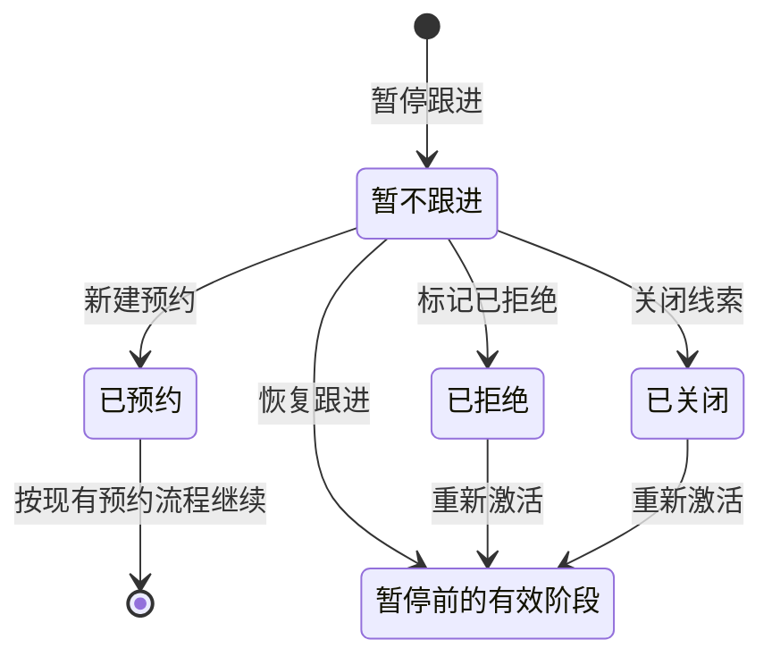

# 暂停跟进后直接产生跟进结果

> 一句话结论：线索处于“暂不跟进”时，销售可以直接新建预约、标记拒绝或关闭线索，一次保存完成业务结果，不再被迫先恢复跟进再操作一次。
> 版本 / 需求 ID：1.0 / REQ-FOLLOW-001
> 需求类型：规则、状态与数据｜补充类型：表单交互、权限与审计
> 更新时间：2026-11-20

> 📌
> - **直接预约**：暂停态可直接新建预约，保存成功后进入 `已预约`。
> - **一次落库**：只记录预约、拒绝或关闭这一项真实业务结果，不补写恢复跟进事件。
> - **保留暂停能力**：没有新结果、只想继续跟随时，仍可选择 `恢复跟进`。
> - **不做**：不改列表字段、筛选、排序、导出、线索归属或预约后出勤与咨询流程。

## 交互原型

[打开完整交互原型](https://h3-ai-lab.github.io/hhhprd/projects/paused-follow-up-direct-outcome/prototype/)

原型可验证暂停线索直接预约、恢复跟进、拒绝、关闭、重新激活、字段校验、重复提交和双语切换。

## 要解决什么

销售暂停线索后，如果家长重新表达预约意愿，当前仍要先把线索恢复为普通跟进，再第二次提交预约。两次操作不仅增加销售步骤，还会在跟进历史中写入一次没有独立业务结果的恢复记录，使操作次数难以反映真实跟进过程。

本期把暂停后的预约、拒绝和关闭都作为直接业务结果处理。暂停仍保留，但不再是所有后续动作的强制中转站。

## 范围

**做**

- `暂不跟进` 的“下一步操作”新增 `新建预约`。
- 保存暂停态预约后直接进入 `已预约`，不展示或记录额外的恢复跟进步骤。
- 继续保留暂停态 `恢复跟进`、`已拒绝`、`已关闭` 的现有直出路径。
- 预约时间、会议链接、原因、补充说明和跟进时间线沿用现有更新跟进弹窗规则。
- 预约、状态更新、暂停退出和跟进事件一次提交完成，任一步失败均保持 `暂不跟进`。
- 已拒绝或已关闭线索仍只能先重新激活，再继续跟进。

**不做**

- 不新增独立“预约”菜单、批量预约或快捷预约入口。
- 不新增列表字段、筛选器、排序能力或导出。
- 不改变预约后的改期、取消、出勤、咨询完成、咨询未完成和支付规则。
- 不改变当前线索归属、首跟 CC、当前 CC 或业绩归属。
- 不为历史暂停记录补造恢复事件，不批量改写历史跟进时间线。
- 不改变有效预约存在时禁止暂停或关闭、待支付禁止新建预约的限制。

## 状态与流程

当前阶段仍由业务动作驱动。`暂不跟进` 允许直接退出到预约或终态，也可显式恢复为暂停前的有效阶段。

关键动作矩阵：

| 当前状态 | 下一步操作 | 必要信息 | 保存后当前阶段 | 历史记录 |
|---|---|---|---|---|
| 暂不跟进 | 恢复跟进 | 沿用现网本次跟进说明和校验 | 暂停前阶段 | 一条恢复跟进事件 |
| 暂不跟进 | 新建预约 | 预约开始时间；会议链接按现网可选 | 已预约 | 一条新建预约事件和一条预约记录 |
| 暂不跟进且从未预约 | 标记已拒绝 | 拒绝原因 | 已拒绝 | 一条拒绝事件 |
| 暂不跟进且存在预约历史 | 关闭线索 | 关闭原因 | 已关闭 | 一条关闭事件 |
| 已拒绝或已关闭 | 重新激活线索 | 沿用现网规则 | 重新进入可跟进状态 | 一条重新激活事件 |

## 状态判定

- `暂不跟进` 只表示销售主动暂停；进入该状态不退回公海，不改变当前 CC，也不关闭线索。
- 暂停态保存 `新建预约` 时，系统先校验当前线索仍为可跟进且未支付，再创建一条当前有效预约，并同时结束暂停。
- 保存成功后当前阶段直接显示 `已预约`，不能短暂显示普通跟进阶段或要求销售再次保存。
- 从未创建过销售咨询预约的线索，终态动作为 `已拒绝`。
- 存在过预约历史后再暂停的线索，终态动作为 `已关闭`，不因取消或未出勤回退为已拒绝。
- `恢复跟进` 返回暂停事件发生前的有效阶段，不进入已拒绝、已关闭或已预约。
- 已支付用户仍按销售中心现有规则处理，不因暂停直出绕过支付判断。

## 页面与交互

入口保持：`销售管理 → 销售中心 → 我的跟进 → 更多 → 更新跟进`。

弹窗顶部继续展示当前跟进阶段。当前阶段为 `暂不跟进` 时，“下一步操作”按以下顺序展示：

1. 恢复跟进
2. 新建预约
3. 标记已拒绝或关闭线索（由预约历史决定，只展示一项）

选择 `新建预约` 后：

- 展示新的预约开始时间，必填。
- 展示 Google Meet 会议链接，保持现网可选规则。
- 展示本次跟进说明；新建预约不要求额外填写恢复原因。
- 预约开始时间使用线索所属业务线的时区口径，页面沿用现有业务线时区提示。
- 提交前提示“保存后将直接进入已预约，不会单独生成恢复跟进记录”。

选择 `标记已拒绝` 或 `关闭线索` 后：

- 只展示当前适用终态的完整原因枚举和本次跟进说明。
- 原因选择 `其他` 时展示补充原因输入框。
- 提交后直接进入对应终态，不再要求恢复跟进。

选择 `恢复跟进` 后，继续使用现网恢复跟进字段和校验，不显示预约字段。

弹窗底部继续展示不可编辑的跟进时间线。直接预约成功后，时间线只新增一条 `新建预约` 记录，其原阶段为 `暂不跟进`，不新增恢复跟进记录。

保存处理中禁用重复提交。保存成功后关闭弹窗、刷新列表阶段和最近跟进时间，并展示成功提示；保存失败时保留弹窗内容和原 `暂不跟进` 状态，允许修正后重试。

## 字段与排序

本期不新增列表列、筛选器或导出字段，销售中心列表的字段顺序和现有排序能力不变。当前列表未提供表头排序时，不新增排序交互；所有现有字段继续不支持新增排序。

更新跟进弹窗字段：

| 字段 | 显示条件 | 业务规则 |
|---|---|---|
| 当前跟进阶段 | 始终 | 只读；暂停时显示 `暂不跟进` |
| 下一步操作 | 始终 | 必填；只展示当前状态允许的动作 |
| 新的预约开始时间 | 选择新建预约 | 必填；按线索业务线时区解释 |
| Google Meet | 选择新建预约 | 选填；填写时须为合法 HTTPS 地址 |
| 原因 | 拒绝、关闭、恢复等现网要求原因的动作 | 必填；拒绝与关闭使用各自完整原因枚举；其他原因需补充文本 |
| 本次跟进说明 | 按动作 | 新建预约时选填；现网要求必填的动作继续必填 |
| 跟进时间线 | 始终 | 只读；追加展示，不覆盖 |

## 数据与历史口径

- 每次保存只产生本次业务动作对应的生命周期事件。
- 直出预约事件的变更前阶段为 `暂不跟进`，变更后阶段为 `已预约`。
- 直出拒绝事件的变更后结果为 `已拒绝`；直出关闭事件的变更后状态为 `已关闭`。
- 暂停原因继续保留在暂停事件中，后续直出动作不覆盖、不重复复制。
- 最近跟进时间更新为本次保存时间；暂停时间本身不被改写。
- 跟进时间线按直出动作展示，不插入系统生成的 `恢复跟进` 行。
- 历史暂停和恢复记录保持原样，不批量迁移；上线后新操作按本规则记录。

## RBAC 权限数据

### 功能权限

| 页面 / 动作 | 默认角色 | 数据范围 | 审计 |
|---|---|---|---|
| 销售中心 `我的跟进` 查看 | 沿用销售中心现有角色 | 沿用线索业务线、团队或本人数据范围 | 普通查询不新增审计 |
| 更新跟进中的新建预约 | 拥有现有 `salesV3_update` 权限的销售、销售组长、管理员、超级管理员 | 与更新跟进一致；销售本人，组长含团队，管理员按业务线 | 记录操作人、时间和阶段前后 |
| 更新跟进中的拒绝或关闭 | 同上 | 同上 | 记录原因、阶段前后和失败结果 |
| 恢复跟进与重新激活 | 同上 | 同上 | 记录操作人、时间和阶段前后 |

### 字段与数据权限

| 字段组 / 列表 | 可见角色 | 编辑角色 | 脱敏 / 隐藏 | 可导出 | 候选范围限制 |
|---|---|---|---|---|---|
| 当前跟进阶段 | 有销售中心查看权限的角色 | 不直接编辑，由动作更新 | 无权时完全隐藏 | 不新增导出 | 仅权限范围内线索 |
| 预约时间、会议链接 | 有我的跟进查看权限且能看到当前预约的角色 | 仅通过新建或改期操作编辑 | 无权时完全隐藏 | 不新增导出 | 仅当前线索 |
| 拒绝或关闭原因 | 有终态处理权限的角色 | 仅终态动作编辑 | 无权时完全隐藏 | 不新增导出 | 使用当前业务线的完整原因枚举 |
| 跟进时间线 | 有销售中心查看权限的角色 | 不可编辑 | 无权时完全隐藏 | 不新增导出 | 仅当前线索 |

### 权限数据变更

| 变更类型 | 权限层级 | 权限项 | 业务说明 | 默认角色 / 数据范围 | 是否新增审计 |
|---|---|---|---|---|---|
| 复用 | 动作 | 现有 `salesV3_update` | 暂停态直接预约继续使用更新跟进权限 | 现有销售角色与线索数据范围 | 是，记录业务动作 |
| 复用 | 数据 | 销售中心线索数据权限 | 不扩大可见或可操作范围 | 沿用业务线、团队或本人范围 | 否 |
| 不新增 | 菜单 / 页面 / 导出 | 无 | 不新增页面、菜单或下载入口 | 不适用 | 否 |

## 并发、失败与边界

| 场景 | 处理 |
|---|---|
| 重复点击保存 | 同一请求只生成一个有效预约和一条直出事件；重复请求返回原结果 |
| 两名有权限人员同时操作 | 只允许基于最新状态成功的动作；后提交者提示状态已变化并刷新 |
| 保存中用户被支付 | 取消预约直出，不修改阶段；提示用户已支付并按最新状态刷新 |
| 保存中线索被关闭或转派 | 不保存预约和事件；保持服务端当前状态，提示重新打开 |
| 有效预约已存在 | 不创建第二条有效预约，不修改阶段 |
| 线索已关闭或已拒绝 | 只提供重新激活，不提供直出预约 |
| 待支付阶段 | 不提供暂停直出预约，沿用现网限制 |
| 缺少预约时间 | 阻止提交，保持 `暂不跟进` |
| 会议链接不是 HTTPS | 阻止提交并提示修正 |
| 拒绝或关闭没有原因 | 阻止提交，保持 `暂不跟进` |
| 写预约成功但阶段写入失败 | 整体回滚，不允许出现“已预约记录存在但线索仍暂停”的半成功状态 |
| 网络结果未知 | 重新读取服务端状态；确认成功前不重复创建预约 |
| 权限被撤销或账号停用 | 下次提交立即失败，不创建预约或事件 |
| 历史线索缺少暂停事件 | 仍可按当前 `暂不跟进` 直接预约，但无法展示暂停前阶段；不推测历史 |
