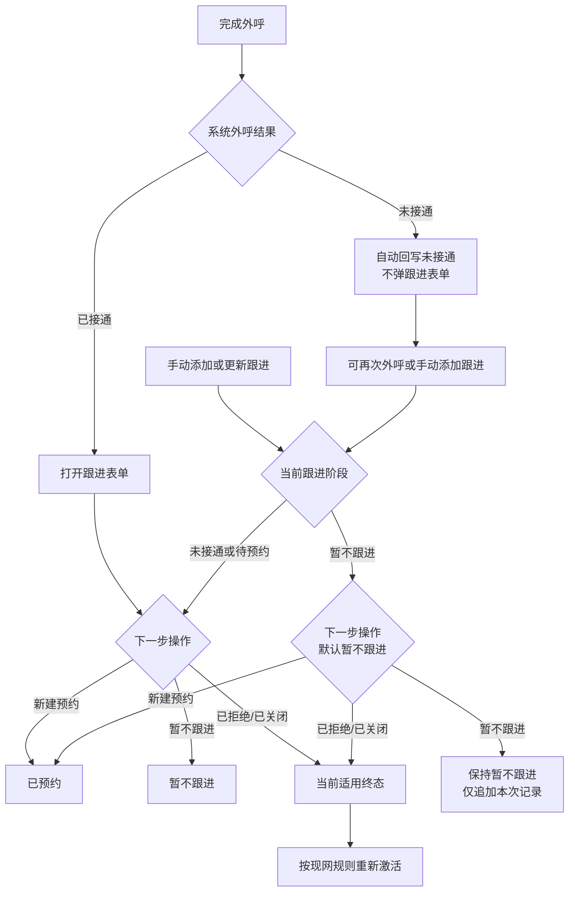

# 暂停跟进后直接产生跟进结果

> 一句话结论：系统移除“恢复跟进”操作；外呼未接通自动回写阶段，外呼接通和手动添加跟进都直接选择新建预约、暂不跟进或按现有规则拒绝/关闭线索。
> 版本 / 需求 ID：1.1 / REQ-FOLLOW-001
> 需求类型：规则、状态与数据｜补充类型：表单交互、权限与审计
> 更新时间：2026-11-23

> 📌
> - **移除恢复跟进**：所有新操作入口不再提供“恢复跟进”，也不再通过恢复动作回到历史阶段。
> - **外呼分流**：未接通自动回写 `未接通`，不弹出跟进表单；接通后必须选择本次业务结果。
> - **暂停可继续操作**：`暂不跟进` 默认保持暂停，也可直接新建预约或执行当前适用终态。
> - **终态沿用现网**：从未预约过选择 `已拒绝`；存在预约历史选择 `已关闭`。
> - **不做**：不改列表字段、筛选、排序、导出、线索归属或有效预约后的出勤与咨询流程。

## 交互原型

[打开完整交互原型](https://h3-ai-lab.github.io/hhhprd/projects/paused-follow-up-direct-outcome/prototype/)

原型可验证已接通外呼、未接通自动回写、暂停默认项、直接预约、终态动作、重新激活、字段校验、历史记录和双语切换。

## 要解决什么

销售暂停线索后重新产生预约意愿时，当前操作链路仍可能要求先恢复跟进，再提交一次预约；这会增加操作步骤，并在历史中产生一条没有独立业务结果的恢复记录。

同时，外呼系统可能把“语音信箱”判定为已接通。销售看到接通后需要提交跟进结果，但现有暂停原因没有“语音信箱”，无法准确说明本次联系情况。

本期把恢复跟进从系统中移除，改为由真实业务结果直接驱动阶段：已接通进入跟进处理，未接通自动回写；暂停态可保持暂停、预约或进入当前适用终态。

## 范围

**做**

- 移除外呼小结、手动添加跟进和更新跟进中的 `恢复跟进` 操作。
- 外呼结果为未接通时自动回写 `未接通`，不强制打开跟进表单。
- 外呼结果为已接通时打开跟进表单，下一步操作提供 `新建预约`、`暂不跟进`、当前适用终态。
- 手动添加或更新 `暂不跟进` 线索时提供 `新建预约`、`暂不跟进`、当前适用终态；默认选中 `暂不跟进`。
- 暂停原因新增 `语音信箱`。
- 从 `暂不跟进` 新建预约后直接进入 `已预约`，不补写恢复跟进事件。
- 外呼接通后的跟进和手动添加跟进共用同一套动作、校验、终态和阶段更新规则。
- 已拒绝或已关闭线索继续按现网规则重新激活。

**不做**

- 不保留隐藏的恢复跟进入口、快捷操作或兼容提交路径。
- 不为历史恢复记录删除、改写或补造数据。
- 不新增列表字段、筛选器、排序能力或导出。
- 不改变预约后的改期、取消、出勤、咨询完成、咨询未完成和支付规则。
- 不改变当前线索归属、首跟 CC、当前 CC 或业绩归属。
- 不把 `语音信箱` 自动视为已拒绝；它只记录为本次暂停原因。

## 状态与流程

`暂不跟进` 保留为粘滞状态。系统不再提供从暂不跟进返回暂停前阶段的恢复动作；线索只能通过新建预约、当前适用终态或后续新外呼结果进入其他业务阶段。

## 入口与动作矩阵

### 外呼后跟进

| 外呼结果 | 是否打开跟进表单 | 可选下一步操作 | 未选择操作 | 保存后阶段 |
|---|---|---|---|---|
| 未接通 | 否 | 不展示 | 保存外呼结果 | 未接通 |
| 已接通 | 是 | 新建预约、暂不跟进、当前适用终态 | 阻止保存并提示选择 | 按所选动作更新 |

- 未接通保存后只追加外呼记录和阶段事件，不要求销售再次操作。
- 已接通时销售必须提交本次跟进结果，不能只保存通话结果后回到列表。
- 已接通选择 `新建预约` 后直接进入 `已预约`。
- 已接通选择 `暂不跟进` 后进入 `暂不跟进`，必须选择暂停原因。
- 已接通但系统识别为语音信箱时，销售可选择 `暂不跟进 → 语音信箱`，同时保留外呼结果为已接通。

### 手动添加或更新跟进

| 当前阶段 | 可选下一步操作 | 默认操作 | 保存后阶段 |
|---|---|---|---|
| 未接通 | 新建预约、暂不跟进、当前适用终态 | 无默认，必须选择 | 按所选动作更新 |
| 已接通 · 待预约 | 新建预约、暂不跟进、当前适用终态 | 无默认，必须选择 | 按所选动作更新 |
| 暂不跟进 | 新建预约、暂不跟进、当前适用终态 | 暂不跟进 | 预约、保持暂停或进入终态 |
| 已拒绝或已关闭 | 重新激活线索 | 重新激活线索 | 按现网规则恢复为可跟进 |

`当前适用终态`的判定与现网保持一致：

- 从未创建过销售咨询预约：显示并执行 `已拒绝`。
- 存在过任意销售咨询预约：显示并执行 `已关闭`。
- 同一线索同一时刻只展示一个终态动作。

## 状态判定

- `暂不跟进` 不再有 `恢复跟进` 出口，也不保存“暂停前阶段”用于恢复。
- 在暂不跟进状态再次选择 `暂不跟进` 表示保持暂停并记录本次跟进，不重复执行一次暂停状态迁移。
- 若只补充本次跟进说明或调整暂停原因，追加一条“保持暂不跟进”的跟进记录，更新最近跟进时间，不新增一条重复的 `暂停跟进` 阶段事件。
- 若未填写说明、未调整原因且未选择其他动作，阻止保存并提示补充内容，避免无意义提交。
- 存在有效预约且尚未提交出勤/咨询结果时，不提供 `暂不跟进` 或终态动作；必须先按现网流程处理改期、取消、未出勤、咨询完成或咨询未完成。
- 当前阶段为咨询已完成 · 待支付时，可暂不跟进或执行当前适用终态，但不能新建预约。
- 已支付用户继续按销售中心现有规则处理，不因本次动作绕过支付判断。
- `已拒绝` 和 `已关闭` 都是终态；只有重新激活成功后，才恢复外呼、添加跟进和新建预约等操作。

## 页面与交互

### 外呼结果回写

- 外呼系统返回未接通时，系统直接更新当前阶段为 `未接通`，追加外呼自动记录，不弹出跟进表单。
- 外呼系统返回已接通时，结束通话后打开现有跟进表单；用户只能选择本次业务结果，不能再选择恢复跟进。
- 跟进表单关闭或保存失败时，已接通通话事实仍然保留，但线索阶段保持最近一次成功值。

### 更新跟进表单

入口：`销售管理 → 销售中心 → 我的跟进 → 更多 → 更新跟进`。

表单顶部继续展示当前跟进阶段。`下一步操作` 只展示当前阶段允许的动作，不展示 `恢复跟进`。

选择 `新建预约` 后：

- 展示新的预约开始时间，必填。
- 展示 Google Meet 会议链接，沿用现网选填和 HTTPS 校验。
- 展示本次跟进说明。
- 保存后直接进入 `已预约`，不经过任何中间阶段。

选择 `暂不跟进` 后：

- 原因必填，原因枚举包括：暂无需求、暂不方便、预算原因、语音信箱、其他。
- 选择 `其他` 时展示补充原因。
- 当前已经是 `暂不跟进` 时默认选中该操作，并回显最近一次暂停原因。
- 保持暂停时，本次跟进说明用于追加记录；没有新增内容时不允许提交。

选择当前适用终态后：

- 从未预约过时显示 `已拒绝`，使用拒绝原因。
- 存在预约历史时显示 `已关闭`，使用关闭原因。
- 选择 `其他` 时展示补充原因。
- 终态动作保存后立即生效，不要求先暂停或恢复。

重新激活线索沿用现网原因、说明、确认和成功反馈。

弹窗底部继续展示不可编辑的跟进时间线。直接预约成功后只新增一条 `新建预约` 记录；不再新增恢复跟进记录。

保存处理中禁用重复提交。保存成功后关闭弹窗、刷新列表阶段和最近跟进时间；保存失败时保留表单内容，服务端阶段不变。

## 字段与排序

本期不新增列表列、筛选器或导出字段，销售中心列表的字段顺序和现有排序能力不变。当前列表未提供表头排序时，不新增排序交互；所有现有字段继续不支持新增排序。

| 字段 | 显示条件 | 业务规则 |
|---|---|---|
| 当前跟进阶段 | 始终 | 只读，与列表和筛选枚举一致 |
| 下一步操作 | 跟进表单 | 必填；已接通外呼和手动添加必须选择内容动作，不展示恢复跟进 |
| 新的预约开始时间 | 新建预约 | 必填；按线索所属业务线时区解释 |
| Google Meet | 新建预约 | 选填；填写时须为合法 HTTPS 地址 |
| 原因 | 暂不跟进、拒绝、关闭 | 必填；暂停原因包含语音信箱；其他原因可补充文本；重新激活沿用现网规则 |
| 本次跟进说明 | 按动作 | 保持暂不跟进时至少填写说明或调整原因；其他动作沿用现网规则 |
| 跟进时间线 | 始终 | 只读、追加展示，不覆盖历史 |

## 数据与历史口径

- 未接通自动回写只产生一条外呼结果事件，不产生人工跟进动作和待办。
- 已接通跟进与手动添加跟进均以本次选择的动作产生一条业务事件和一条跟进记录。
- 从暂不跟进直接预约时，事件变更前阶段为 `暂不跟进`，变更后阶段为 `已预约`。
- 暂停原因保存为事件事实；后续预约或终态动作不覆盖原暂停原因。
- 直接在暂停态预约不插入恢复跟进记录。
- 历史 `恢复跟进` 记录继续按原事实展示，但不再作为可选动作、默认动作或统计中的新事件来源。
- 历史暂停记录缺少暂停前阶段时，不补造阶段；列表继续以当前阶段为准。
- 最近跟进时间在保存成功的业务动作或保持暂停记录时更新；未接通自动回写也更新最近跟进时间。

## RBAC 权限数据

### 功能权限

| 页面 / 动作 | 默认角色 | 数据范围 | 审计 |
|---|---|---|---|
| 销售中心 `我的跟进` 查看 | 沿用销售中心现有角色 | 沿用线索业务线、团队或本人数据范围 | 普通查询不新增审计 |
| 外呼及接通后提交跟进 | 拥有现有外呼权限和更新跟进权限的销售、销售组长、管理员、超级管理员 | 销售本人；组长含团队；管理员按业务线 | 记录通话结果、动作、阶段前后和原因 |
| 手动添加或更新跟进 | 拥有现有 `salesV3_update` 权限的销售、销售组长、管理员、超级管理员 | 与更新跟进一致 | 记录动作、阶段前后和非敏感变更内容 |
| 新建预约、暂不跟进、拒绝或关闭 | 同上 | 同上 | 记录操作人、时间、原因和阶段前后 |
| 重新激活线索 | 同上 | 同上 | 记录操作人和阶段前后 |

### 字段与数据权限

| 字段组 / 列表 | 可见角色 | 编辑角色 | 脱敏 / 隐藏 | 可导出 | 候选范围限制 |
|---|---|---|---|---|---|
| 当前跟进阶段 | 有销售中心查看权限的角色 | 不直接编辑，由动作更新 | 无权时完全隐藏 | 本期不新增导出 | 仅权限范围内线索 |
| 外呼结果与通话记录 | 有销售中心和外呼查看权限的角色 | 外呼结果由系统写入 | 无权时完全隐藏 | 沿用现有外呼导出权限 | 仅当前权限范围内线索 |
| 预约时间、会议链接 | 有我的跟进查看权限且能看到当前预约的角色 | 通过新建或改期操作编辑 | 无权时完全隐藏 | 本期不新增导出 | 仅当前线索 |
| 暂停、拒绝、关闭原因 | 有对应动作权限的角色 | 通过动作编辑 | 无权时完全隐藏 | 本期不新增导出 | 使用当前业务线的完整原因枚举 |
| 跟进时间线 | 有销售中心查看权限的角色 | 不可编辑 | 无权时完全隐藏 | 本期不新增导出 | 仅当前线索 |

### 权限数据变更

| 变更类型 | 权限层级 | 权限项 | 业务说明 | 默认角色 / 数据范围 | 是否新增审计 |
|---|---|---|---|---|---|
| 复用 | 动作 | 现有外呼权限 | 发起外呼并保存外呼结果 | 现有外呼角色与线索数据范围 | 是，记录外呼结果 |
| 复用 | 动作 | 现有 `salesV3_update` | 提交接通后跟进、手动添加跟进和暂停直出结果 | 现有销售角色与线索数据范围 | 是，记录业务动作 |
| 删除 | 动作 | `恢复跟进` | 不再允许任何新入口提交恢复跟进 | 不分配 | 历史记录保留，不再产生新事件 |
| 复用 | 数据 | 销售中心线索数据权限 | 不扩大可见或可操作范围 | 沿用业务线、团队或本人范围 | 否 |
| 不新增 | 菜单 / 页面 / 导出 | 无 | 不新增页面、菜单或下载入口 | 不适用 | 否 |

## 并发、失败与历史兼容

| 场景 | 处理 |
|---|---|
| 重复点击保存 | 同一动作只生成一条跟进记录；新建预约只生成一个有效预约；重复请求返回原结果 |
| 两人同时操作同一线索 | 只允许基于最新阶段成功的动作；后提交者提示阶段已变化并刷新 |
| 外呼未接通自动回写失败 | 保留通话事实并显示同步失败，不推测阶段；恢复后按原 Call ID 幂等补写 |
| 已接通后跟进表单取消或校验失败 | 保留接通事实，阶段不因未提交的表单动作被伪造 |
| 保存中用户被支付 | 取消会改变未支付业务阶段的动作；提示用户已支付并按最新状态刷新 |
| 有效预约已存在 | 不允许暂停、拒绝或关闭；只能处理当前预约结果 |
| 暂不跟进默认项无内容 | 保持暂停但没有说明或原因变化时，禁止保存 |
| 暂停原因选择语音信箱 | 只保存暂停原因，不改变已接通/未接通外呼结果 |
| 缺少预约时间 | 阻止提交，当前阶段保持不变 |
| 会议链接不是 HTTPS | 阻止提交并提示修正 |
| 拒绝或关闭没有原因 | 阻止提交，当前阶段保持不变 |
| 旧客户端提交恢复跟进 | 拒绝操作并提示刷新；不得更新阶段或写入新事件 |
| 历史恢复跟进记录 | 只读展示，不迁移、不删除、不重新解释 |
| 权限被撤销或账号停用 | 下次提交立即失败，不创建预约或事件 |
| 历史线索缺少暂停原因 | 保持暂停时要求重新选择原因；不推断历史原因 |
