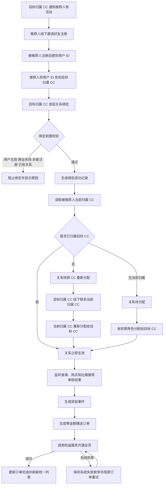
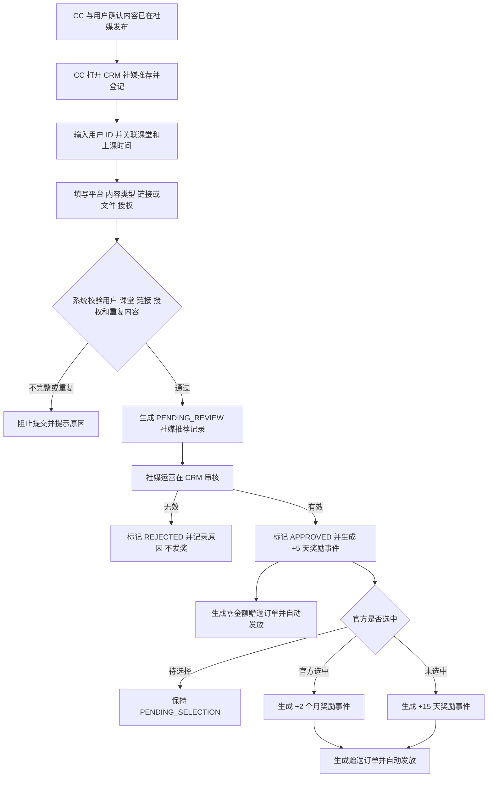

# 拉新裂变mvp

> CC 使用被推荐人用户 ID 绑定推荐人与被推荐人的邀请关系；系统校验被推荐人是否为新注册且无其他推荐关系，生成待转移关系并提示其当前归属 CC。当前归属 CC 通过“重新分配线索”将被推荐人转给邀请人的归属 CC 后，系统再按首课、购买或社媒推荐事件自动生成赠送订单并发放权益。
> 需求编号：REQ-GRW-001｜状态：待评审｜更新时间：2026-11-13
> 需求类型：业务流程｜补充类型：集成与自动化、权限与审计、看板与指标

> 📌
>
> - 关系绑定使用用户 ID：被推荐人完成注册后，由推荐人将用户 ID 告知邀请人的归属 CC；绑定页不再使用手机号关联。
> - 先绑定、再转移、后发奖：绑定成功后展示被推荐人的当前归属 CC；当前归属 CC 使用“重新分配线索”将其转给目标归属 CC，关系进入生效状态后才触发奖励。
> - 权益发放后置且自动：绑定成功后，首课完课 +14 天，首次购买 3/6/12 个月自动发放 +1/+2/+3 个月。
> - 社媒推荐保留完整链路：CC 代用户登记课堂内容、平台、链接和授权 → 社媒运营审核有效/无效 → 有效内容发基础 +5 天 → 官方选中 +2 个月或未选中 +15 天。

## 交互原型

[打开完整交互原型](https://h3-ai-lab.github.io/hhhprd/projects/referral-growth-mvp/prototype/)

原型包含统一的拉新关系列表、用户 ID 绑定、新注册判定、当前 CC 提示与转移、社媒推荐审核、自动奖励事件和赠送订单；支持中文、英文完整切换。

## 要解决什么

当前团队已在线下执行转介绍活动：CC 联系推荐人，推荐人邀请好友注册；好友注册后将用户 ID 告知推荐人，再由推荐人提供给 CC。CC 还需线下协调被推荐人的当前归属 CC 完成线索转移，之后才能自动发奖。系统需要把这套关系、归属确认和奖励记录串联起来。

本期先建立可被注册、课程、订单和权益系统共同识别的推荐关系，再由业务事件自动触发权益。CC 只负责关系录入和异常处理，不再手工判断奖励、添加会员或补写 referral 备注。

## 本期目标与范围

本期要建立一条可由 CC 直接完成并自动出数的 MVP 拉新链路：

| 做 | 不做 |
|---|---|
| 独立“拉新关系”入口；绑定与加会员分离 | 用户端邀请链接、推荐码和客户端自动分享页 |
| 使用被推荐人用户 ID 绑定已注册用户 | 好友后续续费奖励 |
| 新注册判定、当前归属 CC 提示和待转移状态 | 自动抢占其他 CC 的线索 |
| 原 CC 使用“重新分配线索”完成转移 | 不经当前 CC 直接改写线索归属 |
| 首课完课 +14 天的自动奖励事件 | 人工选择首课奖励和手工填写发放天数 |
| 首次购买 3/6/12 个月的自动奖励事件 | 非首次购买和退款自动冲正 |
| CC 在 CRM 登记社媒推荐，以及后续审核、无效、待选择、官方选中和未选中流程 | App 用户自助投稿、自动抓取第三方平台发布结果 |
| 绑定后展示当前 CC 并联动现有重新分配功能 | 普通非推荐线索的分配权重和掉库规则变更 |
| 统一拉新关系列表、关系详情、奖励事件和基础异常处理 | 缺失历史关系的自动补录或凭备注倒推 |
| 自动生成零金额赠送订单，并复用现有会员开通链路 | 将赠送订单计入实付 GMV 或付费用户 |

## 角色与业务对象

| 角色 | 本期职责 |
|---|---|
| 推荐人 | 接受 CC 活动沟通，向朋友介绍产品并获得推荐权益 |
| 被推荐人 | 经推荐人邀请、完成正式注册后向推荐人提供用户 ID 的新用户 |
| 销售 CC | 维护推荐人与被推荐人的关系、核对推荐归属并处理绑定异常；代用户登记社媒推荐内容和课堂证据；不手工发推荐奖励 |
| 销售组长 / 管理员 | 可代团队录入，处理失败记录，核对 CC 归属 |
| 社媒运营 | 审核 CC 登记的图片或视频、课堂证据和授权，判定有效、无效、官方选中或未选中 |
| 营销运营 | 查看泰国拉新关系与社媒推荐记录、人数、GMV 和异常 |

| 业务对象 | 关键内容 | 唯一约束 |
|---|---|---|
| 拉新绑定 | 来源、推荐人、被推荐人用户 ID、业务线、操作 CC、目标归属 CC、当前归属 CC、绑定状态、绑定时间 | 一个被推荐人只能绑定一个推荐人 |
| 推荐关系 | 推荐人、被推荐人、被推荐人注册时间、关系状态、绑定时间、归属转移完成时间 | 一个被推荐人只能绑定一个推荐人 |
| 归属转移记录 | 绑定 ID、被推荐人用户 ID、原 CC、目标 CC、转移前状态、结果、时间和操作人 | 同一绑定最多完成一次有效转移 |
| 奖励事件 | 事件类型、来源事件 ID、关系、奖励规则、触发时间、发放状态 | 同一业务事件最多生成一条奖励 |
| 赠送订单 | 订单 ID、用户、订单类型、业务来源、奖励事件、权益天数、权益开始和结束时间、金额、状态 | 同一奖励事件最多生成一笔赠送订单 |
| 权益发放明细 | 奖励规则、发放前后有效期、权益服务流水、失败原因 | 同一关系同一规则最多成功发放一次 |
| 社媒推荐记录 | 投稿 ID、用户、登记 CC、登记时间、课堂、内容类型、平台、图片或视频、内容链接、授权、审核和选中状态、权益状态 | 同一用户同一内容或链接只记一条 |

## MVP 业务流程

### 关键规则

| 场景 | 规则 | 用户看到的结果 |
|---|---|---|
| 两阶段 | 关系绑定必须先于权益发放；绑定页不选择奖励、不填写会员天数、不调用权益服务 | 绑定成功只表示关系成立，奖励在后续业务事件到达时自动生成 |
| CC 操作 | 操作 CC 取当前登录账号；目标归属 CC 默认取推荐人当前线索负责人，无负责人时取操作 CC | 操作 CC 与目标归属 CC 均写入绑定；有权限的组长或管理员可在提交前调整目标归属 CC |
| 推荐人资格 | 推荐人为有效注册用户，账号正常且属于泰国业务线 | 不满足时阻止建立拉新关系 |
| 被推荐人用户 ID | 必填且精确匹配一个已注册用户；不接受手机号、姓名或模糊搜索作为关系键 | 用户不存在、为游客或匹配到非唯一用户时阻止绑定 |
| 业务线匹配 | 被推荐人必须与推荐人属于同一业务线 | 跨业务线时阻止绑定并显示原因 |
| 被推荐人资格 | 被推荐人为有效正式注册用户且账号正常 | 用户类型或状态不符时立即提示，不写关系 |
| 新注册判定 | 以被推荐人正式账号注册时间 `registered_at` 判断：`campaign_start_at ≤ registered_at ≤ 本次绑定提交时间` | 系统明确展示被推荐人注册时间、活动开始时间及“新注册/非新注册” |
| 自荐拦截 | 被推荐人与推荐人的用户 ID 相同，或两者已验证手机号相同 | 阻止提交并提示不能绑定自荐关系 |
| 关系唯一 | 一个被推荐人只能绑定一个推荐人；同一推荐人与被推荐人只能有一条绑定 | 重复提交返回原记录，不重复创建关系 |
| 多好友推荐 | 推荐人可以绑定多个不同被推荐人 | 每个被推荐人独立形成一条关系和奖励记录 |
| 当前 CC 展示 | 绑定成功后读取被推荐人当前线索归属 CC 并展示名称；无当前归属时显示“待分配” | 目标归属 CC 可明确知道需要线下联系谁 |
| 绑定生效 | 被推荐人已归属目标 CC 时立即生效；归属其他 CC 时进入 `BOUND_PENDING_TRANSFER`，完成重新分配后更新为 `BOUND_ACTIVE` | 待转移期间可展示关系，但不触发奖励 |
| 自动发放 | 仅当关系为 `BOUND_ACTIVE` 且对应业务事件满足规则时生成奖励事件 | CC 不选择奖励规则、不填写时长、不手工添加会员 |
| 赠送订单 | 奖励事件通过校验后先生成零金额赠送订单，再由订单驱动会员权益开通 | 订单、权益和审计可相互追溯；不直接修改会员到期时间 |
| 订单口径 | 赠送订单金额为 0，不进入 GMV、实付收入或付费转化 | 订单中心可查到来源、CC、会员变化和奖励事件 |
| 发放状态 | 奖励事件独立记录待发放、发放中、已发放、发放失败 | 绑定状态与奖励状态分开展示，互不覆盖 |
| 退款与撤销 | 归因订单最终退款、撤单或拒付后，关系保留但标记“归因失效”，不追溯扣回已发权益 | 本期只阻止后续重复奖励，人工冲正沿用现有权益流程 |

### 新注册判定与归属转移

**新注册口径**：

- 每个拉新活动必须配置唯一的 `campaign_start_at`，按业务线时区保存；本期使用泰国活动开始时间。
- 被推荐人必须是正式注册用户，`registered_at` 位于活动开始时间和本次绑定提交时间之间，起止边界均包含。
- 被推荐人在活动开始前已存在正式账号，即使之后重新登录或补充资料，也判定为非新注册。
- 游客转正式用户以正式账号注册时间为准；未注册用户不能绑定。
- 同一用户 ID 的活动注册判定结果在绑定记录中保存快照，不随后续活动配置变化而重算。

**绑定与归属转移规则**：

- 目标归属 CC 提交推荐人与被推荐人用户 ID 后，系统校验被推荐人的存在性、业务线、正式用户状态、新注册、自荐和已有推荐关系。
- 所有校验通过后立即生成绑定成功记录，并返回被推荐人当前归属 CC 的姓名；不得由目标归属 CC 直接改写被推荐人的归属。
- 被推荐人已归属目标 CC：关系立即变为 `BOUND_ACTIVE`，开始监听奖励事件。
- 被推荐人归属其他 CC：关系变为 `BOUND_PENDING_TRANSFER`；目标 CC 线下联系当前归属 CC，由当前归属 CC 通过销售中心“重新分配线索”完成转移。
- 被推荐人无当前归属：关系保持 `BOUND_PENDING_TRANSFER` 并显示“待分配”，由具备线索分配权限的组长/管理员分配给目标 CC。
- 转移成功后系统将关系更新为 `BOUND_ACTIVE`，保存原 CC、目标 CC、转移时间和操作人，并补评估绑定后已经发生且尚未奖励的首课和购买事件。
- 转移失败、目标 CC 停用、跨业务线或目标候选不可用时，关系保持待转移，不发权益，并进入归属异常。
- 首位 CC 和原始归属快照必须保留；后续转移不重写历史首跟和业绩归属。

### 首课完课赠送数据枚举

首课数据以课程服务最终完成事件为准，仅“已完成”触发推荐奖励。

| 数据 / 枚举 | 取值 | 说明 |
|---|---|---|
| `event_type` | `REFERRAL_FIRST_TRIAL_COMPLETED` | 被推荐人首课完课事件 |
| `lesson_type` | `FIRST_TRIAL` | 只接受首次体验课，不包含正课、补课和试听预约 |
| `lesson_sequence` | `1` | 被推荐人的第一节体验课 |
| `completion_status` | `SCHEDULED` / `IN_PROGRESS` / `COMPLETED` / `CANCELLED` / `NO_SHOW` / `RESCHEDULED` / `TECH_FAILED` | 仅 `COMPLETED` 触发奖励 |
| `business_line_match` | `MATCHED` / `MISMATCHED` | 只有 `MATCHED` 触发奖励 |
| `relation_status` | `BOUND_PENDING_TRANSFER` / `BOUND_ACTIVE` / `INVALID` | 只有 `BOUND_ACTIVE` 触发奖励；待转移期间先缓存事件 |
| `benefit_rule` | `FIRST_TRIAL_COMPLETED_REWARD` | 首课完课奖励规则 |
| `benefit_unit` | `DAY` | 首课奖励按自然日发放 |
| `benefit_value` | `14` | 推荐人增加 14 天会员 |
| `deduplication_key` | `referral_relation_id + lesson_completion_id` | 同一关系、同一完课事件只发一次 |

其他限制：

- 完课时间必须晚于绑定时间。
- 完课发生在待转移期间时，先保留待评估事件；关系转为 `BOUND_ACTIVE` 后再按规则生成奖励。
- 取消、未到课、改期、进行中和技术失败不生成奖励；后续真正完成首课时可再次触发。
- 同一推荐关系首课完课奖励最多成功一次。
- 被推荐人后续购买会员时，首课奖励和购买奖励分别生成事件，可叠加。

### 社媒推荐数据枚举

社媒推荐采用“CC 先代用户登记内容、社媒运营再审核、审核通过后自动发奖”的模式。本期不建设 App 用户自助投稿。

| 数据 / 枚举 | 取值 | 说明 |
|---|---|---|
| `submission_channel` | `CC_MANUAL_ENTRY` | 由 CC 在 CRM 代用户登记 |
| `platform` | `FACEBOOK` / `INSTAGRAM` / `TIKTOK` / `YOUTUBE` / `OTHER` | 记录社媒内容实际发布的平台 |
| `content_type` | `PHOTO` / `VIDEO` | 接受图片或视频 |
| `content_ref_type` | `UPLOADED_FILE` / `EXTERNAL_LINK` | CC 可上传用户提供的文件凭证，或登记可访问的外部内容链接 |
| `lesson_evidence` | 课堂名称、课堂 ID、上课时间 | 必须能够关联用户的 Dino AI 课堂记录 |
| `authorization_status` | `AUTHORIZED_OFFICIAL_USE` / `NOT_AUTHORIZED` | 是否授权官方使用；官方选中必须已授权 |
| `registered_by_cc` | 当前登录 CC 用户 ID | 自动记录，不允许手工替换 |
| `review_status` | `PENDING_REVIEW` / `APPROVED` / `REJECTED` | 基础有效性审核状态 |
| `review_reason` | `CONTENT_NOT_FOUND` / `NOT_OWN_CONTENT` / `NOT_DINO_CLASS` / `DUPLICATE_CONTENT` / `OTHER` | 仅拒绝时必填 |
| `selection_status` | `PENDING_SELECTION` / `OFFICIALLY_SELECTED` / `NOT_SELECTED` | 有效内容的官方选用结果 |
| `SOCIAL_MEDIA_APPROVED` | 奖励 `+5 天` | 运营审核有效后发放一次 |
| `SOCIAL_MEDIA_NOT_SELECTED` | 奖励 `+15 天` | 有效内容最终未被官方选中时发放一次 |
| `SOCIAL_MEDIA_OFFICIALLY_SELECTED` | 奖励 `+2 个月` | 被官方选中时发放一次 |
| `deduplication_key` | `social_recommendation_id + reward_event_type` | 基础、未选中、官方选中三类奖励各自最多一次 |

社媒推荐流程：

社媒推荐规则：

- CC 登记时必须通过用户 ID 关联本人、课堂证据、平台、内容凭证和授权状态；运营审核前内容不产生奖励。
- 用户 ID、课堂归属、内容链接或文件、授权和重复内容必须在 CC 点击“提交登记”前完成校验。
- 用户不存在、课堂不属于该用户、链接不可访问或同一内容重复登记时阻止提交，不生成“发放失败”记录。
- 审核有效触发基础 +5 天，之后同一投稿只能进入“官方选中”或“未选中”之一。
- 未授权官方使用时不能标记为官方选中。
- 内容无效、不属于本人、无法关联 Dino AI 课堂或重复投稿时不产生奖励。
- 同一用户同一内容文件或同一外部链接只允许一条有效投稿记录。
- 运营可在同一记录中更新审核和选中状态，所有状态变化留痕。

### 赠送订单生成规则

自动赠送不能只调用会员权益变更而跳过订单。每个奖励事件通过前置校验后，必须先生成赠送订单，再由订单驱动会员权益开通。

| 订单字段 | 规则 |
|---|---|
| 订单 ID | 使用内部赠送订单独立前缀，例如 `GRT`；由订单服务生成 |
| 订单类型 | `MEMBERSHIP_GRANT` |
| 业务来源 | `FRIEND_REFERRAL` 或 `SOCIAL_MEDIA_RECOMMENDATION` |
| 发放来源类型 | `REFERRAL_REWARD` 或 `SOCIAL_MEDIA_REWARD`；不得复用面向 CC 手工操作的 `MANUAL` 语义，也不得复用 `WEB` 银行转账语义 |
| 奖励事件 | 关联唯一的 `reward_event_id` 和 `reward_event_type` |
| 来源业务键 | `REFERRAL_REWARD:{reward_event_id}` 或 `SOCIAL_MEDIA_REWARD:{reward_event_id}`，作为订单和权益发放共同幂等键 |
| 权益接收用户 | 好友推荐为推荐人；社媒推荐为发布内容的用户 |
| 关联用户 | 好友推荐记录被推荐人；社媒推荐为空 |
| 奖励时长 | 同时保存原始奖励单位、奖励值，以及按会员权益规则计算后的实际天数 |
| 订单金额 | `0`，币种仍记录业务线币种 |
| 支付状态 | `NOT_REQUIRED`，不产生支付记录，不计入实付 GMV |
| 订单状态 | `CREATING` → `CREATED` → `FULFILLED`；系统异常进入 `FAILED` |
| 会员权益 | 保存权益生效前到期时间、权益生效后到期时间、权益服务流水和会员状态 |
| 操作与归属 | 保存触发奖励的绑定来源、操作 CC、归属 CC 和用户手机号快照 |

订单生成规则：

- 沿用现有“添加会员”的订单创建、权益联动和 `sourceBizKey` 幂等思路。
- 现有 CC 手工添加会员限制为 1～3 天，且存在有效 App Store / Google Play 订阅订单时禁止手工添加；自动推荐奖励使用系统发放入口，不受 CC 手工天数和手工拦截限制，但必须由会员权益服务校验最终开通结果。
- 天数型奖励直接以对应天数创建订单；月数型奖励由系统按自然月计算实际权益区间，同时保留 `benefit_unit=MONTH` 和原始月数，避免订单被误认为 1/2/3 个固定天数商品。
- 同一奖励事件重复回调必须返回原订单，不创建第二笔赠送订单。
- 订单创建成功但权益开通失败时，保留该订单并重试原订单，不重新创建订单。
- 赠送订单可以在订单中心按类型和来源查看，但默认不计入付费订单、付费用户和 GMV 指标。
- 退款或归因失效只影响后续奖励资格，不把零金额赠送订单改写成付费订单。

### 校验与发放失败边界

所有业务校验必须在对应提交动作完成前完成，包括好友推荐绑定、首课或购买事件接收，以及 CC 登记社媒推荐和审核结果更新。奖励触发前的资格校验不通过时不得生成奖励事件或“发放失败”记录。

前置校验至少包括：

- 操作人是否有拉新绑定权限，以及推荐人、被推荐人和订单是否在数据权限范围内。
- 推荐人和被推荐人是否为有效注册用户、账号是否正常，被推荐人是否为正式注册用户。
- 被推荐人用户 ID 是否精确命中且唯一，是否满足活动新注册时间范围。
- 推荐人和被推荐人业务线是否一致，是否为同一用户或同一已验证手机号。
- 被推荐人是否已绑定其他推荐人，推荐人与被推荐人之间是否已经存在有效关系。
- 奖励规则、课程事件或社媒推荐状态的枚举值是否合法，以及奖励配置是否可计算。

绑定提交时统一校验关系与归属；业务事件到达时再次校验事件合法性、关系状态、业务线、事件时间和幂等键，不合法则不创建奖励事件。只有奖励事件通过校验并开始请求权益服务后，系统异常才可以记为“发放失败”。

“发放失败”原因只允许使用以下系统异常枚举：

| 原因枚举 | 页面文案 | 重试规则 |
|---|---|---|
| `ORDER_CREATION_FAILED` | 系统异常：赠送订单创建失败 | 使用同一奖励事件幂等重试 |
| `ENTITLEMENT_SERVICE_UNAVAILABLE` | 系统异常：权益服务暂不可用 | 按间隔自动重试 |
| `ENTITLEMENT_REQUEST_TIMEOUT` | 系统异常：权益服务请求超时 | 先查询请求结果，再使用同一幂等键重试 |
| `ENTITLEMENT_RESULT_UNKNOWN` | 系统异常：权益处理结果待确认 | 先查询原权益流水，确认未成功后才可重试 |
| `ENTITLEMENT_INTERNAL_ERROR` | 系统异常：权益服务内部错误 | 自动重试；超过次数后转人工 |
| `SYSTEM_DATA_ACCESS_ERROR` | 系统异常：业务数据访问失败 | 数据服务恢复后重试 |
| `SYSTEM_UNKNOWN_ERROR` | 系统异常：未知异常 | 转人工核查，不重复发起新关系 |

用户不存在、非正式用户、非新注册、业务线不一致、推荐关系重复、奖励规则缺失或权限不足均属于前置校验失败，不得保存为“发放失败”。

## 统一页面：拉新关系

入口：

- `营销中心 → 拉新关系`
- `用户管理 → 用户列表 → 操作 → 维护拉新关系`
- `销售管理 → 销售中心 → 我的跟进 / 已付费 → 更多 → 维护拉新关系`

营销中心页面顶部展示拉新指标，下方使用**同一个统一列表**承载好友推荐、绑定状态、奖励事件和赠送订单，不再拆分“关系维护”和“拉新归因”两个关系列表。社媒推荐使用独立审核列表，但奖励事件和赠送订单沿用同一套发放与追溯规则。销售中心和用户列表复用同一个绑定弹窗，并自动带入当前行的推荐人。

### 好友推荐绑定

| 字段 | 规则 |
|---|---|
| 推荐人 | 从当前用户详情带入，展示用户 ID、姓名、所属业务线、当前 CC 和账号状态；不可手工替换 |
| 被推荐人用户 ID | 必填；精确查询被推荐人，不接受手机号或模糊搜索 |
| 用户核验结果 | 显示被推荐人的用户 ID、姓名、业务线、正式账号注册时间、活动开始时间、是否新注册、当前归属 CC |
| 新注册标记 | `NEW_REGISTRATION` / `NOT_NEW_REGISTRATION`；只有前者允许绑定 |
| 目标归属 CC | 默认取推荐人当前 CC；推荐人无有效 CC 时取操作 CC |
| 绑定来源 | 固定为 `FRIEND_REFERRAL` |
| 绑定备注 | 可选，只补充业务说明，不得替代结构化关系 |

绑定提交不展示奖励规则、会员天数、开启状态和权益原因，不调用权益服务。提交成功后展示被推荐人当前归属 CC：已归属目标 CC 时立即生效；归属其他 CC 时提示目标 CC 线下联系当前归属 CC 并使用“重新分配线索”完成转移；无归属时提示通过有权限角色完成分配。

### 绑定状态

| 枚举 | 页面含义 | 可用操作 |
|---|---|---|
| `BOUND_PENDING_TRANSFER` | 绑定已成功，但被推荐人尚未转给目标归属 CC | 查看当前归属 CC、联系当前归属 CC、处理归属异常 |
| `BOUND_ACTIVE` | 被推荐人已归属目标 CC，关系生效并监听奖励事件 | 查看、处理奖励异常 |
| `INVALID` | 重复、自荐、跨业务线或人工确认无效 | 查看原因 |

### 顶部指标

- 推荐人数
- 被推荐人数
- 裂变 GMV
- 权益发放成功率

### 筛选

| 筛选 | 规则 |
|---|---|
| 业务日期 | 全文指标共用；可选“关系绑定时间”或“订单支付时间”，默认关系绑定时间 |
| 日期范围 | 起止日期均包含，默认近 30 个自然日 |
| 业务线 | 本期只显示当前用户有权限的业务线，泰国为默认值 |
| 来源 | 本期统一列表固定展示好友推荐 |
| 归属 CC | 按当前用户数据权限返回候选账号，包含停用账号历史快照 |
| 绑定状态 | 全部、待转移、已生效、无效 |
| 奖励状态 | 全部、待触发、待发放、已发放、发放失败、归因失效 |
| 关键词 | 精确匹配推荐人用户 ID、被推荐人用户 ID、业务事件 ID、赠送订单 ID 或来源订单 ID |

### 统一列表

本期列表不提供字段排序。

`绑定 ID、来源、推荐人、被推荐人用户 ID、业务线、绑定状态、操作 CC、目标归属 CC、当前归属 CC、下一触发条件、最近奖励事件、奖励值、赠送订单 ID、赠送订单状态、权益状态`

统一列表展示好友推荐关系、绑定状态和会员奖励。点击任一行打开关系详情抽屉：

- 关系或内容 ID、创建时间、当前状态。
- 推荐人与被推荐人的用户 ID、姓名快照、账号状态、业务线、被推荐人注册时间、新注册判定和当前归属 CC。
- 所有奖励事件：事件 ID、事件类型、业务事件 ID、触发时间、奖励值和状态。
- 赠送订单：订单 ID、订单类型、业务来源、金额 0、创建时间、订单状态和来源业务键。
- 操作 CC、归属 CC、命中的奖励规则和自动生成原因。
- 权益发放前后到期时间、权益流水、失败原因和重试次数。
- 退款、撤单或拒付后的归因失效状态。

## 社媒推荐流程与功能

入口：

- `营销中心 → 社媒推荐 → 登记社媒推荐`
- `用户管理 → 用户列表 → 操作 → 登记社媒推荐`
- `销售管理 → 销售中心 → 我的跟进 / 已付费 → 更多 → 登记社媒推荐`

### CC 登记社媒推荐

CC 与用户确认课堂内容已经在社媒平台发布后，在 CRM 代用户登记。内容登记与运营审核分属不同角色，CC 登记后记录进入 `PENDING_REVIEW`。

| 字段 | 规则 |
|---|---|
| 用户 ID | 必填，按完整用户 ID 精确查询；不接受手机号或姓名作为关系键 |
| 用户核验结果 | 显示用户姓名、业务线、账号状态、正式用户状态和当前归属 CC |
| 课堂证据 | 从该用户的课堂记录中选择课堂 ID、课堂名称和上课时间；无有效课堂记录时阻止登记 |
| 平台 | `FACEBOOK / INSTAGRAM / TIKTOK / YOUTUBE / OTHER` |
| 内容类型 | `PHOTO / VIDEO` |
| 内容凭证 | `UPLOADED_FILE / EXTERNAL_LINK`；上传文件时保存文件地址，外部内容登记可访问链接 |
| 官方使用授权 | `AUTHORIZED_OFFICIAL_USE / NOT_AUTHORIZED`；官方选中前必须已授权 |
| 登记备注 | 可选，补充线下核验信息，不能替代结构化字段 |
| 登记 CC | 自动取当前登录账号，不允许手工修改 |
| 提交渠道 | 固定为 `CC_MANUAL_ENTRY` |

CC 点击“提交登记”前，系统完成用户、数据权限、业务线、课堂归属、内容链接或文件可访问性、授权和重复内容校验。通过后生成 `PENDING_REVIEW` 记录，并保存用户、课堂、内容和操作 CC 快照；登记成功只表示进入审核队列，不发放权益。

### 运营审核

社媒推荐列表默认展示 `PENDING_REVIEW` 记录，运营打开详情后：

1. 查看投稿用户、课堂证据、图片/视频或外部链接和授权状态。
2. 选择 `APPROVED` 或 `REJECTED`。
3. 拒绝时必须选择原因并填写备注。
4. 通过后生成 `SOCIAL_MEDIA_APPROVED` 奖励事件，自动发放基础 +5 天。
5. 审核通过后进入 `PENDING_SELECTION`，后续标记 `OFFICIALLY_SELECTED` 或 `NOT_SELECTED`。

| 操作 | 前置条件 | 结果 |
|---|---|---|
| 通过审核 | 内容真实、属于投稿用户、可关联 Dino AI 课堂、未重复 | 状态变为 `APPROVED`，状态变为 `PENDING_SELECTION`，发放基础 +5 天 |
| 拒绝审核 | 无内容、内容无效、非本人、非课堂内容、重复或无法访问 | 状态变为 `REJECTED`，不发基础或额外奖励 |
| 标记官方选中 | 已审核通过且已授权官方使用 | 额外 +2 个月，只发放一次 |
| 标记未选中 | 已审核通过且尚未产生选中结果 | 额外 +15 天，只发放一次 |

### 社媒推荐列表

`投稿 ID、用户 ID/姓名、登记 CC、平台、课堂信息、内容类型、内容摘要、提交渠道、提交时间、审核状态、选中状态、审核运营、奖励事件、赠送订单、权益状态`

筛选：

| 筛选 | 规则 |
|---|---|
| 日期范围 | 按提交时间筛选，起止日期均包含 |
| 业务线 | 仅显示当前用户有权限的业务线 |
| 登记 CC | 按当前用户数据权限返回候选账号，包含停用账号历史快照 |
| 平台 | 全部、Facebook、Instagram、TikTok、YouTube、其他 |
| 提交渠道 | 本期固定为 `CC_MANUAL_ENTRY` |
| 审核状态 | 全部、待审核、已通过、已拒绝 |
| 选中状态 | 全部、待选择、官方选中、未选中 |
| 奖励状态 | 全部、待触发、待发放、已发放、发放失败 |
| 关键词 | 精确匹配投稿 ID、用户 ID、内容 ID、内容链接或赠送订单 ID |

本期社媒推荐列表不提供字段排序。

## 指标口径

### 公共口径

- **时区**：`Asia/Bangkok` 自然日。
- **业务线**：本期固定为泰国；所有页面使用同一权限范围。
- **关系集合**：绑定状态为 `BOUND_ACTIVE` 的有效好友推荐关系；`BOUND_PENDING_TRANSFER` 可展示但不计入奖励人数和 GMV。
- **奖励事件集合**：已实际触发并进入发放流程的奖励事件。
- **业务日期**：默认使用关系绑定时间；切换后统一使用归因订单支付时间。
- **归属口径**：使用记录创建时的操作 CC、归属 CC 和用户姓名快照；后续转派不重写历史。
- **零分母**：比率分母为 0 时显示“—”。
- **百分比精度**：保留一位小数。

### 指标定义

| 指标 | 分子 | 分母 | 单位 | 统计范围 | 时间字段 | 去重键 | 零值规则 |
|---|---|---|---|---|---|---|---|
| 推荐人数 | 关系集合中至少有一条记录的推荐人用户数 | — | 人 | 当前业务线、来源、CC、绑定状态筛选范围 | 关系绑定时间或订单支付时间 | `referrer_user_id` | 无记录显示 0 |
| 被推荐人数 | 关系集合中至少有一条记录的被推荐人用户数 | — | 人 | 同上 | 同上 | `referred_user_id` | 无记录显示 0 |
| 裂变 GMV | 关系集合内各条有效关系唯一归因订单的实付金额之和 | — | THB | 同一关系和日期筛选；排除待支付、已取消、最终退款、测试订单和所有赠送订单 | 关系绑定时间或订单支付时间 | `order_id` | 无有效订单显示 0 |
| 权益发放成功率 | 奖励状态为“已发放”的奖励事件数 | 已发起权益发放的奖励事件数 | % | 关系集合内的全部奖励事件；重试不重复计入分母 | 与关系集合共用绑定时间或订单支付时间 | `reward_event_id` | 分母为 0 显示“—” |

指标卡、详情和后续导出必须使用同一关系集合。时间筛选切换时，四个指标同时切换，不允许单卡使用不同日期字段。

## RBAC 权限数据

### 功能权限

| 页面 / 资源 | 操作 | 业务含义 | 默认角色 | 数据范围 | 审计 |
|---|---|---|---|---|---|
| 拉新关系 | 页面查看 | 在统一列表中查看关系、内容、奖励事件和赠送订单 | CC_TH、销售组长、营销运营、管理员、超级管理员 | CC 看本人操作或本人归属；组长看团队；运营看授权业务线 | 权限变更审计 |
| 拉新关系 / 销售中心 | 新建好友推荐 | 录入被推荐人用户 ID、校验新注册并建立绑定 | CC_TH、销售组长、管理员、超级管理员 | 推荐人与被推荐人均在操作人可见业务线内且业务线一致 | 记录成功、失败、未授权尝试 |
| 销售中心 | 重新分配线索 | 被推荐人当前归属 CC 将其转给目标归属 CC，或由有权限的组长/管理员代操作 | CC_TH（仅受限推荐转移）、销售组长、管理员、超级管理员 | 当前操作人负责被推荐人，目标为绑定中的目标 CC | 记录绑定 ID、原 CC、目标 CC、原因和结果 |
| 拉新关系 / 销售中心 | 处理归属异常 | 处理待转移超时、目标 CC 停用或无分配权限 | 销售组长、管理员、超级管理员 | 团队或授权业务线范围 | 记录原 CC、新 CC、原因和时间 |
| 社媒推荐 | 页面查看 | 查看待审核、已通过、已拒绝和奖励状态 | CC_TH、社媒运营、营销运营、管理员、超级管理员 | CC 看本人登记；运营看授权业务线 | 权限变更审计 |
| 社媒推荐 / 销售中心 | 登记内容 | 按用户 ID 代用户登记课堂内容、平台、凭证和授权 | CC_TH、销售组长、管理员、超级管理员 | 用户在当前操作人可见业务线内 | 记录登记 CC、用户、课堂、渠道和校验结果 |
| 社媒推荐 | 审核内容 | 标记有效或无效并记录拒绝原因 | 社媒运营、营销运营、管理员、超级管理员 | 当前授权业务线 | 记录审核人、前后状态和时间 |
| 社媒推荐 | 更新选中结果 | 标记官方选中或未选中 | 社媒运营、营销运营、管理员、超级管理员 | 当前授权业务线 | 记录前后状态和操作人 |
| 拉新关系 | 详情查看 | 查看业务事件、赠送订单和权益明细 | 同页面查看 | 与列表同范围，逐条再次校验 | 不记录普通查询 |
| 拉新关系 | 失败重试 | 重试待发放或系统异常导致的失败权益 | 销售组长、营销运营、管理员、超级管理员 | 仅在当前可见范围 | 记录操作人、原因、前后状态和结果 |

### 字段与数据权限

| 字段组 / 列表 | 可见角色 | 编辑角色 | 脱敏 / 隐藏 | 可导出 | 候选范围限制 |
|---|---|---|---|---|---|
| 推荐人/被推荐人用户 ID、姓名 | 页面查看角色 | 无 | 姓名按用户中心权限展示 | 本期不提供导出 | 仅当前业务线 |
| 订单 ID、套餐、实付金额 | 页面查看角色 | 无 | 沿用订单中心权限 | 本期不提供导出 | 仅归因订单 |
| 赠送订单 ID、金额 0、订单状态和权益变化 | 页面查看角色 | 无 | 沿用订单中心权限 | 本期不提供导出 | 仅系统赠送订单 |
| 被推荐人用户 ID、注册时间和当前 CC | 拥有拉新绑定和用户查看权限的角色 | 无 | 手机号不进入绑定和统一列表 | 否 | 只按用户 ID 精确查询 |
| 支付凭证 | 不新增 | 无 | 拉新页面不展示 | 否 | 不提供候选搜索 |
| 操作 CC、归属 CC | 页面查看角色 | 仅提交前调整归属 CC | 历史停用账号保留姓名快照 | 否 | 仅可见 CC |
| 社媒推荐内容、链接与课堂证据 | CC_TH（仅本人登记）、社媒运营、营销运营、管理员、超级管理员 | CC 登记人；审核人或被授权运营 | 按内容访问权限处理 | 否 | CC 仅本人登记；运营仅授权业务线 |

### 权限数据变更

| 变更类型 | 权限层级 | 权限项 | 业务说明 | 默认角色 / 数据范围 | 新增审计 |
|---|---|---|---|---|---|
| 新增 | 菜单 / 页面 | `growth_relation.view` | 进入统一拉新关系页面，查看关系、奖励事件和赠送订单 | CC_TH、销售组长、营销运营、管理员、超级管理员 | 权限变更 |
| 新增 | 动作 | `growth_binding.create` | 按被推荐人用户 ID 新建好友推荐绑定 | CC_TH、销售组长、管理员、超级管理员；当前数据范围 | 是 |
| 新增 | 动作 | `growth_binding.transfer_referred_lead` | 允许当前 CC 在推荐关系约束下将被推荐人转给目标归属 CC | CC_TH、销售组长、管理员、超级管理员；仅绑定中的被推荐人 | 是 |
| 新增 | 动作 | `growth_binding.resolve_assignment` | 处理推荐线索与既有线索归属冲突 | 销售组长、管理员、超级管理员；团队或授权业务线范围 | 是 |
| 新增 | 菜单 / 页面 | `social_recommendation.view` | 查看社媒推荐记录；CC 仅看本人登记，运营查看授权业务线 | CC_TH、社媒运营、营销运营、管理员、超级管理员；按角色限制数据范围 | 权限变更 |
| 新增 | 动作 | `social_recommendation.create` | 按用户 ID 代用户登记社媒推荐内容、课堂证据和授权 | CC_TH、销售组长、管理员、超级管理员；当前数据范围 | 是 |
| 新增 | 动作 | `social_recommendation.review` | 审核社媒推荐内容 | 社媒运营、营销运营、管理员、超级管理员；当前授权业务线 | 是 |
| 新增 | 动作 | `social_recommendation.update_selection` | 更新官方选中结果 | 社媒运营、营销运营、管理员、超级管理员；当前授权业务线 | 是 |
| 复用 | 动作 | 用户中心与课程查询权限 | 解析被推荐人用户 ID、注册时间，以及社媒推荐用户和课堂证据 | 沿用现有角色和业务线范围 | 是 |
| 复用 | 系统动作 | 现有权益发放服务身份 | 奖励事件触发后由系统调用权益服务，不要求 CC 手工发放 | 由系统任务执行 | 是 |
| 新增 | 动作 | `growth_grant.retry` | 重试失败权益 | 组长、运营、管理员、超级管理员 | 是 |
| 复用 | 页面 / 动作 | 销售中心查看与更多菜单 | 在销售中心“我的跟进 / 已付费”中展示维护拉新关系入口，操作仍由 `growth_binding.create` 鉴权 | 沿用销售中心角色和 `growth_binding.create` | 是 |
| 复用 | 数据 | 用户、订单、业务线和团队范围 | 拉新功能的候选用户、订单和记录范围 | 不扩大现有权限 | 否 |

### 离职与停用

- 账号停用后立即失去拉新绑定、社媒推荐审核、查看和重试权限。
- 历史记录保留操作 CC、归属 CC、姓名和团队快照，并显示“已停用”。
- 推荐人的后续线索交接沿用现有销售中心规则，不因本需求改变分配或掉库。
- 归属 CC 的后续转派不重写历史拉新记录和已产生 GMV；新负责人只获得后续业务处理权。

## 数据依赖与异常

| 数据 / 场景 | 业务处理 |
|---|---|
| 用户服务不可用 | 不提交绑定；保留当前用户 ID 并允许重新核验 |
| 被推荐人用户 ID 不存在或对应游客用户 | 阻止绑定并提示必须是已正式注册用户 |
| 被推荐人非活动新注册 | 阻止绑定并展示注册时间和活动开始时间 |
| 被推荐人已注册但尚未完课或购买 | 绑定成功后等待归属转移和业务事件 |
| 被推荐人已归属目标 CC | 绑定后立即变为 `BOUND_ACTIVE` |
| 被推荐人归属其他 CC | 保存 `BOUND_PENDING_TRANSFER`，不触发奖励，等待重新分配 |
| 被推荐人无当前归属 | 保持待转移，由有权限角色分配给目标 CC |
| 目标 CC 停用或无有效业务线权限 | 转移失败，关系保持待转移并进入归属异常 |
| 被推荐人已有推荐人 | 返回原绑定和奖励状态，不新增第二段关系 |
| 同一关系重复绑定 | 使用同一业务记录返回原结果，不创建重复关系 |
| 两个 CC 并发提交同一被推荐人 | 仅一个绑定成功；另一个提示已有推荐关系 |
| 首课事件非 `COMPLETED` | 不生成首课奖励事件；后续真实完课仍可触发 |
| 首课完课早于绑定时间 | 不生成奖励事件并保留被忽略原因 |
| 订单事件不是首次有效购买或套餐不符 | 不生成对应购买奖励事件 |
| 社媒推荐审核为 `REJECTED` | 不生成奖励事件；记录拒绝原因 |
| 社媒推荐重复内容或同一状态重复回调 | 使用 `social_recommendation_id + reward_event_type` 幂等，不重复发奖 |
| CC 登记时用户不存在、课堂不属于该用户、链接不可访问或内容重复 | 阻止提交并提示具体字段；不创建投稿记录，不进入“发放失败” |
| 两名 CC 并发登记同一内容 | 按用户 ID、内容文件或链接去重，仅一条投稿记录成功 |
| 课程、订单或社媒推荐状态延迟 | 事件到达后补触发；必须校验绑定时间、业务线和幂等键 |
| 赠送订单创建失败 | 奖励事件保持待发放并记录 `ORDER_CREATION_FAILED`；使用相同来源业务键重试，不创建第二笔订单 |
| 订单已创建但权益开通失败 | 保留赠送订单并进入系统失败重试；重试继续使用原订单和原幂等键 |
| 订单创建成功、权益成功、订单状态回写失败 | 以权益流水确认发放成功，后台补偿订单状态；不重复创建订单或权益 |
| 权益服务不可用、超时、结果未知或内部错误 | 校验阶段已完成，记录“待确认”或“发放失败”并保存系统异常枚举；查询或使用同一幂等键重试 |
| 推荐人会员已过期或无当前会员 | 允许按现有添加体验天数能力发放，并从当前时间起算 |
| 推荐人会员有效 | 奖励从现有效期顺延 |
| 归因订单退款或撤销 | 关系保留并标记“归因失效”，看板按现行指标规则排除 |
| 订单晚到或状态回写延迟 | 系统展示最近成功状态；发放结果以权益服务确认状态为准 |
| 历史手工备注 | 不自动识别；仅新增或经人工确认后形成的关系进入看板 |
| 权限被撤销 | 下一次请求立即失效；已打开详情不能继续执行操作 |

绑定校验失败、事件不满足触发条件或业务数据变化不写入“发放失败”；权益发放成功率只统计已完成奖励事件校验并实际进入权益服务请求的奖励事件。

## 非功能与审计

- 推荐关系绑定、业务事件接收和权益发放必须分别幂等。
- 同一被推荐人只能绑定一个推荐人；同一业务事件最多生成一条奖励；同一关系同一奖励类型最多成功发放一次。
- 绑定成功不得直接修改会员有效期；奖励事件必须先落赠送订单，再由订单驱动权益变更。
- 赠送订单使用确定性来源业务键，重复回调、超时重试和人工重试都必须复用原订单。
- 订单中心必须能够按 `MEMBERSHIP_GRANT` 查询赠送订单，并展示业务来源、操作 CC、归属 CC、业务事件、来源业务键、权益变化和系统失败原因。
- 推荐人、被推荐人的用户 ID 和归因订单 ID 是关系唯一性核对依据；姓名和注册时间作为展示快照。
- 被推荐人只通过用户 ID 精确关联，不使用手机号匹配；手机号不进入拉新列表和本期导出。
- 操作 CC 取登录账号，不由前端自由填写；归属 CC 的调整必须二次确认并留痕。
- 审计至少记录：操作人、操作时间、推荐人、被推荐人、业务事件 ID、事件枚举、来源、命中规则、奖励值、操作前后状态、失败原因和幂等键。
- 关系绑定、待转移转已生效、转移失败、社媒推荐审核、官方选中结果、奖励触发、权益成功、权益失败、重试、归因失效和越权尝试都必须进入操作日志。
- 上线首日建立数据基线；缺失的历史关系不展示为 0 以外的推断结果。
