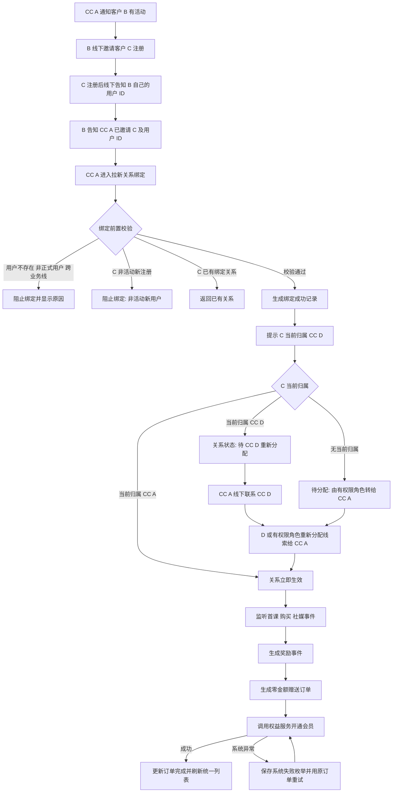

# 拉新裂变mvp

> CC 使用被推荐人 C 的用户 ID 绑定 B → C 邀请关系；系统校验 C 是否为新注册且无其他推荐关系，生成待转移关系并提示 C 当前归属 CC。原 CC 通过“重新分配线索”将 C 转给邀请人的 CC 后，系统再按首课、购买或社媒事件自动生成赠送订单并发放权益。
> 需求编号：REQ-GRW-001｜状态：待评审｜更新时间：2026-11-13
> 需求类型：业务流程｜补充类型：集成与自动化、权限与审计、看板与指标

> 📌
>
> - 关系绑定使用用户 ID：C 完成注册后，由 B 将 C 的用户 ID 告知 CC A；绑定页不再使用手机号关联。
> - 先绑定、再转移、后发奖：绑定成功后展示 C 当前归属 CC D；D 使用“重新分配线索”将 C 转给 CC A，关系进入生效状态后才触发奖励。
> - 权益发放后置且自动：绑定成功后，首课完课 +14 天，首次购买 3/6/12 个月自动发放 +1/+2/+3 个月。
> - 社媒推荐单独维护内容平台、内容类型、授权和选中状态，并按发布、未选中、官方选中等事件自动发放权益。

## 交互原型

[打开完整交互原型](https://h3-ai-lab.github.io/hhhprd/projects/referral-growth-mvp/prototype/)

原型包含统一的拉新关系列表、好友推荐和社媒推荐绑定、当前 CC 提示与转移状态、自动奖励事件、赠送订单、关系详情及指标；支持中文、英文完整切换。

## 要解决什么

当前团队已在线下执行转介绍活动：CC 联系推荐人 B，B 邀请朋友 C，C 注册后将用户 ID 告知 B，再由 B 提供给 CC；CC 还需线下协调 C 当前归属 CC 完成线索转移，之后才能自动发奖。系统需要把这套关系、归属确认和奖励记录串联起来。

本期先建立可被注册、课程、订单和权益系统共同识别的推荐关系，再由业务事件自动触发权益。CC 只负责关系录入和异常处理，不再手工判断奖励、添加会员或补写 referral 备注。

## 本期目标与范围

本期要建立一条可由 CC 直接完成并自动出数的 MVP 拉新链路：

| 做 | 不做 |
|---|---|
| 独立“拉新关系”入口；绑定与加会员分离 | C 端邀请链接、推荐码和客户端自动分享页 |
| 使用 C 用户 ID 绑定已注册用户 | 好友后续续费奖励 |
| 新注册判定、当前归属 CC 提示和待转移状态 | 自动抢占其他 CC 的线索 |
| 原 CC 使用“重新分配线索”完成转移 | 不经当前 CC 直接改写线索归属 |
| 首课完课 +14 天的自动奖励事件 | 人工选择首课奖励和手工填写发放天数 |
| 首次购买 3/6/12 个月的自动奖励事件 | 非首次购买和退款自动冲正 |
| 社媒内容平台、类型、链接、授权和选中状态维护 | 自动抓取第三方社媒发布和官方选中结果 |
| 绑定后展示当前 CC 并联动现有重新分配功能 | 普通非推荐线索的分配权重和掉库规则变更 |
| 统一拉新关系列表、关系详情、奖励事件和基础异常处理 | 缺失历史关系的自动补录或凭备注倒推 |
| 自动生成零金额赠送订单，并复用现有会员开通链路 | 将赠送订单计入实付 GMV 或付费用户 |

## 角色与业务对象

| 角色 | 本期职责 |
|---|---|
| 推荐人 B | 接受 CC 活动沟通，向朋友介绍产品并获得推荐权益 |
| 被推荐人 C | 被 B 推荐、完成正式注册后向 B 提供用户 ID 的新用户 |
| 销售 CC | 维护 B → C 关系、核对推荐归属并处理绑定异常；不手工发推荐奖励 |
| 销售组长 / 管理员 | 可代团队录入，处理失败记录，核对 CC 归属 |
| 营销运营 | 查看泰国拉新关系、来源、人数、GMV 和异常 |

| 业务对象 | 关键内容 | 唯一约束 |
|---|---|---|
| 拉新绑定 | 来源、推荐人 B、被推荐人 C 用户 ID、业务线、操作 CC、推荐归属 CC、当前归属 CC、绑定状态、绑定时间 | 一个 C 只能绑定一个 B |
| 推荐关系 | 推荐人 B、被推荐人 C、C 注册时间、关系状态、绑定时间、归属转移完成时间 | 一个 C 只能绑定一个 B |
| 归属转移记录 | 绑定 ID、C 用户 ID、原 CC、目标 CC、转移前状态、结果、时间和操作人 | 同一绑定最多完成一次有效转移 |
| 奖励事件 | 事件类型、来源事件 ID、关系、奖励规则、触发时间、发放状态 | 同一业务事件最多生成一条奖励 |
| 赠送订单 | 订单 ID、用户、订单类型、业务来源、奖励事件、权益天数、权益开始和结束时间、金额、状态 | 同一奖励事件最多生成一笔赠送订单 |
| 权益发放明细 | 奖励规则、发放前后有效期、权益服务流水、失败原因 | 同一关系同一规则最多成功发放一次 |
| 社媒推荐记录 | 用户、平台、内容类型、链接、发布时间、授权状态、选中状态、操作 CC、权益状态 | 同一用户同一内容链接只记一条 |

## MVP 业务流程

### 关键规则

| 场景 | 规则 | 用户看到的结果 |
|---|---|---|
| 两阶段 | 关系绑定必须先于权益发放；绑定页不选择奖励、不填写会员天数、不调用权益服务 | 绑定成功只表示关系成立，奖励在后续业务事件到达时自动生成 |
| CC 操作 | 操作 CC 取当前登录账号；归属 CC 默认取 B 当前线索负责人，无负责人时取操作 CC | 两个 CC 均写入绑定；有权限的组长或管理员可在提交前调整归属 CC |
| 推荐人资格 | B 为有效注册用户，账号正常且属于泰国业务线；可与 C 不同手机号 | 不满足时阻止进入拉新推荐发放 |
| 被推荐人用户 ID | 必填且精确匹配一个已注册用户；不接受手机号、姓名或模糊搜索作为关系键 | 用户不存在、为游客或匹配到非唯一用户时阻止绑定 |
| 业务线匹配 | C 必须与 B 属于同一业务线 | 跨业务线时阻止绑定并显示原因 |
| 被推荐人资格 | C 为有效正式注册用户且账号正常 | 用户类型或状态不符时立即提示，不写关系 |
| 新注册判定 | 以 C 的正式账号注册时间 `registered_at` 判断：`campaign_start_at ≤ registered_at ≤ 本次绑定提交时间` | 系统明确展示 C 注册时间、活动开始时间及“新注册/非新注册” |
| 自荐拦截 | C 与 B 用户 ID 相同，或两者已验证手机号相同 | 阻止提交并提示不能绑定自荐关系 |
| 关系唯一 | 一个 C 只能绑定一个 B；同一 B/C 只能有一条绑定 | 重复提交返回原记录，不重复创建关系 |
| 多好友推荐 | B 可以绑定多个不同 C | 每个 C 独立形成一条关系和奖励记录 |
| 当前 CC 展示 | 绑定成功后读取 C 当前线索归属 CC D 并展示名称；无当前归属时显示“待分配” | CC A 可明确知道需要线下联系谁 |
| 绑定生效 | 当前 CC 为 A 时立即生效；当前 CC 为 D 时进入 `BOUND_PENDING_TRANSFER`，转向 A 后更新为 `BOUND_ACTIVE` | 待转移期间可展示关系，但不触发奖励 |
| 自动发放 | 仅当关系为 `BOUND_ACTIVE` 且对应业务事件满足规则时生成奖励事件 | CC 不选择奖励规则、不填写时长、不手工添加会员 |
| 赠送订单 | 奖励事件通过校验后先生成零金额赠送订单，再由订单驱动会员权益开通 | 订单、权益和审计可相互追溯；不直接修改会员到期时间 |
| 订单口径 | 赠送订单金额为 0，不进入 GMV、实付收入或付费转化 | 订单中心可查到来源、CC、会员变化和奖励事件 |
| 发放状态 | 奖励事件独立记录待发放、发放中、已发放、发放失败 | 绑定状态与奖励状态分开展示，互不覆盖 |
| 退款与撤销 | 归因订单最终退款、撤单或拒付后，关系保留但标记“归因失效”，不追溯扣回已发权益 | 本期只阻止后续重复奖励，人工冲正沿用现有权益流程 |
| 社媒推荐 | 先保存用户、平台、内容类型、链接、发布时间、授权状态和内容状态，再由状态变化自动生成奖励事件 | 不进入好友推荐关系；同一内容的状态和奖励独立追溯 |

### 新注册判定与归属转移

**新注册口径**：

- 每个拉新活动必须配置唯一的 `campaign_start_at`，按业务线时区保存；本期使用泰国活动开始时间。
- C 必须是正式注册用户，`registered_at` 位于活动开始时间和本次绑定提交时间之间，起止边界均包含。
- C 在活动开始前已存在正式账号，即使之后重新登录或补充资料，也判定为非新注册。
- 游客转正式用户以正式账号注册时间为准；未注册用户不能绑定。
- 同一用户 ID 的活动注册判定结果在绑定记录中保存快照，不随后续活动配置变化而重算。

**绑定与归属转移规则**：

- CC A 提交 B + C 用户 ID 后，系统校验 C 的存在性、业务线、正式用户状态、新注册、自荐和已有推荐关系。
- 所有校验通过后立即生成绑定成功记录，并返回 C 当前归属 CC D 的姓名；不得由 CC A 直接改写 C 的归属。
- C 当前归属 CC A：关系立即变为 `BOUND_ACTIVE`，开始监听奖励事件。
- C 当前归属 CC D：关系变为 `BOUND_PENDING_TRANSFER`；CC A 线下联系 D，D 通过销售中心“重新分配线索”将 C 转给 A。
- C 当前无归属：关系保持 `BOUND_PENDING_TRANSFER` 并显示“待分配”，由具备线索分配权限的组长/管理员分配给 A。
- 转移成功后系统将关系更新为 `BOUND_ACTIVE`，保存原 CC、目标 CC、转移时间和操作人，并补评估绑定后已经发生且尚未奖励的首课、购买或社媒事件。
- 转移失败、目标 CC 停用、跨业务线或目标候选不可用时，关系保持待转移，不发权益，并进入归属异常。
- 首位 CC 和原始归属快照必须保留；后续转移不重写历史首跟和业绩归属。

### 首课完课赠送数据枚举

首课数据以课程服务最终完成事件为准，仅“已完成”触发推荐奖励。

| 数据 / 枚举 | 取值 | 说明 |
|---|---|---|
| `event_type` | `REFERRAL_FIRST_TRIAL_COMPLETED` | 被推荐人首课完课事件 |
| `lesson_type` | `FIRST_TRIAL` | 只接受首次体验课，不包含正课、补课和试听预约 |
| `lesson_sequence` | `1` | 被推荐人的第一节体验课 |
| `completion_status` | `SCHEDULED` / `IN_PROGRESS` / `COMPLETED` / `CANCELLED` / `NO_SHOW` / `RESCHEDULED` / `TECH_FAILED` | 仅 `COMPLETED` 触发奖励 |
| `business_line_match` | `MATCHED` / `MISMATCHED` | 只有 `MATCHED` 触发奖励 |
| `relation_status` | `BOUND_PENDING_TRANSFER` / `BOUND_ACTIVE` / `INVALID` | 只有 `BOUND_ACTIVE` 触发奖励；待转移期间先缓存事件 |
| `benefit_rule` | `FIRST_TRIAL_COMPLETED_REWARD` | 首课完课奖励规则 |
| `benefit_unit` | `DAY` | 首课奖励按自然日发放 |
| `benefit_value` | `14` | 推荐人增加 14 天会员 |
| `deduplication_key` | `referral_relation_id + lesson_completion_id` | 同一关系、同一完课事件只发一次 |

其他限制：

- 完课时间必须晚于绑定时间。
- 完课发生在待转移期间时，先保留待评估事件；关系转为 `BOUND_ACTIVE` 后再按规则生成奖励。
- 取消、未到课、改期、进行中和技术失败不生成奖励；后续真正完成首课时可再次触发。
- 同一推荐关系首课完课奖励最多成功一次。
- 被推荐人后续购买会员时，首课奖励和购买奖励分别生成事件，可叠加。

### 社媒推荐数据枚举

社媒推荐采用“先保存内容记录，后按内容状态自动发奖”的模式。

| 数据 / 枚举 | 取值 | 说明 |
|---|---|---|
| `source_type` | `SOCIAL_POST` | 社媒推荐内容 |
| `platform` | `FACEBOOK` / `INSTAGRAM` / `TIKTOK` / `YOUTUBE` / `OTHER` | 内容发布平台 |
| `content_type` | `PHOTO` / `VIDEO` | 接受图片或视频 |
| `authorization_status` | `AUTHORIZED_OFFICIAL_USE` / `NOT_AUTHORIZED` | 是否授权官方使用；官方选中必须已授权 |
| `content_status` | `PUBLISHED` / `VALID_NOT_SELECTED` / `OFFICIALLY_SELECTED` / `INVALID` | 内容生命周期状态 |
| `SOCIAL_POST_PUBLISHED` | 奖励 `+5 天` | 内容有效发布后自动发放一次 |
| `SOCIAL_POST_NOT_SELECTED` | 奖励 `+15 天` | 有效内容未被官方选中时自动发放一次 |
| `SOCIAL_POST_OFFICIALLY_SELECTED` | 奖励 `+2 个月` | 被官方选中后自动发放一次 |
| `SOCIAL_POST_INVALID` | 不发放 | 内容无效、删除、非本人或不属于 Dino AI 课堂 |
| `deduplication_key` | `social_submission_id + reward_event_type` | 发布、未选中、官方选中三类奖励各自最多一次 |

社媒状态规则：

- 同一内容只能选择“官方选中”或“有效未选中”之一，不能同时获得两种结果奖励。
- `PUBLISHED` 触发基础 +5 天；后续状态变化可再触发额外奖励。
- 未授权官方使用时不能进入 `OFFICIALLY_SELECTED`。
- 发布内容无效时不产生任何奖励；已提交记录保留状态和原因。
- 同一用户同一内容链接只允许一条社媒推荐记录。

### 赠送订单生成规则

自动赠送不能只调用会员权益变更而跳过订单。每个奖励事件通过前置校验后，必须先生成赠送订单，再由订单驱动会员权益开通。

| 订单字段 | 规则 |
|---|---|
| 订单 ID | 使用内部赠送订单独立前缀，例如 `GRT`；由订单服务生成 |
| 订单类型 | `MEMBERSHIP_GRANT` |
| 业务来源 | `FRIEND_REFERRAL` 或 `SOCIAL_POST` |
| 发放来源类型 | `REFERRAL_REWARD` 或 `SOCIAL_REWARD`；不得复用面向 CC 手工操作的 `MANUAL` 语义，也不得复用 `WEB` 银行转账语义 |
| 奖励事件 | 关联唯一的 `reward_event_id` 和 `reward_event_type` |
| 来源业务键 | `REFERRAL_REWARD:{reward_event_id}` 或 `SOCIAL_REWARD:{reward_event_id}`，作为订单和权益发放共同幂等键 |
| 权益接收用户 | 好友推荐为推荐人 B；社媒推荐为发布内容的用户 |
| 关联用户 | 好友推荐记录被推荐人 C；社媒推荐为空 |
| 奖励时长 | 同时保存原始奖励单位、奖励值，以及按会员权益规则计算后的实际天数 |
| 订单金额 | `0`，币种仍记录业务线币种 |
| 支付状态 | `NOT_REQUIRED`，不产生支付记录，不计入实付 GMV |
| 订单状态 | `CREATING` → `CREATED` → `FULFILLED`；系统异常进入 `FAILED` |
| 会员权益 | 保存权益生效前到期时间、权益生效后到期时间、权益服务流水和会员状态 |
| 操作与归属 | 保存触发奖励的绑定来源、操作 CC、归属 CC 和用户手机号快照 |

订单生成规则：

- 沿用现有“添加会员”的订单创建、权益联动和 `sourceBizKey` 幂等思路。
- 现有 CC 手工添加会员限制为 1～3 天，且存在有效 App Store / Google Play 订阅订单时禁止手工添加；自动推荐奖励使用系统发放入口，不受 CC 手工天数和手工拦截限制，但必须由会员权益服务校验最终开通结果。
- 天数型奖励直接以对应天数创建订单；月数型奖励由系统按自然月计算实际权益区间，同时保留 `benefit_unit=MONTH` 和原始月数，避免订单被误认为 1/2/3 个固定天数商品。
- 同一奖励事件重复回调必须返回原订单，不创建第二笔赠送订单。
- 订单创建成功但权益开通失败时，保留该订单并重试原订单，不重新创建订单。
- 赠送订单可以在订单中心按类型和来源查看，但默认不计入付费订单、付费用户和 GMV 指标。
- 退款或归因失效只影响后续奖励资格，不把零金额赠送订单改写成付费订单。

### 校验与发放失败边界

所有业务校验必须在 CC 点击“确认绑定”前完成。绑定后的奖励由系统规则和业务事件生成；奖励触发前的资格校验不通过时不得生成奖励事件或“发放失败”记录。

前置校验至少包括：

- 操作人是否有拉新绑定权限，以及推荐人、被推荐人和订单是否在数据权限范围内。
- 推荐人和被推荐人是否为有效注册用户、账号是否正常，C 是否为正式注册用户。
- C 用户 ID 是否精确命中且唯一，是否满足活动新注册时间范围。
- 推荐人和被推荐人业务线是否一致，是否为同一用户或同一已验证手机号。
- 被推荐人是否已绑定其他推荐人，当前 B/C 是否已经存在有效关系。
- 奖励规则、课程事件或社媒事件的枚举值是否合法，以及奖励配置是否可计算。

绑定提交时统一校验关系与归属；业务事件到达时再次校验事件合法性、关系状态、业务线、事件时间和幂等键，不合法则不创建奖励事件。只有奖励事件通过校验并开始请求权益服务后，系统异常才可以记为“发放失败”。

“发放失败”原因只允许使用以下系统异常枚举：

| 原因枚举 | 页面文案 | 重试规则 |
|---|---|---|
| `ORDER_CREATION_FAILED` | 系统异常：赠送订单创建失败 | 使用同一奖励事件幂等重试 |
| `ENTITLEMENT_SERVICE_UNAVAILABLE` | 系统异常：权益服务暂不可用 | 按间隔自动重试 |
| `ENTITLEMENT_REQUEST_TIMEOUT` | 系统异常：权益服务请求超时 | 先查询请求结果，再使用同一幂等键重试 |
| `ENTITLEMENT_RESULT_UNKNOWN` | 系统异常：权益处理结果待确认 | 先查询原权益流水，确认未成功后才可重试 |
| `ENTITLEMENT_INTERNAL_ERROR` | 系统异常：权益服务内部错误 | 自动重试；超过次数后转人工 |
| `SYSTEM_DATA_ACCESS_ERROR` | 系统异常：业务数据访问失败 | 数据服务恢复后重试 |
| `SYSTEM_UNKNOWN_ERROR` | 系统异常：未知异常 | 转人工核查，不重复发起新关系 |

用户不存在、非正式用户、非新注册、业务线不一致、推荐关系重复、奖励规则缺失或权限不足均属于前置校验失败，不得保存为“发放失败”。

## 统一页面：拉新关系

入口：

- `营销中心 → 拉新关系`
- `用户管理 → 用户列表 → 操作 → 维护拉新关系`
- `销售管理 → 销售中心 → 我的跟进 / 已付费 → 更多 → 维护拉新关系`

营销中心页面顶部展示拉新指标，下方使用**同一个统一列表**同时承载好友推荐、社媒推荐、绑定状态、奖励事件和赠送订单，不再拆分“关系维护”和“拉新归因”两个关系列表。销售中心和用户列表复用同一个绑定弹窗，并自动带入当前行的推荐人 B。

### 好友推荐绑定

| 字段 | 规则 |
|---|---|
| 推荐人 B | 从当前用户详情带入，展示用户 ID、姓名、所属业务线、当前 CC 和账号状态；不可手工替换 |
| 被推荐人用户 ID | 必填；精确查询 C，不接受手机号或模糊搜索 |
| 用户核验结果 | 显示 C 的用户 ID、姓名、业务线、正式账号注册时间、活动开始时间、是否新注册、当前归属 CC |
| 新注册标记 | `NEW_REGISTRATION` / `NOT_NEW_REGISTRATION`；只有前者允许绑定 |
| 绑定归属 CC A | 默认取 B 当前 CC；B 无有效 CC 时取操作 CC |
| 绑定来源 | 固定为 `FRIEND_REFERRAL` |
| 绑定备注 | 可选，只补充业务说明，不得替代结构化关系 |

绑定提交不展示奖励规则、会员天数、开启状态和权益原因，不调用权益服务。提交成功后展示 C 当前归属 CC D：当前为 A 时立即生效；为 D 时提示 A 线下联系 D 并使用“重新分配线索”完成转移；无归属时提示通过有权限角色完成分配。

### 社媒推荐绑定

| 字段 | 规则 |
|---|---|
| 发布用户 | 从当前用户详情带入，必须为有效注册用户 |
| 发布平台 | `FACEBOOK`、`INSTAGRAM`、`TIKTOK`、`YOUTUBE`、`OTHER` |
| 内容类型 | `PHOTO`、`VIDEO` |
| 内容链接 | 必填且同一用户同一链接只能存在一条记录 |
| 发布时间 | 必填，不能晚于当前时间 |
| 授权状态 | `AUTHORIZED_OFFICIAL_USE`、`NOT_AUTHORIZED` |
| 内容状态 | `PUBLISHED`、`VALID_NOT_SELECTED`、`OFFICIALLY_SELECTED`、`INVALID` |
| 操作与归属 CC | 操作 CC 自动记录；归属 CC 默认取发布用户当前 CC |

内容状态保存后由系统自动生成对应奖励事件。每日或人工更新“官方选中 / 有效未选中”状态时，系统使用同一社媒记录追加相应额外奖励，不重复创建社媒记录。

### 绑定状态

| 枚举 | 页面含义 | 可用操作 |
|---|---|---|
| `BOUND_PENDING_TRANSFER` | 绑定已成功，但 C 尚未转给 A | 查看当前归属 D、联系 D、处理归属异常 |
| `BOUND_ACTIVE` | C 已归属 A，关系生效并监听奖励事件 | 查看、处理奖励异常 |
| `INVALID` | 重复、自荐、跨业务线或人工确认无效 | 查看原因 |

### 顶部指标

- 推荐人数
- 被推荐人数
- 裂变 GMV
- 权益发放成功率

### 筛选

| 筛选 | 规则 |
|---|---|
| 业务日期 | 全文指标共用；可选“关系绑定时间”或“订单支付时间”，默认关系绑定时间 |
| 日期范围 | 起止日期均包含，默认近 30 个自然日 |
| 业务线 | 本期只显示当前用户有权限的业务线，泰国为默认值 |
| 来源 | 全部、好友推荐、社媒推荐 |
| 归属 CC | 按当前用户数据权限返回候选账号，包含停用账号历史快照 |
| 绑定状态 | 全部、待转移、已生效、无效 |
| 奖励状态 | 全部、待触发、待发放、已发放、发放失败、归因失效 |
| 关键词 | 精确匹配推荐人用户 ID、被推荐人用户 ID、业务事件 ID、赠送订单 ID 或来源订单 ID |

### 统一列表

本期列表不提供字段排序。

`绑定/内容 ID、来源、推荐人/发布用户、被推荐人/内容摘要、业务线、绑定或内容状态、操作 CC、目标归属 CC、当前归属 CC、下一触发条件、最近奖励事件、奖励值、赠送订单 ID、赠送订单状态、权益状态`

好友推荐行和社媒推荐行共用筛选、分页和状态体系。好友推荐行展示 B、C、绑定状态和会员奖励；社媒推荐行展示发布用户、平台、内容类型、内容状态和社媒奖励。点击任意行打开同一详情抽屉：

- 关系或内容 ID、创建时间、当前状态。
- B 与 C 的用户 ID、姓名快照、账号状态、业务线、C 注册时间、新注册判定和当前归属 CC；社媒行展示发布用户、平台、内容类型、链接和授权状态。
- 所有奖励事件：事件 ID、事件类型、业务事件 ID、触发时间、奖励值和状态。
- 赠送订单：订单 ID、订单类型、业务来源、金额 0、创建时间、订单状态和来源业务键。
- 操作 CC、归属 CC、命中的奖励规则和自动生成原因。
- 权益发放前后到期时间、权益流水、失败原因和重试次数。
- 退款、撤单或拒付后的归因失效状态。

## 指标口径

### 公共口径

- **时区**：`Asia/Bangkok` 自然日。
- **业务线**：本期固定为泰国；所有页面使用同一权限范围。
- **关系集合**：绑定状态为 `BOUND_ACTIVE` 的有效好友推荐关系；`BOUND_PENDING_TRANSFER` 可展示但不计入奖励人数和 GMV。
- **奖励事件集合**：已实际触发并进入发放流程的奖励事件。
- **业务日期**：默认使用关系绑定时间；切换后统一使用归因订单支付时间。
- **归属口径**：使用记录创建时的操作 CC、归属 CC 和用户姓名快照；后续转派不重写历史。
- **零分母**：比率分母为 0 时显示“—”。
- **百分比精度**：保留一位小数。

### 指标定义

| 指标 | 分子 | 分母 | 单位 | 统计范围 | 时间字段 | 去重键 | 零值规则 |
|---|---|---|---|---|---|---|---|
| 推荐人数 | 关系集合中至少有一条记录的推荐人用户数 | — | 人 | 当前业务线、来源、CC、绑定状态筛选范围 | 关系绑定时间或订单支付时间 | `referrer_user_id` | 无记录显示 0 |
| 被推荐人数 | 关系集合中至少有一条记录的被推荐人用户数 | — | 人 | 同上 | 同上 | `referred_user_id` | 无记录显示 0 |
| 裂变 GMV | 关系集合内各条有效关系唯一归因订单的实付金额之和 | — | THB | 同一关系和日期筛选；排除待支付、已取消、最终退款、测试订单和所有赠送订单 | 关系绑定时间或订单支付时间 | `order_id` | 无有效订单显示 0 |
| 权益发放成功率 | 奖励状态为“已发放”的奖励事件数 | 已发起权益发放的奖励事件数 | % | 关系集合内的全部奖励事件；重试不重复计入分母 | 与关系集合共用绑定时间或订单支付时间 | `reward_event_id` | 分母为 0 显示“—” |

指标卡、详情和后续导出必须使用同一关系集合。时间筛选切换时，四个指标同时切换，不允许单卡使用不同日期字段。

## RBAC 权限数据

### 功能权限

| 页面 / 资源 | 操作 | 业务含义 | 默认角色 | 数据范围 | 审计 |
|---|---|---|---|---|---|
| 拉新关系 | 页面查看 | 在统一列表中查看关系、内容、奖励事件和赠送订单 | CC_TH、销售组长、营销运营、管理员、超级管理员 | CC 看本人操作或本人归属；组长看团队；运营看授权业务线 | 权限变更审计 |
| 拉新关系 / 销售中心 | 新建好友推荐 | 录入 C 用户 ID、校验新注册并建立绑定 | CC_TH、销售组长、管理员、超级管理员 | B 与 C 均在操作人可见业务线内且业务线一致 | 记录成功、失败、未授权尝试 |
| 销售中心 | 重新分配线索 | 当前 CC D 将待转移的 C 转给目标 CC A，或由有权限的组长/管理员代操作 | CC_TH（仅受限推荐转移）、销售组长、管理员、超级管理员 | D 当前负责 C，目标为绑定中的 A | 记录绑定 ID、原 CC、目标 CC、原因和结果 |
| 拉新关系 / 销售中心 | 处理归属异常 | 处理待转移超时、目标 CC 停用或无分配权限 | 销售组长、管理员、超级管理员 | 团队或授权业务线范围 | 记录原 CC、新 CC、原因和时间 |
| 社媒推荐 | 新增内容 | 保存平台、类型、链接、发布时间和授权状态 | CC_TH、营销运营、管理员、超级管理员 | 当前用户数据范围 | 记录内容快照 |
| 社媒推荐 | 更新内容状态 | 设置已发布、有效未选中、官方选中或无效 | 营销运营、管理员、超级管理员 | 当前业务线范围 | 记录前后状态、操作人和时间 |
| 拉新关系 | 详情查看 | 查看业务事件、赠送订单和权益明细 | 同页面查看 | 与列表同范围，逐条再次校验 | 不记录普通查询 |
| 拉新关系 | 失败重试 | 重试待发放或系统异常导致的失败权益 | 销售组长、营销运营、管理员、超级管理员 | 仅在当前可见范围 | 记录操作人、原因、前后状态和结果 |

### 字段与数据权限

| 字段组 / 列表 | 可见角色 | 编辑角色 | 脱敏 / 隐藏 | 可导出 | 候选范围限制 |
|---|---|---|---|---|---|
| B/C 用户 ID、姓名 | 页面查看角色 | 无 | 姓名按用户中心权限展示 | 本期不提供导出 | 仅当前业务线 |
| 订单 ID、套餐、实付金额 | 页面查看角色 | 无 | 沿用订单中心权限 | 本期不提供导出 | 仅归因订单 |
| 赠送订单 ID、金额 0、订单状态和权益变化 | 页面查看角色 | 无 | 沿用订单中心权限 | 本期不提供导出 | 仅系统赠送订单 |
| 被推荐人用户 ID、注册时间和当前 CC | 拥有拉新绑定和用户查看权限的角色 | 无 | 手机号不进入绑定和统一列表 | 否 | 只按用户 ID 精确查询 |
| 支付凭证 | 不新增 | 无 | 拉新页面不展示 | 否 | 不提供候选搜索 |
| 操作 CC、归属 CC | 页面查看角色 | 仅提交前调整归属 CC | 历史停用账号保留姓名快照 | 否 | 仅可见 CC |
| 社媒内容链接 | 页面查看角色 | 仅创建人本次提交前 | 按链接访问权限处理 | 否 | 无 |

### 权限数据变更

| 变更类型 | 权限层级 | 权限项 | 业务说明 | 默认角色 / 数据范围 | 新增审计 |
|---|---|---|---|---|---|
| 新增 | 菜单 / 页面 | `growth_relation.view` | 进入统一拉新关系页面，查看关系、社媒、奖励事件和赠送订单 | CC_TH、销售组长、营销运营、管理员、超级管理员 | 权限变更 |
| 新增 | 动作 | `growth_binding.create` | 按 C 用户 ID 新建好友推荐绑定 | CC_TH、销售组长、管理员、超级管理员；当前数据范围 | 是 |
| 新增 | 动作 | `growth_binding.transfer_referred_lead` | 允许当前 CC 在推荐关系约束下将 C 转给 A | CC_TH、销售组长、管理员、超级管理员；仅绑定中 C | 是 |
| 新增 | 动作 | `growth_binding.resolve_assignment` | 处理推荐线索与既有线索归属冲突 | 销售组长、管理员、超级管理员；团队或授权业务线范围 | 是 |
| 新增 | 动作 | `growth_social.create` | 新建社媒推荐内容记录 | CC_TH、营销运营、管理员、超级管理员；当前数据范围 | 是 |
| 新增 | 动作 | `growth_social.update_status` | 更新社媒内容生命周期和选中结果 | 营销运营、管理员、超级管理员；当前业务线范围 | 是 |
| 复用 | 动作 | 用户中心用户查询与查看权限 | 仅用于解析被推荐人用户 ID 和注册时间 | 沿用现有角色和业务线范围 | 是 |
| 复用 | 系统动作 | 现有权益发放服务身份 | 奖励事件触发后由系统调用权益服务，不要求 CC 手工发放 | 由系统任务执行 | 是 |
| 新增 | 动作 | `growth_grant.retry` | 重试失败权益 | 组长、运营、管理员、超级管理员 | 是 |
| 复用 | 页面 / 动作 | 销售中心查看与更多菜单 | 在销售中心“我的跟进 / 已付费”中展示维护拉新关系入口，操作仍由 `growth_binding.create` 鉴权 | 沿用销售中心角色和 `growth_binding.create` | 是 |
| 复用 | 数据 | 用户、订单、业务线和团队范围 | 拉新功能的候选用户、订单和记录范围 | 不扩大现有权限 | 否 |

### 离职与停用

- 账号停用后立即失去拉新绑定、社媒内容维护、查看和重试权限。
- 历史记录保留操作 CC、归属 CC、姓名和团队快照，并显示“已停用”。
- B 后续线索交接沿用现有销售中心规则，不因本需求改变分配或掉库。
- 归属 CC 的后续转派不重写历史拉新记录和已产生 GMV；新负责人只获得后续业务处理权。

## 数据依赖与异常

| 数据 / 场景 | 业务处理 |
|---|---|
| 用户服务不可用 | 不提交绑定；保留当前用户 ID 并允许重新核验 |
| C 用户 ID 不存在或对应游客用户 | 阻止绑定并提示必须是已正式注册用户 |
| C 非活动新注册 | 阻止绑定并展示注册时间和活动开始时间 |
| C 已注册但尚未完课或购买 | 绑定成功后等待归属转移和业务事件 |
| C 当前归属 CC A | 绑定后立即变为 `BOUND_ACTIVE` |
| C 当前归属 CC D | 保存 `BOUND_PENDING_TRANSFER`，不触发奖励，等待 D 重新分配 |
| C 无当前归属 | 保持待转移，由有权限角色将 C 分配给 A |
| 目标 CC A 停用或无有效业务线权限 | 转移失败，关系保持待转移并进入归属异常 |
| C 已有推荐人 | 返回原绑定和奖励状态，不新增第二段关系 |
| 同一关系重复绑定 | 使用同一业务记录返回原结果，不创建重复关系 |
| 两个 CC 并发提交同一 C | 仅一个绑定成功；另一个提示已有推荐关系 |
| 首课事件非 `COMPLETED` | 不生成首课奖励事件；后续真实完课仍可触发 |
| 首课完课早于绑定时间 | 不生成奖励事件并保留被忽略原因 |
| 订单事件不是首次有效购买或套餐不符 | 不生成对应购买奖励事件 |
| 社媒内容状态为 `INVALID` | 不生成奖励事件；记录无效原因 |
| 社媒重复内容或同一状态重复回调 | 使用 `social_submission_id + reward_event_type` 幂等，不重复发奖 |
| 课程、订单或社媒事件延迟 | 事件到达后补触发；必须校验绑定时间、业务线和幂等键 |
| 赠送订单创建失败 | 奖励事件保持待发放并记录 `ORDER_CREATION_FAILED`；使用相同来源业务键重试，不创建第二笔订单 |
| 订单已创建但权益开通失败 | 保留赠送订单并进入系统失败重试；重试继续使用原订单和原幂等键 |
| 订单创建成功、权益成功、订单状态回写失败 | 以权益流水确认发放成功，后台补偿订单状态；不重复创建订单或权益 |
| 权益服务不可用、超时、结果未知或内部错误 | 校验阶段已完成，记录“待确认”或“发放失败”并保存系统异常枚举；查询或使用同一幂等键重试 |
| B 已过期或无当前会员 | 允许按现有添加体验天数能力发放，并从当前时间起算 |
| B 有有效会员 | 奖励从现有效期顺延 |
| 归因订单退款或撤销 | 关系保留并标记“归因失效”，看板按现行指标规则排除 |
| 订单晚到或状态回写延迟 | 系统展示最近成功状态；发放结果以权益服务确认状态为准 |
| 历史手工备注 | 不自动识别；仅新增或经人工确认后形成的关系进入看板 |
| 权限被撤销 | 下一次请求立即失效；已打开详情不能继续执行操作 |

绑定校验失败、事件不满足触发条件或业务数据变化不写入“发放失败”；权益发放成功率只统计已完成奖励事件校验并实际进入权益服务请求的奖励事件。

## 非功能与审计

- 推荐关系绑定、业务事件接收和权益发放必须分别幂等。
- 同一被推荐人只能绑定一个推荐人；同一业务事件最多生成一条奖励；同一关系同一奖励类型最多成功发放一次。
- 绑定成功不得直接修改会员有效期；奖励事件必须先落赠送订单，再由订单驱动权益变更。
- 赠送订单使用确定性来源业务键，重复回调、超时重试和人工重试都必须复用原订单。
- 订单中心必须能够按 `MEMBERSHIP_GRANT` 查询赠送订单，并展示业务来源、操作 CC、归属 CC、业务事件、来源业务键、权益变化和系统失败原因。
- B、C 用户 ID 和归因订单 ID 是关系唯一性核对依据；姓名和注册时间作为展示快照。
- 被推荐人只通过用户 ID 精确关联，不使用手机号匹配；手机号不进入拉新列表和本期导出。
- 操作 CC 取登录账号，不由前端自由填写；归属 CC 的调整必须二次确认并留痕。
- 审计至少记录：操作人、操作时间、B、C、业务事件 ID、事件枚举、来源、命中规则、奖励值、操作前后状态、失败原因和幂等键。
- 绑定成功、待转移转已生效、转移失败、奖励触发、权益成功、权益失败、重试、归因失效和越权尝试都必须进入操作日志。
- 上线首日建立数据基线；缺失的历史关系不展示为 0 以外的推断结果。
