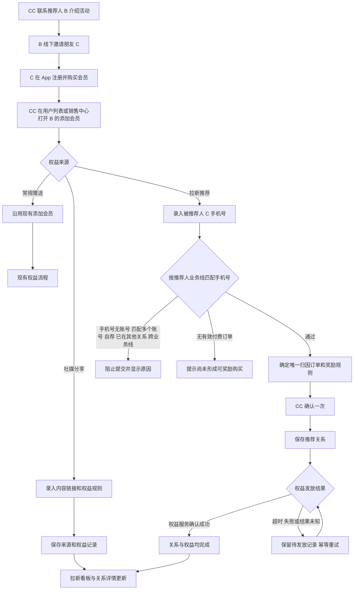

# 拉新裂变mvp

> CC 在现有“添加会员”中录入被推荐人手机号，系统按推荐人所属业务线匹配唯一用户、核验其有效订单、绑定 B → C 推荐关系并自动发放推荐人权益；一次提交完成后可直接按 CC、来源、人数和 GMV 核对结果。
> 需求编号：REQ-GRW-001｜状态：待评审｜更新时间：2026-11-13
> 需求类型：业务流程｜补充类型：集成与自动化、权限与审计、看板与指标

> 📌
>
> - 本期只做 CRM 内部闭环：B、C 关系由 CC 录入，不做 C 端邀请链接和自动绑定。
> - 复用“添加会员”入口；选择拉新来源并录入 C 后，系统自动核验订单、确定奖励，CC 一次确认同时绑定关系并发放权益。
> - 首版按好友有效购买 3/6/12 个月发放 +1/+2/+3 个月；社媒分享本期只做来源和权益留痕，不建审核队列。

## 交互原型

[打开完整交互原型](https://h3-ai-lab.github.io/hhhprd/projects/referral-growth-mvp/prototype/)

原型包含拉新归因看板、关系详情，以及从用户列表进入“添加会员”按手机号完成业务线匹配、推荐关系绑定和权益发放的完整操作；支持中文、英文完整切换。

## 要解决什么

当前团队已在线下执行转介绍活动：CC 联系推荐人 B，B 邀请朋友 C，C 购买套餐后，CC 到 CRM 给 B 加会员并手写 referral 备注。这个动作没有结构化关系，忘记备注后无法追溯来源，也无法回答哪个 CC 带来哪些被推荐用户和多少 GMV。

本期不再建设完整推荐平台，而是让 CC 在已有发权益动作中顺手完成结构化归因。业务核验由系统完成，CC 不再分别查订单、算奖励、写备注并等待二次确认。

## 本期目标与范围

本期要建立一条可由 CC 直接完成并自动出数的 MVP 拉新链路：

| 做 | 不做 |
|---|---|
| 复用用户列表和销售中心的“添加会员”入口 | C 端邀请链接、推荐码和自动身份绑定 |
| B → C 关系录入、订单核验和唯一性控制 | 首次试听自动奖励、好友后续续费奖励 |
| 购买后推荐权益自动匹配和发放 | 社媒内容审核队列、官方选中流程 |
| 推荐和社媒来源、操作 CC、归属 CC 留痕 | CRM 线索分配、销售归属和转派规则变更 |
| 拉新归因看板、关系详情和基础异常处理 | 缺失历史关系的自动补录或凭备注倒推 |

## 角色与业务对象

| 角色 | 本期职责 |
|---|---|
| 推荐人 B | 接受 CC 活动沟通，向朋友介绍产品并获得推荐权益 |
| 被推荐人 C | 注册 Dino AI 并购买有效会员套餐，作为拉新归因和 GMV 来源 |
| 销售 CC | 录入 B → C 关系，核验系统结果并提交权益发放 |
| 销售组长 / 管理员 | 可代团队录入，处理失败记录，核对 CC 归属 |
| 营销运营 | 查看泰国拉新关系、来源、人数、GMV 和异常 |

| 业务对象 | 关键内容 | 唯一约束 |
|---|---|---|
| 拉新权益记录 | 来源、操作 CC、归属 CC、推荐人、被推荐人、被推荐人手机号快照、归因订单、奖励规则、权益状态 | 每次有效提交一条 |
| 推荐关系 | 推荐人 B、被推荐人 C、被推荐人手机号快照、关系状态、绑定时间 | 一个 C 只能绑定一个 B |
| 权益发放明细 | 奖励规则、发放前后有效期、权益服务流水、失败原因 | 同一关系同一规则最多成功发放一次 |
| 社媒分享记录 | 用户、内容链接、操作 CC、归属 CC、权益规则、权益状态 | 同一用户同一链接只记一条 |

## MVP 业务流程

### 关键规则

| 场景 | 规则 | 用户看到的结果 |
|---|---|---|
| CC 操作 | 操作 CC 取当前登录账号；归属 CC 默认取 B 当前线索负责人，无负责人时取操作 CC | 两个 CC 均写入记录；有权限的组长或管理员可在提交前调整归属 CC |
| 推荐人资格 | B 为有效注册用户，账号正常且属于泰国业务线；可与 C 不同手机号 | 不满足时阻止进入拉新推荐发放 |
| 被推荐人手机号 | 输入完整手机号；系统去除空格、横线和无效前缀后按 E.164 规范化，只允许输入手机号，不接受用户 ID 作为替代 | 无法规范化时提示手机号格式错误，不发起查询 |
| 业务线匹配 | 以推荐人 B 所属业务线为唯一匹配条件，在手机号关联的用户账号中只匹配与 B 同业务线的 C | 手机号仅存在其他业务线账号时，提示“手机号用户与推荐人业务线不一致”并阻止提交 |
| 手机号唯一性 | 同一手机号在同一业务线必须唯一命中一个有效注册用户；同一手机号可存在多个业务线账号 | 同业务线命中 0 个或多个用户时不写关系，提示用户不存在或账号重复 |
| 被推荐人资格 | 匹配到的 C 为有效注册用户、非游客、账号正常，且与 B 属于同一业务线 | 用户类型、状态或业务线不符时立即提示，不写关系 |
| 自荐拦截 | C 与 B 用户 ID 相同，或两者已验证手机号相同 | 阻止提交并提示不能绑定自荐关系 |
| 订单资格 | C 至少有一笔已支付、未最终取消或退款的泰国会员订单，套餐为 3/6/12 个月 | 系统展示订单 ID、套餐、实付金额和支付时间 |
| 归因订单 | 在符合套餐条件的订单中取支付时间最早的一笔；同一订单只能服务一条推荐关系 | 自动选单，不允许 CC 手工改写订单 |
| 推荐奖励 | 3 个月 +1 个月；6 个月 +2 个月；12 个月 +3 个月 | 有效期按自然月顺延，不再展示可编辑天数 |
| 关系唯一 | 一个 C 只能绑定一个 B；同一 B/C 只能有一条关系 | 重复提交返回原记录，不重复发放 |
| 多好友推荐 | B 可以绑定多个不同 C | 每个 C 独立形成一条关系和奖励记录 |
| 无独立审批 | CC 提交即完成业务确认，不进入推荐审批队列 | 常规用户、订单和权益权限继续生效 |
| 绑定与发放 | 首次提交即生成一条待发放关系；权益成功后标记已发放 | 发放失败时关系仍可追溯，并展示失败原因与重试状态 |
| 退款与撤销 | 归因订单最终退款、撤单或拒付后，关系保留但标记“归因失效”，不追溯扣回已发权益 | 本期只阻止后续重复奖励，人工冲正沿用现有权益流程 |
| 社媒分享 | 录入用户、内容链接和奖励规则，本期沿用现有手动天数，不自动审核内容 | 保存来源、CC、链接、规则和权益流水，不生成推荐关系 |

### 校验与发放失败边界

所有业务校验必须在 CC 点击“确认发放”前完成。校验不通过时不得创建推荐关系、权益记录或“发放失败”记录，只展示对应原因并允许 CC 修改输入后重新校验。

前置校验至少包括：

- 操作人是否有添加会员权限，以及推荐人、被推荐人和订单是否在数据权限范围内。
- 推荐人和被推荐人是否为有效注册用户、账号是否正常。
- 手机号格式是否正确、是否能在推荐人所属业务线唯一匹配被推荐人。
- 推荐人和被推荐人业务线是否一致，是否为同一用户或同一已验证手机号。
- 被推荐人是否已绑定其他推荐人，当前 B/C 是否已经存在有效关系。
- 被推荐人是否有符合套餐范围、支付状态和业务线要求的唯一归因订单。
- 奖励规则和权益有效期是否已配置且可以计算。

点击确认前必须再次完成上述校验；若数据已变化，则回到校验失败状态，不进入发放。只有校验通过并开始请求权益服务后，系统异常才可以记为“发放失败”。

“发放失败”原因只允许使用以下系统异常枚举：

| 原因枚举 | 页面文案 | 重试规则 |
|---|---|---|
| `ENTITLEMENT_SERVICE_UNAVAILABLE` | 系统异常：权益服务暂不可用 | 按间隔自动重试 |
| `ENTITLEMENT_REQUEST_TIMEOUT` | 系统异常：权益服务请求超时 | 先查询请求结果，再使用同一幂等键重试 |
| `ENTITLEMENT_RESULT_UNKNOWN` | 系统异常：权益处理结果待确认 | 先查询原权益流水，确认未成功后才可重试 |
| `ENTITLEMENT_INTERNAL_ERROR` | 系统异常：权益服务内部错误 | 自动重试；超过次数后转人工 |
| `SYSTEM_DATA_ACCESS_ERROR` | 系统异常：业务数据访问失败 | 数据服务恢复后重试 |
| `SYSTEM_UNKNOWN_ERROR` | 系统异常：未知异常 | 转人工核查，不重复发起新关系 |

用户不存在、业务线不一致、手机号重复、订单不符合条件、推荐关系重复、奖励规则缺失或权限不足均属于前置校验失败，不得保存为“发放失败”。

## 页面 1：添加会员

入口：`用户管理 → 用户列表 → 操作 → 添加会员`；销售中心沿用现有“添加会员时长”入口。

### 与现有页面的关系

现有弹窗中的用户 ID、开通类型、有效期天数、开通原因和确认操作保留。新增内容放在开通类型之后、有效期之前：

- **权益来源**：必选，选项为“常规赠送、拉新推荐、社媒分享”，默认“常规赠送”。
- **活动类型**：选择“拉新推荐”时自动固定为“好友推荐”，不重复选择。
- **被推荐人手机号**：选择“拉新推荐”时必填；支持带国际区号的完整手机号输入，系统按推荐人 B 所属业务线精确匹配账号，不允许模糊匹配、猜测对象或通过用户 ID 替代。
- **业务线匹配结果**：手机号匹配后同时显示推荐人业务线、被推荐人业务线和“一致”状态；业务线不一致时不展示可发放结果。
- **订单核验区**：手机号和业务线匹配通过后，自动显示被推荐人用户 ID、用户状态、套餐、订单 ID、实付金额、支付时间和可奖励规则。
- **奖励有效期**：选择拉新推荐后由规则自动带出并只读；常规赠送和社媒分享继续沿用现有输入能力。
- **开通原因**：拉新推荐自动生成结构化原因，例如 `拉新推荐 · B推荐C · 3个月套餐`；CC 可追加说明，不能删除系统生成部分。

### 操作状态

| 状态 | 页面表现 | 可用操作 |
|---|---|---|
| 未录入 C 手机号 | 显示被推荐人手机号输入框，确认按钮不可用 | 录入、取消 |
| 核验中 | 显示“正在核验用户与订单”，冻结重复提交 | 取消 |
| 核验通过 | 展示匹配到的用户、业务线一致状态、唯一订单、奖励规则和发放后说明 | 返回修改、确认发放 |
| 手机号无效 | 提示格式错误、用户不存在或同业务线命中多个账号 | 修改手机号 |
| 业务线不一致 | 展示推荐人和手机号用户的各自业务线，不显示订单和发放结果 | 修改手机号或取消 |
| 无法奖励 | 提示没有符合条件的 3/6/12 个月有效订单 | 取消，待 C 后续购买后再操作 |
| 重复关系 | 展示已有推荐人、绑定时间和权益状态 | 关闭；不允许再次发放 |
| 发放中 | 弹窗保留当前信息并展示处理中 | 不允许重复点击 |
| 发放失败 | 只展示系统异常原因、记录状态和后续重试说明 | 关闭或按权限重试 |
| 成功 | 关闭弹窗并提示关系已绑定、权益已发放 | 查看关系详情 |

## 页面 2：拉新归因

入口：`营销中心 → 拉新归因`。

### 顶部指标

- 推荐人数
- 被推荐人数
- 裂变 GMV
- 权益发放成功率

### 筛选

| 筛选 | 规则 |
|---|---|
| 业务日期 | 全文指标共用；可选“关系绑定时间”或“订单支付时间”，默认关系绑定时间 |
| 日期范围 | 起止日期均包含，默认近 30 个自然日 |
| 业务线 | 本期只显示当前用户有权限的业务线，泰国为默认值 |
| 来源 | 全部、拉新推荐、社媒分享 |
| 归属 CC | 按当前用户数据权限返回候选账号，包含停用账号历史快照 |
| 权益状态 | 全部、待发放、已发放、发放失败、归因失效 |
| 关键词 | 精确匹配推荐人用户 ID、被推荐人用户 ID、被推荐人手机号或订单 ID；手机号在列表按权限脱敏 |

### 关系列表

本期列表不提供字段排序。

`推荐人用户 ID、推荐人姓名、被推荐人用户 ID、被推荐人姓名、被推荐人手机号（脱敏）、来源、归因订单、套餐、实付金额、订单支付时间、关系绑定时间、操作 CC、归属 CC、奖励规则、权益状态`

点击关系行打开详情，展示：

- 推荐关系 ID、绑定时间、当前状态。
- B 与 C 的用户 ID、姓名快照和账号状态，以及 C 的脱敏手机号和业务线匹配结果。
- 订单 ID、套餐、实付金额、支付方式、支付时间和最终状态。
- 操作 CC、归属 CC、权益规则和自动生成原因。
- 权益发放前后有效期、权益流水、失败原因和每次重试结果。
- 退款、撤单或拒付后的归因失效状态。

### 社媒分享记录

“社媒分享”使用同一列表筛选和状态，展示用户、内容链接、操作 CC、归属 CC、奖励规则和权益状态。社媒记录不展示推荐人和被推荐人关系，也不进入推荐人数、被推荐人数和裂变 GMV。

## 指标口径

### 公共口径

- **时区**：`Asia/Bangkok` 自然日。
- **业务线**：本期固定为泰国；所有页面使用同一权限范围。
- **关系集合**：已成功创建推荐关系，且未被判定为重复、自荐或无效的拉新权益记录。
- **业务日期**：默认使用关系绑定时间；切换后统一使用归因订单支付时间。
- **归属口径**：使用记录创建时的操作 CC、归属 CC 和用户姓名快照；后续转派不重写历史。
- **零分母**：比率分母为 0 时显示“—”。
- **百分比精度**：保留一位小数。

### 指标定义

| 指标 | 分子 | 分母 | 单位 | 统计范围 | 时间字段 | 去重键 | 零值规则 |
|---|---|---|---|---|---|---|---|
| 推荐人数 | 关系集合中至少有一条记录的推荐人用户数 | — | 人 | 当前业务线、来源、CC、权益状态筛选范围 | 关系绑定时间或订单支付时间 | `referrer_user_id` | 无记录显示 0 |
| 被推荐人数 | 关系集合中至少有一条记录的被推荐人用户数 | — | 人 | 同上 | 同上 | `referred_user_id` | 无记录显示 0 |
| 裂变 GMV | 关系集合内各条有效关系唯一归因订单的实付金额之和 | — | THB | 同一关系和日期筛选；排除待支付、已取消、最终退款和测试订单 | 关系绑定时间或订单支付时间 | `order_id` | 无有效订单显示 0 |
| 权益发放成功率 | 权益状态为“已发放”的关系数 | 已发起权益发放的关系数 | % | 同一筛选范围；重试不重复计入分母 | 关系绑定时间或订单支付时间 | `referral_relation_id` | 分母为 0 显示“—” |

指标卡、详情和后续导出必须使用同一关系集合。时间筛选切换时，四个指标同时切换，不允许单卡使用不同日期字段。

## RBAC 权限数据

### 功能权限

| 页面 / 资源 | 操作 | 业务含义 | 默认角色 | 数据范围 | 审计 |
|---|---|---|---|---|---|
| 添加会员 | 常规赠送 | 沿用现有权益发放 | 现有拥有添加会员权限的角色 | 现有用户与业务线范围 | 沿用现有权益审计 |
| 添加会员 | 拉新推荐发放 | 录入 C 手机号、匹配账号、绑定关系并发权益 | CC_TH、销售组长、管理员、超级管理员 | B 与 C 均在操作人可见业务线内且业务线一致 | 记录成功、失败、未授权尝试 |
| 添加会员 | 社媒分享发放 | 录入来源、链接并发权益 | CC_TH、销售组长、营销运营、管理员、超级管理员 | 当前用户数据范围 | 记录来源、链接和权益流水 |
| 拉新归因 | 页面查看 | 查看关系、人数、GMV 和权益状态 | CC_TH、销售组长、营销运营、管理员、超级管理员 | CC 看本人操作或本人归属；组长看团队；营销运营看授权业务线 | 权限变更审计 |
| 拉新归因 | 详情查看 | 查看订单和权益明细 | 同页面查看 | 与列表同范围，逐条再次校验 | 不记录普通查询 |
| 拉新归因 | 失败重试 | 重试待发放或失败权益 | 销售组长、营销运营、管理员、超级管理员 | 仅在当前可见范围 | 记录操作人、原因、前后状态和结果 |

### 字段与数据权限

| 字段组 / 列表 | 可见角色 | 编辑角色 | 脱敏 / 隐藏 | 可导出 | 候选范围限制 |
|---|---|---|---|---|---|
| B/C 用户 ID、姓名 | 页面查看角色 | 无 | 姓名按用户中心权限展示 | 本期不提供导出 | 仅当前业务线 |
| 订单 ID、套餐、实付金额 | 页面查看角色 | 无 | 沿用订单中心权限 | 本期不提供导出 | 仅归因订单 |
| 被推荐人手机号 | 拥有添加会员和用户敏感字段权限的角色 | 仅本次核验输入 | 录入时明文，保存和展示时脱敏；无权时只显示后四位 | 否 | 只按手机号精确匹配推荐人同业务线账号 |
| 支付凭证 | 不新增 | 无 | 拉新页面不展示 | 否 | 不提供候选搜索 |
| 操作 CC、归属 CC | 页面查看角色 | 仅提交前调整归属 CC | 历史停用账号保留姓名快照 | 否 | 仅可见 CC |
| 社媒内容链接 | 页面查看角色 | 仅创建人本次提交前 | 按链接访问权限处理 | 否 | 无 |

### 权限数据变更

| 变更类型 | 权限层级 | 权限项 | 业务说明 | 默认角色 / 数据范围 | 新增审计 |
|---|---|---|---|---|---|
| 新增 | 动作 | `growth_grant.create` | 从添加会员发起拉新推荐或社媒分享记录 | CC_TH、销售组长、营销运营、管理员、超级管理员；当前数据范围 | 是 |
| 复用 | 动作 | 用户中心手机号查询与查看权限 | 仅用于解析被推荐人手机号对应账号 | 沿用现有角色和业务线范围 | 是 |
| 新增 | 菜单 / 页面 | `growth_attribution.view` | 进入拉新归因并查看列表、详情 | CC_TH 本人、组长团队、运营授权业务线、管理员全量 | 权限变更 |
| 新增 | 动作 | `growth_grant.retry` | 重试失败权益 | 组长、运营、管理员、超级管理员 | 是 |
| 复用 | 动作 | 现有添加会员权益权限 | 继续控制实际发放能力 | 沿用现有角色与业务线范围 | 沿用现有权益审计 |
| 复用 | 数据 | 用户、订单、业务线和团队范围 | 拉新功能的候选用户、订单和记录范围 | 不扩大现有权限 | 否 |

### 离职与停用

- 账号停用后立即失去拉新发放、查看和重试权限。
- 历史记录保留操作 CC、归属 CC、姓名和团队快照，并显示“已停用”。
- B 后续线索交接沿用现有销售中心规则，不因本需求改变分配或掉库。
- 归属 CC 的后续转派不重写历史拉新记录和已产生 GMV；新负责人只获得后续业务处理权。

## 数据依赖与异常

| 数据 / 场景 | 业务处理 |
|---|---|
| 用户或手机号服务不可用 | 不提交关系；保留弹窗输入并允许重新核验 |
| 手机号存在其他业务线账号 | 不向操作人展示其他业务线用户身份，只提示业务线不一致 |
| 同一手机号同业务线命中多个账号 | 阻止提交并进入人工核实，不使用任一账号自动发权益 |
| 订单服务不可用 | 不推断支付结果，不允许发放；提示稍后重试 |
| C 无有效 3/6/12 个月订单 | 不建立推荐关系、不发权益；C 后续满足条件时可重新提交 |
| C 已有推荐人 | 返回原关系和权益状态，不新增第二段关系 |
| 同一关系重复点击 | 使用同一业务记录返回原结果，不重复发权益 |
| 两个 CC 并发提交同一 C | 仅一个绑定成功；另一个提示已有推荐关系 |
| 权益服务不可用、超时、结果未知或内部错误 | 校验阶段已完成，记录“待确认”或“发放失败”并保存系统异常枚举；查询或使用同一幂等键重试 |
| B 已过期或无当前会员 | 允许按现有添加体验天数能力发放，并从当前时间起算 |
| B 有有效会员 | 奖励从现有效期顺延 |
| 归因订单退款或撤销 | 关系保留并标记“归因失效”，看板按现行指标规则排除 |
| 订单晚到或状态回写延迟 | 系统展示最近成功状态；发放结果以权益服务确认状态为准 |
| 历史手工备注 | 不自动识别；仅新增或经人工确认后形成的关系进入看板 |
| 权限被撤销 | 下一次请求立即失效；已打开详情不能继续执行操作 |

前置校验失败和业务数据变化不写入“发放失败”；权益发放成功率只统计已完成前置校验并实际进入权益服务请求的关系。

## 非功能与审计

- 推荐关系和权益发放必须幂等，任何重复提交都只能产生一条推荐关系和一次有效奖励。
- B、C 用户 ID 和归因订单 ID 是关系唯一性核对依据；手机号用于查找 C，姓名和脱敏手机号作为展示快照。
- 被推荐人手机号只按精确值在推荐人所属业务线内匹配；保存时使用规范化结果和脱敏展示值，订单支付凭证不进入拉新页面和本期导出。
- 操作 CC 取登录账号，不由前端自由填写；归属 CC 的调整必须二次确认并留痕。
- 审计至少记录：操作人、操作时间、B、C、订单、来源、规则、操作前后状态、失败原因和幂等键。
- 关系绑定、权益成功、权益失败、重试、归因失效和越权尝试都必须进入操作日志。
- 上线首日建立数据基线；缺失的历史关系不展示为 0 以外的推断结果。
