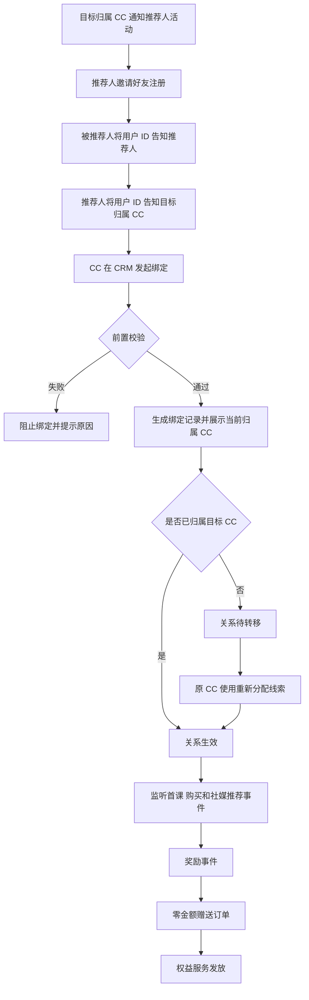
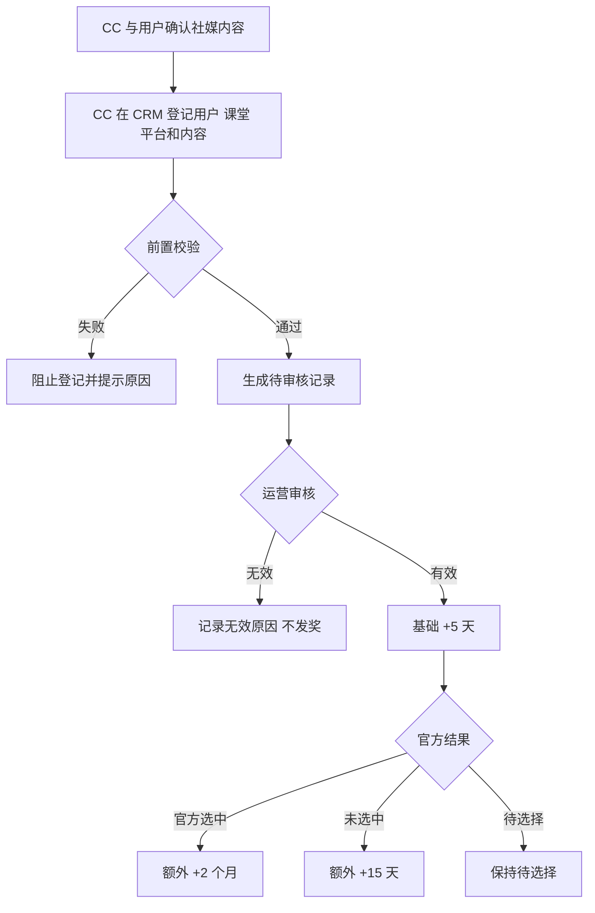

# 拉新裂变mvp

> CC 使用被推荐人用户 ID 建立邀请关系；绑定后先完成线索归属转移，再按首课、购买和社媒推荐事件自动生成零金额赠送订单并发放权益。
> 需求编号：REQ-GRW-001｜状态：待评审｜更新时间：2026-11-13
> 需求类型：业务流程｜补充类型：集成与自动化、权限与审计、看板与指标

## 交互原型

[打开完整交互原型](https://h3-ai-lab.github.io/hhhprd/projects/referral-growth-mvp/prototype/)

## 目标与范围

本期建立一套可被用户、课程、订单、社媒推荐、线索和权益系统共同识别的拉新记录，解决推荐关系无结构化记录、奖励依赖 CC 手工判断、操作 CC 和归因结果无法追溯的问题。

**做**

- 通过被推荐人用户 ID 建立唯一推荐关系。
- 校验正式注册、活动新注册、业务线一致、自荐和重复推荐。
- 展示被推荐人的当前归属 CC；关系在完成“重新分配线索”后生效。
- 按首课完课、首次购买和社媒推荐审核结果自动发奖。
- 由 CC 在 CRM 代用户登记社媒推荐，由运营审核。
- 生成零金额赠送订单，并复用现有会员权益开通能力。
- 在统一拉新列表中查看关系、奖励事件、赠送订单和权益结果。

**不做**

- 不建设用户端邀请链接、推荐码或 App 自助投稿。
- 不自动抢占或改写其他 CC 的线索归属。
- 不发放好友续费奖励，不做退款自动追扣。
- 不自动抓取第三方社媒平台结果。
- 不根据历史备注猜测或补造推荐关系。
- 不将赠送订单计入 GMV、实付收入或付费用户。
- 不将 CC 手工增加用户时长作为拉新或社媒推荐发奖入口；该操作与奖励归因完全分离。

## 角色与业务对象

| 角色 | 职责 |
|---|---|
| 推荐人 | 接受 CC 活动说明，邀请好友注册，并向 CC 提供被推荐人用户 ID |
| 被推荐人 | 经推荐人邀请并完成正式注册的新用户 |
| 销售 CC | 绑定推荐关系、登记社媒推荐、查看当前归属并处理异常；不手工发奖 |
| 目标归属 CC | 推荐关系所归属的 CC，默认取推荐人当前 CC |
| 当前归属 CC | 被推荐人当前线索的真实负责人，负责将其重新分配给目标归属 CC |
| 销售组长 / 管理员 | 调整目标归属、处理无归属线索和发放异常 |
| 社媒运营 | 审核 CC 登记的社媒内容及官方选中结果 |

| 业务对象 | 唯一性 |
|---|---|
| 拉新关系 | 一个被推荐人只能绑定一个推荐人 |
| 归属转移记录 | 同一关系最多完成一次有效转移 |
| 社媒推荐记录 | 同一用户、同一内容文件或链接只生成一条有效记录 |
| 奖励事件 | 同一业务事件最多生成一条 |
| 赠送订单 | 同一奖励事件最多生成一笔 |
| 权益发放记录 | 同一关系、同一奖励规则最多成功发放一次 |

## 业务流程

### 拉新关系

### 社媒推荐

## 业务规则

### 用户与关系

- 推荐人和被推荐人均须为有效正式注册用户，账号状态正常。
- 被推荐人使用完整用户 ID 精确匹配，不接受手机号、姓名或模糊搜索。
- 被推荐人必须与推荐人属于同一业务线。
- 业务线枚举为 `THAILAND / VIETNAM / SAUDI_ARABIA`；本期拉新活动只在泰国业务线执行，其他业务线仅用于现有账号识别和跨业务线拦截。
- 被推荐人不得是推荐人本人；用户 ID 或已验证手机号相同均视为自荐。
- 被推荐人的正式账号注册时间必须满足：`campaign_start_at ≤ registered_at ≤ binding_time`，起止边界均包含。
- 活动开始前已有正式账号的用户即使重新登录或补充资料，仍判定为非新注册。
- 新注册判定结果在绑定时保存快照，不因后续活动配置变化重算。
- 推荐人可以绑定多个不同被推荐人；每个被推荐人独立形成一条关系和奖励记录。

### 绑定、转移与状态

绑定只建立关系，不发放权益。目标归属 CC 默认取推荐人当前 CC；推荐人无有效 CC 时取操作 CC，有权限的组长或管理员可在提交前调整。

| 状态 | 进入条件 | 是否发奖 | 退出条件 |
|---|---|---|---|
| `BOUND_PENDING_TRANSFER` | 被推荐人当前归属其他 CC 或无归属 | 否，事件先缓存 | 完成线索重新分配 |
| `BOUND_ACTIVE` | 被推荐人已归属目标 CC | 是 | 退款或人工确认无效时进入失效 |
| `INVALID` | 重复、自荐、跨业务线或人工确认无效 | 否 | 不可恢复，保留审计 |

- 绑定成功后展示被推荐人的当前归属 CC；CC 不得直接改写该归属。
- 当前归属 CC 使用销售中心“重新分配线索”将被推荐人转给目标归属 CC。
- 转移成功后关系变为 `BOUND_ACTIVE`，保存原 CC、目标 CC、转移时间和操作人。
- 关系生效后补评估绑定后已经发生且尚未发奖的课程、订单和社媒推荐事件。
- 目标 CC 停用、跨业务线或转移失败时，关系保持待转移并发起归属异常。
- 原归属和首位 CC 快照永久保留；后续转派不重写历史业绩归属。

### 奖励事件

奖励事件仅在关系已生效且对应业务事件通过校验后生成。

| 事件 | 触发条件 | 权益 |
|---|---|---|
| `REFERRAL_FIRST_TRIAL_COMPLETED` | 被推荐人第一节体验课状态为 `COMPLETED`，且完课时间晚于绑定时间 | 推荐人 +14 天 |
| `REFERRAL_FIRST_PURCHASE_3M` | 被推荐人首次有效购买 3 个月会员 | 推荐人 +1 个月 |
| `REFERRAL_FIRST_PURCHASE_6M` | 被推荐人首次有效购买 6 个月会员 | 推荐人 +2 个月 |
| `REFERRAL_FIRST_PURCHASE_12M` | 被推荐人首次有效购买 12 个月会员 | 推荐人 +3 个月 |
| `SOCIAL_MEDIA_APPROVED` | CC 登记内容审核有效 | 发布用户 +5 天 |
| `SOCIAL_MEDIA_OFFICIALLY_SELECTED` | 已审核有效且授权官方使用，最终被官方选中 | 发布用户 +2 个月 |
| `SOCIAL_MEDIA_NOT_SELECTED` | 已审核有效且最终未选中 | 发布用户 +15 天 |

奖励状态枚举：`WAITING / PROCESSING / ISSUED / FAILED`。社媒推荐记录在审核前使用 `PENDING_REVIEW`，审核无效使用 `NOT_APPLICABLE`。

首课：

- 只接受 `FIRST_TRIAL` 且 `lesson_sequence=1`；预约、进行中、取消、未到课、改期和技术失败不触发。
- 同一推荐关系最多成功发放一次首课奖励；首课和购买奖励可叠加。

购买：

- 只接受被推荐人的首次有效会员订单；套餐仅限 3、6、12 个月。
- 待支付、取消、失败或测试订单不触发；最终退款、撤单或拒付后归因失效，不追扣已发权益。
- 首课和购买按各自业务事件去重，不互相替代。

### 社媒推荐

社媒推荐由 CC 与用户确认内容后，在 CRM 代用户登记；本期不建设 App 用户自助投稿。

- 用户 ID、课堂归属、内容链接或文件、授权和重复内容必须在提交登记前校验。
- 内容审核前不产生奖励；基础生效后才可进入“官方选中”或“未选中”。
- 审核状态为 `PENDING_REVIEW / APPROVED / REJECTED`，选中状态为 `PENDING_SELECTION / OFFICIALLY_SELECTED / NOT_SELECTED`。
- 未授权官方使用时不能标记为官方选中。
- 审核无效时不生成奖励事件，记录无效原因和备注。
- 同一记录最终只能进入“官方选中”或“未选中”之一，状态变化全程留痕。
- 两种结果奖励互斥；重复回调使用 `social_recommendation_id + reward_event_type` 幂等。

### 赠送订单与权益

奖励事件通过校验后必须先生成赠送订单，再由订单驱动权益开通，不能直接修改会员到期时间。

| 订单规则 | 说明 |
|---|---|
| 订单类型 | `MEMBERSHIP_GRANT` |
| 金额与支付 | 金额为 0，支付状态为 `NOT_REQUIRED`，不计入 GMV 和付费用户 |
| 业务来源 | `FRIEND_REFERRAL` 或 `SOCIAL_MEDIA_RECOMMENDATION` |
| 来源类型 | `REFERRAL_REWARD` 或 `SOCIAL_MEDIA_REWARD` |
| 权益接收人 | 好友推荐为推荐人；社媒推荐为发布用户 |
| 幂等键 | `REFERRAL_REWARD:{reward_event_id}` 或 `SOCIAL_MEDIA_REWARD:{reward_event_id}` |
| 天数型奖励 | 按自然日顺延 |
| 月数型奖励 | 按自然月顺延，同时保存原始单位和值 |
| 订单状态 | `CREATING → CREATED → FULFILLED`；系统异常进入 `FAILED` |

现有 CC 手工添加会员的 1～3 天限制和商店订阅拦截不适用于系统奖励，但系统仍须通过会员权益服务确认最终开通结果。

### 校验与系统失败

所有业务和权限校验必须前置；校验不通过时不创建关系、奖励事件或“发放失败”记录。

以下情况属于前置校验失败：用户不存在或非正式用户、非活动新注册、业务线不一致、自荐、重复关系、课堂或内容不符合规则、奖励配置不可计算、权限不足。

“发放失败”只允许以下系统异常：

| 枚举 | 页面文案 | 重试规则 |
|---|---|---|
| `ORDER_CREATION_FAILED` | 赠送订单创建失败 | 使用同一奖励事件幂等重试 |
| `ENTITLEMENT_SERVICE_UNAVAILABLE` | 权益服务暂不可用 | 按间隔自动重试 |
| `ENTITLEMENT_REQUEST_TIMEOUT` | 权益服务请求超时 | 先查询结果，再使用同一幂等键重试 |
| `ENTITLEMENT_RESULT_UNKNOWN` | 权益处理结果待确认 | 查询原权益流水，确认未成功后才可重试 |
| `ENTITLEMENT_INTERNAL_ERROR` | 权益服务内部错误 | 自动重试，超限后转人工 |
| `SYSTEM_DATA_ACCESS_ERROR` | 业务数据访问失败 | 数据服务恢复后重试 |
| `SYSTEM_UNKNOWN_ERROR` | 未知系统异常 | 转人工核查 |

## 字段与排序

现有拉新关系列表和社媒推荐列表均没有字段排序入口或可排序表头，本期不新增排序能力。

### 好友推荐绑定

| 字段 | 规则 | 排序 |
|---|---|---|
| 推荐人 | 从用户上下文带入，展示用户 ID、姓名、业务线、当前 CC、账号状态；不可手工替换 | 不支持 |
| 被推荐人用户 ID | 必填，精确查询正式注册用户 | 不支持 |
| 用户核验结果 | 展示姓名、业务线、注册时间、活动开始时间、新注册判定和当前归属 CC | 不支持 |
| 新注册标记 | `NEW_REGISTRATION` / `NOT_NEW_REGISTRATION`；仅前者可绑定 | 不支持 |
| 目标归属 CC | 默认取推荐人当前 CC，无有效 CC 时取操作 CC | 不支持 |
| 绑定来源 | 固定为 `FRIEND_REFERRAL` | 不支持 |
| 绑定备注 | 可选；只补充业务说明，不能替代结构化关系 | 不支持 |

### 社媒推荐登记

| 字段 | 规则 | 排序 |
|---|---|---|
| 用户 ID | 必填，精确查询；不接受手机号或姓名 | 不支持 |
| 用户核验结果 | 展示姓名、业务线、账号状态、正式用户状态和当前归属 CC | 不支持 |
| 课堂证据 | 从该用户课堂记录选择课堂 ID、名称和上课时间 | 不支持 |
| 平台 | `FACEBOOK / INSTAGRAM / TIKTOK / YOUTUBE / OTHER` | 不支持 |
| 内容类型 | `PHOTO / VIDEO` | 不支持 |
| 内容凭证 | `UPLOADED_FILE / EXTERNAL_LINK` | 不支持 |
| 内容链接或文件 | 链接须可访问；文件须可核验 | 不支持 |
| 官方使用授权 | `AUTHORIZED_OFFICIAL_USE / NOT_AUTHORIZED` | 不支持 |
| 登记备注 | 可选，补充线下核验信息 | 不支持 |
| 登记 CC | 自动取当前登录账号 | 不支持 |
| 提交渠道 | 固定为 `CC_MANUAL_ENTRY` | 不支持 |

## 列表与筛选

### 拉新关系

入口：

- `营销中心 → 拉新关系`
- `用户管理 → 用户列表 → 维护拉新关系`
- `销售管理 → 销售中心 → 我的跟进 / 已付费 → 维护拉新关系`

关系维护和拉新归因共用同一个列表，不再拆分两个关系列表。

字段顺序：

`绑定 ID → 来源 → 推荐人 → 被推荐人用户 ID → 业务线 → 绑定状态 → 操作 CC → 目标归属 CC → 当前归属 CC → 下一触发条件 → 最近奖励事件 → 奖励值 → 赠送订单 ID → 赠送订单状态 → 权益状态`

| 筛选 | 规则 |
|---|---|
| 业务日期 | 关系绑定时间或归因订单支付时间，默认绑定时间 |
| 日期范围 | 起止日期均包含，默认近 30 个自然日 |
| 业务线 | 当前用户有权限的业务线 |
| 来源 | 固定为好友推荐 |
| 归属 CC | 按数据权限返回候选，包含停用账号历史快照 |
| 绑定状态 | 全部、待转移、已生效、无效 |
| 奖励状态 | 全部、待触发、待发放、已发放、发放失败、归因失效 |
| 关键词 | 精确匹配推荐人用户 ID、被推荐人用户 ID、业务事件 ID、赠送订单 ID、来源订单 ID |

### 社媒推荐

入口：`营销中心 → 社媒推荐 → 登记社媒推荐`，以及用户列表和销售中心对应动作。

字段顺序：

`投稿 ID → 用户 ID/姓名 → 登记 CC → 平台 → 课堂信息 → 内容类型 → 内容摘要 → 提交渠道 → 提交时间 → 审核状态 → 选中状态 → 审核运营 → 奖励事件 → 赠送订单 → 权益状态`

| 筛选 | 规则 |
|---|---|
| 日期范围 | 按提交时间筛选，起止日期均包含 |
| 业务线 | 当前用户有权限的业务线 |
| 登记 CC | 按数据权限返回候选，保留停用账号快照 |
| 平台 | 全部、Facebook、Instagram、TikTok、YouTube、其他 |
| 审核状态 | 全部、待审核、已通过、已拒绝 |
| 选中状态 | 全部、待选择、官方选中、未选中 |
| 奖励状态 | 全部、待触发、待发放、已发放、发放失败 |
| 关键词 | 投稿 ID、用户 ID、内容 ID、内容链接、赠送订单 ID |

## 指标口径

### 公共口径

- 时区：`Asia/Bangkok`，自然日。
- 业务线：当前用户权限范围，本期以泰国为主。
- 关系集合：`BOUND_ACTIVE` 的有效好友推荐关系；待转移关系可展示，但不计入人数和 GMV。
- 奖励事件集合：已通过校验并进入发放流程的奖励事件。
- 日期字段：默认关系绑定时间，可切换为归因订单支付时间。
- 归属口径：使用记录创建时的操作 CC、归属 CC 和用户姓名快照。
- 百分比保留一位小数；分母为 0 时显示“—”。

### 指标定义

| 指标 | 分子 | 分母 | 单位 | 统计范围 | 时间字段 | 去重键 | 零值规则 |
|---|---|---|---|---|---|---|---|
| 推荐人数 | 关系集合中至少有一条记录的推荐人用户数 | — | 人 | 当前业务线、来源、CC、绑定状态 | 绑定时间或订单支付时间 | `referrer_user_id` | 0 |
| 被推荐人数 | 关系集合中至少有一条记录的被推荐人用户数 | — | 人 | 同上 | 同上 | `referred_user_id` | 0 |
| 裂变 GMV | 有效关系唯一归因订单的实付金额之和 | — | THB | 排除待支付、取消、最终退款、测试订单和赠送订单 | 绑定时间或订单支付时间 | `order_id` | 0 |
| 权益发放成功率 | 已发放奖励事件数 | 已发起权益发放的奖励事件数 | % | 关系集合内全部奖励事件；重试不重复计数 | 与关系集合一致 | `reward_event_id` | — |

指标卡、详情和列表使用同一关系集合、日期字段和去重口径。

## 页面与操作

### 拉新关系

- 顶部展示推荐人数、被推荐人数、裂变 GMV 和权益发放成功率。
- 统一列表展示关系与奖励结果，点击行打开详情。
- 待转移关系展示当前归属 CC，并提供线下联系提示。
- 当前归属 CC 在销售中心通过“重新分配线索”完成转派。
- 关系详情展示用户快照、新注册判定、来源、操作 CC、归属 CC、奖励事件、赠送订单、权益流水和失败原因。

### 社媒推荐

- 运营查看待审核记录、课堂证据、内容凭证和授权状态。
- 审核通过发放 +5 天；无效则不生成奖励。
- 通过后记录官方选中或未选中结果，并生成对应额外奖励。
- 所有奖励结果展示赠送订单和权益状态。

## RBAC 权限数据

### 功能权限

| 页面 / 资源 | 操作 | 默认角色 | 数据范围 | 审计 |
|---|---|---|---|---|
| 拉新关系 | 页面查看 | CC_TH、销售组长、营销运营、管理员、超级管理员 | CC 看本人操作或归属；组长看团队；运营看授权业务线 | 权限变更审计 |
| 拉新关系 / 销售中心 | 新建好友推荐 | CC_TH、销售组长、管理员、超级管理员 | 推荐人与被推荐人均在可见业务线且业务线一致 | 成功、失败、越权尝试 |
| 销售中心 | 重新分配线索 | 当前归属 CC、销售组长、管理员、超级管理员 | 仅限关系中的被推荐人及目标 CC | 记录原 CC、目标 CC、原因和结果 |
| 拉新关系 | 处理归属异常 | 销售组长、管理员、超级管理员 | 团队或授权业务线 | 记录原 CC、新 CC、原因和时间 |
| 社媒推荐 | 页面查看 | CC_TH、社媒运营、营销运营、管理员、超级管理员 | CC 看本人登记；运营看授权业务线 | 权限变更审计 |
| 社媒推荐 / 销售中心 | 登记内容 | CC_TH、销售组长、管理员、超级管理员 | 用户在当前操作人可见业务线 | 记录用户、课堂、渠道和校验结果 |
| 社媒推荐 | 审核内容 | 社媒运营、营销运营、管理员、超级管理员 | 当前授权业务线 | 审核人、前后状态和时间 |
| 社媒推荐 | 更新选中结果 | 社媒运营、营销运营、管理员、超级管理员 | 当前授权业务线 | 前后状态和操作人 |
| 拉新关系 | 失败重试 | 销售组长、营销运营、管理员、超级管理员 | 当前可见范围 | 操作人、原因、前后状态和结果 |

### 字段与数据权限

| 资源 | 可见角色 | 编辑 | 脱敏 / 导出 | 候选范围 |
|---|---|---|---|---|
| 推荐人 / 被推荐人用户 ID、姓名 | 页面查看角色 | 无 | 按用户中心权限脱敏；本期不导出 | 当前业务线 |
| 归因订单、赠送订单和权益明细 | 页面查看角色 | 无 | 沿用订单中心权限；本期不导出 | 仅归因或赠送订单 |
| 被推荐人注册时间、当前 CC | 拉新绑定和用户查看角色 | 无 | 手机号不进入绑定和统一列表 | 按用户 ID 精确查询 |
| 操作 CC、归属 CC | 页面查看角色 | 仅提交前调整目标 CC | 停用账号保留姓名快照 | 可见 CC |
| 社媒推荐内容、链接和课堂证据 | CC 本人、社媒运营、营销运营、管理员、超级管理员 | 登记人、审核人或授权运营 | 按内容权限处理；本期不导出 | 本人或授权业务线 |

### 权限数据变更

| 类型 | 权限项 | 说明 | 默认角色 / 范围 |
|---|---|---|---|
| 新增 | `growth_relation.view` | 查看统一拉新关系和奖励结果 | CC_TH、销售组长、营销运营、管理员、超级管理员 |
| 新增 | `growth_binding.create` | 新建好友推荐绑定 | CC_TH、销售组长、管理员、超级管理员；当前数据范围 |
| 新增 | `growth_binding.transfer_referred_lead` | 将关系内被推荐人转给目标归属 CC | 当前 CC、销售组长、管理员、超级管理员 |
| 新增 | `growth_binding.resolve_assignment` | 处理推荐线索归属异常 | 销售组长、管理员、超级管理员 |
| 新增 | `social_recommendation.view` | 查看社媒推荐记录 | CC 看本人；运营看授权业务线 |
| 新增 | `social_recommendation.create` | 登记社媒推荐 | CC_TH、销售组长、管理员、超级管理员 |
| 新增 | `social_recommendation.review` | 审核社媒推荐 | 社媒运营、营销运营、管理员、超级管理员 |
| 新增 | `social_recommendation.update_selection` | 更新官方选中结果 | 社媒运营、营销运营、管理员、超级管理员 |
| 新增 | `growth_grant.retry` | 重试系统异常导致的失败权益 | 销售组长、营销运营、管理员、超级管理员 |
| 复用 | 用户中心与课程查询权限 | 查询用户、课堂和注册信息 | 沿用现有角色和业务线范围 |
| 复用 | 现有系统权益发放身份 | 由系统创建赠送订单并调用权益服务 | 系统任务 |

### 离职与停用

- 账号停用后立即失去绑定、登记、审核、查看和重试权限。
- 历史记录保留操作 CC、归属 CC、姓名和团队快照，并展示“已停用”。
- 推荐人后续线索交接沿用销售中心现有规则，不改变分配或掉库。
- 后续转派不重写历史拉新记录和已产生 GMV；新负责人只承接后续处理权。

## 数据依赖与异常

| 场景 | 处理 |
|---|---|
| 用户服务不可用 | 不提交绑定；保留用户 ID，允许重新核验 |
| 被推荐人不存在、为游客或非正式用户 | 阻止绑定并提示正式注册要求 |
| 被推荐人非活动新注册 | 阻止绑定并展示注册时间和活动开始时间 |
| 推荐关系重复或两名 CC 并发提交 | 仅一条关系成功；重复请求返回原记录 |
| 被推荐人已有推荐人 | 返回原关系及奖励状态 |
| 被推荐人当前归属目标 CC | 绑定后立即生效 |
| 被推荐人归属其他 CC | 保持待转移，完成重新分配后生效 |
| 被推荐人无当前归属 | 保持待转移，由有权限角色分配给目标 CC |
| 目标 CC 停用或无权限 | 转移失败，保持待转移并进入归属异常 |
| 首课事件非 `COMPLETED` | 不生成奖励；后续真正完课时仍可触发 |
| 首课早于绑定时间 | 不生成奖励并保留忽略原因 |
| 非首次有效购买或套餐不符 | 不生成购买奖励 |
| 社媒推荐审核无效 | 不生成奖励，保存原因和备注 |
| 社媒推荐重复内容或重复回调 | 按记录 ID 和事件类型幂等 |
| CC 登记时用户、课堂或链接校验失败 | 阻止提交，不创建记录，不记为发放失败 |
| 课程、订单或社媒结果延迟 | 事件到达后补触发，并校验关系状态、时间和幂等键 |
| 赠送订单创建失败 | 奖励保持待发放，使用同一业务键重试 |
| 权益服务不可用、超时或结果未知 | 保留订单和幂等键，查询或重试直至确认 |
| 订单状态回写失败 | 以权益流水确认结果，后台补偿订单状态 |
| 推荐人无有效会员 | 从当前时间发放 |
| 推荐人会员有效 | 从现到期时间顺延 |
| 归因订单退款或撤销 | 标记归因失效；不追扣已发权益 |
| 历史手写备注 | 不自动识别，不生成关系 |
| 权限被撤销 | 下次请求立即失效，不能继续提交或审核 |

## 非功能与审计

- 关系绑定、业务事件接收和权益发放分别幂等。
- 同一业务事件最多生成一条奖励；同一奖励最多生成一笔赠送订单。
- 赠送订单使用确定性来源业务键，重复回调、超时和人工重试均复用原订单。
- 操作 CC 取登录账号；目标归属 CC 调整须留痕。
- 审计记录操作人、时间、推荐人、被推荐人、业务事件 ID、事件枚举、来源、命中规则、奖励值、状态变化、失败原因和幂等键。
- 绑定、转移、社媒登记与审核、奖励触发、权益成功、失败重试、归因失效和越权尝试均须记录。
- 缺失历史关系不通过备注或行为推断补造。
