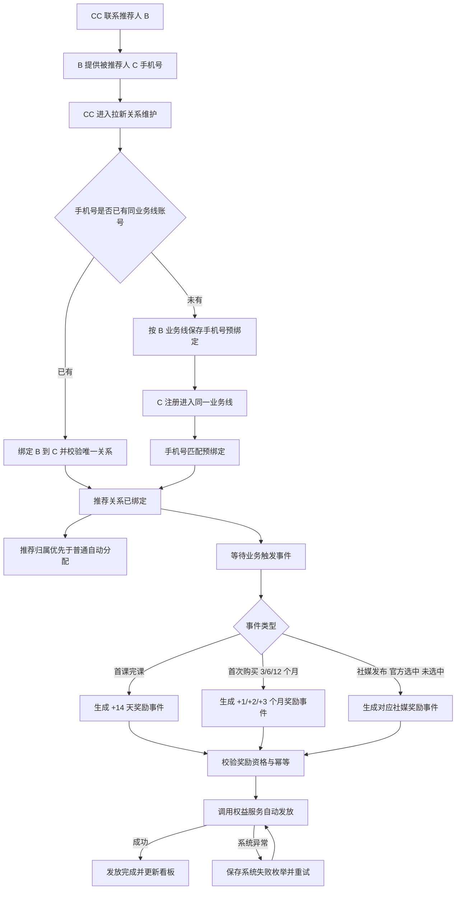

# 拉新裂变mvp

> CC 先按被推荐人手机号建立并维护 B → C 拉新关系，系统随后根据首课完课、首次购买或社媒内容状态自动生成并发放权益；关系绑定与权益发放是两个独立阶段。
> 需求编号：REQ-GRW-001｜状态：待评审｜更新时间：2026-11-13
> 需求类型：业务流程｜补充类型：集成与自动化、权限与审计、看板与指标

> 📌
>
> - 关系绑定前置：CC 先维护 B → C 关系；C 尚未注册时可保存手机号预绑定，注册后自动关联用户并进入推荐归属。
> - 权益发放后置且自动：绑定成功后，首课完课 +14 天，首次购买 3/6/12 个月自动发放 +1/+2/+3 个月。
> - 社媒推荐单独维护内容平台、内容类型、授权和选中状态，并按发布、未选中、官方选中等事件自动发放权益。

## 交互原型

[打开完整交互原型](https://h3-ai-lab.github.io/hhhprd/projects/referral-growth-mvp/prototype/)

原型包含拉新关系维护、好友推荐和社媒推荐绑定、自动发放事件、关系详情及拉新归因看板；支持中文、英文完整切换。

## 要解决什么

当前团队已在线下执行转介绍活动：CC 联系推荐人 B，B 邀请朋友 C，C 注册或购买后，CC 再到 CRM 手工给 B 加会员并备注 referral。这个过程既没有前置关系，也无法阻止 C 被普通分配规则分给其他 CC；奖励还要人工判断和操作。

本期先建立可被注册、课程、订单和权益系统共同识别的推荐关系，再由业务事件自动触发权益。CC 只负责关系录入和异常处理，不再手工判断奖励、添加会员或补写 referral 备注。

## 本期目标与范围

本期要建立一条可由 CC 直接完成并自动出数的 MVP 拉新链路：

| 做 | 不做 |
|---|---|
| 独立“拉新关系维护”入口；绑定与加会员分离 | C 端邀请链接、推荐码和客户端自动分享页 |
| 已注册用户绑定，以及 C 未注册时的手机号预绑定 | 好友后续续费奖励 |
| 首课完课 +14 天的自动奖励事件 | 人工选择首课奖励和手工填写发放天数 |
| 首次购买 3/6/12 个月的自动奖励事件 | 非首次购买和退款自动冲正 |
| 社媒内容平台、类型、链接、授权和选中状态维护 | 自动抓取第三方社媒发布和官方选中结果 |
| 推荐用户进入 B 所属 CC 的分配保护与归属修正 | 普通非推荐线索的分配权重和掉库规则变更 |
| 拉新归因、关系详情、奖励事件和基础异常处理 | 缺失历史关系的自动补录或凭备注倒推 |

## 角色与业务对象

| 角色 | 本期职责 |
|---|---|
| 推荐人 B | 接受 CC 活动沟通，向朋友介绍产品并获得推荐权益 |
| 被推荐人 C | 被 B 推荐的新用户；可先以手机号预绑定，注册后关联唯一用户 |
| 销售 CC | 维护 B → C 关系、核对推荐归属并处理绑定异常；不手工发推荐奖励 |
| 销售组长 / 管理员 | 可代团队录入，处理失败记录，核对 CC 归属 |
| 营销运营 | 查看泰国拉新关系、来源、人数、GMV 和异常 |

| 业务对象 | 关键内容 | 唯一约束 |
|---|---|---|
| 拉新绑定 | 来源、推荐人 B、被推荐人 C 或待注册手机号、业务线、操作 CC、归属 CC、绑定状态、绑定时间 | B/C 或 B/手机号组合唯一 |
| 推荐关系 | 推荐人 B、被推荐人 C、推荐人手机号快照、关系状态、绑定时间、注册关联时间 | 一个 C 只能绑定一个 B |
| 奖励事件 | 事件类型、来源事件 ID、关系、奖励规则、触发时间、发放状态 | 同一业务事件最多生成一条奖励 |
| 权益发放明细 | 奖励规则、发放前后有效期、权益服务流水、失败原因 | 同一关系同一规则最多成功发放一次 |
| 社媒推荐记录 | 用户、平台、内容类型、链接、发布时间、授权状态、选中状态、操作 CC、权益状态 | 同一用户同一内容链接只记一条 |

## MVP 业务流程

### 关键规则

| 场景 | 规则 | 用户看到的结果 |
|---|---|---|
| 两阶段 | 关系绑定必须先于权益发放；绑定页不选择奖励、不填写会员天数、不调用权益服务 | 绑定成功只表示关系成立，奖励在后续业务事件到达时自动生成 |
| CC 操作 | 操作 CC 取当前登录账号；归属 CC 默认取 B 当前线索负责人，无负责人时取操作 CC | 两个 CC 均写入绑定；有权限的组长或管理员可在提交前调整归属 CC |
| 推荐人资格 | B 为有效注册用户，账号正常且属于泰国业务线；可与 C 不同手机号 | 不满足时阻止进入拉新推荐发放 |
| 被推荐人手机号 | 输入完整手机号；系统去除空格、横线和无效前缀后按 E.164 规范化，只允许输入手机号，不接受用户 ID 作为替代 | 无法规范化时提示手机号格式错误，不发起查询 |
| 业务线匹配 | 以推荐人 B 所属业务线为唯一匹配条件；已有账号必须与 B 同业务线，未注册手机号按 B 业务线创建预绑定 | 手机号仅存在其他业务线账号时，提示业务线不一致并阻止绑定 |
| 手机号唯一性 | 同一手机号在同一业务线最多绑定一个有效注册用户或一条待注册预绑定 | 已有同业务线关系时返回原绑定，不创建第二条 |
| 被推荐人资格 | 匹配到的 C 为有效注册用户、非游客、账号正常，且与 B 属于同一业务线 | 用户类型、状态或业务线不符时立即提示，不写关系 |
| 自荐拦截 | C 与 B 用户 ID 相同，或两者已验证手机号相同 | 阻止提交并提示不能绑定自荐关系 |
| 未注册预绑定 | C 尚未注册时，保存推荐人、规范化手机号、业务线和归属 CC；注册事件到达后补写 C 用户 ID | 预绑定阶段不创建用户，不发权益 |
| 注册关联 | C 首次注册时先匹配同业务线待注册绑定，再写入推荐来源和归属 CC，之后才进入普通分配规则 | 推荐线索不会被普通自动分配抢先归属 |
| 关系唯一 | 一个 C 只能绑定一个 B；同一 B/C 或 B/手机号只能有一条有效绑定 | 重复提交返回原记录，不重复创建关系 |
| 多好友推荐 | B 可以绑定多个不同 C | 每个 C 独立形成一条关系和奖励记录 |
| 无独立审批 | CC 提交绑定即完成业务确认，不进入推荐审批队列 | 绑定立即生效，等待业务事件 |
| 自动发放 | 仅当绑定有效且对应业务事件满足规则时生成奖励事件 | CC 不选择奖励规则、不填写时长、不手工添加会员 |
| 发放状态 | 奖励事件独立记录待发放、发放中、已发放、发放失败 | 绑定状态与奖励状态分开展示，互不覆盖 |
| 退款与撤销 | 归因订单最终退款、撤单或拒付后，关系保留但标记“归因失效”，不追溯扣回已发权益 | 本期只阻止后续重复奖励，人工冲正沿用现有权益流程 |
| 社媒推荐 | 先保存用户、平台、内容类型、链接、发布时间、授权状态和内容状态，再由状态变化自动生成奖励事件 | 不进入好友推荐关系；同一内容的状态和奖励独立追溯 |

### 推荐线索分配保护

- 待注册预绑定生效后，C 首次注册时先按“手机号 + B 所属业务线”匹配预绑定，再执行普通自动分配。
- 预绑定命中且归属 CC 有效时，线索直接归属 B 的 CC，并记录 `assignment_source=REFERRAL`，跳过本轮分配权重。
- B 当前 CC 已停用时，依次使用绑定操作 CC、团队推荐待分配队列；不得直接进入普通随机分配。
- 已注册但尚未分配的 C 绑定后，直接写入推荐归属。
- C 已分配给其他 CC 且尚无外呼、跟进或预约时，绑定后自动转给 B 的 CC，并通知原 CC 和组长。
- C 已产生外呼、接通、跟进或预约时，保留“归属异常”并生成组长处理任务；推荐关系和后续奖励事件仍独立记录，不因归属处理而丢失。
- 首位 CC、原当前 CC、推荐归属 CC 和每次转派必须保留历史快照，后续转派不重写历史首跟和业绩归属。

### 首课完课赠送数据枚举

首课数据以课程服务最终完成事件为准，仅“已完成”触发推荐奖励。

| 数据 / 枚举 | 取值 | 说明 |
|---|---|---|
| `event_type` | `REFERRAL_FIRST_TRIAL_COMPLETED` | 被推荐人首课完课事件 |
| `lesson_type` | `FIRST_TRIAL` | 只接受首次体验课，不包含正课、补课和试听预约 |
| `lesson_sequence` | `1` | 被推荐人的第一节体验课 |
| `completion_status` | `SCHEDULED` / `IN_PROGRESS` / `COMPLETED` / `CANCELLED` / `NO_SHOW` / `RESCHEDULED` / `TECH_FAILED` | 仅 `COMPLETED` 触发奖励 |
| `business_line_match` | `MATCHED` / `MISMATCHED` | 只有 `MATCHED` 触发奖励 |
| `relation_status` | `BOUND` / `PENDING_REGISTRATION` / `INVALID` | 只有 `BOUND` 触发奖励 |
| `benefit_rule` | `FIRST_TRIAL_COMPLETED_REWARD` | 首课完课奖励规则 |
| `benefit_unit` | `DAY` | 首课奖励按自然日发放 |
| `benefit_value` | `14` | 推荐人增加 14 天会员 |
| `deduplication_key` | `referral_relation_id + lesson_completion_id` | 同一关系、同一完课事件只发一次 |

其他限制：

- 完课时间必须晚于绑定时间。
- 取消、未到课、改期、进行中和技术失败不生成奖励；后续真正完成首课时可再次触发。
- 同一推荐关系首课完课奖励最多成功一次。
- 被推荐人后续购买会员时，首课奖励和购买奖励分别生成事件，可叠加。

### 社媒推荐数据枚举

社媒推荐采用“先保存内容记录，后按内容状态自动发奖”的模式。

| 数据 / 枚举 | 取值 | 说明 |
|---|---|---|
| `source_type` | `SOCIAL_POST` | 社媒推荐内容 |
| `platform` | `FACEBOOK` / `INSTAGRAM` / `TIKTOK` / `YOUTUBE` / `OTHER` | 内容发布平台 |
| `content_type` | `PHOTO` / `VIDEO` | 接受图片或视频 |
| `authorization_status` | `AUTHORIZED_OFFICIAL_USE` / `NOT_AUTHORIZED` | 是否授权官方使用；官方选中必须已授权 |
| `content_status` | `PUBLISHED` / `VALID_NOT_SELECTED` / `OFFICIALLY_SELECTED` / `INVALID` | 内容生命周期状态 |
| `SOCIAL_POST_PUBLISHED` | 奖励 `+5 天` | 内容有效发布后自动发放一次 |
| `SOCIAL_POST_NOT_SELECTED` | 奖励 `+15 天` | 有效内容未被官方选中时自动发放一次 |
| `SOCIAL_POST_OFFICIALLY_SELECTED` | 奖励 `+2 个月` | 被官方选中后自动发放一次 |
| `SOCIAL_POST_INVALID` | 不发放 | 内容无效、删除、非本人或不属于 Dino AI 课堂 |
| `deduplication_key` | `social_submission_id + reward_event_type` | 发布、未选中、官方选中三类奖励各自最多一次 |

社媒状态规则：

- 同一内容只能选择“官方选中”或“有效未选中”之一，不能同时获得两种结果奖励。
- `PUBLISHED` 触发基础 +5 天；后续状态变化可再触发额外奖励。
- 未授权官方使用时不能进入 `OFFICIALLY_SELECTED`。
- 发布内容无效时不产生任何奖励；已提交记录保留状态和原因。
- 同一用户同一内容链接只允许一条社媒推荐记录。

### 校验与发放失败边界

所有业务校验必须在 CC 点击“确认绑定”前完成。绑定后的奖励由系统规则和业务事件生成；奖励触发前的资格校验不通过时不得生成奖励事件或“发放失败”记录。

前置校验至少包括：

- 操作人是否有拉新绑定权限，以及推荐人、被推荐人和订单是否在数据权限范围内。
- 推荐人和被推荐人是否为有效注册用户、账号是否正常。
- 手机号格式是否正确、是否能在推荐人所属业务线唯一匹配被推荐人。
- 推荐人和被推荐人业务线是否一致，是否为同一用户或同一已验证手机号。
- 被推荐人是否已绑定其他推荐人，当前 B/C 是否已经存在有效关系。
- 奖励规则、课程事件或社媒事件的枚举值是否合法，以及奖励配置是否可计算。

绑定提交时统一校验关系与归属；业务事件到达时再次校验事件合法性、关系状态、业务线、事件时间和幂等键，不合法则不创建奖励事件。只有奖励事件通过校验并开始请求权益服务后，系统异常才可以记为“发放失败”。

“发放失败”原因只允许使用以下系统异常枚举：

| 原因枚举 | 页面文案 | 重试规则 |
|---|---|---|
| `ENTITLEMENT_SERVICE_UNAVAILABLE` | 系统异常：权益服务暂不可用 | 按间隔自动重试 |
| `ENTITLEMENT_REQUEST_TIMEOUT` | 系统异常：权益服务请求超时 | 先查询请求结果，再使用同一幂等键重试 |
| `ENTITLEMENT_RESULT_UNKNOWN` | 系统异常：权益处理结果待确认 | 先查询原权益流水，确认未成功后才可重试 |
| `ENTITLEMENT_INTERNAL_ERROR` | 系统异常：权益服务内部错误 | 自动重试；超过次数后转人工 |
| `SYSTEM_DATA_ACCESS_ERROR` | 系统异常：业务数据访问失败 | 数据服务恢复后重试 |
| `SYSTEM_UNKNOWN_ERROR` | 系统异常：未知异常 | 转人工核查，不重复发起新关系 |

用户不存在、业务线不一致、手机号重复、订单不符合条件、推荐关系重复、奖励规则缺失或权限不足均属于前置校验失败，不得保存为“发放失败”。

## 页面 1：拉新关系维护

入口：`营销中心 → 拉新关系维护`；也可从推荐人用户详情进入并自动带入 B。

页面包含“好友推荐、社媒推荐、奖励事件”三个页签。好友推荐和社媒推荐只负责建立绑定或内容记录，权益发放在业务事件到达后自动执行。

### 好友推荐绑定

| 字段 | 规则 |
|---|---|
| 推荐人 B | 从当前用户详情带入，展示用户 ID、姓名、所属业务线、当前 CC 和账号状态；不可手工替换 |
| 被推荐人手机号 | 必填；支持国际区号，规范化后按 B 所属业务线匹配已有用户或创建待注册预绑定 |
| 匹配结果 | 显示已注册用户与业务线，或显示“待注册手机号”；不得展示其他业务线用户身份 |
| 绑定归属 CC | 默认取 B 当前 CC；B 无有效 CC 时依次取操作 CC、团队推荐待分配队列 |
| 绑定来源 | 固定为 `FRIEND_REFERRAL` |
| 绑定备注 | 可选，只补充业务说明，不得替代结构化关系 |

绑定提交不展示奖励规则、会员天数、开启状态和权益原因，不调用权益服务。

### 社媒推荐绑定

| 字段 | 规则 |
|---|---|
| 发布用户 | 从当前用户详情带入，必须为有效注册用户 |
| 发布平台 | `FACEBOOK`、`INSTAGRAM`、`TIKTOK`、`YOUTUBE`、`OTHER` |
| 内容类型 | `PHOTO`、`VIDEO` |
| 内容链接 | 必填且同一用户同一链接只能存在一条记录 |
| 发布时间 | 必填，不能晚于当前时间 |
| 授权状态 | `AUTHORIZED_OFFICIAL_USE`、`NOT_AUTHORIZED` |
| 内容状态 | `PUBLISHED`、`VALID_NOT_SELECTED`、`OFFICIALLY_SELECTED`、`INVALID` |
| 操作与归属 CC | 操作 CC 自动记录；归属 CC 默认取发布用户当前 CC |

内容状态保存后由系统自动生成对应奖励事件。每日或人工更新“官方选中 / 有效未选中”状态时，系统使用同一社媒记录追加相应额外奖励，不重复创建社媒记录。

### 关系列表

本期列表不提供字段排序。

`绑定 ID、来源、推荐人用户 ID/姓名、被推荐人用户 ID/手机号、业务线、操作 CC、归属 CC、绑定状态、绑定时间、下一触发条件、最近奖励事件、奖励状态`

待注册预绑定的被推荐人用户 ID显示“—”；注册关联后补齐用户 ID，历史手机号和业务线快照保留。

### 绑定状态

| 枚举 | 页面含义 | 可用操作 |
|---|---|---|
| `PENDING_REGISTRATION` | 待被推荐人注册 | 查看、取消、重新核验手机号 |
| `BOUND` | 关系已绑定，等待业务事件 | 查看、处理归属异常 |
| `INVALID` | 重复、自荐、跨业务线或人工确认无效 | 查看原因 |

### 奖励事件

奖励事件列表展示：

`事件 ID、奖励类型、关联绑定、用户、业务事件 ID、触发时间、奖励值、发放状态、失败原因、重试次数`

奖励事件与绑定状态分开维护。绑定成功不会直接增加会员；只有首课完课、首次购买或社媒状态事件满足规则并完成幂等校验后，才进入自动发放。

## 页面 2：拉新归因

入口：`营销中心 → 拉新归因`。

### 顶部指标

- 推荐人数
- 被推荐人数
- 裂变 GMV
- 权益发放成功率

### 筛选

| 筛选 | 规则 |
|---|---|
| 业务日期 | 全文指标共用；可选“关系绑定时间”或“订单支付时间”，默认关系绑定时间 |
| 日期范围 | 起止日期均包含，默认近 30 个自然日 |
| 业务线 | 本期只显示当前用户有权限的业务线，泰国为默认值 |
| 来源 | 全部、好友推荐、社媒推荐 |
| 归属 CC | 按当前用户数据权限返回候选账号，包含停用账号历史快照 |
| 绑定状态 | 全部、待注册、已绑定、无效 |
| 奖励状态 | 全部、待发放、已发放、发放失败、归因失效 |
| 关键词 | 精确匹配推荐人用户 ID、被推荐人用户 ID、被推荐人手机号或订单 ID；手机号在列表按权限脱敏 |

### 关系列表

本期列表不提供字段排序。

`推荐人用户 ID、推荐人姓名、被推荐人用户 ID、被推荐人姓名、被推荐人手机号（脱敏）、来源、绑定状态、绑定时间、下一触发条件、最近奖励事件、归因订单、实付金额、操作 CC、归属 CC、奖励状态`

点击关系行打开详情，展示：

- 推荐关系 ID、绑定时间、当前状态。
- B 与 C 的用户 ID、姓名快照和账号状态，以及 C 的脱敏手机号和业务线匹配结果。
- 待触发条件、最近一次首课完课 / 首次购买 / 社媒状态事件及对应奖励。
- 订单 ID、套餐、实付金额、支付方式、支付时间和最终状态。
- 操作 CC、归属 CC、命中的奖励规则和自动生成原因。
- 权益发放前后有效期、权益流水、失败原因和每次重试结果。
- 退款、撤单或拒付后的归因失效状态。

### 社媒推荐记录

“社媒推荐”使用同一列表筛选和状态，展示用户、平台、内容类型、内容链接、授权状态、选中状态、操作 CC、归属 CC、奖励规则和奖励状态。社媒记录不展示推荐人和被推荐人关系，也不进入推荐人数、被推荐人数和裂变 GMV。

## 指标口径

### 公共口径

- **时区**：`Asia/Bangkok` 自然日。
- **业务线**：本期固定为泰国；所有页面使用同一权限范围。
- **关系集合**：绑定状态为 `BOUND` 的有效好友推荐关系；`PENDING_REGISTRATION` 只展示，不计入推荐人数和 GMV。
- **奖励事件集合**：已实际触发并进入发放流程的奖励事件。
- **业务日期**：默认使用关系绑定时间；切换后统一使用归因订单支付时间。
- **归属口径**：使用记录创建时的操作 CC、归属 CC 和用户姓名快照；后续转派不重写历史。
- **零分母**：比率分母为 0 时显示“—”。
- **百分比精度**：保留一位小数。

### 指标定义

| 指标 | 分子 | 分母 | 单位 | 统计范围 | 时间字段 | 去重键 | 零值规则 |
|---|---|---|---|---|---|---|---|
| 推荐人数 | 关系集合中至少有一条记录的推荐人用户数 | — | 人 | 当前业务线、来源、CC、绑定状态筛选范围 | 关系绑定时间或订单支付时间 | `referrer_user_id` | 无记录显示 0 |
| 被推荐人数 | 关系集合中至少有一条记录的被推荐人用户数 | — | 人 | 同上 | 同上 | `referred_user_id` | 无记录显示 0 |
| 裂变 GMV | 关系集合内各条有效关系唯一归因订单的实付金额之和 | — | THB | 同一关系和日期筛选；排除待支付、已取消、最终退款和测试订单 | 关系绑定时间或订单支付时间 | `order_id` | 无有效订单显示 0 |
| 权益发放成功率 | 奖励状态为“已发放”的奖励事件数 | 已发起权益发放的奖励事件数 | % | 关系集合内的全部奖励事件；重试不重复计入分母 | 与关系集合共用绑定时间或订单支付时间 | `reward_event_id` | 分母为 0 显示“—” |

指标卡、详情和后续导出必须使用同一关系集合。时间筛选切换时，四个指标同时切换，不允许单卡使用不同日期字段。

## RBAC 权限数据

### 功能权限

| 页面 / 资源 | 操作 | 业务含义 | 默认角色 | 数据范围 | 审计 |
|---|---|---|---|---|---|
| 拉新关系维护 | 查看好友推荐 | 查看推荐人、被推荐人、绑定状态和触发进度 | CC_TH、销售组长、营销运营、管理员、超级管理员 | CC 看本人操作或本人归属；组长看团队；运营看授权业务线 | 权限变更审计 |
| 拉新关系维护 | 新建好友推荐 | 录入 C 手机号并建立绑定或待注册预绑定 | CC_TH、销售组长、管理员、超级管理员 | B 与 C 均在操作人可见业务线内且业务线一致 | 记录成功、失败、未授权尝试 |
| 拉新关系维护 | 取消待注册绑定 | 取消尚未关联用户的预绑定 | CC_TH、销售组长、管理员、超级管理员 | 当前绑定归属范围内 | 记录原因和前后状态 |
| 拉新关系维护 | 处理归属异常 | 确认已由其他 CC 跟进过的 C 应归谁负责 | 销售组长、管理员、超级管理员 | 团队或授权业务线范围 | 记录原 CC、新 CC、原因和时间 |
| 社媒推荐 | 新增内容 | 保存平台、类型、链接、发布时间和授权状态 | CC_TH、营销运营、管理员、超级管理员 | 当前用户数据范围 | 记录内容快照 |
| 社媒推荐 | 更新内容状态 | 设置已发布、有效未选中、官方选中或无效 | 营销运营、管理员、超级管理员 | 当前业务线范围 | 记录前后状态、操作人和时间 |
| 拉新归因 | 页面查看 | 查看关系、人数、GMV 和权益状态 | CC_TH、销售组长、营销运营、管理员、超级管理员 | CC 看本人操作或本人归属；组长看团队；营销运营看授权业务线 | 权限变更审计 |
| 拉新归因 | 详情查看 | 查看订单和权益明细 | 同页面查看 | 与列表同范围，逐条再次校验 | 不记录普通查询 |
| 拉新归因 | 失败重试 | 重试待发放或失败权益 | 销售组长、营销运营、管理员、超级管理员 | 仅在当前可见范围 | 记录操作人、原因、前后状态和结果 |

### 字段与数据权限

| 字段组 / 列表 | 可见角色 | 编辑角色 | 脱敏 / 隐藏 | 可导出 | 候选范围限制 |
|---|---|---|---|---|---|
| B/C 用户 ID、姓名 | 页面查看角色 | 无 | 姓名按用户中心权限展示 | 本期不提供导出 | 仅当前业务线 |
| 订单 ID、套餐、实付金额 | 页面查看角色 | 无 | 沿用订单中心权限 | 本期不提供导出 | 仅归因订单 |
| 被推荐人手机号 | 拥有拉新绑定和用户敏感字段权限的角色 | 仅本次核验输入 | 录入时明文，保存和展示时脱敏；无权时只显示后四位 | 否 | 只按手机号精确匹配推荐人同业务线账号 |
| 支付凭证 | 不新增 | 无 | 拉新页面不展示 | 否 | 不提供候选搜索 |
| 操作 CC、归属 CC | 页面查看角色 | 仅提交前调整归属 CC | 历史停用账号保留姓名快照 | 否 | 仅可见 CC |
| 社媒内容链接 | 页面查看角色 | 仅创建人本次提交前 | 按链接访问权限处理 | 否 | 无 |

### 权限数据变更

| 变更类型 | 权限层级 | 权限项 | 业务说明 | 默认角色 / 数据范围 | 新增审计 |
|---|---|---|---|---|---|
| 新增 | 菜单 / 页面 | `growth_binding.view` | 进入拉新关系维护并查看好友推荐绑定 | CC_TH、销售组长、营销运营、管理员、超级管理员 | 权限变更 |
| 新增 | 动作 | `growth_binding.create` | 新建好友推荐绑定或待注册预绑定 | CC_TH、销售组长、管理员、超级管理员；当前数据范围 | 是 |
| 新增 | 动作 | `growth_binding.cancel` | 取消未生效的待注册绑定 | CC_TH、销售组长、管理员、超级管理员；当前数据范围 | 是 |
| 新增 | 动作 | `growth_binding.resolve_assignment` | 处理推荐线索与既有线索归属冲突 | 销售组长、管理员、超级管理员；团队或授权业务线范围 | 是 |
| 新增 | 动作 | `growth_social.create` | 新建社媒推荐内容记录 | CC_TH、营销运营、管理员、超级管理员；当前数据范围 | 是 |
| 新增 | 动作 | `growth_social.update_status` | 更新社媒内容生命周期和选中结果 | 营销运营、管理员、超级管理员；当前业务线范围 | 是 |
| 复用 | 动作 | 用户中心手机号查询与查看权限 | 仅用于解析被推荐人手机号对应账号 | 沿用现有角色和业务线范围 | 是 |
| 复用 | 系统动作 | 现有权益发放服务身份 | 奖励事件触发后由系统调用权益服务，不要求 CC 手工发放 | 由系统任务执行 | 是 |
| 新增 | 菜单 / 页面 | `growth_attribution.view` | 进入拉新归因并查看列表、详情 | CC_TH 本人、组长团队、运营授权业务线、管理员全量 | 权限变更 |
| 新增 | 动作 | `growth_grant.retry` | 重试失败权益 | 组长、运营、管理员、超级管理员 | 是 |
| 复用 | 数据 | 用户、订单、业务线和团队范围 | 拉新功能的候选用户、订单和记录范围 | 不扩大现有权限 | 否 |

### 离职与停用

- 账号停用后立即失去拉新绑定、社媒内容维护、查看和重试权限。
- 历史记录保留操作 CC、归属 CC、姓名和团队快照，并显示“已停用”。
- B 后续线索交接沿用现有销售中心规则，不因本需求改变分配或掉库。
- 归属 CC 的后续转派不重写历史拉新记录和已产生 GMV；新负责人只获得后续业务处理权。

## 数据依赖与异常

| 数据 / 场景 | 业务处理 |
|---|---|
| 用户或手机号服务不可用 | 不提交绑定；保留当前输入并允许重新核验 |
| 手机号存在其他业务线账号 | 不向操作人展示其他业务线用户身份，只提示业务线不一致 |
| 同一手机号同业务线命中多个账号 | 阻止提交并进入人工核实，不使用任一账号自动发权益 |
| C 尚未注册 | 保存 `PENDING_REGISTRATION` 预绑定；注册后按同业务线手机号关联并更新为 `BOUND` |
| C 已注册但尚未完课或购买 | 只保存 `BOUND` 关系，等待首课完课或首次购买事件 |
| C 已有推荐人 | 返回原绑定和奖励状态，不新增第二段关系 |
| 同一关系重复绑定 | 使用同一业务记录返回原结果，不创建重复关系 |
| 两个 CC 并发提交同一 C | 仅一个绑定成功；另一个提示已有推荐关系 |
| 首课事件非 `COMPLETED` | 不生成首课奖励事件；后续真实完课仍可触发 |
| 首课完课早于绑定时间 | 不生成奖励事件并保留被忽略原因 |
| 订单事件不是首次有效购买或套餐不符 | 不生成对应购买奖励事件 |
| 社媒内容状态为 `INVALID` | 不生成奖励事件；记录无效原因 |
| 社媒重复内容或同一状态重复回调 | 使用 `social_submission_id + reward_event_type` 幂等，不重复发奖 |
| 课程、订单或社媒事件延迟 | 事件到达后补触发；必须校验绑定时间、业务线和幂等键 |
| 权益服务不可用、超时、结果未知或内部错误 | 校验阶段已完成，记录“待确认”或“发放失败”并保存系统异常枚举；查询或使用同一幂等键重试 |
| B 已过期或无当前会员 | 允许按现有添加体验天数能力发放，并从当前时间起算 |
| B 有有效会员 | 奖励从现有效期顺延 |
| 归因订单退款或撤销 | 关系保留并标记“归因失效”，看板按现行指标规则排除 |
| 订单晚到或状态回写延迟 | 系统展示最近成功状态；发放结果以权益服务确认状态为准 |
| 历史手工备注 | 不自动识别；仅新增或经人工确认后形成的关系进入看板 |
| 权限被撤销 | 下一次请求立即失效；已打开详情不能继续执行操作 |

绑定校验失败、事件不满足触发条件或业务数据变化不写入“发放失败”；权益发放成功率只统计已完成奖励事件校验并实际进入权益服务请求的奖励事件。

## 非功能与审计

- 推荐关系绑定、业务事件接收和权益发放必须分别幂等。
- 同一被推荐人只能绑定一个推荐人；同一业务事件最多生成一条奖励；同一关系同一奖励类型最多成功发放一次。
- 绑定成功不得直接修改会员有效期，权益变更只能由奖励事件触发。
- B、C 用户 ID 和归因订单 ID 是关系唯一性核对依据；手机号用于查找 C，姓名和脱敏手机号作为展示快照。
- 被推荐人手机号只按精确值在推荐人所属业务线内匹配；保存时使用规范化结果和脱敏展示值，订单支付凭证不进入拉新页面和本期导出。
- 操作 CC 取登录账号，不由前端自由填写；归属 CC 的调整必须二次确认并留痕。
- 审计至少记录：操作人、操作时间、B、C、业务事件 ID、事件枚举、来源、命中规则、奖励值、操作前后状态、失败原因和幂等键。
- 绑定成功、待注册转已绑定、奖励触发、权益成功、权益失败、重试、归因失效和越权尝试都必须进入操作日志。
- 上线首日建立数据基线；缺失的历史关系不展示为 0 以外的推断结果。
