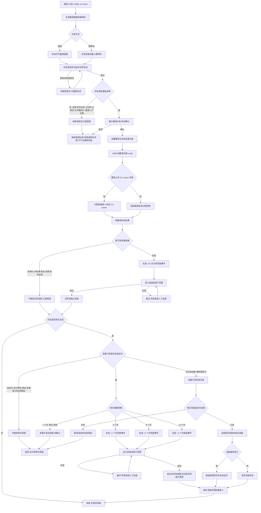
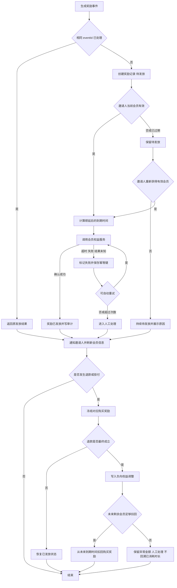
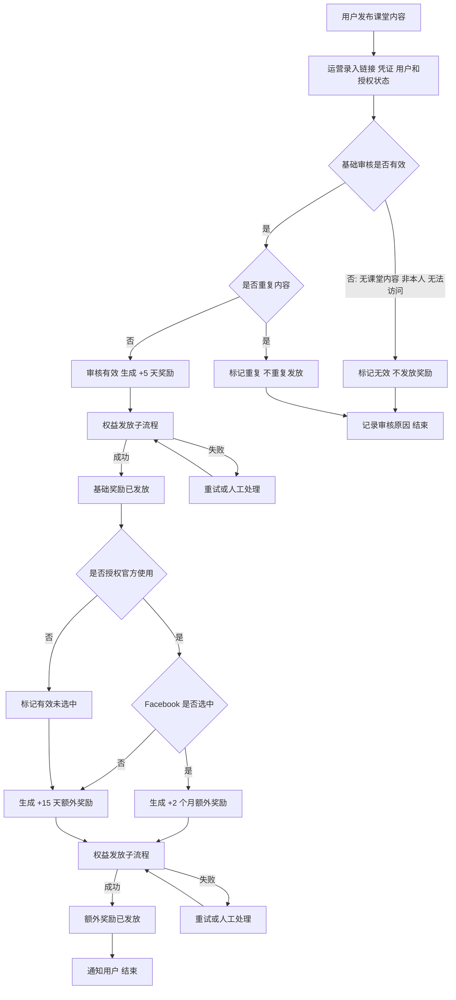

# 泰国推荐奖励（Referrals & Rewards）

> 泰国老用户邀请好友、分享课堂内容，符合条件后由系统自动延长会员，并在 CRM 可追踪、审核和追溯。  
> 需求编号：REQ-TH-001｜状态：待评审｜更新时间：2026-11-10


> 📌
>
> - 好友完成首次试听，邀请人 +14 天；好友购买 3/6/12 个月，邀请人再加 1/2/3 个月。
> - 有效社媒投稿先 +5 天；被官方 Facebook 选中再加 2 个月，未被选中再加 15 天。
> - 本期仅泰国；奖励按自然日/自然月延长会员，不发现金、优惠券或积分。

> ⚠️ 来源：[主需求](https://qjphu5vphyf4.jp.larksuite.com/wiki/OewiwN0BCiDituksN8dj7HDupNd)；[较新同名文档](https://qjphu5vphyf4.jp.larksuite.com/wiki/XB2PwcT9lie4WMkSmAUjGIvopxh) 补充了“未被官方选中再加 15 天”。本文按较新版本编写并列入待确认。

## 可交互原型

线上原型：[https://h3-ai-lab.github.io/hhhprd/projects/referrals-rewards/prototype/](https://h3-ai-lab.github.io/hhhprd/projects/referrals-rewards/prototype/)

本地原型：[http://127.0.0.1:4175/projects/referrals-rewards/prototype/](http://127.0.0.1:4175/projects/referrals-rewards/prototype/)

原型源码：[http://127.0.0.1:4175/projects/referrals-rewards/prototype/index.html](http://127.0.0.1:4175/projects/referrals-rewards/prototype/index.html)

| 页面 | 直达地址 |
|---|---|
| 功能概览与奖励流程 | [打开概览](https://h3-ai-lab.github.io/hhhprd/projects/referrals-rewards/prototype/#/overview) |
| CRM 推荐活动 | [打开推荐活动](https://h3-ai-lab.github.io/hhhprd/projects/referrals-rewards/prototype/#/activity) |
| CRM 社媒审核 | [打开社媒审核](https://h3-ai-lab.github.io/hhhprd/projects/referrals-rewards/prototype/#/social) |
| App 邀请体验 | [打开 App 原型](https://h3-ai-lab.github.io/hhhprd/projects/referrals-rewards/prototype/#/app) |
| 奖励发放流水 | [打开奖励流水](https://h3-ai-lab.github.io/hhhprd/projects/referrals-rewards/prototype/#/ledger) |
| 规则与异常 | [打开规则](https://h3-ai-lab.github.io/hhhprd/projects/referrals-rewards/prototype/#/rules) |
| 验收清单 | [打开验收](https://h3-ai-lab.github.io/hhhprd/projects/referrals-rewards/prototype/#/acceptance) |

本地原型服务停止后，在仓库中执行：

```bash
cd crm-prd
python3 -m http.server 4175 --bind 127.0.0.1
```

## 要解决什么

泰国目前主要依赖 Meta 获客，推荐和老用户内容分享没有可追踪、可自动结算的机制。本期需要完成：

1. 老用户在 App 内分享邀请链接或推荐码。
2. 好友完成试听、购买后，系统自动识别并延长邀请人会员。
3. 运营在 CRM 审核社媒投稿、查看奖励状态并处理失败。
4. 推荐关系、奖励事件和会员发放均可追溯，避免手工补时长。

## 业务流程总图

覆盖从邀请人发起分享，到好友试听/购买，再到奖励入账、失败重试和退款冲正的完整链路。



说明：

- 试听奖励和购买奖励独立判断，好友购买后发生退款，只处理购买奖励，不撤销已经生效的 +14 天试听奖励。
- 同一好友最多拥有一次试听奖励和一次购买奖励。首次购买已触发后，退款后再次购买也不重复触发。
- 退款发生时先冻结，不立即修改历史会员；退款最终确认后按本节“会员与退款”规则处理。

## 权益发放与退款流程图



退款规则建议如下，进入评审时需最终确认：

- 奖励未发放：直接取消或冻结。
- 奖励已发放：先冻结，以退款最终结果为准。
- 确认退款：只冲正对应购买奖励；从未来会员时长尾部扣回，不追溯扣掉用户已经使用的时间。
- 部分退款、拒付、争议：进入人工审核，不由系统猜测奖励额度。
- 试听 +14 天不因好友后续退款而撤销。

## 范围

| 做                                  | 不做                      |
| ---------------------------------- | ----------------------- |
| App 内 `Refer a Friend`、链接/推荐码、关系绑定 | KOL/KOC 商业合作结算          |
| 好友 Lead 创建及 CC 自动归属                | 非泰国、跨国家、跨业务线推荐          |
| 首次试听、首次购买的自动奖励                     | 好友作为被邀请人的会员或现金奖励        |
| 社媒投稿录入、审核及奖励                       | 现金返佣、钱包、优惠券、积分          |
| CRM Referrals & Rewards 页面         | 自动识别 Facebook 官方页面是否已发布 |
| 奖励失败重试、审计和基础指标                     | 上线前历史推荐/投稿自动补发          |

## 角色与权限

| 角色     | 权限                           |
| ------ | ---------------------------- |
| 邀请人    | 查看、复制和分享本人链接/推荐码；查看本人推荐进度与奖励 |
| 被邀请好友  | 登录、确认推荐关系、试听和购买              |
| 推荐运营   | 查看泰国数据、审核社媒投稿、重试失败奖励、导出      |
| 销售 CC  | 在销售中心处理自动分配给本人的被邀请好友线索       |
| 管理员/超管 | 全量查看、权限配置和异常处理               |

推荐奖励使用独立模块权限；运营不能直接修改会员到期时间。CC 不进入奖励后台。审核、重试和导出必须留痕。

## 需求 1：推荐与绑定

入口：App → Profile → `Refer a Friend`。

页面展示规则摘要、邀请链接、推荐码、已邀请/已试听/已购买人数及本人奖励。链接不得暴露手机号等敏感信息。

```text
好友打开链接 → 手机号登录 → 确认推荐关系
→ CRM 创建/关联 Lead → 首次试听完成 → 邀请人 +14 天
→ 好友购买会员 → 邀请人再得 1/2/3 个月
```

| 场景          | 规则                                      |
| ----------- | --------------------------------------- |
| 邀请人资格       | 工作假设：泰国业务线有效会员；待确认                      |
| 好友资格        | 未开始首次试听、未绑定其他邀请人的用户                     |
| 关系绑定        | 必须在好友首次试听开始前完成；确认后不能自行更换邀请人             |
| 自荐/重复       | 同一用户 ID、验证手机号自荐，或好友已有邀请人时拦截             |
| 无效推荐码       | 不阻断登录，只提示关系未绑定                          |
| Lead 归属     | 好友登录且 CRM 记录 Lead 后，自动分配给邀请人当前 CC owner |
| CC owner 缺失 | 回退泰国现有自动分配规则；待确认                        |

新推荐只新增来源和推荐关系，不覆盖邀请人原有注册渠道和销售归属。

## 需求 2：好友奖励

### 首次试听

好友完成首节体验课后，邀请人 **+14 天**。

有效条件：体验课、该好友第一节、状态已完成、完成时间晚于绑定时间、属于泰国业务线。仅预约、未到课、取消、改期、进行中不触发。

### 首次购买

| 好友购买       | 邀请人奖励        |
| ---------- | ------------ |
| 3 个月       | +1 个月        |
| 6 个月       | +2 个月        |
| 12 个月      | +3 个月        |
| 1 个月、周包及其他 | 本期暂不自动发放；待确认 |

有效订单必须支付成功、属于泰国业务线和适用会员商品，且未取消、退款或拒付。好友先试听再购买时，试听 +14 天和购买奖励叠加；每个好友的各奖励最多一次，续费再奖励不在本期。

### 会员发放

- 已有会员：从当前到期时间顺延。
- +14 天按自然日，+1/+2/+3 个月按自然月。
- 会员已过期：工作假设为保留待发放，重新成为有效会员后发放；待确认。
- 必须由权益服务确认会员实际延长，接口成功不等于发放成功。
- 同一业务事件只能生成一条奖励，重复回调不得重复加时长。
- 退款最终成立时，按“权益发放与退款流程图”冲正对应购买奖励；冲正过程同样需要幂等和审计。

## 需求 3：社媒分享奖励

用户在社交平台发布孩子在 Dino AI 课堂中的照片或视频后，由运营在 CRM 录入内容链接/凭证、用户、课堂信息、授权状态和备注。



规则：

- 未授权官方使用时，不能标记为“已选中”。
- 同一链接或媒体内容只奖励一次。
- 被删除、无法访问或不属于该用户的内容可标记无效。
- 社媒奖励和好友推荐奖励可以叠加。
- 已发奖励是否因内容删除或审核纠错而扣回，待确认。

## 需求 4：CRM 页面

建议入口：`营销中心 → Referrals & Rewards`，最终归属待确认。

顶部指标：`Referred Friends`、`First Trial Completed`、`Paid Conversions`、`Pending Rewards`。

页面结构：

1. `Referral Activity`：推荐关系与奖励进度。
2. `Social Post Review`：社媒投稿审核队列。
3. 选中推荐后在右侧展示 `Reward Details` 和会员当前到期时间。

推荐列表字段：Referral ID、邀请人、被邀请好友、CC Owner、绑定时间、试听状态、购买套餐、奖励状态、累计奖励。

筛选项：时间、试听状态、套餐、奖励状态、CC、邀请人/好友关键词。手机号按权限脱敏。

社媒审核可执行：查看内容、标记有效/无效、选中/未选中、重试失败奖励。操作需二次确认并记录备注，不允许直接填写奖励天数。

奖励详情展示：奖励类型、触发事件和时间、奖励时长、发放前后到期时间、状态、失败原因、重试记录和操作人。

## 数据与状态

| 对象/事件      | 来源      | 关键关系                |
| ---------- | ------- | ------------------- |
| 推荐关系       | 推荐服务    | 邀请人、被邀请好友、推荐码       |
| Lead/CC 归属 | CRM     | 被邀请好友、邀请人的 CC owner |
| 首次试听       | 课程服务    | 推荐关系、课程完成记录         |
| 首次购买       | 订单/支付服务 | 推荐关系、订单、套餐          |
| 会员延长       | 会员/权益服务 | 奖励记录、发放前后到期时间       |
| 社媒投稿       | CRM     | 用户、内容、审核人           |
| 奖励记录       | 推荐/奖励服务 | 业务事件 ID、时长、状态、审计    |

唯一约束：

- 一个好友只能绑定一个邀请人。
- 每个好友的试听奖励、购买奖励各一次。
- 每条社媒内容的基础、额外奖励各一次。
- 奖励发放使用业务事件 ID 幂等。

状态：

| 对象   | 状态                      |
| ---- | ----------------------- |
| 推荐关系 | 待确认、已绑定、无效              |
| 好友进度 | 已绑定、已试听、已购买             |
| 社媒投稿 | 待审核、有效待选择、官方选中、有效未选中、无效 |
| 奖励   | 待触发、待发放、发放中、已发放、失败      |

## 异常与边界

| ID   | 场景                   | 处理                | 恢复方式              |
| ---- | -------------------- | ----------------- | ----------------- |
| R-01 | 推荐码无效、过期或跨业务线        | 不绑定，提示原因          | 不影响普通登录；可重新获取有效链接 |
| R-02 | 登录失败、取消验证            | 不创建推荐关系           | 返回登录页重试           |
| R-03 | 自荐、同手机号、已被推荐、已试听、已购买 | 拒绝绑定并记录原因         | 用户可按普通流程使用产品      |
| R-04 | 邀请人无资格或账号停用          | 不建立推荐关系           | 账号恢复后需重新分享        |
| R-05 | 好友确认前取消              | 不生成推荐关系           | 可重新打开有效链接         |
| R-06 | 邀请人没有有效 CC owner     | Lead 回退自动分配       | 保留原分配来源供追溯        |
| R-07 | 好友未预约、未到课、取消、改期      | 不触发 +14 天         | 后续完成首节试听仍可触发      |
| R-08 | 体验课技术异常或状态延迟         | 等待最终课程结果          | 课程补偿后由有效完课事件触发    |
| R-09 | 重复试听完成事件             | 返回原奖励结果           | 不重复增加会员           |
| R-10 | 试听和购买事件同时到达          | 独立生成两条奖励          | 按业务发生时间串行发放       |
| R-11 | 订单待支付、支付失败、取消        | 不触发购买奖励           | 后续首笔有效支付可触发       |
| R-12 | 非泰国、非会员商品、零金额        | 不触发购买奖励           | 不做人工推断            |
| R-13 | 1 个月/周包/其他套餐         | 本期不自动奖励           | 待业务确认规则后补发或纳入新版本  |
| R-14 | 重复购买回调               | 返回原奖励结果           | 不重复加会员            |
| R-15 | 退款发生在购买奖励发放前         | 取消或冻结待发奖励         | 退款撤销则重新激活         |
| R-16 | 退款发生在购买奖励发放后         | 冻结购买奖励并核对         | 退款最终成立后冲正未来会员     |
| R-17 | 部分退款、拒付、支付争议         | 进入人工审核            | 依据最终结论处理          |
| R-18 | 邀请人会员已过期             | 奖励待发放             | 邀请人重新成为有效会员后发放    |
| R-19 | 权益服务超时或结果未知          | 保存幂等键并进入失败        | 查询或重试直到确认         |
| R-20 | 多个奖励并发发放             | 同一用户按事件时间串行处理     | 防止覆盖到期时间          |
| R-21 | 社媒内容无效、删除、非本人        | 标记无效，不继续发放        | 审核记录保留            |
| R-22 | 社媒内容重复               | 不重复奖励             | 可用原记录核对           |
| R-23 | 未授权官方但仍有效            | 不发 “选中” 奖励，按未选中处理 | 后续取得授权可重新审核       |
| R-24 | 审核误操作                | 管理员纠正             | 记录前后状态和原因         |

## 非功能要求

- 绑定与奖励发放接口必须幂等。
- 用户只能访问本人推荐和奖励；跨对象 ID 不得越权。
- 手机号、邀请链接、订单和会员信息沿用 CRM 数据权限。
- 主要文案支持泰语和英语；时间按 `Asia/Bangkok` 展示。
- 监控绑定成功率、试听/订单事件失败率、奖励发放成功率和重复事件率。

## 验收

### 推荐与绑定

1. 邀请人能复制/分享链接和推荐码；好友登录确认后生成唯一推荐关系。
2. 好友登录并创建 Lead 后，自动分配给邀请人当前 CC owner。
3. 自荐、同手机号、已有邀请人、已开始试听或已购买用户不能建立有效绑定。
4. 无效推荐码不阻断登录，只提示未绑定。

### 好友奖励

1. 好友完成首节体验课后，邀请人到期时间准确增加 14 天；未到课、取消、改期不触发。
2. 好友购买 3/6/12 个月后，邀请人分别增加 1/2/3 个月，并与 +14 天叠加。
3. 订单取消、退款或无效支付不触发购买奖励。
4. 购买奖励未发放时退款，奖励取消/冻结；已发放后确认退款，按规则冲正购买奖励，不影响试听 +14 天。
5. 重复回调不重复延长；权益失败可重试且最终只成功发放一次。

### 社媒奖励

1. 有效投稿首次审核通过后增加 5 天。
2. 官方选中再增加 2 个月；有效未选中再增加 15 天。
3. 未授权官方使用的投稿不能标记选中。
4. 重复内容不重复发放；无权限用户不能审核或重试。

### CRM

1. 顶部指标与明细使用同一筛选范围和统计截止时点。
2. 能查看邀请人、好友、CC、试听、购买及奖励全链路。
3. 奖励详情可核对触发事件、到期时间变化、失败原因与操作记录。
4. 页面和导出范围一致，跨业务线及无权限账号无法读取。

## 待确认

| 问题                   | 当前假设               | 影响      |
| -------------------- | ------------------ | ------- |
| 邀请人是否必须为有效会员         | 是                  | 绑定资格与防刷 |
| 未选中 +15 天是否最终生效      | 按较新文档执行            | 奖励成本    |
| +5 天、+15 天、+2 个月是否叠加 | 是                  | 总奖励额    |
| 社媒审核 SLA、审核人和申诉      | 工作日内，细则待定          | 运营流程    |
| 1 个月/周包是否有购买奖励       | 本期不发               | 奖励覆盖    |
| 退款/拒付如何冲正购买奖励        | 已发奖励冻结；最终确认后冲正未来会员 | 财务与风控   |
| 好友续费是否再奖励            | 不再奖励               | 长期成本    |
| 邀请人无 CC owner 如何分配   | 回退自动分配             | 销售归属    |
| 会员过期后奖励何时生效          | 重新成为有效会员后          | 权益结算    |
| 邀请码有效期、单人邀请上限        | 未限制                | 防刷      |
| 页面归属和独立权限            | 营销中心               | 信息架构    |
| 历史推荐/投稿是否补发          | 不补发                | 数据迁移    |

## 发布建议

1. **P0 推荐闭环**：App 分享、关系绑定、Lead 归属、试听和购买奖励。
2. **P1 社媒奖励**：CRM 投稿录入、审核及对应奖励。
3. **P1 运营增强**：导出、批量重试、异常对账和完整看板。

上线前必须完成推荐关系唯一约束、奖励幂等、权益发放契约、退款策略、监控告警和泰国灰名单测试。
