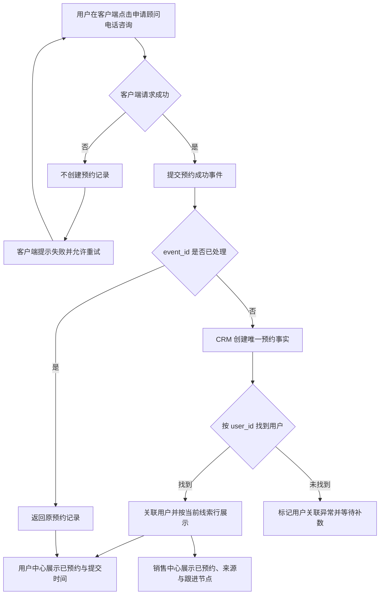
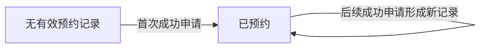

# 用户顾问咨询预约沉淀为线索跟进节点

> 一句话结论：客户端用户成功申请顾问电话咨询后，CRM 保存不可编辑的预约事实，并在用户中心与销售中心统一展示、筛选和导出，让销售能在正常跟进场景中识别用户主动回电需求。
> 版本 / 需求 ID：V1.0 / REQ-CONSULT-001
> 需求类型：规则、状态与数据；补充类型：表单、字段与列表，权限与审计
> 更新时间：2026-11-16
> 来源：[越南顾问咨询预约](https://qjphu5vphyf4.jp.larksuite.com/wiki/W6gEwwc0oiLYnLk4H5CjDfRfp5d)

> 📌
> - **事实源**：以客户端成功提交并被 CRM 确认的预约申请为准。
> - **统一展示**：用户中心和销售中心使用同一状态、来源和时间。
> - **不混淆业务**：`用户咨询预约` 不等于现有 `销售咨询预约`，也不改变销售阶段、线索归属或上课安排。
> - **不做**：不新增看板指标、自动联系、人工改状态或独立线索。

## 交互原型

[打开完整交互原型](https://h3-ai-lab.github.io/hhhprd/projects/user-consultation-lead/prototype/)

原型可验证销售中心与用户中心的状态联动、筛选、详情、导出、空结果和中英文切换。

## 要解决什么

越南新注册用户可以在客户端主动申请顾问电话咨询，但该需求目前主要沉淀在独立“意向用户列表”中。销售回到用户中心或销售中心查看客户时，不能直接判断该用户是否主动申请回电，也无法按此条件筛选目标客户。

本期把成功预约沉淀为用户与线索共同可见的跟进事实。销售仍按现有线索归属和跟进规则处理，预约事实只补充“用户主动需要回电”这一信息。

## 范围

**做**

- 接收客户端预约成功事件，创建可追溯、幂等的预约记录。
- 将预约记录关联到稳定 `user_id`，并在销售列表中按用户展示最新预约状态。
- 在用户中心和销售中心新增 `用户咨询预约`、`提交意向时间`。
- 在销售中心现有筛选项分组中新增 `用户咨询预约` 筛选。
- 在用户中心现有筛选分组中新增 `用户咨询预约` 筛选。
- 在窗口宽度允许时，列表状态格同时展示预约来源；来源也进入导出。
- 将现有意向用户记录按可核验的 `user_id`、`createdAt` 回填。
- 保留现有独立意向用户列表，继续作为原始申请记录与对账入口。

**不做**

- 不修改邀请页文案、展示条件、提交按钮、Onboarding 进入规则或体验课提醒。
- 不以 `已预约` 自动改变跟进阶段、购买意向、用户状态、负责人或线索池状态。
- 不自动拨号、分配销售、创建跟进任务或承诺具体联系时间。
- 不把预约记录等同于已接通、已安排试听课、已到课或已成交。
- 不在本需求中新增看板指标、趋势、转化率或自动触达。
- 不允许销售手工把 `未预约` 改为 `已预约`，也不允许修改提交时间。

## 来源依据与现状边界

当前 `意向用户列表` 的页面列和查询结果都没有预约来源字段，当前数据只有用户、电话、注册来源和提交时间等字段。客户端现有需求正文也只完整描述了注册后的咨询邀请；`Paywall 返回` 当前出现在展示规则和 CRM 记录要求中，尚不能据此认定客户端或 CRM 已经存在可查询的来源枚举。

原需求对目标 CRM 给出的明确要求是：“CRM 展示用户、联系电话、申请时间及申请来源。来源区分「注册后」和「Paywall 返回后」，同一预约只展示一条。”

因此本 PRD 将以下内容定义为待建设的来源数据：

- `注册后`：从需求文档明确存在的“注册后邀请”入口成功提交。
- `Paywall 返回后`：从需求文档明确提到的“Paywall 返回入口”成功提交。
- 以上两个值属于目标方案，不是当前系统已有枚举，也不是仅由页面文案推导出的值。

现有意向用户记录没有来源，不能通过当前用户状态、注册来源或时间猜测其入口，统一显示 `来源未采集`。`来源未采集` 是历史空值的展示状态，不是第三种预约来源，也不进入来源枚举筛选。

## 主流程与对象关系





对象关系：

| 对象 | 作用 | 唯一关系 |
|---|---|---|
| CRM 用户 | 用户中心展示主体 | 以稳定 `user_id` 关联 |
| 用户咨询预约记录 | 保存每次成功申请的事实、来源、时间和联系电话快照 | 每次成功申请一条记录，重复事件不重复创建 |
| 销售线索 | 销售中心跟进主体 | 按同一 `user_id` 展示预约摘要，不复制记录到分表 Lead |
| 意向用户列表 | 原始记录与对账入口 | 与用户咨询预约记录使用同一事实源 |

预约事实属于用户，并随用户在当前销售列表中的可见行展示。若同一用户因线索分表或其他原因出现多行，每行都展示同一份最新预约摘要，但不会因此生成多条预约记录。

## 状态与判定

| 条件 | 用户咨询预约 | 提交意向时间 | 来源 | 结果 |
|---|---|---|---|---|
| 用户存在至少一条有效预约记录 | 已预约 | 最新一条有效记录的提交时间 | 最新一条有效记录的来源 | 显示绿色状态标签，不修改销售阶段 |
| 用户没有有效预约记录 | 未预约 | — | — | 显示中性状态标签 |
| 用户只有同步失败或其他下游异常的成功预约记录 | 已预约 | 该记录提交时间 | 原始来源 | 下游异常不否定用户已完成申请 |
| 客户端请求失败、超时或尚未得到 CRM 成功确认 | 不新增记录 | 不展示新时间 | 不展示 | 保持原状态，客户端允许重试 |
| 相同 `event_id` 重复到达 | 不新增记录 | 保持首次成功确认时间 | 保持原来源 | 返回原预约结果 |
| 同一用户不同申请事件成功 | 已预约 | 最新有效记录时间 | 最新有效记录来源 | 历史预约记录保留，列表展示最新摘要 |

规则：

- `已预约` 的唯一触发条件是客户端预约申请已成功创建并被 CRM 确认。
- `未预约` 表示当前没有成功预约申请，不表示用户一定看到了邀请，也不表示用户明确拒绝。
- 提交时间以 CRM 首次确认申请成功的服务端时间为准；客户端点击时间仅用于异常核对。
- 用户咨询预约记录创建后不可由销售编辑或删除。
- 不依据通话、聊天、购买或体验课状态倒推预约。
- 现有 `销售咨询预约` 的定义、数据来源和筛选行为保持不变。

## 现有 CRM 页面比对

### 销售中心

当前 `我的跟进` 默认列按以下顺序展示：

`用户 ID → 学生姓名 → 购买意向 → 用户状态 → 用户类型 → 年龄段 → 课程等级 → 登录账号 → 渠道来源-落地页 → 操作`

当前列表没有排序入口或可排序表头。

当前筛选区第三行依次为：

`用户状态 → 销售咨询预约 → 预约外呼 → 注册日期及起止日期`

目标只在 `销售咨询预约` 之后增加 `用户咨询预约`，位于 `预约外呼` 之前；不把新筛选追加到筛选区末尾。

### 用户中心

当前默认列按以下顺序展示：

`用户 ID → 学生姓名 → 用户状态 → 用户类型 → 年龄段 → 课程等级 → 注册方式 → 登录账号 → 短信验证码 → 渠道来源-落地页 → 操作`

当前筛选区第一行依次为：

`搜索 → 用户类型 → 注册方式 → 渠道来源-落地页 → 渠道来源-App → 业务线`

第二行为：

`用户状态 → 导出`

目标在第二行 `用户状态` 之后、`导出` 之前增加 `用户咨询预约`。

### 字段顺序比对

| 页面 | 现状顺序 | 字段 | 比对结果 | 目标位置 |
|---|---|---|---|---|
| 销售中心列表 | 用户状态之后为用户类型 | 用户咨询预约 | 新增 | `用户状态` 之后 |
| 销售中心列表 | 用户状态之后为用户类型 | 提交意向时间 | 新增 | `用户咨询预约` 之后 |
| 销售中心筛选 | 销售咨询预约 → 预约外呼 | 用户咨询预约 | 新增 | 紧邻 `销售咨询预约` 之后 |
| 用户中心列表 | 用户状态之后为用户类型 | 用户咨询预约 | 新增 | `用户状态` 之后 |
| 用户中心列表 | 用户状态之后为用户类型 | 提交意向时间 | 新增 | `用户咨询预约` 之后 |
| 用户中心筛选 | 用户状态 → 导出 | 用户咨询预约 | 新增 | `用户状态` 之后、`导出` 之前 |
| 意向用户列表 | 提交意向时间为最后一列 | 提交意向时间 | 保留 | 保持不变 |

## 字段与排序

用户中心和销售中心当前列表均没有排序入口或可排序表头，本需求不增加排序能力。以下字段均不支持排序。

| 字段 | 业务含义 | 类型 / 枚举 | 来源 | 可编辑 | 空值展示 | 排序要求 |
|---|---|---|---|---|---|---|
| 用户咨询预约 | 用户是否成功提交顾问电话咨询申请 | 枚举：已预约、未预约 | 由有效预约记录派生 | 否 | 历史关联失败时显示“待核对”，不显示“未预约” | 不支持；当前列表无排序能力 |
| 提交意向时间 | 最新预约记录被 CRM 首次确认成功的时间 | 日期时间，按业务线时区展示到分钟 | 用户咨询预约记录 | 否 | 未预约显示 `—`；历史记录失真的显示“待核对” | 不支持；当前列表无排序能力 |
| 用户咨询预约来源 | 用户从哪个客户端入口提交申请 | 目标枚举：注册后、Paywall 返回后；历史空值显示来源未采集 | 客户端成功预约事件；当前意向用户记录尚无此字段 | 否 | 未预约显示 `—`，有申请但来源为空显示“来源未采集” | 不支持；当前列表无排序能力 |

展示规则：

- `已预约` 使用绿色标签，`未预约` 使用中性标签。
- `提交意向时间` 精确到分钟，越南业务线按 `Asia/Ho_Chi_Minh (UTC+7)` 展示。
- 列表宽度允许时，在状态标签下方以次要文字展示来源；窄屏仅在详情或导出中展示来源。
- 不把联系电话、事件 ID、用户 ID 或内部处理状态加入新增默认列。

## 列表、搜索、筛选与导出

### 搜索

用户中心和销售中心现有搜索范围保持不变：用户 ID、姓名和登录账号或手机号按各页面现有能力执行，不把预约状态和提交时间加入自由文本搜索。

### 筛选

| 筛选项 | 可选值 | 默认值 | 规则 |
|---|---|---|---|
| 用户咨询预约 | 全部、已预约、未预约 | 全部 | 与业务线、用户状态及现有其他筛选条件按“且”组合 |

筛选行为：

- `已预约` 返回当前筛选范围内至少有一条有效预约记录的用户或线索。
- `未预约` 返回当前筛选范围内没有有效预约记录的用户或线索。
- 历史关联失败的用户只在选择“全部”时出现，并在状态列显示“待核对”，不进入“未预约”。
- 切换页签、翻页和切换中英文时保留已应用筛选。
- 无数据、筛选无结果、无权限和数据加载失败使用不同状态文案。

### 导出

用户中心和销售中心继续使用各自现有的导出 / 下载入口和权限。

| 导出字段 | 是否默认包含 | 规则 |
|---|---|---|
| `user_id` | 是 | 保持现有导出字段 |
| `consultation_booking_status` | 是 | `BOOKED` / `NOT_BOOKED`；待核对记录不进入普通导出 |
| `consultation_submitted_at` | 是 | ISO 时间，并带业务线时区 |
| `consultation_source` | 是 | `REGISTER_AFTER_SIGNUP` / `PAYWALL_RETURN`；历史记录来源为空 |
| `consultation_request_id` | 是 | 用于与原始记录对账；重复导出不改变记录 |

导出使用当前筛选和数据权限，不受当前页分页限制。联系电话沿用现有敏感字段导出权限。导出任务需记录操作人、筛选条件、行数、数据范围和时间。

## 预约事件与数据依赖

客户端成功创建预约后向 CRM 提交以下业务信息：

| 信息 | 必填 | 业务含义 | 异常处理 |
|---|---|---|---|
| `event_id` | 是 | 单次申请事件的幂等标识 | 重复事件返回原记录，不重复创建 |
| `user_id` | 是 | 客户端已验证的 CRM 用户 ID | 缺失或无效时拒绝写入并进入异常对账 |
| `phone_number` | 是 | 用户注册时已验证的电话号码 | 保存申请时快照；不覆盖用户资料中的当前号码 |
| `dial_code` | 是 | 联系电话区号 | 缺失时拒绝写入 |
| `source` | 是 | 注册后或 Paywall 返回后 | 非法值拒绝写入；当前已成功预约的历史事件允许来源为空 |
| `event_at` | 是 | 客户端记录的点击时间 | 仅用于核对，不作为列表提交时间 |
| `accepted_at` | 是 | CRM 首次确认申请成功的服务端时间 | 写入 `提交意向时间` |
| `business_line` | 是 | 用户所属业务线 | 用于时区、筛选和数据权限；不回退猜测 |

| 数据 / 系统 | 作用 | 时效与失败处理 |
|---|---|---|
| 客户端预约页 | 采集用户主动申请回电的意图 | 请求失败不写 CRM，保留原状态并允许重试 |
| CRM 预约事实 | 用户和销售列表的唯一展示来源 | 写入成功即形成预约事实；不可人工修改 |
| 用户主数据 | 按 `user_id` 展示用户与业务线 | 用户暂不可查时保存记录并标记待关联，后续自动补偿 |
| 销售线索 | 在现有销售行中展示同一预览 | 与用户通过 `user_id` 关联，不依赖某个线索分表复制事实 |
| 国际产品同步 | 原需求的后续触达链路 | 同步失败不阻断 CRM 显示“已预约”，保留失败原因供排查 |
| AF 咨询申请成功事件 | 广告效果回传 | 与本需求独立；AF 延迟或失败不改变 CRM 预约事实 |

## 权限与数据范围

### 功能权限

| 页面 / 资源 | 操作 | 业务含义 | 默认角色 | 数据范围 | 审计 |
|---|---|---|---|---|---|
| 用户中心 | 查看用户咨询预约字段 | 查看用户是否主动申请回电、时间与来源 | 沿用用户中心现有角色 | 沿用用户中心业务线与用户数据范围 | 不单独记录普通查询 |
| 销售中心 | 查看用户咨询预约字段 | 在现有线索行识别用户主动回电需求 | 销售专员、销售组长、管理员、超级管理员 | 沿用现有线索数据范围 | 不单独记录普通查询 |
| 用户中心导出 | 导出预约摘要字段 | 导出当前筛选范围内的用户 | 需现有用户中心导出权限 | 与查看权限取交集 | 记录操作人、筛选、行数和时间 |
| 销售中心下载 | 下载预约摘要字段 | 下载当前筛选范围内的线索 | 需现有销售中心下载权限 | 与查看权限取交集 | 记录操作人、筛选、行数和时间 |

### 字段与数据权限

| 字段组 / 列表 | 可见角色 | 编辑角色 | 脱敏 / 隐藏 | 可导出 | 候选范围限制 |
|---|---|---|---|---|---|
| 用户咨询预约、提交意向时间、来源 | 拥有对应页面查看权限的角色 | 无 | 不包含电话号码；历史关联异常显示“待核对” | 需现有导出权限 | 仅返回业务线和数据权限内数据 |
| 咨询联系电话快照 | 沿用用户中心和销售中心现有电话查看权限 | 无 | 无权限时掩码或隐藏 | 沿用现有电话导出权限 | 只对可访问的用户或线索展示 |
| 事件 ID 与关联状态 | 管理员、系统管理员及现有排障角色 | 无 | 默认列表不展示 | 仅通过对账导出提供 | 沿用人、线索和业务线数据范围 |

### 权限数据变更

| 变更类型 | 权限层级 | 权限项 | 业务说明 | 默认角色 / 数据范围 | 是否新增审计 |
|---|---|---|---|---|---|
| 新增 | 字段 | `crm.user_center.user_consultation_appointment.view` | 用户中心查看预约状态、时间和来源 | 继承用户中心页面现有角色与数据范围 | 否 |
| 新增 | 字段 | `crm.sales_center.user_consultation_appointment.view` | 销售中心查看预约状态、时间和来源 | 继承销售中心页面现有角色与数据范围 | 否 |
| 修改 | 导出 | 用户中心现有导出字段清单 | 增加预约摘要字段 | 继承现有导出权限与数据范围 | 是 |
| 修改 | 导出 | 销售中心现有下载字段清单 | 增加预约摘要字段 | 继承现有下载权限与数据范围 | 是 |
| 复用 | 页面 / 数据 | 用户中心、销售中心现有查看与数据范围权限 | 不新增独立页面或独立数据权限 | 沿用现有业务线、团队和本人范围 | 否 |

没有对应页面或字段权限时，不展示字段值，也不能通过筛选、导出或详情间接判断结果。页面可进入不代表可导出，导出必须单独校验现有导出权限。

员工停用后立即失去用户中心和销售中心访问权；预约事实与历史提交时间继续保留。线索交接继续沿用现有流程，新负责人是否能看到预约摘要取决于其是否拥有该线索的现有数据权限。预约记录本身不新增负责人、待办或绩效归属，也不因交接改变提交时间或来源。

## 页面与交互

### 用户中心

- 在 `用户状态` 后展示 `用户咨询预约` 与 `提交意向时间`。
- 在第二行筛选区展示 `用户咨询预约`。
- 状态格包含最新来源；未预约不展示来源和时间。
- 搜索、导出和操作入口保持原位置。
- 页面无匹配结果时展示“暂无符合条件的用户”，并保留已应用筛选。
- 无字段权限时不展示新增列和筛选，不通过占位符暴露数据存在。

### 销售中心

- 在 `我的跟进`、`公海`、`已付费` 的现有线索行中展示同一预约摘要。
- 默认列在 `用户状态` 后增加 `用户咨询预约`、`提交意向时间`。
- 现有筛选区第三行在 `销售咨询预约` 后增加 `用户咨询预约`。
- 预约摘要不改变行操作、拨号、更新跟进、重新分配、退回公海或分配与掉库规则。
- 若用户预约记录创建时间早于销售线索可查询时间，线索出现后自动显示同一预约摘要。
- 下载弹窗展示当前筛选、行数和预约摘要字段。
- 数据加载失败时显示失败提示和重试入口，不将加载失败显示成 `未预约`。

### 意向用户列表

- 保留现有 `意向用户列表` 页面及其列、筛选和提交时间。
- 用户咨询预约记录与该页面使用同一事实源，不出现两套冲突状态。
- 后续如补充来源，应与用户中心和销售中心使用相同枚举。

## 用户故事

```text
用户完成新注册
→ 在邀请页点击申请顾问电话咨询
→ CRM 成功确认申请
→ 用户继续进入 Onboarding
→ 销售在销售中心看到“用户咨询预约：已预约”和提交时间
→ 销售按现有规则打开用户或线索并跟进回电
              ↘ 请求失败 → 不写预约事实 → 用户重试
              ↘ 重复事件 → 返回原记录 → 不重复展示
              ↘ 用户未被关联 → 显示待核对 → 自动补偿后恢复
```

## 历史数据与异常

| 场景 | 页面结果 | 数据与恢复 |
|---|---|---|
| 老用户已有意向用户记录 | 回填为已预约并展示原提交时间，来源显示“来源未采集” | 仅使用可核验的 `user_id` 与 `createdAt`；不得推断为注册后或 Paywall 返回后 |
| 历史记录缺少用户或提交时间 | 不作为有效预约记录 | 显示在原始意向列表的异常范围，禁止猜测补齐 |
| 用户无预约记录 | 显示未预约、时间 `—` | 不代表用户看到了邀请或明确拒绝 |
| 客户端请求失败或用户取消 | 保持原状态，不生成新记录 | 客户端允许再次申请；失败事件不进入 CRM |
| 同一事件重复提交 | 仍为已预约 | 返回原记录，不新增行或更新时间 |
| 同一用户多个成功申请 | 列表展示最新成功申请摘要 | 历史记录保留，不删除旧时间线 |
| 事件到达时用户暂不可查 | 显示“待核对” | 保存事实并等待用户补数，不自动切换到未预约 |
| 业务线与用户主数据不一致 | 使用有效预约记录的原始业务线快照 | 标记异常供排查，不通过当前资料覆盖历史 |
| 国际产品同步失败 | 仍显示已预约 | 保留同步失败原因，后续按原链路重试或补偿 |
| AF 回传失败 | 仍显示已预约 | 广告归因异常独立处理，不回滚 CRM 预约事实 |
| 权限被撤销 | 下次请求起字段、筛选和导出不可用 | 历史记录不清除；已生成的下载文件按现有安全策略处理 |

预约记录保留创建事件、提交时间、来源、联系电话快照和关联状态。任何数据修复都必须通过可审计流程完成，不允许直接改写用户可见值。

