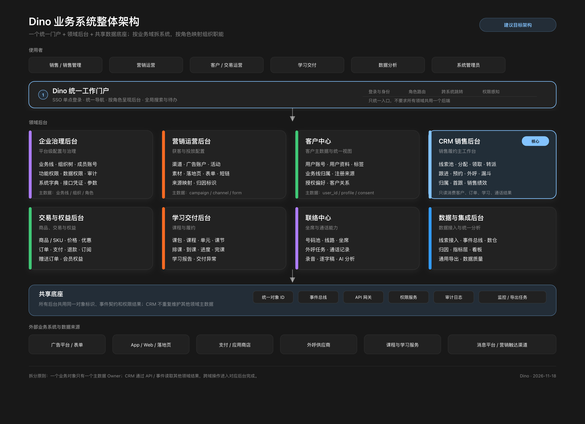

# Dino 业务系统整体架构

> 定位：产品系统边界与目标蓝图，不限定微服务、前端容器或具体技术实现。
> 状态：目标架构建议｜更新日期：2026-11-18

## 1. 核心原则

- CRM 是销售履约与客户经营工作台，不是所有业务领域共用的后台。
- 按业务域拆系统，不按组织部门拆系统；组织职能通过角色和数据权限映射。
- 每个业务对象只有一个主数据 Owner，其他系统通过 API、事件或只读视图使用。
- 对用户保留统一登录和统一导航，但不要求所有领域共用一个后端。
- 跨域操作进入对应后台完成，CRM 不同时维护客户、商品、支付、课程等主数据。

## 2. 目标架构

## 3. 后台职责

| 后台 | 核心职责 | 主要主数据 | CRM 的关系 |
|---|---|---|---|
| 企业治理后台 | 业务线、组织、成员、角色、功能权限、数据权限、审计、字典、接口凭证 | 业务线、组织、成员、角色 | 使用授权结果，不维护全局账号和组织 |
| 营销运营后台 | 渠道、广告账户、活动、素材、落地页、表单、短链、来源映射 | 渠道、活动、表单、落地页、短链 | 接收标准线索与归因结果 |
| 客户中心 | 用户账号、客户资料、偏好、营销授权、业务线归属、客户关系 | 用户主数据、客户授权 | 提供只读 Customer 360 查询 |
| CRM 销售后台 | 线索池、分配、领取、转派、跟进、预约、外呼、漏斗、归属、销售绩效 | 线索当前归属、销售过程 | 销售履约核心工作台 |
| 交易与权益后台 | 商品、SKU、价格、优惠、订单、支付、退款、订阅、赠送订单、权益 | 商品、价格、订单、支付、权益 | 只读展示订单摘要与支付事件 |
| 学习交付后台 | 课包、课程、单元、课节、排课、到课、学习进度、完课、报告 | 课程结构与学习进度 | 只读展示跟进所需学习结果 |
| 联络中心 | 号码池、线路、坐席、外呼任务、通话记录、录音、逐字稿 | 通话记录、媒体资产 | 接收通话结果和录音索引 |
| 数据与集成后台 | 线索接入、事件总线、归因、数仓、指标层、看板、通用导出任务 | 标准事件、指标口径、快照 | 为 CRM 提供看板和明细只读能力 |

## 4. 现有模块归属

| 当前能力 | 目标归属 | 处理方式 |
|---|---|---|
| 营销中心：渠道、活动、素材、落地页、表单、短链 | 营销运营后台 | 迁出 CRM；CRM 保留来源结果和跳转入口 |
| 营销中心：SKU、价格、优惠 | 交易与权益后台 | 迁出 CRM；营销页通过接口引用 |
| 营销中心：广告归因数据 | 数据与集成后台 | 统一接入、映射和快照，CRM 只读展示 |
| 线索接入与来源标准化 | 数据与集成后台 | 先标准化、去重、补全，再进入 CRM |
| 用户中心 | 客户中心 + CRM 只读视图 | 客户主数据由客户中心维护 |
| 用户学习结果与报告 | 学习交付后台 | CRM 只读展示销售所需信息 |
| 销售中心 | CRM 销售后台 | 保留并继续强化 |
| 通话记录、录音、逐字稿 | 联络中心 + CRM 只读视图 | 通话能力归联络中心，CRM 承接业务结果 |
| 订单、支付、退款、会员权益 | 交易与权益后台 | CRM 只读展示，支付和退款在原系统操作 |
| 角色、成员、业务线、组织与审计 | 企业治理后台 | 作为所有后台的共享权限底座 |
| 管理看板与指标 | 数据与集成后台 | 统一定义指标并嵌入 CRM |
| CRM 业务分配规则、跟进规则、销售流程 | CRM 销售后台 | 保留在 CRM |

## 5. 数据与集成边界

| 对象 | 唯一 Owner | 关键标识 | CRM 使用方式 |
|---|---|---|---|
| 业务线、组织、成员、角色 | 企业治理后台 | `org_id`、`member_id`、`role_id` | 获取权限和候选范围 |
| 用户与客户资料 | 客户中心 | `user_id` | 只读查询，不重复建档 |
| 渠道、活动、落地页、短链 | 营销运营后台 | `channel_id`、`campaign_id`、`form_id`、`short_link_id` | 读取来源与归因结果 |
| 线索与当前销售归属 | CRM 销售后台 | `lead_id` | CRM 主操作对象 |
| 商品、价格、订单、支付、权益 | 交易与权益后台 | `sku_id`、`order_id`、`payment_id` | 只读摘要、支付状态和权益状态 |
| 课程与学习进度 | 学习交付后台 | `course_id`、`lesson_id`、`learning_record_id` | 只读展示 |
| 通话与媒体文件 | 联络中心 | `call_id` | 只读展示、按权限下载 |
| 指标、快照与导出任务 | 数据与集成后台 | `metric_id`、`snapshot_id`、`task_id` | 嵌入 CRM 看板与导出任务 |

## 6. 关键流程

### 线索接入

`广告平台 / 表单 / App / Web → 数据与集成后台 → 标准化与去重 → CRM 销售后台`

### 销售履约

`CRM 销售后台 → 销售跟进 / 预约 / 外呼 → 成交 → 交易与权益后台`

### 跨域只读

`客户中心 / 交易与权益 / 学习交付 / 联络中心 → 统一事件和查询接口 → CRM 只读展示`

### 经营分析

`各领域业务事件 → 数据与集成后台 → 指标层 → CRM 看板与明细`

## 7. 落地顺序

1. **治理先行**：建立业务线、组织、角色、数据权限和审计的统一模型。
2. **统一标识**：冻结 `user_id`、`lead_id`、`campaign_id`、`sku_id`、`order_id`、`org_id`。
3. **停止新增跨域配置**：CRM 不再新增长期由营销、商品、支付或学习系统负责的配置功能。
4. **先读后写**：CRM 先增加只读视图和跳转入口，再迁移写操作。
5. **按域迁移**：依次迁移企业治理、营销运营、交易权益、学习交付和数据分析。
6. **统一门户**：保持统一登录、导航和权限提示，允许各后台独立发布。

## 8. 架构约束

- 一个业务对象只能有一个写入 Owner。
- 禁止通过数据库直连或其他系统页面反向覆盖主数据。
- 跨系统关联必须使用稳定 ID，不使用姓名、手机号或展示名称作为主键。
- 跨域查询、看板和导出必须复用同一数据权限结果。
- 前台体验可以统一，后端系统边界和数据 Owner 必须清晰。
- 不因组织部门调整重命名业务系统；组织变化只调整角色、权限和可见菜单。

## 9. 成功标准

- 业务人员能在统一门户找到自己的工作入口，不再依赖 CRM 承载所有配置。
- 每个核心对象都有唯一主数据系统和清晰的责任边界。
- CRM、营销、交易、学习、数据和治理之间通过标准接口与事件协作。
- 页面不重复维护相同数据，权限、审计和指标口径保持一致。
- 新业务线或新组织接入时，无需复制一套 CRM 页面或主数据。
