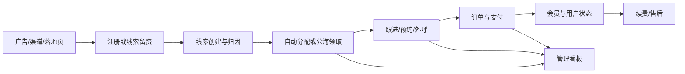

# Dino CRM 整体 PRD

> CRM 是 Dino AI 在海外多业务线获客与转化链路中的统一工作台：承接渠道线索、销售跟进、用户与订单查询、权限控制和经营分析。
> 更新时间：2026-11-10

> 📌
> - **主线**：渠道/广告留资 → 注册与线索 → 分配/领取 → 跟进/外呼 → 支付 → 用户与订单 → 看板。
> - **原则**：先统一对象和口径，再加页面与报表；不覆盖已有有效来源和销售归属。
> - **边界**：CRM 负责配置、承接、查看和操作入口，不负责课程、支付处理、电话线路和广告投放本身。

## 1. 要解决什么

CRM 要解决五类问题：

| 问题 | CRM 的答案 |
|---|---|
| 用户是谁、从哪里来、当前什么状态 | 用户、来源、业务线、会员与学习结果查询 |
| 线索由谁承接、下一步做什么 | 线索池、分配、领取、转派、跟进、预约、外呼 |
| 用户买了什么、是否支付成功 | 订单、主从流水、支付、权益与续费查询 |
| 运营如何配置渠道、商品和落地页 | 渠道、SKU、价格优惠、落地页、皮肤、短链 |
| 谁可以看和改、如何追溯 | 角色、岗位、业务线/区域权限、敏感能力和审计 |

## 2. 产品边界

| CRM 负责 | 外部系统负责 |
|---|---|
| 渠道、商品售卖、落地页和短链配置 | 广告平台投放、商品主数据、C 端页面实现 |
| 用户、线索、销售跟进、订单的统一工作入口 | 用户注册、课程学习、报告生成、支付扣款 |
| 外呼入口、跟进闭环、通话结果回写 | 实际电话连接、线路、坐席供应商 |
| 权限、数据范围、审计和经营分析 | 企业身份体系、数仓和 BI 实现 |

CRM 展示结果不等于 CRM 生成结果。每个需求必须写清 CRM 是配置方、承接方、展示方还是操作方。

## 3. 业务主链路

## 4. 功能地图

| 模块 | 当前定位 | 下一阶段重点 |
|---|---|---|
| 用户中心 | 全量用户、来源、资料、学习结果与会员查询 | 注册时间筛选、报告、业务线口径 |
| 销售中心 | CC 承接线索、外呼、预约、跟进与转派 | 统一来源、TikTok/Messenger、续费跟进、区域权限 |
| 订单中心 | 支付、会员、主子订单与售后核对 | 支付状态一致性、续费/试用订单标识 |
| 营销中心 | 渠道、SKU、价格优惠、落地页、皮肤与短链 | 模块归属、短链治理、投放链路 |
| 系统配置 | 角色、成员、功能权限、业务线范围和审计 | 区域/团队层级、岗位权限、敏感操作 |
| 管理看板 | 转化、销售跟进、支付结果及明细下载 | 指标口径、数据时效与可核对性 |

## 5. 跨模块底线

### 用户与来源

- 用户、线索、订单必须以稳定唯一 ID 关联。
- 新留资只追加来源，不覆盖原有效注册渠道和销售归属。
- 明确定义首次来源、有效来源、最近来源和广告来源。
- 注册业务线、服务业务线、订单业务线和业绩归属不能混用。

### 线索与销售

- 线索状态必须明确哪些人工流转、哪些系统自动流转。
- 自动分配、领取、转派、掉库、回池和重新激活都要写明触发条件。
- 已付费用户保留续费跟进时，写出归属、阶段和再分配规则。

### 订单与支付

- 支付成功事件必须能驱动订单、用户权益和销售状态。
- 主订单、子订单、续费、退款和免费试用要有唯一标识与关联关系。
- 不依赖“用户状态=付费”反推真实支付事实。

### 权限与审计

- 菜单隐藏和接口拦截必须同时生效。
- 功能权限决定能不能做，数据权限决定能做哪些对象。
- 手机号、验证码、录音、导出、赠送权益和订单归属属于敏感能力。
- 敏感操作至少记录操作人、时间、对象和变更前后值。

### 数据与指标

- 每个指标写明分子、分母、去重维度、时间和数据来源。
- 金额默认不跨币种相加；时间和日分组必须写明时区。
- 看板数字要能通过明细或导出复核。
- 外部同步要写明频率、延迟、失败重试和补偿方式。

## 6. 文档怎么分层

| 文档 | 回答的问题 | 何时新建 |
|---|---|---|
| 整体 PRD | CRM 为什么存在、边界和跨模块原则 | 产品方向或模块地图变化时 |
| 领域 PRD | 用户、线索、销售、订单等业务域如何完整运转 | 多个需求共享复杂规则时 |
| 版本 PRD | 本版本交付什么、依赖什么、何时算完成 | 形成版本范围时 |
| 功能 PRD | 一个需求如何落地、验收 | 每次新需求 |

功能 PRD 推荐使用 `../skills/crm-prd-authoring/assets/feature-prd.md`。复杂需求才增加状态机、数据字典和接口表；简单需求不需要为了模板完整而写空章节。

## 7. 业务流程图标准

所有功能 PRD 必须包含详细业务流程图，不能只写文字流程：

- 从实际触发点开始，到业务结果完成；不能停在“页面展示”或“接口成功”。
- 至少一张端到端总图，覆盖用户、CRM、数据对象和外部系统之间的流转。
- 分支必须覆盖成功、取消、无结果、重复提交、并发、超时、失败、重试、退款/撤销、权限变化和历史数据。
- 订单类需求必须画出租、支付、退款、拒付和权益回退。
- 状态较多时增加对象状态图；跨系统时增加时序图。
- 图中每个异常终点都要说明用户看到什么、系统记录什么、如何恢复、谁处理。
- 图下用场景矩阵补齐图中不便展开的边界，并与验收编号对应。

流程图规模较大时，采用“一张总图 + 按业务对象拆分的子图”，避免所有细节挤在同一张图里。

## 8. 每个需求必须回答

1. 谁遇到什么问题，为什么现在做？
2. 要改变什么结果，怎样衡量？
3. 本期做什么，明确不做什么？
4. 哪些角色、权限和数据范围受影响？
5. 主流程和关键状态怎样流转？
6. 页面、字段、提示和异常是什么？
7. 依赖哪些数据或外部系统，失败怎么办？
8. 如何验收，上线后如何确认没有产生新的错误数据？

## 9. 当前优先事项

| 优先级 | 事项 | 原因 |
|---|---|---|
| 1 | 统一用户、线索、订单和业务线口径 | 多个需求的共同底座 |
| 2 | 订单支付与用户状态一致性 | 已影响销售判断、统计和业务信任 |
| 3 | 权限层级与敏感操作专项 | 区域扩展和所有高敏感能力依赖 |
| 4 | Zaro 沟通记录与线索数据统一 | 已明确为近期高优业务需求 |
| 5 | 营销/投放/订单模块长期归属 | 避免页面重复建设后再次迁移 |

全局决策见 `decisions.md`。

