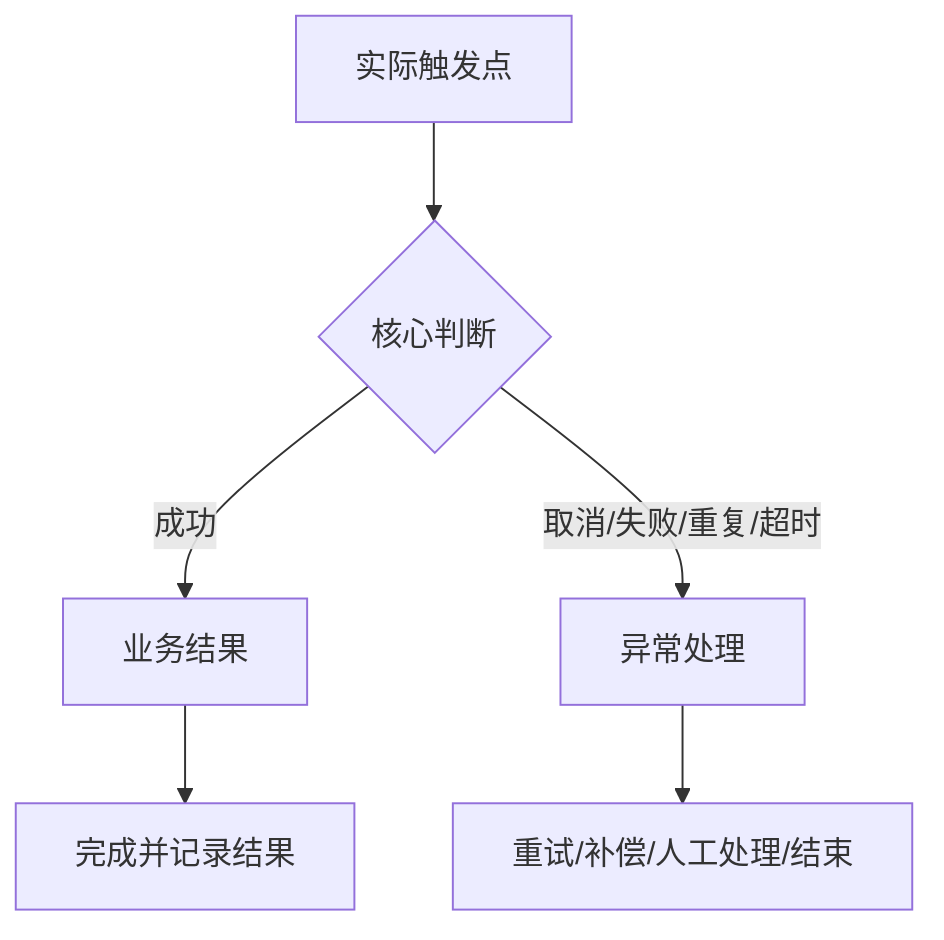

# <需求名称>

> 一句话结论：<谁在什么场景要完成什么，本期做到什么边界。>
> 版本 / 需求 ID：<x.x / REQ-xxx>
> 更新时间：YYYY-MM-DD

> 📌
> - **需求 1**：<一句话>
> - **需求 2**：<一句话>
> - **不做**：<最重要的非目标>

## 要解决什么

<用 2–4 句话说明现状、问题和为什么现在做。>

## 范围

**做**

- <能力 1>
- <能力 2>

**不做**

- <非目标 1>
- <非目标 2>

## 业务流程图



流程图必须：

- 从实际业务触发点开始，到权益、订单或业务对象最终状态结束。
- 覆盖正常、失败、取消、重复、并发、超时、退款/撤销、权限变化和历史数据。
- 标出跨模块和数据落点，不只画页面跳转。
- 复杂需求增加状态图和异常场景矩阵。

## 需求 1：<名称>

<一句话说明本期要实现的结果。>

### 页面与交互

- <入口、状态和主要操作>
- <关键字段和默认值>
- <成功、失败、空态和权限提示>

### 规则

| 场景 | 规则 | 结果 |
|---|---|---|
| | | |

### 数据与依赖

| 数据/系统 | 来源 | 唯一标识 | 时效/失败处理 |
|---|---|---|---|
| | | | |

## 需求 2：<名称>

<按需复制上一节。无页面需求时，用品规则表和流程图代替。>

## 权限与数据范围

| 角色/条件 | 能看什么 | 能做什么 | 限制 |
|---|---|---|---|
| | | | |

## 用户怎么走

```text
入口 → 第一步 → 第二步 → 成功结果
              ↘ 失败/取消 → 恢复方式
```

## 异常与边界

- **无数据**：<页面和操作>
- **重复提交**：<幂等结果>
- **并发修改**：<冲突处理>
- **外部失败**：<提示、重试、补偿>
- **权限变化**：<即时生效>
- **历史数据**：<兼容和迁移>

## 验收

### 需求 1：<名称>

1. <可观察的完整场景>
2. <权限和数据范围>
3. <异常或边界>

### 需求 2：<名称>

1. <可观察的完整场景>
2. <外部系统失败或恢复>

## 待确认

| 问题 | 默认假设 | 影响 | Owner |
|---|---|---|---|
| | | | |

## 写作检查

- 开头能看懂为什么做和本期边界。
- 业务流程图覆盖端到端主链路和全部关键异常。
- 页面、规则、数据和例外没有互相矛盾。
- 权限同时覆盖菜单、接口和数据范围。
- 验收能直接执行，不依赖主观判断。
- 没有内容的章节已删除。

