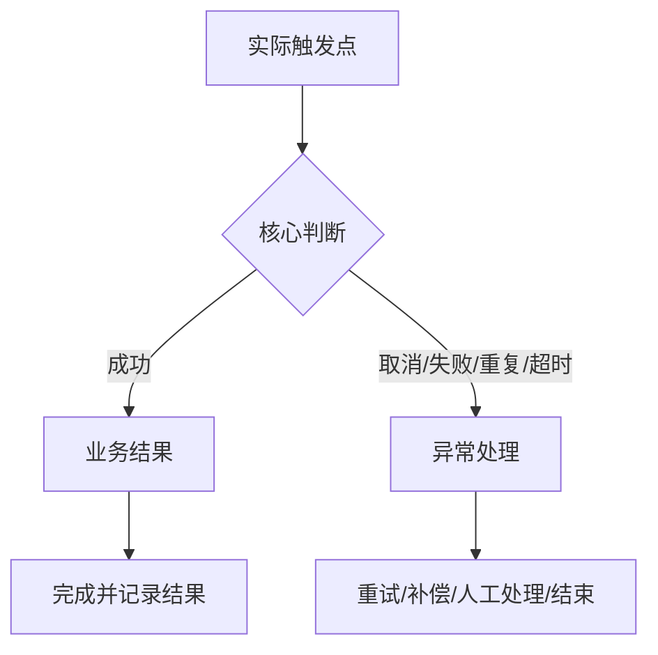

# <需求名称>

> 结构参考：[REQ-CC-002 单文件 PRD 参考样例](../projects/first-contact-concise/PRD.md)

> 一句话结论：<谁在什么场景要完成什么，本期做到什么边界。>
> 版本 / 需求 ID：<x.x / REQ-xxx>
> 需求类型：<业务流程 / 表单字段列表 / 规则状态数据 / 权限审计 / 集成自动化 / 看板指标 / 用户端体验>
> 更新时间：YYYY-MM-DD

> 📌
> - **需求 1**：<一句话>
> - **需求 2**：<一句话>
> - **不做**：<最重要的非目标>

## 交互原型

> 交互原型：[打开完整原型](<唯一原型地址>)

原型引用规则：

- 每份功能 PRD 只保留一个“完整交互原型”主地址。
- 不罗列页面直达链接、源码地址、本地地址或“线上/本地”双入口。
- 页面导航、状态切换和页面间关系由原型内部完成。
- PRD 只说明从原型可以验证哪些能力，不复述原型导航。

## 要解决什么

<用 2–4 句话说明现状、问题和为什么现在做。>

## 范围

**做**

- <能力 1>
- <能力 2>

**不做**

- <非目标 1>
- <非目标 2>

## 主流程与关键规则图

按需求主类型选择最少且足够表达问题的图：

- 业务流程：端到端流程图。
- 表单、字段与列表：页面路径或查询/操作范围图。
- 规则、状态与数据：决策表或状态机。
- 权限与审计：角色与数据范围矩阵，必要时加授权流程。
- 集成与自动化：事件时序、重试与补偿图。
- 看板与指标：指标层级和下钻关系图。
- 用户端体验：用户旅程图。



涉及业务流转的流程图必须：

- 从实际业务触发点开始，到权益、订单或业务对象最终状态结束。
- 覆盖正常、失败、取消、重复、并发、超时、退款/撤销、权限变化和历史数据。
- 标出跨模块和数据落点，不只画页面跳转。
- 复杂需求增加状态图和异常场景矩阵。

## 需求 1：<名称>

<一句话说明本期要实现的结果。>

### 页面与交互

- <入口、状态和主要操作>
- <关键字段和默认值>
- <成功、失败、空态和权限提示>

### 字段与排序（适用时）

先检查当前列表页是否已有排序入口或可排序表头；没有时所有字段均填“不支持排序”，不新增排序交互。

| 字段 | 业务含义 | 排序结论 | 排序理由 | 方向/空值位置/多字段优先级 |
|---|---|---|---|---|
| | | 支持/不支持/条件排序 | | |

### 规则

| 场景 | 规则 | 结果 |
|---|---|---|
| | | |

### 数据与依赖

| 数据/系统 | 来源 | 唯一标识 | 时效/失败处理 |
|---|---|---|---|
| | | | |

## 需求 2：<名称>

<按需复制上一节。无页面需求时，用品规则表和流程图代替。>

## RBAC 权限数据

### 功能权限

| 页面/资源 | 操作 | 业务含义 | 默认角色 | 数据范围 | 审计 |
|---|---|---|---|---|---|
| | 查看/新增/编辑/删除/审批/批量/导入/导出 | | | | |

### 字段与数据权限

| 字段组/列表 | 可见角色 | 编辑角色 | 脱敏/隐藏 | 可导出 | 候选范围限制 |
|---|---|---|---|---|---|
| | | | | | |

### 权限数据变更

| 变更类型 | 权限层级 | 权限项 | 业务说明 | 默认角色/数据范围 | 是否新增审计 |
|---|---|---|---|---|---|
| 新增/修改/复用 | 菜单/页面/动作/数据/字段/导出 | | | | |

## 用户故事

```text
入口 → 第一步 → 第二步 → 成功结果
              ↘ 失败/取消 → 恢复方式
```

## 异常与边界

- **无数据**：<页面和操作>
- **重复提交**：<幂等结果>
- **并发修改**：<冲突处理>
- **外部失败**：<提示、重试、补偿>
- **权限变化**：<即时生效>
- **历史数据**：<兼容和迁移>

